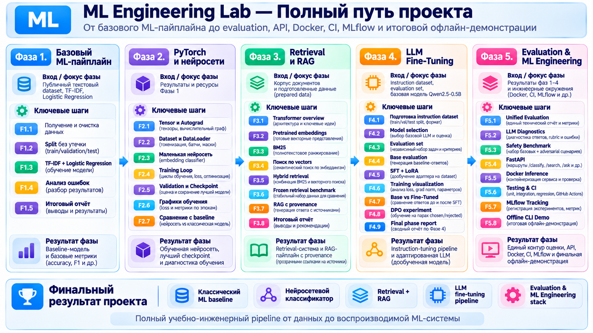

# ML Engineering Lab

**От классического NLP и PyTorch к Retrieval/RAG, LLM Fine-Tuning и воспроизводимой ML-инфраструктуре.**

Практический учебно-инженерный проект, в котором последовательно реализованы и проверены основные части жизненного цикла текстовых ML-систем: **подготовка данных → обучение и оценка моделей → поиск релевантной информации → эксперименты с LLM → API, контейнеризация, тестирование и учёт результатов**.

**Позиционирование.** Это инженерная лаборатория и техническое портфолио, не коммерческий AI-продукт. Реальные эксперименты F1-F4 и демонстрационный сервис F5 решают связанные, но не тождественные задачи: F5 использует отдельный небольшой синтетический набор данных и не запускает обученную Qwen или модели предыдущих фаз как единый production pipeline.

**Основной инженерный фокус:** поиск и обработка информации, Retrieval/RAG, интеграция LLM, оценка качества, воспроизводимость экспериментов и эксплуатационная обвязка. Фазы F1-F2 создают фундамент, F3 исследует поисковые механизмы, F4 демонстрирует методы адаптации LLM, F5 собирает инженерный контур контроля и демонстрации.

## Архитектура проекта
<p align="center">

</p>

## Содержание
- [О проекте и инженерной задаче](#о-проекте-и-инженерной-задаче)
- [Краткие результаты](#краткие-результаты)
- [Архитектура и границы компонентов](#архитектура-и-границы-компонентов)
- [Пять фаз проекта](#пять-фаз-проекта)
- [Измеренные результаты и их интерпретация](#измеренные-результаты-и-их-интерпретация)
- [Практическая демонстрация](#практическая-демонстрация)
- [Воспроизводимость, тестирование и аудит](#воспроизводимость-тестирование-и-аудит)
- [Технологии и структура репозитория](#технологии-и-структура-репозитория)
- [Ограничения и направления развития](#ограничения-и-направления-развития)
- [Навигация по документации](#навигация-по-документации)

---

## О проекте и инженерной задаче
В прикладных AI-системах недостаточно получить ответ модели или высокую метрику на одном тесте. Нужно понимать, **как были подготовлены данные, с чем сравнивается результат, что происходит при ошибках, откуда берётся информация для ответа и можно ли воспроизвести эксперимент**.

В качестве предметной области выбраны **технические вопросы и ответы**: Python и программирование, Linux/Unix, базы данных и системное администрирование. Для разных задач используются как реальные отобранные записи Stack Exchange, так и отдельно подготовленные синтетические контрольные наборы.

Проект последовательно отвечает на несколько инженерных вопросов:

1. **Можно ли получить сильную базовую модель без нейросети?** Построить воспроизводимый текстовый классификатор и провести анализ ошибок.
2. **Что даёт собственная нейросеть?** Реализовать PyTorch training loop, выбрать checkpoint и честно сравнить его с классическим ML на одной test-выборке.
3. **Как находить нужную информацию?** Реализовать BM25, поиск по Transformer embeddings, Hybrid/RRF и сравнить ранжирование по Recall@K и MRR@K.
4. **Как контролировать ответы на основе документов?** Связать извлечённый текст с конкретным источником и проверяемой цитатой; не выдавать неподтверждённый текст за факт.
5. **Как адаптировать LLM ограниченными ресурсами?** Провести настоящие CPU-эксперименты SFT/LoRA и DPO, сохраняя проверяемые артефакты и не делая выводов, которые эксперимент не подтверждает.
6. **Как превратить исследования в инженерно проверяемую систему?** Добавить сводную оценку, диагностику, HTTP API, Docker, тесты/CI, MLflow и автономную демонстрацию.

**Принцип проекта:** метрика имеет смысл только вместе с задачей, выборкой, протоколом, исходными файлами и ограничениями. Отрицательный результат или отсутствие доказанного улучшения - полноценный результат исследования.

## Краткие результаты

| Направление | Что подтверждено | Где посмотреть |
|---|---|---|
| **Classical ML** | 3 040 очищенных записей, 608 test-примеров; **Accuracy 0.8799**, **Macro F1 0.8838** | [Фаза F1](docs/phases/F1.md) |
| **PyTorch** | Собственный embedding-классификатор (**578 548 параметров**); **Test Macro F1 0.7813** на тех же 608 примерах | [Фаза F2](docs/phases/F2.md) |
| **Retrieval / RAG** | BM25, Vector, Hybrid/RRF; на frozen benchmark лучший **Recall@5 0.7875** и **MRR@5 0.8502** у Vector | [Фаза F3](docs/phases/F3.md) |
| **LLM Fine-Tuning** | Qwen2.5-0.5B; реальные CPU-шаги LoRA SFT и DPO; **540 672 обучаемых LoRA-параметра** | [Фаза F4](docs/phases/F4.md) |
| **Evaluation & MLOps** | 19 метрик / 4 источника; FastAPI + Docker HTTP smoke **8/8**; MLflow **6/6** runs; Offline CLI **10/10** | [Фаза F5](docs/phases/F5.md) |

Эти показатели **не являются одной шкалой качества**: классификация, retrieval, обучение LLM и технические smoke-тесты оценивают разные свойства системы.

## Архитектура и границы компонентов

### Исследовательский контур: F1–F4

[]()

Здесь **не изображён непрерывный RAG → Qwen production pipeline**, потому что он не реализован как единый сервис. F3 исследует самостоятельный retrieval/RAG-контур с проверкой источников; F4 исследует адаптацию отдельной LLM.

### Демонстрационный и эксплуатационный контур: F5

[]()

**Разделение намеренное.** Демо использует реальные вычислительные алгоритмы на разрешённых искусственных текстах, но **не загружает checkpoint F1/F2, pretrained-индекс F3 или Qwen/LoRA из F4**. Это позволяет проверять API и контейнер независимо от тяжёлых моделей и правового статуса исходного корпуса.

---

## Пять фаз проекта

### F1 - Data Engineering & Classical ML

**Задача:** подготовить надёжную основу для последующих сравнений: выбрать набор технических вопросов, очистить его, исключить утечки между выборками, обучить простой baseline и проанализировать ошибки.

Что реализовано:
- Загрузка корпуса технических Q&A из четырёх источников Stack Exchange, фиксация ревизии и SHA-256 файлов.
- Очистка текста, исследование распределений и дубликатов; **3 040** записей после очистки.
- Разделение на **1 824 train / 608 validation / 608 test** с контролем групповой утечки.
- Векторизация **TF-IDF**, классификация **Logistic Regression**, выбор конфигурации на validation, финальная оценка на test.
- **Accuracy, Precision, Recall, Macro F1, confusion matrix**, анализ **73** ошибок на test и формирование проверяемого итогового отчёта.

**Вывод:** классическая модель даёт сильную и воспроизводимую отправную точку: **Macro F1 = 0.8838**. Качество проверяется не только одним числом — важны матрица ошибок, независимая test-выборка и целостность данных.

**Ключевые материалы:** [обзор F1](docs/phases/F1.md) · [TF-IDF + Logistic Regression](docs/steps/F1_07_classical_baseline.md) · [анализ ошибок](docs/steps/F1_08_error_analysis.md) · [итоговый отчёт](docs/steps/F1_09_report.md).

<details>
<summary><strong>Все девять этапов F1</strong></summary>

1. [F1.1 - Основа проекта](docs/steps/F1_01_project_foundation.md)
2. [F1.2 - Выбор датасета](docs/steps/F1_02_dataset_selection.md)
3. [F1.3 - Получение данных](docs/steps/F1_03_data_ingestion.md)
4. [F1.4 - Очистка](docs/steps/F1_04_cleaning.md)
5. [F1.5 - EDA](docs/steps/F1_05_eda.md)
6. [F1.6 - Leakage-aware split](docs/steps/F1_06_splits.md)
7. [F1.7 - Classical baseline](docs/steps/F1_07_classical_baseline.md)
8. [F1.8 - Error analysis](docs/steps/F1_08_error_analysis.md)
9. [F1.9 - Final phase report](docs/steps/F1_09_report.md)

</details>

### F2 - PyTorch & Neural Networks

**Задача:** самостоятельно реализовать основные механизмы обучения нейросети и проверить, выигрывает ли нейросетевой подход у baseline F1 на **одной и той же задаче классификации**.

Что реализовано:
- Тензорные операции и автоматическое дифференцирование **autograd**.
- Подготовка последовательностей токенов через `Dataset`, `DataLoader`, padding и masks.
- Собственный **EmbeddingClassifier на 578 548 параметров**: embeddings, pooling, линейный классификационный выход.
- Цикл обучения: forward pass, `CrossEntropyLoss`, backward pass, `AdamW`, обновление параметров.
- Validation, сохранение лучшего checkpoint, диагностика learning curves и регрессионные тесты.
- Сопоставимое test-сравнение F1/F2 на **608 одинаковых примерах**.

**Результат:** нейросеть получила **Test Macro F1 0.7813**, а классическая модель - **0.8838**. Нейросеть действительно обучается и её состояние воспроизводится, но для данного корпуса и протокола **усложнение модели не повысило качество**.

**Ключевые материалы:** [обзор F2](docs/phases/F2.md) · [embedding-классификатор](docs/steps/F2_03_embedding_classifier.md) · [training loop](docs/steps/F2_04_training_loop.md) · [сравнение моделей](docs/steps/F2_07_classical_vs_neural.md).

<details>
<summary><strong>Все восемь этапов F2</strong></summary>

1. [F2.1 - Tensors & Autograd](docs/steps/F2_01_autograd.md)
2. [F2.2 - Dataset & DataLoader](docs/steps/F2_02_dataset_dataloader.md)
3. [F2.3 - Embedding Classifier](docs/steps/F2_03_embedding_classifier.md)
4. [F2.4 - Training Loop](docs/steps/F2_04_training_loop.md)
5. [F2.5 - Validation & Checkpointing](docs/steps/F2_05_validation_checkpointing.md)
6. [F2.6 - Training Diagnostics](docs/steps/F2_06_training_diagnostics.md)
7. [F2.7 - Classical vs Neural](docs/steps/F2_07_classical_vs_neural.md)
8. [F2.8 - Final Phase Report](docs/steps/F2_08_final_phase_report.md)

</details>

### F3 - Transformers, Information Retrieval & RAG

**Задача:** научиться находить релевантные документы по словам и смыслу, измерять качество ранжирования и возвращать ответ с **проверяемым источником**.

Что реализовано:
- Механизм **Scaled Dot-Product Self-Attention**: роль матриц Q/K/V и softmax.
- Предобученный encoder **`sentence-transformers/paraphrase-MiniLM-L3-v2`**; размерность embeddings - **384**. Ревизия модели зафиксирована в [отчёте F3.7](reports/public/f3_07/F3_07_comparison.md).
- **BM25** с инвертированным индексом и ранжированием по лексическим признакам.
- **Exact dense vector search на NumPy** с cosine similarity без ANN-индекса.
- **Hybrid Search**: объединение BM25 и Vector выдач алгоритмом **Reciprocal Rank Fusion (RRF)**.
- **Frozen benchmark:** 88 документов, 80 запросов, 160 связей релевантности (*qrels*). Ранжирование строится до чтения qrels.
- Метрики **Recall@1/5/10**, **MRR@1/5/10**, оценка по доменам и по типам `lexical`/`paraphrase`.
- Базовый **RAG/provenance-контур** с указанием `doc_id`, `source_id`, проверкой цитат и **extractive fallback** при невозможности подтвердить генерацию.

**Результат:** на зафиксированном синтетическом benchmark лучший общий **Recall@5 = 0.7875** показал Vector Search. Hybrid оказался лучше BM25, но слабее Vector; объединение поисковиков **не гарантирует** роста метрик. Для перефразированных запросов Vector Recall@5 составил **0.6625** против **0.3875** у BM25.

**Ключевые материалы:** [обзор F3](docs/phases/F3.md) · [BM25](docs/steps/F3_03_bm25_indexing.md) · [Vector Search](docs/steps/F3_04_vector_search_numpy.md) · [Hybrid/RRF](docs/steps/F3_05_hybrid_rrf.md) · [сравнение](reports/public/f3_07/F3_07_comparison.md) · [RAG и provenance](docs/steps/F3_08_rag_provenance.md).

<details>
<summary><strong>Все девять этапов F3</strong></summary>

1. [F3.1 - Self-Attention](docs/steps/F3_01_transformer_attention.md)
2. [F3.2 - Pretrained Embeddings](docs/steps/F3_02_pretrained_embeddings.md)
3. [F3.3 - BM25 Indexing](docs/steps/F3_03_bm25_indexing.md)
4. [F3.4 - NumPy Vector Search](docs/steps/F3_04_vector_search_numpy.md)
5. [F3.5 - Hybrid Search / RRF](docs/steps/F3_05_hybrid_rrf.md)
6. [F3.6 - Frozen Retrieval Benchmark](docs/steps/F3_06_frozen_retrieval_benchmark.md)
7. [F3.7 - BM25 vs Vector vs Hybrid](docs/steps/F3_07_bm25_vector_hybrid_comparison.md)
8. [F3.8 - RAG & Provenance](docs/steps/F3_08_rag_provenance.md)
9. [F3.9 - Final Phase Report](docs/steps/F3_09_final_phase_report.md)

</details>

### F4 - LLM Fine-Tuning: Qwen, SFT/LoRA и DPO

**Задача:** исследовать адаптацию предобученной языковой модели с ограниченными CPU-ресурсами: подготовить инструкции, зафиксировать baseline, выполнить настоящие шаги оптимизации, проверить сохранённые результаты и не подменять обучение утверждением о качестве.

Что реализовано:
- **Instruction dataset:** 80 технических примеров, split **56 train / 12 validation / 12 test** с защитой от пересечения смысловых групп.
- Модель **`Qwen/Qwen2.5-0.5B`**, приблизительно 494 млн параметров, с зафиксированной ревизией.
- Независимый **evaluation set:** 32 контрольных вопроса и **64 критерия** экспертной оценки; сохранены 32 ответа Base-модели.
- **Supervised Fine-Tuning (SFT)** c **LoRA**: обучаемыми были **540 672 параметра** - около **0.1093%** от общей модели; выполнен **один реальный optimizer step на CPU**.
- Контроль loss, нормы градиента, learning rate и проверка артефактов; **validation loss 2.2882 → 2.2816** (примерно -0.286% на контрольном примере).
- Сравнение Base и LoRA: из 32 ответов **12 изменились**, 20 остались идентичными.
- Учебный **DPO**: 20 пар предпочтений и один реальный шаг оптимизации; зафиксировано небольшое изменение validation preference margin.
- Проверка ревизий, манифестов, SHA-256 и итоговый отчёт F4.9.

**Результат:** подтверждена техническая работоспособность кратких экспериментов по адаптации LLM. **Улучшение правильности или полезности ответов не доказано:** обучение было минимальным, а независимая экспертная оценка по всем критериям не завершена. LoRA и DPO здесь демонстрируют **механизм обучения**, а не готовую специализированную модель.

**Ключевые материалы:** [обзор F4](docs/phases/F4.md) · [SFT + LoRA](docs/steps/F4_05_sft_lora.md) · [Base vs Fine-Tuned](docs/steps/F4_07_base_vs_finetuned.md) · [DPO](docs/steps/F4_08_dpo_experiment.md) · [финальный аудит](docs/steps/F4_09_final_phase_report.md).

<details>
<summary><strong>Все девять этапов F4</strong></summary>

1. [F4.1 - Instruction Dataset](docs/steps/F4_01_instruction_dataset.md)
2. [F4.2 - Model Selection](docs/steps/F4_02_model_selection.md)
3. [F4.3 - Independent Evaluation Set](docs/steps/F4_03_evaluation_set.md)
4. [F4.4 - Base Model Evaluation](docs/steps/F4_04_base_model_evaluation.md)
5. [F4.5 - Supervised Fine-Tuning / LoRA](docs/steps/F4_05_sft_lora.md)
6. [F4.6 - Training Visualization](docs/steps/F4_06_training_visualization.md)
7. [F4.7 - Base vs Fine-Tuned](docs/steps/F4_07_base_vs_finetuned.md)
8. [F4.8 - DPO Experiment](docs/steps/F4_08_dpo_experiment.md)
9. [F4.9 - Final Phase Report](docs/steps/F4_09_final_phase_report.md)

</details>

### F5 - Evaluation, API & MLOps

**Задача:** превратить результаты отдельных фаз в **проверяемый инженерный контур**: собрать и проследить происхождение метрик, исследовать качество и безопасность ответов, предоставить HTTP API, обеспечить контейнерный запуск, автоматизированное тестирование, учёт экспериментов и воспроизводимую офлайн-демонстрацию.

Что реализовано:
- **Unified Evaluation:** объединение **19 метрик из четырёх проверенных источников F1-F4** в структурированные JSON/Markdown-отчёты с сохранением контекста задач, выборок и происхождения результатов.
- **LLM Diagnostics:** анализ **32 пар ответов Base/LoRA** по Token Precision, Recall, F1, Exact Match и диагностическим флагам; подготовлена рубрика из **64 критериев** для экспертной оценки. Эти proxy-метрики не доказывают фактическую правильность ответов.
- **Safety Benchmark:** **28/28 синтетических контрактных проверок** (обычные и adversarial-сценарии) для rule-based механизма; подтверждена работа тестового контура, **но не безопасность Qwen**.
- **FastAPI:** HTTP-интерфейс с маршрутами `/health`, `/classify`, `/search` и `/ask`, схемами Pydantic и OpenAPI; **8/8 HTTP smoke PASS** на отдельном синтетическом backend.
- **Docker Inference:** упаковка того же учебного API в изолированный Linux-контейнер, запуск от непривилегированного пользователя, healthcheck и независимая проверка **8/8 HTTP-запросов**.
- **Testing & CI:** разделение unit, integration и regression тестов; матрица pytest, проверяемые отчёты и SHA-256, workflow GitHub Actions. Успешность локальных тестов и удалённого CI учитывается раздельно.
- **MLflow Experiment Tracking:** импорт сохранённых результатов из F1–F4 в локальное SQLite-хранилище; проверены **6/6 записей экспериментов**, метрики, параметры, артефакты и повторный импорт без дублирования.
- **Offline CLI Demo:** автономные сценарии классификации, BM25-поиска и extractive QA с provenance; подтверждены **10/10 PASS**, **4/4 источника F1-F4** и `F5.1=VERIFIED` при повторной проверке `check` на Windows.

**Результат:** создан воспроизводимый контур **Evaluation & MLOps**: от аудита метрик и диагностики до API, Docker, тестирования, отслеживания экспериментов и CLI-демонстрации. **Это не production serving реальных моделей F1–F4:** API и Offline CLI используют отдельный синтетический backend, а улучшение качества LoRA и безопасность настоящей LLM не доказаны представленными тестами.

**Ключевые материалы:** [обзор F5](docs/phases/F5.md) · [Unified Evaluation](docs/steps/F5_01_unified_evaluation.md) · [FastAPI](docs/steps/F5_04_fastapi.md) · [Docker](docs/steps/F5_05_docker_inference.md) · [Testing & CI](docs/steps/F5_06_testing_ci.md) · [MLflow](docs/steps/F5_07_mlflow_tracking.md) · [Offline CLI](docs/steps/F5_08_offline_cli_demo.md).

<details>
<summary><strong>Все восемь этапов F5</strong></summary>

1. [F5.1 - Unified Evaluation](docs/steps/F5_01_unified_evaluation.md)
2. [F5.2 - LLM Diagnostics](docs/steps/F5_02_llm_diagnostics.md)
3. [F5.3 - Safety Benchmark](docs/steps/F5_03_safety_benchmark.md)
4. [F5.4 - FastAPI](docs/steps/F5_04_fastapi.md)
5. [F5.5 - Docker Inference](docs/steps/F5_05_docker_inference.md)
6. [F5.6 - Testing & CI](docs/steps/F5_06_testing_ci.md)
7. [F5.7 - MLflow Experiment Tracking](docs/steps/F5_07_mlflow_tracking.md)
8. [F5.8 - Offline CLI Demo](docs/steps/F5_08_offline_cli_demo.md)

</details>

---

## Измеренные результаты и их интерпретация

### 1. Классификация: классическая модель против PyTorch
| Модель | Данные оценки | Test Macro F1 | Интерпретация |
|---|---|---:|---|
| TF-IDF + Logistic Regression (F1) | 608 общих test-записей | **0.8838** | Более сильный baseline в проведённом сравнении |
| EmbeddingClassifier / PyTorch (F2) | Те же 608 test-записей | **0.7813** | Ниже качество на данном корпусе и протоколе |

**Методологический нюанс:** отдельный отчёт F5.1 читает из F2.6 **лучшую validation Macro F1 = 0.7823**, а не test. Для **сравнения F1 против F2** следует использовать именно сопоставимый test-протокол [F2.7](docs/steps/F2_07_classical_vs_neural.md), а не сравнивать F1 test с F2 validation.

### 2. Retrieval: BM25 против Vector и Hybrid
**Эксперимент F3.7:** 88 синтетических документов, 80 запросов, 160 положительных qrels; один и тот же frozen benchmark, CPU inference с pinned pretrained MiniLM, фиксированные параметры BM25 и RRF.
| Метод | Recall@5 | MRR@5 |
|---|---:|---:|
| BM25 | 0.6375 | 0.7223 |
| **Vector (MiniLM + cosine)** | **0.7875** | **0.8502** |
| Hybrid (BM25 + Vector, RRF) | 0.7688 | 0.8310 |

- **Recall@5** показывает, какая доля релевантных документов найдена среди первых пяти.
- **MRR@5** учитывает позицию **первого** релевантного документа в топ-5.
- В данном опыте Vector лидирует по обеим метрикам; Hybrid выигрывает у BM25, но уступает Vector. Особенно заметна разница между BM25 и Vector для перефразированных вопросов.

**Источник чисел:** [публичный отчёт F3.7](reports/public/f3_07/F3_07_comparison.md) и [F5.1 Unified Evaluation](docs/reports/F5_01_UNIFIED_EVALUATION.md). Это **реальное измерение pretrained encoder на synthetic benchmark**, а не показатель качества поиска по производственной базе знаний. Отдельные synthetic/silver результаты другого протокола не следует смешивать с этой таблицей.

### 3. LLM Fine-Tuning: что показал эксперимент
| Показатель | Результат |
|---|---:|
| Базовая модель | `Qwen/Qwen2.5-0.5B` |
| Instruction dataset | 80 примеров: 56 / 12 / 12 |
| Контрольные вопросы | 32; 64 критерия экспертной проверки |
| Обучаемые LoRA-параметры | 540 672 (~0.1093%) |
| SFT на CPU | 1 optimizer step |
| Validation loss до / после | 2.2882 → 2.2816 |
| Base vs LoRA | 12/32 ответов изменились |
| DPO | 20 preference pairs, 1 optimizer step |

**Интерпретация:** параметрически эффективный fine-tuning действительно выполнился; измеренное снижение loss не является доказательством прироста качества ответов. Полноценный вывод требует дополнительных шагов обучения и независимой экспертной оценки на фиксированном наборе заданий.

### 4. Инженерная эксплуатация: что именно проверялось
| Проверка | Результат | Что это доказывает |
|---|---|---|
| Unified Evaluation | **4/4 источника, 19 метрик** | Полнота извлечения по заданному контракту |
| Safety Rule Gate | **28/28**, статус `PARTIAL` | Выполнение ограниченных синтетических правил |
| FastAPI / TCP Smoke | **8/8** | Работоспособность HTTP-контрактов synthetic demo |
| Docker / TCP Smoke | **8/8** | Запуск сервиса в контейнере и доступность HTTP |
| MLflow | **6/6 runs** | Учёт и повторное чтение импортированных результатов |
| Offline CLI | **10/10**, F5.1 `VERIFIED` | Воспроизводимая локальная демонстрация без сети и LLM |

**Важно:** `PASS` в тестах инфраструктуры не равен «модель отвечает правильно», «система безопасна» или «решение готово к production».

---

## Практическая демонстрация
Ниже - короткие входные точки для проверки уже подготовленного окружения. Подробные зависимости, режимы и ограничения каждого сценария описаны в соответствующем `docs/steps/` и файлах `requirements-*.txt`. Команды приведены для **PowerShell** из корня репозитория.

### FastAPI: HTTP-интерфейс
Запустить сервер:
```powershell
.\.venv\Scripts\python.exe -m scripts.f5_api serve --host 127.0.0.1 --port 8000
```

Открыть **Swagger UI**: <http://127.0.0.1:8000/docs> (доступен только при локально работающем сервере).

Примеры запросов к синтетическому backend:
| Endpoint | JSON-запрос | Что ожидать |
|---|---|---|
| `POST /classify` | `{"text":"Python enumerate start индекс"}` | Категория `python`, `score`, данные backend |
| `POST /search` | `{"query":"SQL HAVING GROUP BY","top_k":2}` | Ранжирование BM25; первый документ `sql_02` |
| `POST /ask` | `{"question":"Python range правая граница"}` | `extractive_demo`, цитата и provenance |
| `POST /ask` | `{"question":"xyzunknowntoken93654"}` | `no_evidence`, ответ не выдумывается |

Независимая проверка реальных HTTP-запросов (в другом терминале):
```powershell
.\.venv\Scripts\python.exe -m scripts.f5_api smoke --url http://127.0.0.1:8000
```

**Ожидаемый контракт:** 8/8 HTTP smoke, в том числе успешные сценарии и корректные ошибки валидации `422` / отсутствующего маршрута `404`. После проверки сервер можно остановить `Ctrl+C`.

[Реализация DemoEngine](src/api_f5/demo_service.py) · [FastAPI-приложение](src/api_f5/app.py) · [Тесты API](tests/test_f5_api.py).

### Docker: изолированный запуск того же API
При работающем Docker Desktop в режиме Linux containers:
```powershell
docker build --file Dockerfile --tag ml-engineering-lab:f5.5 .

.\.venv\Scripts\python.exe -m scripts.f5_docker_smoke --image ml-engineering-lab:f5.5 --port 18055 --timeout 90
```

Smoke-тест ожидает `healthy`, непривилегированный runtime и **8/8 реальных TCP HTTP-проверок**; после завершения удаляет тестовый контейнер. Это **не** Docker-сборка Qwen или полного F1–F4 стека.

### MLflow: история измеренных экспериментов
Проверить наличие источников и план регистрации:
```powershell
.\.venv\Scripts\python.exe -m scripts.f5_mlflow plan
.\.venv\Scripts\python.exe -m scripts.f5_mlflow verify
.\.venv\Scripts\python.exe -m scripts.f5_mlflow list
```

Регистрируются шесть **существующих результатов**, а не шесть новых тренировок: `f1_classical`, `f2_pytorch`, `f3_bm25`, `f3_vector`, `f3_hybrid`, `f4_lora_sft`. MLflow хранит числовые метрики, параметры/теги, `evidence.json` и происхождение входов. [Документация F5.7](docs/steps/F5_07_mlflow_tracking.md).

### Offline CLI: финальная демонстрация без сервисов
```powershell
# Первый запуск: создаёт отчёты вне Git-репозитория
.\.venv\Scripts\python.exe -m scripts.f5_offline_demo run

# Повторная проверка: ничего не перезаписывает
.\.venv\Scripts\python.exe -m scripts.f5_offline_demo check
```

**Подтверждённый локальный результат:**
```text
F5.8 PASS: synthetic=10/10; F1-F4 sources=4/4; F5.1=VERIFIED; mode=check; network=NOT USED; LLM=NOT EXECUTED; Docker=NOT EXECUTED; MLflow=NOT EXECUTED
```

Сценарии: **5 классификаций, 3 BM25-поиска, 2 extractive QA**, плюс отдельная проверка источников F1–F4. Файлы `F5_08_offline_demo.json` и `F5_08_offline_demo.md` сохраняются в `Documents/ML_Engineering_Lab_F5_08_Demo` в профиле текущего пользователя.

**Повторный `run` не перезаписывает каталог.** Если отчёты уже существуют, используйте `check`; для независимого нового запуска предусмотрен `--output-dir` с **новым** каталогом вне репозитория.

[Документация и протокол F5.8](docs/steps/F5_08_offline_cli_demo.md).

---

## Воспроизводимость, тестирование и аудит
### Как устроена проверяемость
- **Data lineage:** для результатов указываются источник, версия, задача, split, конфигурация и SHA-256.
- **Frozen protocols:** выборки, метрики и конфигурации оценки фиксируются до измерения; qrels не используются при построении retrieval-ранжирования.
- **Test isolation:** выбор checkpoint и настройка выполняются без использования test; F1/F2 test-сравнение проводится на одной выборке.
- **Deterministic reports:** для отчётов используются фиксированные схемы JSON, сортировка ключей и контроль повторной генерации.
- **Evidence-first:** проверки обнаруживают пропущенные/изменённые файлы, устаревшие метрики, несогласованные identifiers и подменённые результаты.
- **Separate levels of evidence:** unit-тест проверяет функцию, HTTP smoke — доступность сервиса, модельная метрика — результат конкретной задачи. Эти утверждения не взаимозаменяемы.

### Быстрые проверки
Для подготовленного Python-окружения:
```powershell
# Полная коллекция автоматических тестов
.\.venv\Scripts\python.exe -m pytest -q

# Проверка сводных метрик F1–F4 без переобучения
.\.venv\Scripts\python.exe -m scripts.f5_unified_report --check

# Матрица тестирования F5.6 и реальный локальный HTTP smoke
.\.venv\Scripts\python.exe -m scripts.f5_ci plan
.\.venv\Scripts\python.exe -m scripts.f5_ci http-smoke

# Повторный контроль финальной демонстрации
.\.venv\Scripts\python.exe -m scripts.f5_offline_demo check
```

**Публичные evidence:** [F3.7 Retrieval Comparison](reports/public/f3_07/F3_07_comparison.md), [F5.1 Unified Evaluation](docs/reports/F5_01_UNIFIED_EVALUATION.md), [F5.3 Safety Benchmark](docs/reports/F5_03_SAFETY_BENCHMARK.md). Другие результаты, хранящиеся только локально (например, пользовательская SQLite MLflow и отчёты CLI), не выдаются за опубликованные в репозитории.

GitHub Actions workflows размещены в [`.github/workflows/`](.github/workflows/). **Наличие конфигурации CI не означает, что конкретный удалённый запуск прошёл:** это следует проверять отдельно в [Actions](https://github.com/trasher88/ml-engineering-lab/actions).

### Технический разбор
| Тема | Где искать подтверждения |
|---|---|
| Как предотвращалась утечка train/test | [F1.6](docs/steps/F1_06_splits.md), [F2.7](docs/steps/F2_07_classical_vs_neural.md) |
| Почему BM25, Vector и Hybrid дали разные результаты | [F3.7](docs/steps/F3_07_bm25_vector_hybrid_comparison.md), [публичные метрики](reports/public/f3_07/F3_07_comparison.md) |
| Как подтверждается цитата в RAG | [F3.8](docs/steps/F3_08_rag_provenance.md), [F5.4](docs/steps/F5_04_fastapi.md) |
| Что реально обучалось при LoRA/DPO | [F4.5](docs/steps/F4_05_sft_lora.md), [F4.8](docs/steps/F4_08_dpo_experiment.md) |
| Как исключено ошибочное утверждение о качестве LLM | [F4.7](docs/steps/F4_07_base_vs_finetuned.md), [F5.2](docs/steps/F5_02_llm_diagnostics.md) |
| Как устроен HTTP-контракт | [FastAPI app](src/api_f5/app.py), [HTTP-тесты](tests/test_f5_api.py) |
| Что именно попадает в Docker image | [Dockerfile](Dockerfile), [.dockerignore](.dockerignore) |
| Как собирается provenance метрик и MLflow | [F5.1](docs/steps/F5_01_unified_evaluation.md), [F5.7](docs/steps/F5_07_mlflow_tracking.md) |
| Что демонстрируется без сети | [F5.8](docs/steps/F5_08_offline_cli_demo.md), [код CLI](src/demo_f5/offline_demo.py) |

---

## Технологии и структура репозитория
| Область | Технологии / подходы |
|---|---|
| **Язык и окружение** | **Python**, преимущественно CPU; локальная проверка на Windows / PowerShell; конфигурации Linux CI |
| **Данные и Classical ML** | `pandas`, `scikit-learn`, TF-IDF, Logistic Regression, EDA, leakage-aware split |
| **Deep Learning** | **PyTorch**, tensors/autograd, embeddings, DataLoader, AdamW, checkpoints |
| **Retrieval** | Transformers, **MiniLM embeddings**, **BM25**, NumPy cosine search, Hybrid RRF, Recall@K/MRR@K |
| **LLM** | **Hugging Face Transformers**, **Qwen2.5-0.5B**, SFT, **PEFT/LoRA**, DPO |
| **Оценка** | Confusion Matrix, Precision/Recall/F1, token overlap, diagnostic flags, provenance, SHA-256 |
| **Сервисы и MLOps** | **FastAPI**, Pydantic, Uvicorn, **Docker**, **pytest**, GitHub Actions, **MLflow/SQLite**, CLI |


```text
ml-engineering-lab/
├── README.md                 # Главная страница и навигация
├── configs/                  # Зафиксированные конфигурации и контракты
├── data/                     # Манифесты; локальные артефакты данных
├── docs/
│   ├── phases/               # F1.md ... F5.md - обзор каждой фазы
│   ├── steps/                # Подробные материалы 43 этапов
│   └── reports/              # Отчёты и постеры по фазам
├── models/                   # Манифесты моделей и внешних зависимостей
├── reports/public/           # Публичные агрегированные результаты
├── scripts/                  # CLI: эксперименты, проверки, отчёты, API
├── src/                      # Библиотечный код ML, retrieval, LLM и F5
├── tests/                    # Unit, integration, negative и regression tests
├── .github/workflows/        # CPU и специализированные CI-профили
├── Dockerfile                # Минимальный runtime F5.5
└── pyproject.toml            # Метаданные пакета и настройки pytest
```

Репозиторий содержит **код, конфигурации, тесты, пояснения и разрешённые агрегированные отчёты**, но не претендует на публикацию всех локальных датасетов, моделей, checkpoint и MLflow-хранилища.

## Навигация
**Краткие итоги:** [F1](docs/phases/F1.md) · [F2](docs/phases/F2.md) · [F3](docs/phases/F3.md) · [F4](docs/phases/F4.md) · [F5](docs/phases/F5.md)

**Подробности:** [`docs/steps/`](docs/steps/) · [`docs/reports/`](docs/reports/) · [`reports/public/`](reports/public/) · [`src/`](src/) · [`tests/`](tests/)
---

**Итог:** ML Engineering Lab показывает не только знакомство с ML-библиотеками, но и последовательную инженерную работу с данными, моделями, поиском, экспериментами LLM, измерением качества, доказательностью результатов, автоматизацией проверок и воспроизводимыми демонстрациями. Главный результат проекта - **понимание и реализация проверяемых механизмов**.

