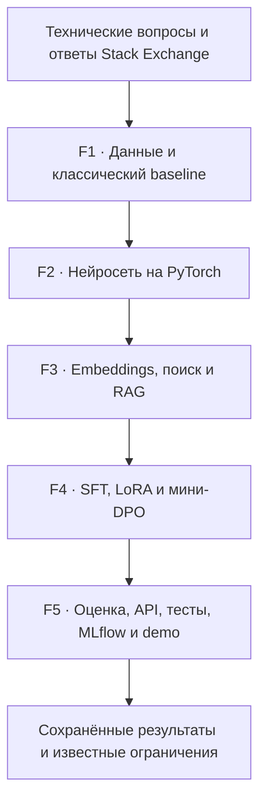

# ML Engineering Lab

**Учебная лаборатория полного ML-цикла на технических вопросах и ответах: подготовка данных, классификация, поиск, RAG, дообучение LLM, оценка и запуск сервиса. Проект показывает не только работающий код, но и фактические результаты с ограничениями.**

В исходном локальном проекте реализованы пять фаз (F1–F5, 43 учебных шага).

## Направления проекта

| Фаза | Инженерная задача | Основные технологии |
|---|---|---|
| F1 | Данные, очистка, разделение и TF-IDF + Logistic Regression | Python, pandas, scikit-learn, TF-IDF, Logistic Regression |
| F2 | Тензоры, градиенты, ручное обучение и validation | PyTorch, DataLoader, autograd, early stopping |
| F3 | Attention, embeddings, BM25, vector, hybrid и RAG | BM25, sentence-transformers, cosine, RRF |
| F4 | Instruction dataset, выбор модели, SFT + LoRA и DPO | Transformers, LoRA, SFT, DPO |
| F5 | Общая оценка, safety, FastAPI, Docker, тесты и MLflow | FastAPI, pytest, MLflow, Docker |

## Метрики из сохранённых локальных экспериментов

*Эти результаты задокументированы в локальных отчётах. Они ещё не воспроизведены в GitHub CI и будут опубликованы вместе с методикой и исходниками соответствующих фаз.*

| Эксперимент | Метрика | Значение |
|---|---|---:|
| Classical ML (F1, новый Windows-прогон) | Test macro F1 | **0.8838** (608 test-примеров) |
| Classical ML (F1, исходный отчёт) | Test macro F1 | **0.8822** (608 test-примеров) |
| PyTorch classifier (F2) | Test macro F1 | **0.7813** (608 примеров) |
| BM25 (F3) | Silver Recall@5 | **0.4500** (80 запросов) |
| Vector retrieval (F3) | Silver Recall@5 | **0.8500** (80 запросов) |
| Hybrid retrieval (F3) | Silver Recall@5 | **0.5500** (80 запросов) |
| Base / SFT tiny LLM (F4) | Reference token F1 | **0.0000 / 0.0000** (8 примеров) |

**Важно:** модель PyTorch уступила классическому baseline; hybrid retrieval уступил vector-only в данном benchmark; SFT tiny LLM не повысил качество. Метрики retrieval опираются на silver labels и не подтверждают фактическую корректность ответов. Отрицательные результаты и ограничения представлены намеренно — это часть инженерной оценки.

## Статус публикации
### Данные и классический ML

1. [F1.1 - Основа ML-проекта](docs/steps/F1_01_project_foundation.md)
2. [F1.2 - Выбор датасета](docs/steps/F1_02_dataset_selection.md)
3. [F1.3 - Получение данных](docs/steps/F1_03_data_ingestion.md)
4. [F1.4 - Очистка](docs/steps/F1_04_cleaning.md)
5. [F1.5 - Разведочный анализ](docs/steps/F1_05_eda.md)
6. [F1.6 - Split без утечки](docs/steps/F1_06_splits.md)
7. [F1.7 - TF-IDF + Logistic Regression](docs/steps/F1_07_classical_baseline.md)
8. [F1.8 - Анализ ошибок](docs/steps/F1_08_error_analysis.md)
9. [F1.9 - Итоговый отчёт F1](docs/steps/F1_09_report.md)
10. [**F1 - Итоги Фазы 1**](/docs/reports/F1_PHASE_REPORT.md)

План последовательного раскрытия модулей: [GitHub Publication Plan](docs/GITHUB_PUBLICATION_PLAN.md).

## Данные и воспроизводимость

Исходные технические Q&A: [StackExchange dataset mirror на Hugging Face](https://huggingface.co/datasets/flax-sentence-embeddings/stackexchange_titlebody_best_and_down_voted_answer_jsonl), исходная ревизия и SHA-256 файлов сохранены в [manifest.json](data/raw/manifest.json). Модели с закреплёнными revision — в [external_manifest.json](models/external_manifest.json). Подробнее: [происхождение данных](docs/DATA_PROVENANCE.md).

**Лицензирование данных:** карточка датасета содержит CC BY-NC-SA 4.0, но индивидуальная атрибуция оригинальных авторов в используемом экспорте отсутствует. Поэтому **в этом репозитории не публикуются исходные вопросы/ответы, обработанный корпус и извлечённые текстовые примеры** до отдельной правовой проверки. Большие веса моделей и кеши тоже исключены.

**Лицензия исходного кода ещё не выбрана.** Пока здесь нет файла `LICENSE`; это не означает разрешение на свободное использование или коммерческое переиспользование кода.

## Ограничения локального проекта

- GPU-профиль не исполнялся (CUDA недоступна).
- Docker build/run не проверены.
- Expert/LLM-judge correctness evaluation не проводилась.
- API и безопасность — учебные прототипы, не production-сервис.
