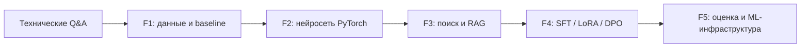

# ML Engineering Lab

<p align="center">

</p>

**Практический учебный проект по Machine Learning (машинному обучению), NLP (обработке естественного языка), LLM (больших языковых моделей) и ML Engineering (ML-инжерении):** от подготовки текстовых данных и построения классификатора до поиска информации, экспериментов с дообучением языковой модели, оценки и демонстрационного API.

Проект построен вокруг технических вопросов и ответов из **Stack Exchange**. Его цель - последовательно реализовать основные компоненты ML/AI-системы, научиться проверять результаты и понимать ограничения каждого подхода. Это **инженерная лаборатория**, а не готовый коммерческий продукт.

**Масштаб:** 
- 5 фаз
- 43 этапа
- разработка на Python
- локальные эксперименты преимущественно на CPU.

## Архитектура проекта


Фазы изучают связанные задачи, но их результаты **не следует считать одним непрерывно обученным пайплайном**: часть проверок Фазы F5 использует синтетический backend, а не реальные модели предыдущих фаз.

## Фазы
| Фаза | Этапы | Что реализовано | Краткие итоги |
|---|---:|---|---|
| [F1 — Data Engineering & Classical ML](docs/phases/F1.md) | 9 | Подготовка данных, разделение выборки, TF-IDF + Logistic Regression | Test Macro F1 **0.8838** |
| [F2 — PyTorch & Neural Networks](docs/phases/F2.md) | 8 | Autograd, embedding-классификатор, обучение, validation, диагностика | Test Macro F1 **0.7813** |
| [F3 — Transformers & Retrieval](docs/phases/F3.md) | 9 | Attention, embeddings, BM25, vector search, Hybrid RRF, RAG с provenance | Лучший Silver Recall@5: **0.8500** (vector) |
| [F4 — LLM Fine-Tuning](docs/phases/F4.md) | 9 | Instruction dataset, Qwen2.5-0.5B, SFT + LoRA, учебный DPO | Реальные CPU-шаги обучения выполнены; рост качества ответов **не доказан** |
| [F5 — Evaluation & ML Engineering](docs/phases/F5.md) | 8 | Сводная оценка, диагностика, safety, API, Docker, тесты, MLflow, CLI-demo | Инфраструктурные проверки пройдены на учебных сценариях |

Подробное техническое описание отдельных этапов — в [`docs/steps/`](docs/steps/). Отчёты и проверочные материалы — в [`docs/reports/`](docs/reports/) и [`reports/public/`](reports/public/).

## Ключевые результаты
| Направление | Результат | Как интерпретировать |
|---|---|---|
| Классический ML | 3 040 очищенных записей; 608 test-примеров; Accuracy **0.8799**, Macro F1 **0.8838** | Сильный baseline для учебной классификации |
| Нейросеть PyTorch | Test Macro F1 **0.7813** | На этом эксперименте уступила классическому baseline |
| Retrieval, 80 запросов | Silver Recall@5: BM25 **0.4500**, Vector **0.8500**, Hybrid RRF **0.5500** | Vector оказался лучше Hybrid на зафиксированном benchmark |
| Дообучение LLM | SFT + LoRA: один реальный optimizer step; validation loss **2.2882 → 2.2816** | Изменение loss за один шаг не доказывает улучшения ответов |
| ML Engineering | FastAPI и Docker HTTP smoke: **8/8**; MLflow: **6/6** запусков; CLI demo: **10/10** сценариев | Проверена учебная инфраструктура; demo/API используют синтетический backend |

**Принцип проекта:** отрицательный или неоднозначный результат - тоже результат. Необходимо отделить воспроизводимую метрику от предположений о качестве, а техническую проверку сервиса - от качества реальной LLM.

## Технологии
- **Данные и классический ML:** Python, pandas, scikit-learn, TF-IDF, Logistic Regression.
- **Нейросети:** PyTorch, autograd, `Dataset`/`DataLoader`, training loop, checkpointing.
- **Поиск и RAG:** Transformer/Attention, sentence-transformers, BM25, cosine similarity, Reciprocal Rank Fusion, provenance.
- **LLM:** Hugging Face Transformers, Qwen2.5-0.5B, SFT, LoRA, учебный DPO.
- **Инфраструктура:** FastAPI, Docker, pytest, MLflow, CLI, GitHub Actions (конфигурация).

## Структура репозитория
```text
ml-engineering-lab/
├── README.md                # Обзор проекта
├── configs/                 # Конфигурации экспериментов
├── data/                    # Манифесты и метаданные данных
├── docs/
│   ├── phases/              # Краткие итоги F1–F5
│   ├── steps/               # Подробная документация этапов
│   └── reports/             # Отчёты по фазам
├── models/                  # Манифесты моделей и метаданные
├── reports/public/          # Публикуемые результаты
├── scripts/                 # Запуск и проверка экспериментов
├── src/                     # Реализации алгоритмов и сервисов
├── tests/                   # Тесты
└── .github/workflows/       # Конфигурации CI
```

## Воспроизводимость и ограничения
- Данные разделяются на train/validation/test; версии внешних ресурсов и контрольные суммы фиксируются в манифестах: [`data/raw/manifest.json`](data/raw/manifest.json), [`models/external_manifest.json`](models/external_manifest.json).
- Retrieval-метрики рассчитаны по **silver-разметке**; это не экспертная проверка корректности сформированных ответов.
- F4 включает минимальные реальные CPU-эксперименты SFT/LoRA и DPO, но **не подтверждает прирост качества LLM**. Экспертная оценка ответов не завершена.
- F5 проверяет API, контейнер, MLflow и CLI в учебных режимах. **Реальная интеграция F1–F4/Qwen в inference-backend не доказана**, как и оценка safety на реальной LLM. Конфигурация GitHub Actions есть, но результат выполнения CI отдельно не подтверждён.
- CUDA/GPU-профиль не проверен. Сервис и safety-проверки не следует трактовать как production-ready.
- Исходные тексты и обработанный корпус не публикуются до правовой проверки: используемый источник обозначен как **CC BY-NC-SA 4.0**, а индивидуальная атрибуция авторов неполна. Лицензия на исходный код репозитория отдельно не установлена.

## Навигация

**Краткие итоги:** [F1](docs/phases/F1.md) · [F2](docs/phases/F2.md) · [F3](docs/phases/F3.md) · [F4](docs/phases/F4.md) · [F5](docs/phases/F5.md)

**Подробности:** [`docs/steps/`](docs/steps/) · [`docs/reports/`](docs/reports/) · [`reports/public/`](reports/public/)
