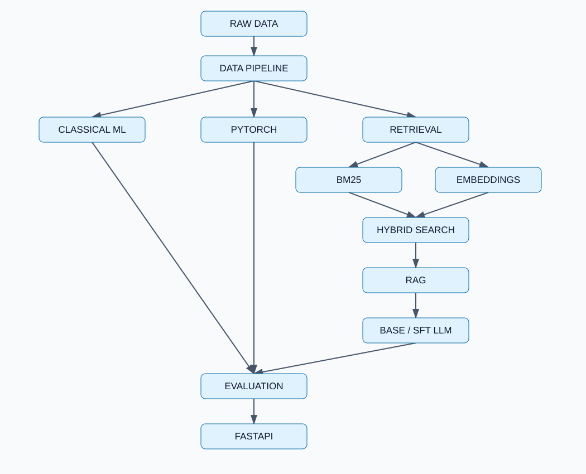

# ML Engineering Lab

**Практическая лаборатория ML Engineering: от технических данных до моделей, retrieval/RAG, оценки качества и API.**

Этот публичный репозиторий **пополняется поэтапно**: в исходном локальном проекте реализованы пять фаз (F1–F5, 43 учебных шага); после отдельного ревью, проверки и документации модули публикуются здесь осмысленными коммитами.

## Направления проекта

| Фаза | Инженерная задача | Основные технологии |
|---|---|---|
| F1 | Ingestion, очистка, split без утечек, baseline и анализ ошибок | Python, pandas, scikit-learn, TF-IDF, Logistic Regression |
| F2 | Обучение собственного классификатора и сравнение с baseline | PyTorch, DataLoader, autograd, early stopping |
| F3 | Информационный поиск и RAG с источниками | BM25, sentence-transformers, cosine, RRF |
| F4 | Мини-эксперименты с дообучением языковой модели | Transformers, LoRA, SFT, DPO |
| F5 | Оценка качества, тестирование, API и эксперименты | FastAPI, pytest, MLflow, Docker |

## Метрики из сохранённых локальных экспериментов

*Эти результаты задокументированы в локальных отчётах. Они ещё не воспроизведены в GitHub CI и будут опубликованы вместе с методикой и исходниками соответствующих фаз.*

| Эксперимент | Метрика | Значение |
|---|---|---:|
| Classical ML (F1) | Test macro F1 | **0.8822** (608 тестовых примеров) |
| PyTorch classifier (F2) | Test macro F1 | **0.7813** (608 примеров) |
| BM25 (F3) | Silver Recall@5 | **0.4500** (80 запросов) |
| Vector retrieval (F3) | Silver Recall@5 | **0.8500** (80 запросов) |
| Hybrid retrieval (F3) | Silver Recall@5 | **0.5500** (80 запросов) |
| Base / SFT tiny LLM (F4) | Reference token F1 | **0.0000 / 0.0000** (8 примеров) |

**Важно:** модель PyTorch уступила классическому baseline; hybrid retrieval уступил vector-only в данном benchmark; SFT tiny LLM не повысил качество. Метрики retrieval опираются на silver labels и не подтверждают фактическую корректность ответов. Отрицательные результаты и ограничения представлены намеренно — это часть инженерной оценки.

## Статус публикации

**P0 — исходная структура; F1.1 — инфраструктура Python; F1.2 — provenance и независимая проверка метаданных датасета.** Остальные модули и результаты будут добавляться по фазам. Репозиторий **ещё не является запускаемым end-to-end ML-продуктом**. CI проверяет метаданные, foundation и offline provenance, но **не выполняет** обучение моделей или GPU/Docker-проверки.

Начало технического разбора: [F1.1 — Project Foundation](docs/steps/F1_01_project_foundation.md). Локально: `py -3 -m pip install -r requirements-foundation.txt`, затем `py -3 -m pytest -q tests/test_foundation.py`.

**F1.2 — Dataset Selection & Provenance:** [теория и ограничения](docs/steps/F1_02_dataset_selection.md). Проверка без загрузки данных: `.\.venv\Scripts\python.exe -m src.data.provenance`; автономные тесты: `.\.venv\Scripts\python.exe -m pytest -q tests/test_provenance.py`. Исходные тексты и веса не публикуются.

План последовательного раскрытия модулей: [GitHub Publication Plan](docs/GITHUB_PUBLICATION_PLAN.md).

## Данные и воспроизводимость

Исходные технические Q&A: [StackExchange dataset mirror на Hugging Face](https://huggingface.co/datasets/flax-sentence-embeddings/stackexchange_titlebody_best_and_down_voted_answer_jsonl), исходная ревизия и SHA-256 файлов сохранены в [manifest.json](data/raw/manifest.json). Модели с закреплёнными revision — в [external_manifest.json](models/external_manifest.json). Подробнее: [происхождение данных](docs/DATA_PROVENANCE.md).

**Лицензирование данных:** карточка датасета содержит CC BY-NC-SA 4.0, но индивидуальная атрибуция оригинальных авторов в используемом экспорте отсутствует. Поэтому **в этом репозитории не публикуются исходные вопросы/ответы, обработанный корпус и извлечённые текстовые примеры** до отдельной правовой проверки. Большие веса моделей и кеши тоже исключены.

**Лицензия исходного кода ещё не выбрана.** Пока здесь нет файла `LICENSE`; это не означает разрешение на свободное использование или коммерческое переиспользование кода.

## Ограничения локального проекта

- GPU-профиль не исполнялся (CUDA недоступна).
- Docker build/run не проверены.
- Expert/LLM-judge correctness evaluation не проводилась.
- API и безопасность — учебные прототипы, не production-сервис.

## Для работодателя

Проект показывает постановку экспериментов, построение воспроизводимых ML-пайплайнов, сравнение baseline и neural models, разработку retrieval/RAG и способность документировать **не только успехи, но и ограничения**. По мере публикации появятся исходники, инструкции запуска, тесты и технические отчёты по каждому модулю.
