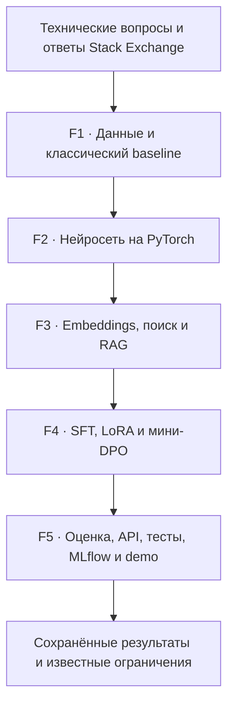

# ML Engineering Lab

**Учебная лаборатория полного ML-цикла на технических вопросах и ответах: подготовка данных, классификация, поиск, RAG, дообучение LLM, оценка и запуск сервиса. Проект показывает не только работающий код, но и фактические результаты с ограничениями.**

В исходном локальном проекте реализованы пять фаз (F1–F5, 43 учебных шага).

## Направления проекта

| Фаза | Инженерная задача | Основные технологии |
|---|---|---|
| F1 | Данные, очистка, разделение и TF-IDF + Logistic Regression | Python, pandas, scikit-learn, TF-IDF, Logistic Regression |
| F2 | Тензоры, градиенты, ручное обучение и validation | PyTorch, DataLoader, autograd, early stopping |
| F3 | Attention, embeddings, BM25, vector, hybrid и RAG | BM25, sentence-transformers, cosine, RRF |
| F4 | Instruction dataset, выбор модели, SFT + LoRA и DPO | Transformers, LoRA, SFT, DPO |
| F5 | Общая оценка, safety, FastAPI, Docker, тесты и MLflow | FastAPI, pytest, MLflow, Docker |

## Метрики из сохранённых локальных экспериментов

*Эти результаты задокументированы в локальных отчётах. Они ещё не воспроизведены в GitHub CI и будут опубликованы вместе с методикой и исходниками соответствующих фаз.*

| Эксперимент | Метрика | Значение |
|---|---|---:|
| Classical ML (F1, новый Windows-прогон) | Test macro F1 | **0.8838** (608 test-примеров) |
| Classical ML (F1, исходный отчёт) | Test macro F1 | **0.8822** (608 test-примеров) |
| PyTorch classifier (F2) | Test macro F1 | **0.7813** (608 примеров) |
| BM25 (F3) | Silver Recall@5 | **0.4500** (80 запросов) |
| Vector retrieval (F3) | Silver Recall@5 | **0.8500** (80 запросов) |
| Hybrid retrieval (F3) | Silver Recall@5 | **0.5500** (80 запросов) |
| Base / SFT tiny LLM (F4) | Reference token F1 | **0.0000 / 0.0000** (8 примеров) |

**Важно:** модель PyTorch уступила классическому baseline; hybrid retrieval уступил vector-only в данном benchmark; SFT tiny LLM не повысил качество. Метрики retrieval опираются на silver labels и не подтверждают фактическую корректность ответов. Отрицательные результаты и ограничения представлены намеренно — это часть инженерной оценки.

## Статус публикации

**P0 — исходная структура; F1.1 — инфраструктура Python; F1.2 — provenance; F1.3 — проверяемый ingestion; F1.4 — детерминированная очистка; F1.5 — EDA; F1.6 — grouped split и защита от лексических утечек; F1.7 — classical ML baseline; F1.8 — анализ ошибок без повторного обучения; F1.9 — генератор итогового отчёта из согласованных локальных аудит-артефактов (проверка на Windows ожидается).** Остальные модули и результаты будут добавляться по фазам. Репозиторий **ещё не является запускаемым end-to-end ML-продуктом**. CI проверяет метаданные и автономные тесты F1.1–F1.9 на синтетических данных, но **не выполняет** обучение модели на реальном корпусе или GPU/Docker-проверки.

Начало технического разбора: [F1.1 — Project Foundation](docs/steps/F1_01_project_foundation.md). Локально: `py -3 -m pip install -r requirements-foundation.txt`, затем `py -3 -m pytest -q tests/test_foundation.py`.

**F1.2 — Dataset Selection & Provenance:** [теория и ограничения](docs/steps/F1_02_dataset_selection.md). Проверка без загрузки данных: `.\.venv\Scripts\python.exe -m src.data.provenance`; автономные тесты: `.\.venv\Scripts\python.exe -m pytest -q tests/test_provenance.py`. Исходные тексты и веса не публикуются.

**F1.3 — Data Ingestion:** [разбор кода и воспроизводимости](docs/steps/F1_03_data_ingestion.md). Локальные offline-тесты: `python -m pytest -q tests/test_ingestion.py`. Реальный download **вручную**, вне CI: `python -m scripts.download_data`; если архивы уже есть: `python -m scripts.download_data --offline`. Для побайтовой проверки: `python -m src.data.provenance --verify-files`. Raw gzip, subset и sample остаются локальными и исключены из Git.

**F1.4 — Data Cleaning:** [разбор очистки и статистики исключений](docs/steps/F1_04_cleaning.md). Локально после F1.3: `python -m scripts.clean_data --expect-input 3066 --expect-output 3040`. Очищенный корпус (`data/interim/`) и локальный audit JSON не публикуются. Группировка близких дубликатов и split будут реализованы отдельно в F1.6.

**F1.5 — Exploratory Data Analysis:** [статистика и графики до разбиения](docs/steps/F1_05_eda.md). После F1.4 локально: `python -m scripts.eda_data --expect-rows 3040` (установить `requirements-eda.txt`). Сводка и изображения сохраняются локально, без оригинальных Q&A. **F1.6 — Data Splitting & Leakage Prevention:** [подробный разбор](docs/steps/F1_06_splits.md). После F1.4 локально: `python -m scripts.split_data --expect-rows 3040` (установить `requirements-splitting.txt`). Группы формируются по вопросам и ответам, train/validation/test не пересекаются по вычисленным группам. Исторические ориентиры — 1824/608/608, 535 near-duplicate edges; реальный Windows-запуск должен подтвердить или объяснить расхождение. Файлы `data/processed/` и локальный audit не публикуются.

**F1.7 — Classical ML Baseline:** [TF-IDF + Logistic Regression, train-only fit и оценки Macro F1](docs/steps/F1_07_classical_baseline.md). После F1.6 локально: `python -m scripts.train_classical --expect-train 1824 --expect-val 608 --expect-test 608` (установить `requirements-classical.txt`). Исторические результаты **не гарантируют** совпадения с новым исполнением. Веса, predictions, метрики и тексты остаются локальными. F1.8 будет посвящён анализу ошибок.

**Подтверждённый Windows-запуск F1.7:** Test macro F1 **0.8838**, Accuracy **0.8799** на 608 примерах; это отдельный прогон с результатами, близкими к историческим, но не обязательно теми же test-ID. Реальное обучение на полном корпусе выполнялось локально, а не в GitHub CI.

**F1.8 — Error Analysis:** [анализ замороженных test-предсказаний](docs/steps/F1_08_error_analysis.md) без повторного обучения. После F1.7: `python -m scripts.analyze_classical --expect-test 608` (установить `requirements-error-analysis.txt`). Отчёт, локальные ID ошибок и изображение confusion matrix исключены из Git. Причины ошибок фиксируются как гипотезы, а не доказанные факты.

**F1.9 — Итоговый отчёт первой фазы:** [генератор отчёта и методика](docs/steps/F1_09_report.md). На локальных аудитах после F1.8: `python -m scripts.build_f1_report --expect-rows 3040 --expect-test 608`, затем та же команда с `--check`. Публичный [F1 Phase Report](docs/reports/F1_PHASE_REPORT.md) добавляем только после воспроизводимой генерации на Windows. [Черновик релиза v0.1-f1](docs/releases/v0.1-f1.md). GitHub CI по-прежнему не запускает полный корпус.

План последовательного раскрытия модулей: [GitHub Publication Plan](docs/GITHUB_PUBLICATION_PLAN.md).

## Данные и воспроизводимость

Исходные технические Q&A: [StackExchange dataset mirror на Hugging Face](https://huggingface.co/datasets/flax-sentence-embeddings/stackexchange_titlebody_best_and_down_voted_answer_jsonl), исходная ревизия и SHA-256 файлов сохранены в [manifest.json](data/raw/manifest.json). Модели с закреплёнными revision — в [external_manifest.json](models/external_manifest.json). Подробнее: [происхождение данных](docs/DATA_PROVENANCE.md).

**Лицензирование данных:** карточка датасета содержит CC BY-NC-SA 4.0, но индивидуальная атрибуция оригинальных авторов в используемом экспорте отсутствует. Поэтому **в этом репозитории не публикуются исходные вопросы/ответы, обработанный корпус и извлечённые текстовые примеры** до отдельной правовой проверки. Большие веса моделей и кеши тоже исключены.

**Лицензия исходного кода ещё не выбрана.** Пока здесь нет файла `LICENSE`; это не означает разрешение на свободное использование или коммерческое переиспользование кода.

## Ограничения локального проекта

- GPU-профиль не исполнялся (CUDA недоступна).
- Docker build/run не проверены.
- Expert/LLM-judge correctness evaluation не проводилась.
- API и безопасность — учебные прототипы, не production-сервис.

## Для работодателя

Проект показывает постановку экспериментов, построение воспроизводимых ML-пайплайнов, сравнение baseline и neural models, разработку retrieval/RAG и способность документировать **не только успехи, но и ограничения**. По мере публикации появятся исходники, инструкции запуска, тесты и технические отчёты по каждому модулю.
