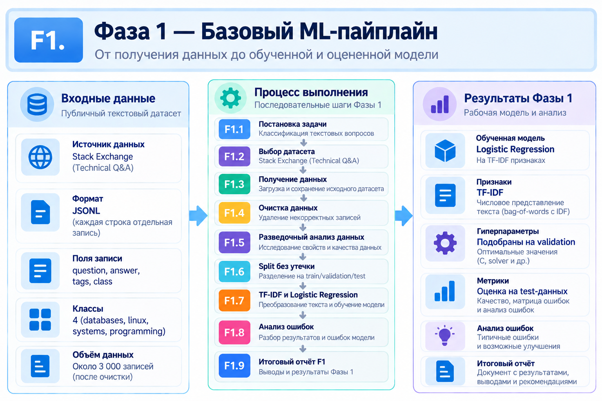

# Фаза 1 - Data Engineering & Classical ML

## Этапы:
[F1.1 - Основа ML-проекта](docs/steps/F1_01_project_foundation.md)
[F1.2 - Выбор датасета](docs/steps/F1_02_dataset_selection.md)
[F1.3 - Получение данных](docs/steps/F1_03_data_ingestion.md)
[F1.4 - Очистка](docs/steps/F1_04_cleaning.md)
[F1.5 - Разведочный анализ](docs/steps/F1_05_eda.md)
[F1.6 - Split без утечки](docs/steps/F1_06_splits.md)
[F1.7 - TF-IDF + Logistic Regression](docs/steps/F1_07_classical_baseline.md)
[F1.8 - Анализ ошибок](docs/steps/F1_08_error_analysis.md)
[F1.9 - Итоговый отчёт F1](docs/steps/F1_09_report.md)

## Цель и содержание
Подготовить воспроизводимую основу ML-проекта: выбрать и загрузить технические вопросы и ответы, очистить текст, исследовать датасет, разделить данные без утечки между train/validation/test и построить первый классификатор на **TF-IDF + Logistic Regression**. Завершающие шаги - анализ ошибок и итоговый отчёт.

## Результаты
- Очищено **3 040 записей**; split: **1 824 / 608 / 608** (train / validation / test).
- На test: **Accuracy 0.8799**, **Macro F1 0.8838**.
- Зафиксировано **73 ошибки** на 608 test-примерах; проведён их анализ.
- Получен воспроизводимый классический **baseline** для сравнения с нейросетевыми подходами.

**Вывод:** прежде чем обучать сложные модели, важно получить корректные данные и сильную, измеримую отправную точку.

[← К обзору проекта](../../README.md)
