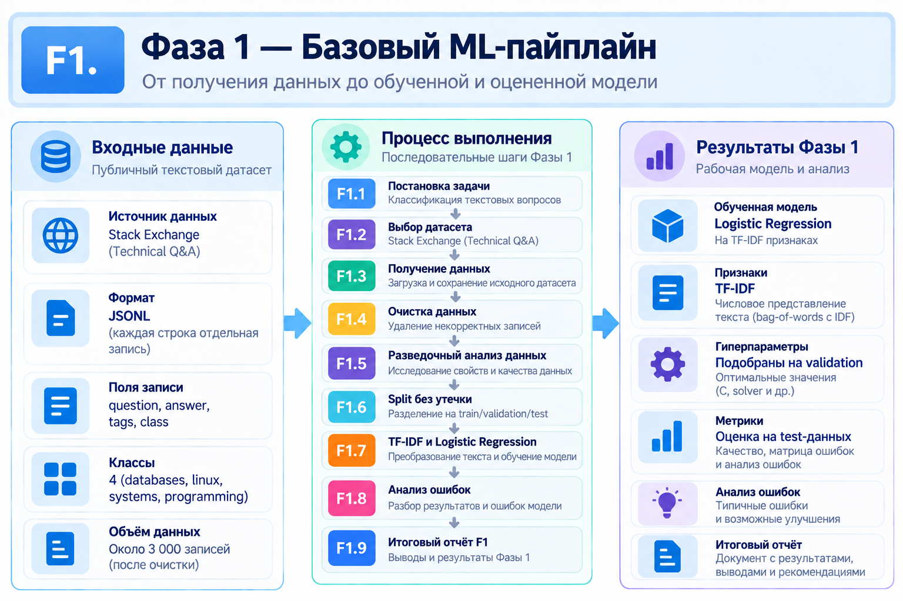

# Фаза 1 - Data Engineering & Classical ML

## Цель
Подготовить воспроизводимую основу ML-проекта: выбрать и загрузить технические вопросы и ответы, очистить текст, исследовать датасет, разделить данные без утечки между train/validation/test и построить первый классификатор на **TF-IDF + Logistic Regression**. Завершающие шаги - анализ ошибок и итоговый отчёт.

## Этапы:
1. [F1.1 - Основа ML-проекта](../steps/F1_01_project_foundation.md)
2. [F1.2 - Выбор датасета](../steps/F1_02_dataset_selection.md)
3. [F1.3 - Получение данных](../steps/F1_03_data_ingestion.md)
4. [F1.4 - Очистка данных](../steps/F1_04_cleaning.md)
5. [F1.5 - Разведочный анализ (EDA)](../steps/F1_05_eda.md)
6. [F1.6 - Split без утечки (Разделение данных на части: Train|Validation|Test)](../steps/F1_06_splits.md)
7. [F1.7 - Базовая модель классификации: TF-IDF + Logistic Regression](../steps/F1_07_classical_baseline.md)
8. [F1.8 - Анализ ошибок модели](../steps/F1_08_error_analysis.md)
9. [F1.9 - Формирование итогового отчёта F1](../steps/F1_09_report.md)

## Что было сделано
В первой фазе решалась задача классификации технических вопросов по четырем категориям.

Организована структура и автоматические проверки, выбран корпус реальных технических вопросов. Загружены 3066 записей. Далее очищен корпус вопросов до 3040 и проведены исследования по распределению классов и качества текстов.

Для корректной оценки реализован групповой Train/Validation/Test split. Обнаруженные похожие записи объединялись в группы, которые не пересекались между выборками. Получилось 1824 обучающих, 608 валидационных и 608 тестовых примеров. Из 608 вопросов правильно квалифицированы 535. При анализе оставшихся 73 ошибок самая частая - путаница systems -> Linix - 24 случая.

В качестве базовой модели используется TD-IDF и Logistic Regression. На тестовой выборке получена Accuracy = 87,99% и Macro F1 = 0,8838.

Фаза завершается генерацией воспроизводимого отчета с автоматическими проверками согласованности результатов.

## Используемые алгоритмы
|**Алгоритм / метод**	| **Для чего используется**|
|---------------------|--------------------------|
|**Data Cleaning**	| Очистка текста от мусора, HTML, лишних символов и дубликатов.|
|**Leakage-aware Split** |	Разделение данных на Train/Validation/Test без утечки похожих примеров.|
|**TF-IDF**	| Преобразование текста в числовые признаки с учётом важности слов.|
|**Logistic Regression** | Классификация текстов по заданным категориям.|
|**Confusion Matrix, Accuracy, Precision, Recall, F1** | Оценка качества классификации и анализ ошибок.|
|**Cross-audit Validation**	| Проверка согласованности результатов всей фазы.|

## Результаты
- Исходный датасет **3 066 записей**; 
- Очищено **3 040 записей**;
- Split: **1 824 / 608 / 608** (train / validation / test);
- На test: **Accuracy 0.8799**, **Macro F1 0.8838**;
- Зафиксировано **73 ошибки** на 608 test-примерах, проведён их анализ;
- Самая частая ошибка: systems → linux (24 случая);
- Получен воспроизводимый классический **baseline** для сравнения с нейросетевыми подходам

**Вывод:** реализован полный путь от исходных данных до проверенного классификатора - с воспроизводимой подготовкой корпуса данных, защитой от обнаруженных дубликатов между выборками и количественной оценкой качества. Метод не гарантирует отсутствие семантических утечек. Прежде чем обучать сложные модели, важно получить корректные данные и измеримую отправную точку. 

[← К обзору проекта](../../README.md)
