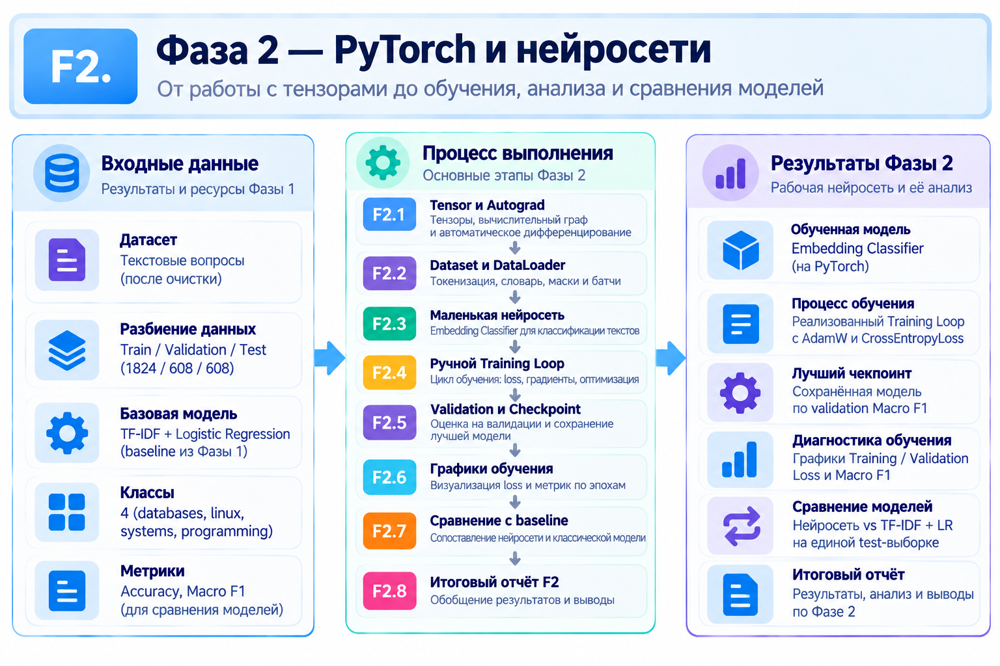

# Фаза 2 - PyTorch & Neural Networks

## Цель
Разобраться, как работает и обучается нейросеть: тензоры и autograd (механизм автоматического дифференцирования), подготовка данных через два ключевых класса в библиотеке PyTorch `Dataset (Набор данных)`/`DataLoader (Загрузчик данных)`, embedding-классификатор (преобразование в числовые векторы), цикл обучения, проверка на валидацию, сохранение лучшего снимка состояния модели и диагностика обучения. Затем сравнить нейросеть с baseline из F1.

## Этапы:
1. [F2.1 - Тензоры и Autograd (Математическая основа обучения нейросети)](../steps/F2_01_autograd.md)
2. [F2.2 - Dataset и DataLoader (Преобразование текста в батчи PyTorch)](../steps/F2_02_dataset_dataloader.md)
3. [F2.3 - Маленькая нейросеть (Embedding Classifier: от токенов к logits)](../steps/F2_03_embedding_classifier.md)
4. [F2.4 - Training Loop (Переход от модели к обучению)](../steps/F2_04_training_loop.md)
5. [F2.5 - Validation & Checkpointing (Выбор и сохранение лучшей модели)](../steps/F2_05_validation_checkpointing.md)
6. [F2.6 - Training Diagnostics & Visualization (Диагностика динамики по эпохам)](../steps/F2_06_training_diagnostics.md)
7. [F2.7 - Classical ML vs Neural Network (Сравнение Базовой модели с Нейросетью)](../steps/F2_07_classical_vs_neural.md)
8. [F2.8 - Формирование итогового отчета F2](../steps/F2_08_final_phase_report.md)

## Что было сделано
Во второй фазе реализован базовый PyTorch pipeline: от преобразования текста в батчи и создания Embedding-классификатора до обучения, валидации, сохранения лучшего снимка нейросети, диагностики и честного сравнения с Базовой моделью.

Освоено вычисление градиентов и автоматическое дифференцирование. Реализованы токенизация, словарь, батчи и маски.

Создана нейросеть с 578 548 параметрами для классификации по 4 категориям. Реализовано обучение с двумя базовыми компонентами для обучения нейронных сетей в библиотеке PyTorch: CrossEntropyLoss (Функция потерь) - измеряет, насколько сильно предсказания модели отличаются от правильных ответов и AdamW (Оптимизатор) - алгоритм, который обновляет параметры (веса) нейросети на основе вычисленной ошибки, чтобы в следующий раз модель ответила точнее.

Добавлена оценки качества, выбор лучшей эпохи и сохранение модели. Построены графики Loss и Macro F1, реализована диагностика обучения.

Нейросеть сравнена с Базовой моделью. Базовая модель оказалась точнее. Усложнение архитектуры не гарантирует повышения качества.

Фаза завершается генерацией воспроизводимого отчета с автоматическими проверками согласованности результатов.

## Используемые алгоритмы
|**Алгоритм / метод**	| **Для чего используется**|
|---------------------|--------------------------|
|**Embedding** |	Преобразование токенов в обучаемые числовые векторы.|
|**Forward Propagation** |	Вычисление предсказания нейросети.|
|**Cross-Entropy Loss** |	Измерение ошибки классификации.|
|**Backpropagation / Autograd** |	Вычисление градиентов для обучения.|
|**Gradient Descent / Optimizer** |	Обновление параметров нейросети.|
|**Masking / Pooling**	| Получение общего представления текста из токенов.|
|**Validation / Checkpointing** |	Проверка качества и сохранение лучшей модели.|

## Результаты
- Реализован и протестирован полный учебный цикл обучения классификатора на **PyTorch**;
- На test: **Macro F1 0.7813** (608 примеров); для сравнения baseline F1 - **0.8838**;
- В отдельном диагностическом запуске Loss снизился с 1,3011 до 0,2540, а Validation Macro F1 вырос с 0,5686 до 0,7823. Явного сигнала переобучения диагностика не обнаружила;
- Подтверждена регрессия Фазы 2: **528/528 тестов PASS**.

**Вывод:** нейросеть успешно реализована и обучена, её качество можно оценивать, анализировать и воспроизводить. Базовая модель оказалась точнее. Для небольшого технического датасета технических вопросов Базовая модель оказалась эффективнее по измеренным метрикам.

[← К обзору проекта](../../README.md)
