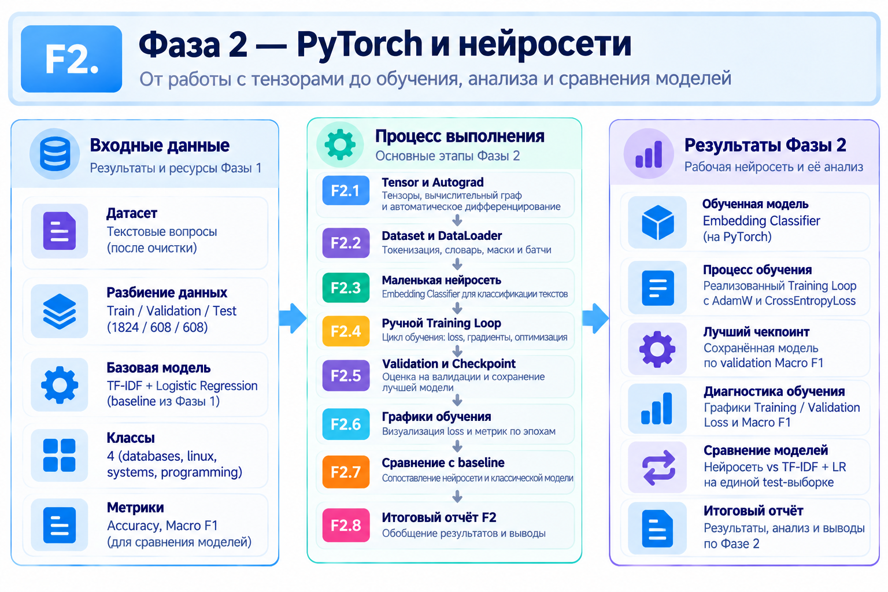

# Фаза 2 - PyTorch & Neural Networks

## Этапы:
1. [F2.1 - Как работают тензоры и Autograd](../steps/F2_01_autograd.md)
2. [F2.2 - Dataset и DataLoader](../steps/F2_02_dataset_dataloader.md)
3. [F2.3 - Embedding Classifier](../steps/F2_03_embedding_classifier.md)
4. [F2.4 - Training Loop](../steps/F2_04_training_loop.md)
5. [F2.5 - Validation & Checkpointing](../steps/F2_05_validation_checkpointing.md)
6. [F2.6 - Training Diagnostics & Visualization](../steps/F2_06_training_diagnostics.md)
7. [F2.7 - Classical ML vs Neural Network](../steps/F2_07_classical_vs_neural.md)
8. [F2.8 - Final Phase Report](../steps/F2_08_final_phase_report.md)

## Цель и содержание
Разобраться, как работает и обучается нейросеть: тензоры и **autograd**, подготовка данных через `Dataset`/`DataLoader`, embedding-классификатор, цикл обучения, проверка на validation, сохранение лучшего checkpoint и диагностика обучения. Затем сравнить нейросеть с baseline из F1.

## Используемые алгоритмы
|**Алгоритм / метод**	| **Для чего используется**|
|---------------------|--------------------------|
|Embedding |	Преобразование токенов в обучаемые числовые векторы.|
|Forward Propagation |	Вычисление предсказания нейросети.|
|Cross-Entropy Loss |	Измерение ошибки классификации.|
|Backpropagation / Autograd |	Вычисление градиентов для обучения.|
|Gradient Descent / Optimizer |	Обновление параметров нейросети.|
|Masking / Pooling	| Получение общего представления текста из токенов.|
|Validation / Checkpointing |	Проверка качества и сохранение лучшей модели.|

## Результаты
- Реализован и протестирован полный учебный цикл обучения классификатора на **PyTorch**.
- На test: **Macro F1 0.7813** (608 примеров); для сравнения baseline F1 - **0.8838**.
- Подтверждена регрессия Фазы 2: **528/528 тестов PASS**.

**Вывод:** нейросеть оказалась слабее классического подхода в данном эксперименте. Усложнение архитектуры само по себе не гарантирует улучшения метрик.

[← К обзору проекта](../../README.md)
