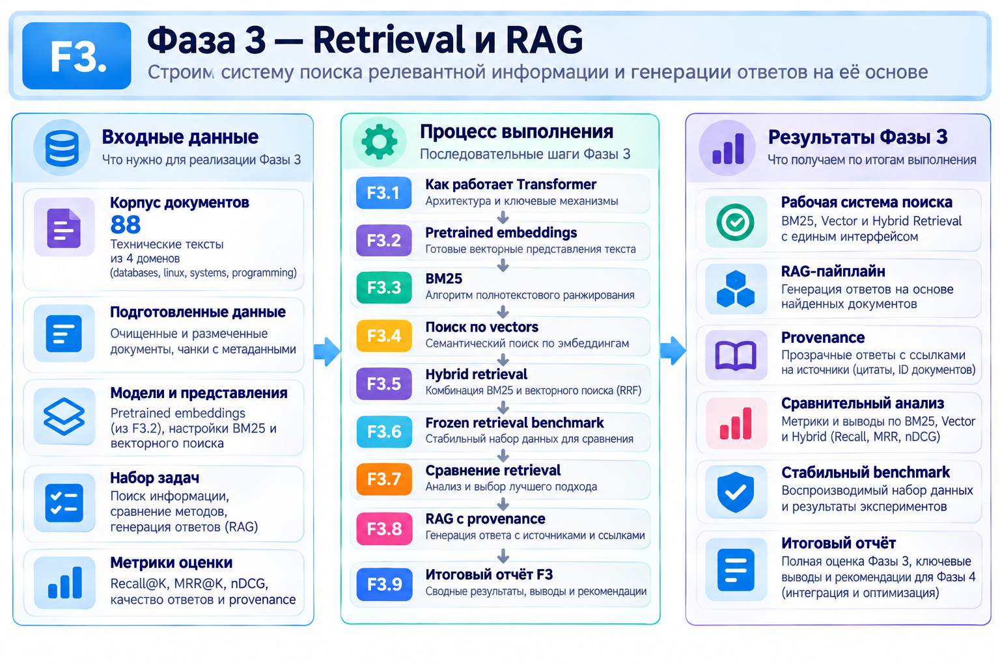

# Фаза 3 - Transformers & Retrieval

## Цель
Научиться создавать поисковую систему, которая находит релевантную информацию в документах и использует её для формирования ответов с проверяемыми источниками.

## Этапы:
1. [F3.1 - Self-Attention (Механизм самовнимания)](../steps/F3_01_transformer_attention.md)
2. [F3.2 - Предобученные Transformer Embeddings](../steps/F3_02_pretrained_embeddings.md)
3. [F3.3 - BM25 и инвертированный индекс](../steps/F3_03_bm25_indexing.md)
4. [F3.4 - Vector Search на NumPy](../steps/F3_04_vector_search_numpy.md)
5. [F3.5 - Объединение Hybrid Search и Reciprocal Rank Fusion](../steps/F3_05_hybrid_rrf.md)
6. [F3.6 - Frozen Retrieval Benchmark (Подготовка эталонных документов)](../steps/F3_06_frozen_retrieval_benchmark.md)
7. [F3.7 - Сравнение BM25, Vector и Hybrid](../steps/F3_07_bm25_vector_hybrid_comparison.md)
8. [F3.8 - RAG, Provenance и Extractive Fallback](../steps/F3_08_rag_provenance.md)
9. [F3.9 - Итоговый отчёт F3](../steps/F3_09_final_phase_report.md)

## Что было сделано
В третьей фазе реализован базовый Transformers & Retrieval pipeline: от изучения механизма внимания Transformer и преобразования текстов в числовые векторы до создания поисковых алгоритмов, сравнения их эффективности и построения RAG-системы с проверяемыми источниками информации.

Освоен механизм Self-Attention - технология, позволяющая модели учитывать взаимосвязи между словами в тексте. Подключена предобученная Transformer-модель MiniLM, которая преобразует текст в числовой вектор из 384 значений (Embedding), отражающий его семантические характеристики.

Реализованы три механизма поиска: BM25 - поиск документов по ключевым словам и их значимости; Vector Search - поиск по смысловой близости текстов с использованием Embeddings и Cosine Similarity (косинусного сходства); Hybrid Search - комбинированный поиск, объединяющий результаты BM25 и Vector Search с помощью алгоритма RRF (Reciprocal Rank Fusion).

Создан эталонный набор данных для оценки поисковых алгоритмов: 88 документов, 80 запросов и 160 связей релевантности. Реализованы метрики Recall@K (доля найденных релевантных документов) и MRR@K (оценка позиции первого релевантного документа в выдаче).

Проведено сравнение трёх поисковых алгоритмов. Лучший результат показал Vector Search - **Recall@5** = 78,75%, **Hybrid Search** - 76,88%, **BM25** - 63,75%. Эксперимент показал, что семантический поиск может превосходить поиск по ключевым словам, а объединение алгоритмов не всегда повышает качество. Результаты получены на синтетическом наборе данных.

Реализован базовый RAG (Retrieval-Augmented Generation) pipeline - механизм поиска информации в документах и подготовки ответов на основе найденных источников. Добавлена система Provenance - проверка происхождения информации, точности цитат и их соответствия исходным документам. При отсутствии подтверждения система использует дословные выдержки из источников либо отказывается от ответа.

Фаза завершается генерацией воспроизводимого технического отчёта с независимым пересчётом метрик, проверкой целостности данных и согласованности результатов.

В результате создана основа поисковой RAG-системы, способной находить информацию по смыслу и ключевым словам, оценивать качество поиска и предоставлять ответы с проверяемыми источниками.

## Используемые алгоритмы
|**Алгоритм / метод**	| **Для чего используется**|
|---------------------|--------------------------|
|**Scaled Dot-Product Self-Attention** |	Вычисление взаимосвязей между токенами через Q, K, V и Softmax.|
|**Pretrained Embeddings** |	Преобразование текстов в семантические векторы готовой моделью.|
|**BM25** |	Поиск документов по словам и их статистической значимости.|
|**Vector Search / Cosine Similarity** |	Поиск текстов, похожих по смыслу.|
|**Hybrid Search** |	Объединение лексического и векторного поиска.|
|**RRF (Reciprocal Rank Fusion)**	| Объединение нескольких рейтингов результатов поиска.|
|**Recall@K / MRR** |	Измерение качества поисковой выдачи.|
|**RAG (Retrieval-Augmented Generation)** |	Формирование ответа LLM с использованием найденных документов.|
|**Provenance / Extractive Fallback**	| Проверка источников ответа и извлечение текста при ненадёжной генерации.|

## Результаты
- Подключена предобученная Transformer-модель MiniLM, преобразующая тексты в векторы размерностью 384. Реализованы три поисковых алгоритма: BM25, Vector Search и Hybrid Search (RRF);
- На запросах с переформулировками Vector Search значительно превзошёл BM25: Recall@5 - 0.6625 против 0.3875. Это подтвердило преимущество семантического поиска в данном эксперименте;
- Реализован базовый RAG pipeline с проверкой происхождения информации (Provenance). Подтверждена корректность цитирования, отклонения неподтверждённого текста и отказа от ответа при отсутствии источников - 3/3 проверки PASS;
- Сформирован воспроизводимый отчёт Фазы 3 с независимым пересчётом метрик, проверкой SHA-256 и согласованности результатов.

**Вывод:** успешно реализована основа поисковой RAG-системы, способной находить информацию по ключевым словам и смыслу, сравнивать эффективность алгоритмов и предоставлять ответы с проверяемыми источниками. На синтетическом наборе данных Vector Search показал лучшие результаты. Гибридный поиск превзошёл BM25, но уступил Vector Search. Полученные результаты подтверждают работоспособность и воспроизводимость решения, однако не доказывают его эффективность на реальных пользовательских запросах.

[← К обзору проекта](../../README.md)
