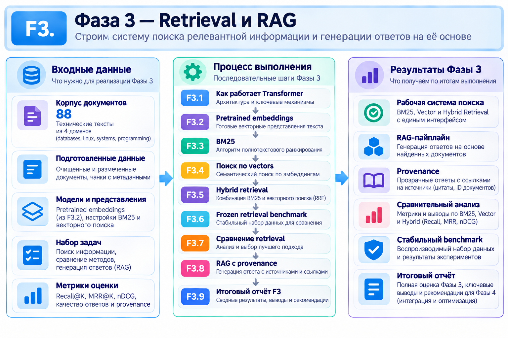

# Фаза 3 - Transformers & Retrieval

## Этапы:
1. [F1.1 - Основа ML-проекта](../steps/F3_01_project_foundation.md)
2. [F1.2 - Выбор датасета](../steps/F3_02_dataset_selection.md)
3. [F1.3 - Получение данных](../steps/F3_03_data_ingestion.md)
4. [F1.4 - Очистка](../steps/F3_04_cleaning.md)
5. [F1.5 - Разведочный анализ](../steps/F3_05_eda.md)
6. [F1.6 - Split без утечки](../steps/F3_06_splits.md)
7. [F1.7 - TF-IDF + Logistic Regression](../steps/F3_07_classical_baseline.md)
8. [F1.8 - Анализ ошибок](../steps/F3_08_error_analysis.md)
9. [F1.9 - Итоговый отчёт F1](../steps/F3_09_report.md)

## Цель и содержание
Изучить механизм **Attention**, получить векторные представления текстов (embeddings) и построить три варианта поиска: лексический **BM25**, семантический **Vector Search** с cosine similarity и комбинированный **Hybrid Search** через RRF. Сравнить их на фиксированном benchmark и реализовать RAG-процесс с указанием источников (**provenance**) и extractive fallback.

## Используемые алгоритмы
|**Алгоритм / метод**	| **Для чего используется**|
|---------------------|--------------------------|
|Scaled Dot-Product Self-Attention |	Вычисление взаимосвязей между токенами через Q, K, V и Softmax.|
|Pretrained Embeddings |	Преобразование текстов в семантические векторы готовой моделью.|
|BM25 |	Поиск документов по словам и их статистической значимости.|
|Vector Search / Cosine Similarity |	Поиск текстов, похожих по смыслу.|
|Hybrid Search |	Объединение лексического и векторного поиска.|
|RRF (Reciprocal Rank Fusion)	| Объединение нескольких рейтингов результатов поиска.|
|Recall@K / MRR |	Измерение качества поисковой выдачи.|
|RAG (Retrieval-Augmented Generation) |	Формирование ответа LLM с использованием найденных документов.|
|Provenance / Extractive Fallback	| Проверка источников ответа и извлечение текста при ненадёжной генерации.|

## Результаты
- Зафиксирован benchmark: **80 запросов**, **88 документов**, **160 пар релевантности**.
- **Silver Recall@5:** BM25 - **0.4500**, Vector - **0.8500**, Hybrid RRF - **0.5500**.
- Реализована проверяемая связка поиска с provenance, позволяющая проследить происхождение найденного контекста.

**Вывод:** на этом наборе задач векторный поиск победил. Гибридный поиск не обязан быть лучше каждой отдельной компоненты; результат зависит от данных и настройки ранжирования. *Silver-разметка не заменяет экспертную оценку качества ответов.*

[← К обзору проекта](../../README.md)
