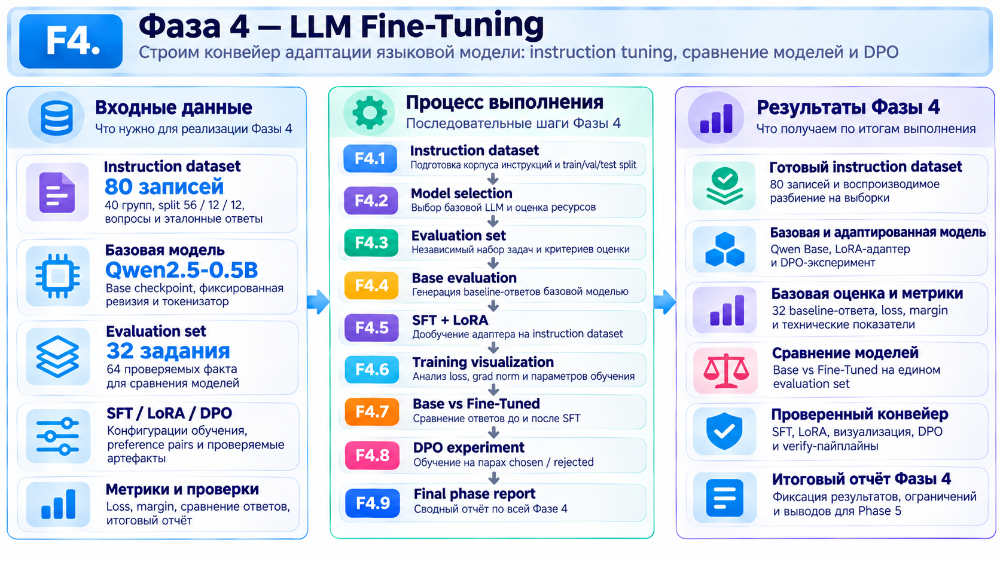

# Фаза 4 - LLM Fine-Tuning

## Этапы:
1. [F4.1 - Instruction Dataset](../steps/F4_01_instruction_dataset.md)
2. [F4.2 - Model Selection](../steps/F4_02_model_selection.md)
3. [F4.3 - Evaluation Set](../steps/F4_03_evaluation_set.md
)
4. [F4.4 - Base Model Evaluation](../steps/F4_04_base_model_evaluation.md
)
5. [F4.5 - Supervised Fine-Tuning и LoRA](../steps/F4_05_sft_lora.md)
6. [F4.6 - Training Visualization](../steps/F4_06_training_visualization.md)
7. [F4.7 - Base vs Fine-Tuned](../steps/F4_07_base_vs_finetuned.md)
8. [F4.8 - Direct Preference Optimization (DPO)](../steps/F4_08_dpo_experiment.md)
9. [F4.9 - Итоговый отчёт F4](../steps/F4_09_final_phase_report.md)

## Цель и содержание
Познакомиться с адаптацией готовой языковой модели под формат инструкций: подготовить instruction dataset и контрольную выборку, выбрать базовую LLM, измерить исходные ответы, провести небольшой **SFT + LoRA** и сравнить выходы. Отдельно изучить **DPO** - обучение на парах предпочтительных и менее предпочтительных ответов.

## Используемые алгоритмы
|**Алгоритм / метод**	| **Для чего используется**|
|---------------------|--------------------------|
|Tokenization |	Преобразование текста в токены, понятные языковой модели.|
|Causal Language Modeling	| Предсказание следующего токена в последовательности.|
|SFT (Supervised Fine-Tuning) |	Дообучение LLM на примерах инструкций и правильных ответов.|
|LoRA (Low-Rank Adaptation)	| Эффективное дообучение небольшого числа дополнительных параметров.|
|QLoRA	| Вариант экономного дообучения с квантованной базовой моделью.|
|DPO (Direct Preference Optimization) |	Обучение предпочтительным ответам на основе пар «лучший - худший».|
|Base vs SFT Evaluation	| Сравнение качества исходной и дообученной моделей.|

## Результаты
- Подготовлено **80 instruction-записей** (56 train / 12 validation / 12 test); использована **Qwen2.5-0.5B**.
- Получены **32/32** базовых ответа; выполнен реальный CPU-шаг SFT + LoRA (**540 672 обучаемых параметра**).
- Validation loss за один шаг: **2.2882 → 2.2816**; среди 32 пар ответов **12 изменились**, **20 остались прежними**.
- Выполнен учебный CPU-шаг **DPO**; улучшение качества ответов не подтверждено.

**Вывод:** освоен механизм дообучения и сравнения LLM, но единичные шаги обучения и небольшие выборки **не доказывают улучшения качества**. Экспертная оценка ответов не завершена.

[← К обзору проекта](../../README.md)
