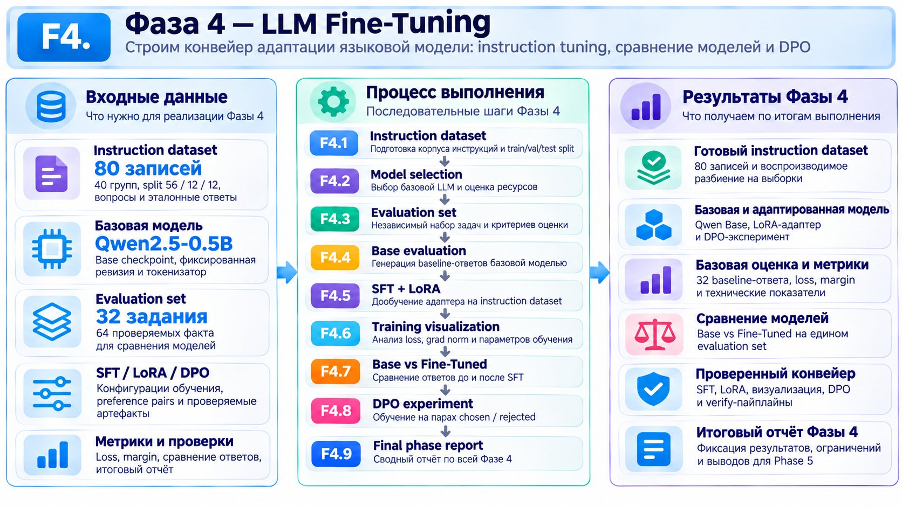

# Фаза 4 - LLM Fine-Tuning

## Цель
Изучить и реализовать полный учебный цикл дообучения большой языковой модели (LLM): от подготовки обучающих данных и оценки исходной модели до Supervised Fine-Tuning (SFT), применения LoRA, обучения на предпочтениях (DPO) и сравнения результатов.

Понять, как можно адаптировать готовую языковую модель под конкретные задачи, не обучая её с нуля, а также научиться контролировать процесс обучения, оценивать изменения и обеспечивать воспроизводимость экспериментов.

## Этапы:
1. [F4.1 - Instruction Dataset (датасет "инструкция/запрос")](../steps/F4_01_instruction_dataset.md)
2. [F4.2 - Выбор модели](../steps/F4_02_model_selection.md)
3. [F4.3 - Evaluation Set (набор тестовых примеров для оценки)](../steps/F4_03_evaluation_set.md
)
4. [F4.4 - Base Model Evaluation (оценка качества и способностей базовой модели)](../steps/F4_04_base_model_evaluation.md
)
5. [F4.5 - Supervised Fine-Tuning и LoRA (дообучение готовой нейросети и метод тонкой настройки)](../steps/F4_05_sft_lora.md)
6. [F4.6 - Training Visualization (графическое представление процесса обучения модели)](../steps/F4_06_training_visualization.md)
7. [F4.7 - Base vs Fine-Tuned (сравнение базовой модели с дообученной)](../steps/F4_07_base_vs_finetuned.md)
8. [F4.8 - Direct Preference Optimization (DPO - прямая оптимизация предпочтений)](../steps/F4_08_dpo_experiment.md)
9. [F4.9 - Итоговый отчёт F4](../steps/F4_09_final_phase_report.md)

## Что было сделано
В четвёртой фазе реализован базовый LLM Fine-Tuning пайплайн на основе предобученной модели Qwen2.5-0.5B с приблизительно 494 миллионами параметров.

Подготовлен набор из 80 технических инструкций с эталонными ответами по Python, Linux, SQL и ML. Данные разделены на Train, Validation и Test с защитой от пересечения смысловых групп (Data Leakage). 

Выбрана и зафиксирована базовая языковая модель Qwen2.5-0.5B. Создан независимый Evaluation Set из 32 контрольных вопросов и 64 критериев оценки, позволяющий сравнивать качество ответов до и после дообучения.

Проведена первоначальная оценка (Base Model Evaluation): модель выполнила генерацию ответов на 32 контрольных вопроса. Полученные ответы сохранены в качестве исходного Baseline для последующего сравнения.

Реализовано настоящее Supervised Fine-Tuning (SFT) - дообучение языковой модели на примерах правильных ответов. Для экономии вычислительных ресурсов применён метод LoRA (Low-Rank Adaptation), позволяющий изменять небольшое количество дополнительных параметров, сохраняя основные веса модели неизменными.

Выполнен реальный шаг обучения на CPU с использованием CrossEntropyLoss, Backpropagation и оптимизатора AdamW. Сохранён обученный LoRA-адаптер. Построены графики Training Loss, Validation Loss, Gradient Norm и Learning Rate, реализована диагностика обучения.

Проведено сравнение Base vs Fine-Tuned: обе версии модели получили одинаковые 32 вопроса при одинаковых параметрах генерации. Реализован механизм попарного сравнения ответов и предусмотрена экспертная оценка их правильности.

Дополнительно реализован DPO (Direct Preference Optimization) - метод дообучения на парах предпочтительного и менее предпочтительного ответов. Подготовлены пары предпочтений и выполнен реальный шаг оптимизации LoRA-адаптера.

Фаза завершается формированием воспроизводимого технического отчёта с проверкой артефактов, контрольных сумм SHA-256, метрик обучения и согласованности экспериментов.

## Используемые алгоритмы
|**Алгоритм / метод**	| **Для чего используется**|
|---------------------|--------------------------|
|**Tokenization** |	Преобразование текста в токены, понятные языковой модели.|
|**Causal Language Modeling**	| Предсказание следующего токена в последовательности.|
|**SFT (Supervised Fine-Tuning)** |	Дообучение LLM на примерах инструкций и правильных ответов.|
|**LoRA (Low-Rank Adaptation)**	| Эффективное дообучение небольшого числа дополнительных параметров.|
|**QLoRA**	| Вариант экономного дообучения с квантованной базовой моделью.|
|**DPO (Direct Preference Optimization)** |	Обучение предпочтительным ответам на основе пар «лучший - худший».|
|**Base vs SFT Evaluation**	| Сравнение качества исходной и дообученной моделей.|

## Результаты
- Реализован и протестирован учебный цикл LLM Fine-Tuning на PyTorch с использованием Transformers и PEFT/LoRA;
- Подготовлен Instruction Dataset из 80 примеров (Train - 56, Validation - 12, Test - 12) и независимый Evaluation Set из 32 вопросов;
- Выполнена реальная генерация исходной моделью Qwen2.5-0.5B: 32/32 ответа сохранены для сравнения;
- Реализовано SFT с LoRA: из приблизительно 494 млн параметров обучались только 540 672 (0,1093%). Выполнен один реальный шаг оптимизатора на CPU;
- После SFT Validation Loss на контрольном примере снизился с 2,2882 до 2,2816 (−0,286%). Это подтверждает изменение функции потерь, но не доказывает улучшение качества ответов;
- При сравнении Base и Fine-Tuned модели изменились 12 из 32 ответов (37,5%), остальные 20 остались идентичными;
- Реализован DPO на наборе из 20 пар предпочтений. Выполнен один реальный шаг оптимизатора, Validation Preference Margin увеличился примерно с 0 до 0,000662;
- Реализованы визуализация обучения, сохранение LoRA-адаптеров, проверка целостности экспериментов и генерация воспроизводимого итогового отчёта.

**Вывод:** успешно реализован учебный механизм дообучения большой языковой модели с использованием SFT, LoRA и DPO.

На практике подтверждено, что можно адаптировать предобученную LLM, изменяя менее 0,11% её параметров, выполнять настоящее обучение на CPU, сохранять результаты и сравнивать поведение модели до и после Fine-Tuning.

Эксперименты продемонстрировали снижение Validation Loss и изменение части генерируемых ответов. Однако улучшение качества ответов не доказано, поскольку SFT и DPO ограничивались одним шагом оптимизатора, а полноценная независимая экспертная оценка не проводилась.

[← К обзору проекта](../../README.md)
