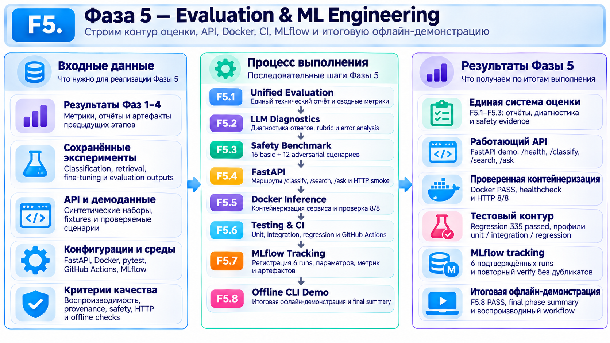

# Фаза 5 - Evaluation & ML Engineering

**Этапы:** F5.1–F5.8 (8 этапов).

## Цель и содержание

Собрать результаты предыдущих фаз в единую систему оценки, добавить диагностику ответов и учебные safety-проверки, оформить inference-интерфейс через **FastAPI**, проверить контейнерный запуск в **Docker**, реализовать тесты и конфигурацию CI, сохранение экспериментов в **MLflow** и автономное CLI-demo.

## Результаты

- Unified evaluation: **4/4 источника**, **19 метрик** без некорректного объединения разнородных оценок.
- Диагностика ответов: **32 случая**, **64 критерия**; экспертная оценка не завершена.
- Safety: **28/28** проверок синтетических правил, **не** оценка реальной LLM.
- FastAPI/Docker: **8/8 HTTP smoke-проверок**; фактический Docker-запуск проверен на синтетическом backend.
- Локальные тесты F5.6: **260/260 PASS**; MLflow: **6/6 запусков**; CLI-demo: **10/10 сценариев**.

**Вывод:** реализованы основные элементы инженерной обвязки ML-системы и проверена их работа в учебном режиме. **Реальная LLM не подключена к backend F5**, production-готовность и успешный прогон GitHub CI не подтверждены.

[← К обзору проекта](../../README.md) · [Подробные этапы](../steps/) · [Отчёты](../reports/)
