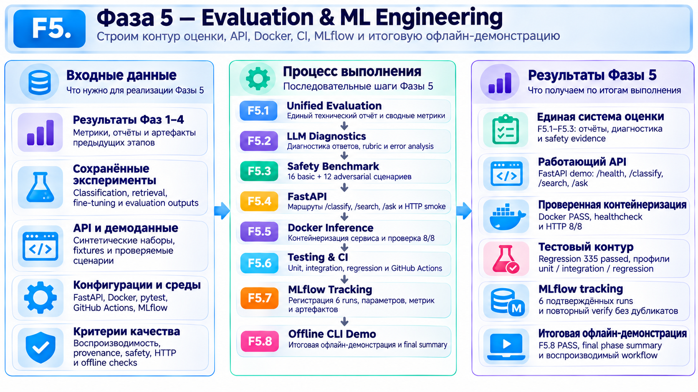

# Фаза 5 - Evaluation & ML Engineering

## Цель
Изучить и реализовать инженерный контур сопровождения ML-системы: объединить результаты предыдущих фаз в воспроизводимую оценку, диагностировать ответы LLM, проверить ограниченные safety-контракты и предоставить доступ к вычислительным компонентам через HTTP API.

Освоить практические механизмы ML Engineering и MLOps: контейнеризацию с Docker, автоматизированное тестирование и CI, регистрацию результатов экспериментов в MLflow, контроль происхождения данных и автономную CLI-демонстрацию. Научиться отделять корректность программной реализации от фактического качества моделей и сохранять проверяемые свидетельства выполненных экспериментов.

## Этапы:
1. [F5.1 - Unified Evaluation Report (единая оценка результатов)](../steps/F5_01_unified_evaluation.md)
2. [F5.2 - LLM Evaluation & Diagnostics (диагностика ответов LLM)](../steps/F5_02_llm_diagnostics.md)
3. [F5.3 - Safety Benchmark (проверка ограниченных safety-контрактов)](../steps/F5_03_safety_benchmark.md)
4. [F5.4 - FastAPI (HTTP-интерфейс ML-системы)](../steps/F5_04_fastapi.md
)
5. [F5.5 - Docker Inference (контейнеризация API)](../steps/F5_05_docker_inference.md)
6. [F5.6 - Testing & CI (автоматизированное тестирование)](../steps/F5_06_testing_ci.md)
7. [F5.7 - MLflow Experiment Tracking (учет экспериментов)](../steps/F5_07_mlflow_tracking.md
)
8. [F5.8 - Offline CLI Demo (автономная демонстрация)](../steps/F5_08_offline_cli_demo.md)

## Цель и содержание
Собрать результаты предыдущих фаз в единую систему оценки, добавить диагностику ответов и учебные safety-проверки, оформить inference-интерфейс через **FastAPI**, проверить контейнерный запуск в **Docker**, реализовать тесты и конфигурацию CI, сохранение экспериментов в **MLflow** и автономное CLI-demo.

## Используемые алгоритмы
|**Алгоритм / метод**	| **Для чего используется**|
|---------------------|--------------------------|
|Token Overlap	| Измерение текстового совпадения ответа с эталоном.|
|LLM-as-a-Judge / Expert Evaluation	| Оценка качества ответов с помощью другой модели или эксперта.|
|Safety Evaluation	| Проверка безопасности и корректности поведения модели.|
|Error Analysis	| Анализ причин неправильных предсказаний и ответов.|
|Regression Testing |	Проверка, что изменения не ухудшили уже работающую систему.|
|FastAPI	| Создание API для классификации, поиска и ответов.|
|Docker	| Упаковка приложения в воспроизводимое окружение.|
|MLflow	| Отслеживание экспериментов, параметров и метрик.|

## Результаты
- Unified evaluation: **4/4 источника**, **19 метрик** без некорректного объединения разнородных оценок.
- Диагностика ответов: **32 случая**, **64 критерия**; экспертная оценка не завершена.
- Safety: **28/28** проверок синтетических правил, **не** оценка реальной LLM.
- FastAPI/Docker: **8/8 HTTP smoke-проверок**; фактический Docker-запуск проверен на синтетическом backend.
- Локальные тесты F5.6: **260/260 PASS**; MLflow: **6/6 запусков**; CLI-demo: **10/10 сценариев**.

**Вывод:** реализованы основные элементы инженерной обвязки ML-системы и проверена их работа в учебном режиме. **Реальная LLM не подключена к backend F5**, production-готовность и успешный прогон GitHub CI не подтверждены.

[← К обзору проекта](../../README.md)
