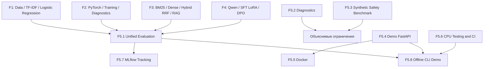

# ML Engineering Lab — техническая сводка F1–F5

**Статус документа:** финальный технический обзор, подготовленный на этапе F5.8; окончательная приёмка F5.8 требует отдельного подтверждения результатов Windows и GitHub Actions.

## 1. Что представляет собой проект

Последовательно реализован учебно-инженерный ML/LLM stack: подготовка данных и классический baseline; явный PyTorch training loop; Transformer/retrieval; экспериментальная адаптация языковой модели; затем evaluation, HTTP API, Docker, CI, MLflow и офлайн-демонстрация. Это портфолио реализации и воспроизводимости алгоритмов, **не production-ready LLM assistant**.

## 2. Основная архитектура



Ветвь F5.4/F5.5/F5.8 использует **отдельный synthetic demo**, а не веса и датасеты F1–F4. Эта граница важна для корректной интерпретации результата.

## 3. Фазы и проверяемые результаты

| Фаза | Реализованные механизмы | Смысл результата / граница доказательства |
|---|---|---|
| F1 | Источники, очистка, group-aware split, TF-IDF + Logistic Regression, baseline, анализ ошибок | Метрики классификации на определённой тестовой выборке, не качество свободных ответов |
| F2 | Autograd, Dataset/DataLoader, Embedding Classifier, оптимизация и checkpoint, диагностика | Train/validation и test требуют отдельного указания split; исторические результаты не переписываются |
| F3 | Self-Attention, pretrained embeddings, BM25, cosine, RRF, frozen retrieval benchmark, RAG provenance | Recall@K/MRR@K на frozen synthetic queries, не качество свободной генерации |
| F4 | Qwen2.5-0.5B, frozen evaluation set, base evaluation, SFT+LoRA, визуализация, сравнение, DPO | Один SFT-optimizer step и один DPO-step не доказывают улучшение прикладного качества |
| F5.1 | Unified Evaluation / Report | Подтверждён на Windows: 4/4 источника, 19 метрических полей; разные task metrics не агрегируются в score |
| F5.2 | LLM diagnostics, token overlap, рубрики, анализ Base/LoRA | 32 пары, 64 критерия, 12 изменившихся ответов; экспертная оценка оставлена незаполненной, не приписывать correctness |
| F5.3 | Synthetic Safety Benchmark | 16 основных + 12 adversarial сценариев: проверяется ограниченный rule-based контракт, не безопасность Qwen |
| F5.4 | FastAPI `/classify`, `/search`, `/ask`, OpenAPI | Демонстрационные CPU-модели на 24 synthetic examples и 12 documents; это не исходные F1–F4 модели |
| F5.5 | Docker Inference | Подтверждённый пользователем запуск Docker: `healthy`, HTTP 8/8, UID=999, synthetic backend |
| F5.6 | Unit/integration/regression + GitHub Actions | Локальная CPU-регрессия; CI на GitHub имеет отдельный статус, исторические сбои других workflows не маскируются |
| F5.7 | SQLite MLflow experiment tracking | На Windows создано и проверено 6/6 runs: F1, F2, BM25, Vector, Hybrid, F4; повторный `verify` не дублирует runs |
| F5.8 | Offline CLI Demo | В разработке проверены 10/10 сценариев и idempotent check; требуется пользовательская приёмка Windows / удалённого CI |

## 4. Важные ограничения

- **Отсутствие единой метрики:** Accuracy/Macro F1, Recall@K/MRR@K, loss, preference margin и token overlap относятся к разным экспериментальным протоколам.
- **Неизмеренная полезность LLM:** изменение отдельных ответов LoRA не равно доказательству повышения их правильности; отсутствие экспертной оценки не заменяется механической рубрикой.
- **Частичный Safety:** синтетические сценарии доказывают соответствие собственному правилу на ограниченной выборке, но не устойчивость LLM к атакам в реальном мире.
- **Demo отдельно от реальных моделей:** F5.8 offline и F5.4 API предназначены для инженерной проверки, а не для определения качества F1–F4 на новых данных.
- **Версии и происхождение данных:** локальные результаты требуют сохранённых исходных JSON, hashes, split, model revision и независимых технических проверок.
- **CI:** успешный локальный pytest не является доказательством прохождения всех GitHub workflows. Исторический Autograd CI может требовать отдельного исправления.

## 5. Воспроизведение основных проверок (PowerShell)

```powershell
cd F:\DEVELOPMENT\ML\ml-engineering-lab

# Сохранённые F1–F4 метрики (проверка без изменения)
.\.venv\Scripts\python.exe -m scripts.f5_unified_report --check

# Регистрация и чтение MLflow без нового обучения
.\.venv\Scripts\python.exe -m scripts.f5_mlflow verify

# Отдельное CPU offline демо
.\.venv\Scripts\python.exe -m scripts.f5_offline_demo run
.\.venv\Scripts\python.exe -m scripts.f5_offline_demo check

# Тесты F5.8
.\.venv\Scripts\python.exe -m pytest tests/test_f5_offline_demo.py -q -ra
```

Docker и HTTP требуют самостоятельного запуска соответствующих этапов. F5.8 не вызывает их автоматически и не создаёт MLflow runs.

## 6. Требования к портфолио

Для предъявления на собеседовании подготовить краткую архитектуру, отдельные таблицы метрик каждого protocol/split, доказательства локальных и удалённых тестов, SHA исходных артефактов, инструкции воспроизведения и явный список ограничений. Не публиковать приватные данные, кеши, веса, `.venv`, `mlruns`, SQLitedb, secrets и содержимое `data/`, если нет явного разрешения на публикацию.

Утверждение «проект готов как техническое учебное портфолио» допустимо после фактической проверки доступности clean clone, CI и однокомандного demo. Утверждение «готов production LLM сервис» не следует из результатов проекта.
