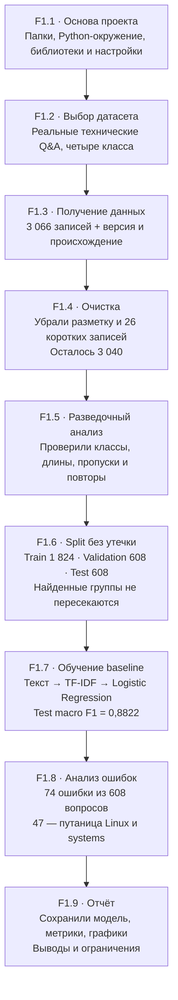

# F1 - Data Engineering & Classical ML: Итоговый отчёт (Краткие итоги фазы)

**F1 - полный путь от технических вопросов до обученного и проверенного classifier.** Модель определяет раздел вопроса: Linux, базы данных, администрирование или программирование.

## Визуализация по шагам

## Резюме
Из 3 066 отобранных технических Q&A получено 3 040 очищенных записей. Данные разделены на непересекающиеся по вычисленным группам выборки train=1824, validation=608, test=608.
Классическая модель **TF-IDF + Logistic Regression** показала на отложенном test **Macro F1=0.8838**, **Accuracy=0.8799** (535 правильных из 608).

## Происхождение и подготовка данных
- Источник: технические Q&A из Stack Exchange через зафиксированную ревизию Hugging Face; метаданные и контрольные суммы - в [`data/raw/manifest.json`](../../data/raw/manifest.json).
- Исходных источников: **4**, выбранных строк: **3066**.
- Очистка: исключены короткие **26**, точные дубликаты **0**, некорректные/пустые **0**; осталось **3040**.
- Распределение очищенного корпуса:

| Класс | Записей |
|---|---:|
| `databases` | 800 |
| `linux` | 793 |
| `programming` | 666 |
| `systems` | 781 |

## Разделение без прямой лексической утечки
| Train | Validation | Test | Групп | Близких связей | Пересечение групп |
|---:|---:|---:|---:|---:|---:|
| 1824 | 608 | 608 | 2983 | 536 | 0 |

Группировка выполнена по `context` и `answer`: символьные TF-IDF n-граммы 3–5, cosine ≥ 0.92, union-find; разделение — StratifiedGroupKFold, seed=42.
Нулевое пересечение вычисленных групп **не гарантирует** отсутствия всех семантических, авторских или временных утечек.
Исторический отчёт первоначального проекта указывает **535** близких связей; в повторном запуске — **536**. Причина различия не установлена; данные не подгонялись под прежний результат.

## Обучение и оценка модели
- Признаки: TF-IDF (словные n-граммы 1–2, `max_features=18000`, `sublinear_tf=True`).
- Классификатор: Logistic Regression (`C=2.0`, `max_iter=500`, `random_state=42`).
- TF-IDF и классификатор обучены только на train; validation/test используются для оценки.

| Выборка | Accuracy | Macro F1 | Weighted F1 |
|---|---:|---:|---:|
| Validation | 0.8684 | 0.8730 | — |
| Test | 0.8799 | 0.8838 | 0.8803 |

## Анализ ошибок
На test: верных прогнозов - **535**, ошибок - **73** из **608** примеров.
Самая частая направленная ошибка: **`systems → linux` - 24 случай(ев)**.
Это наблюдение, а не доказанная причина. Возможное тематическое перекрытие категорий требует отдельной ручной проверки локальных примеров.

## Воспроизводимость и ограничения
- Основа отчёта: локальные JSON-аудиты F1.4–F1.8 с согласованием размеров, SHA-256, confusion matrix и сохранённых метрик; генератор: [`scripts/build_f1_report.py`](../../scripts/build_f1_report.py).
- SHA-256 очищенной выборки: `8b48cf7923a88e5a66f7c0fe98bc6533128102f17601900ee1d6308e93b5e739`.
- SHA-256 test: `1fc9381bf85b0bf6de9807fea64c993807c896bb0634a6b435a4bc522805d6b8`.
- Лицензия карточки датасета - CC BY-NC-SA 4.0; атрибуция отдельных исходных публикаций не восстановлена. Исходные тексты, ID примеров и словарь модели в GitHub не публикуются.
- Метки отражают форум-источник, а не достоверность ответа. Это классификация категории вопроса, не оценка способности решать технические задачи.
- Оценка выполнена на одной версии данных и одном разбиении; исходный отчёт имеет немного отличающиеся метрики. Изменение не доказано статистически значимым.
- Confusion pairs и лексические группы не дают причинного объяснения ошибок.
- GitHub CI работает на синтетических данных. Полный эксперимент воспроизводился на Windows вне CI; тяжелые артефакты хранятся локально.

## Схема и навигация
- [Архитектура F1](../visuals/f1.md)
- [Происхождение данных](../DATA_PROVENANCE.md)

## Главный итог F1
Получили воспроизводимый путь: данные → подготовка → независимые части → обучение → оценка → анализ ошибок → отчёт.
