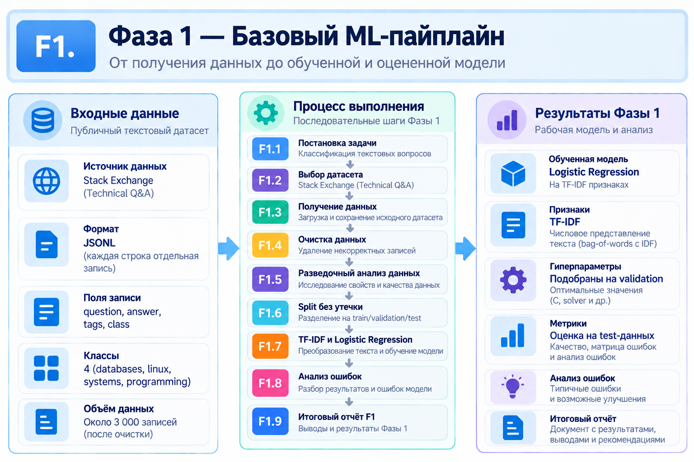

# F1 - Data Engineering & Classical ML: Базовый ML-пайплайн

## Цель фазы
Построить воспроизводимый ML-пайплайн для классификации технических вопросов: выбрать и подготовить реальные данные, разделить их без обнаруженных пересечений похожих записей, обучить простую базовую модель (baseline) и объективно оценить её качество.

Модель определяет тематику вопроса - databases, linux, programming или systems — по тексту публикации Stack Exchange. Она не генерирует ответы и не оценивает их техническую правильность.

## Визуализация по шагам

## Результаты
| Показатель | Результат |
|---|---|
| Исходный датасет | 3 066 записей |
| После очистки | 3 040 записей |
| Train | 1 824 записи |
| Validation | 608 записей |
| Test | 608 записей |
| Групп похожих записей | 2 983 |
| Пересечений групп между выборками | 0 |
| Правильных предсказаний | 535 из 608 |
| Ошибочных предсказаний | 73 |
| **Test Accuracy** | **87,99%** |
| **Test Macro F1** | **0,8838** |
| Самая частая ошибка | systems → linux (24 случая) |

**Итог:** получен измеримый baseline, с которым можно сравнивать нейросетевые модели следующих фаз. Метрики относятся к классификации исходного раздела публикации, а не к способности решать технические задачи.

## Использованные алгоритмы и методы
| Алгоритм / метод | Этап | Назначение |
|---|---|---|
| SHA-256 | F1.2–F1.3 | Контроль целостности исходных данных |
| Seed / Random Sampling | F1.3 | Воспроизводимый отбор записей |
| Text Normalization | F1.4 | Очистка HTML, Markdown и лишних символов |
| Exact Deduplication | F1.4 | Поиск и исключение точных дубликатов |
| Exploratory Data Analysis (EDA) | F1.5 | Анализ классов, длины текстов и распределений |
| Character-level TF-IDF | F1.6 | Векторизация текстов для поиска похожих записей |
| Cosine Similarity | F1.6 | Измерение сходства вопросов и ответов |
| Union-Find | F1.6 | Объединение похожих записей в группы |
| StratifiedGroupKFold | F1.6 | Разделение Train/Validation/Test с учётом групп |
| Word-level TF-IDF | F1.7 | Преобразование вопросов в числовые признаки |
| Logistic Regression | F1.7 | Обучение классификатора технических вопросов |
| Accuracy / Precision / Recall / F1 | F1.7 | Оценка качества классификации |
| Bootstrap | F1.7 | Оценка неопределённости метрик |
| Confusion Matrix | F1.8 | Анализ направлений ошибок классификатора |
| Cross-audit Validation | F1.9 | Проверка согласованности результатов всей фазы |

**Главный результат Фазы 1:** реализован полный путь от исходных данных до проверенного классификатора - с воспроизводимой подготовкой корпуса, защитой от обнаруженных дубликатов между выборками и количественной оценкой качества. Абсолютное отсутствие семантических утечек этот метод не гарантирует.

