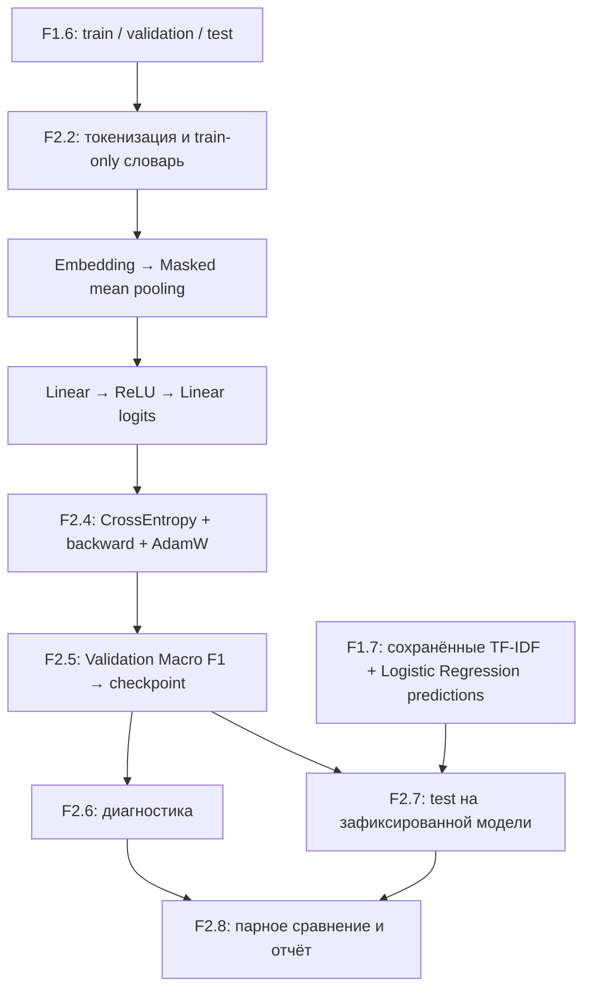

# F2 — PyTorch & Neural Networks: итоговый технический отчёт

> Сформировано F2.8 из локальных агрегатов F2.6 и F2.7; не результат CI-обучения.

## Задача и архитектура

F2 расширяет подготовленный в F1 корпус технических вопросов до небольшого PyTorch-классификатора.
Модель предсказывает **категорию вопроса**, а не достоверность технического ответа.

## Этапы и инженерные результаты

| Этап | Проверенный механизм |
|---|---|
| F2.1 | Tensor shapes, computation graph, autograd, градиенты и их накопление |
| F2.2 | Dataset/DataLoader, padding, truncation, маски, train-only vocabulary |
| F2.3 | EmbeddingClassifier с masked pooling и логитами |
| F2.4 | CrossEntropyLoss, обратный проход и AdamW |
| F2.5 | Оценка на validation, выбор по Macro F1, восстановление checkpoint |
| F2.6 | Графики train/val, история и диагностические проверки |
| F2.7 | Контроль SHA-256/ID и парное сравнение на одном test |
| F2.8 | Проверка согласованности агрегатов и настоящий итоговый отчёт |

## Данные и изоляция разбиений

Train: **1824**, validation: **608**, test: **608**; число классов: **4**.
SHA-256 локального test JSONL: `1fc9381bf85b0bf6de9807fea64c993807c896bb0634a6b435a4bc522805d6b8`.
Словарь и параметры обеих моделей определены без обращения к test.
F1 использует сохранённые test-предсказания; F2 — checkpoint, заранее выбранный по validation.
Test был прочитан для итоговой оценки, **не для настройки модели**.

## Сравнение моделей на фиксированном test

| Модель | Accuracy | Macro F1 | Ошибок из test |
|---|---:|---:|---:|
| TF-IDF + Logistic Regression | 0.8799 | 0.8838 | 73 |
| PyTorch EmbeddingClassifier | 0.7582 | 0.7591 | 147 |

Δ Accuracy (PyTorch − Classical) = **-0.1217**; Δ Macro F1 = **-0.1247**.
Лучшая эпоха checkpoint, участвовавшего в сравнении: **3**, его validation Macro F1: **0.7178**.
Количество параметров F2: **578548**.

## Парный анализ ошибок

| Ситуация | Количество |
|---|---:|
| Обе модели верны | 440 |
| Обе модели ошибаются | 52 |
| Только классическая ошибается | 21 |
| Только нейросеть ошибается | 95 |
| Различающиеся предсказанные классы | 128 |

## Диагностика F2.6 — самостоятельный запуск обучения

Эпох: **5**. Лучшая эпоха этого диагностического запуска: **5**, validation Macro F1: **0.7823**.
Эвристический сигнал: `no_clear_overfitting_signal`.
**Это отдельный запуск**, не обязательно совпадающий с checkpoint F2.5/F2.7. Нельзя переносить его лучшую эпоху или F1 в описание другой модели.

| Эпоха | Training loss | Validation loss | Val Accuracy | Val Macro F1 |
|---:|---:|---:|---:|---:|
| 1 | 1.301096 | 1.161532 | 0.5707 | 0.5686 |
| 2 | 0.925380 | 0.833964 | 0.6793 | 0.6795 |
| 3 | 0.584141 | 0.685091 | 0.7188 | 0.7178 |
| 4 | 0.380981 | 0.617295 | 0.7599 | 0.7645 |
| 5 | 0.254035 | 0.603380 | 0.7780 | 0.7823 |

## Выводы и ограничения

На этом эксперименте classical baseline точнее по Macro F1.
Это сравнение только на одном фиксированном test; устойчивость по другим seed/split не проверялась.
Обучающие данные не включаются в публичный репозиторий из-за нерешённых вопросов атрибуции.
CPU-наблюдения не подтверждают производительность на GPU и не заменяют latency benchmark.
Сопоставимые затраты времени не измерялись и в итоговую таблицу не включены.
Macro F1 описывает классификацию по форумным разделам, не фактическую корректность ответа.
Не допускается улучшать архитектуру после просмотра test и выдавать это за ту же независимую оценку.

## Файлы, с которыми стоит познакомиться

| Файл | Что изучить |
|---|---|
| `src/pytorch_f2/data_pipeline.py` | Источник разбиений, словарь и батчи |
| `src/pytorch_f2/embedding_classifier.py` | Embedding, pooling, logits |
| `src/pytorch_f2/training_loop.py` | Градиенты, loss и optimizer |
| `src/pytorch_f2/validation_checkpoint.py` | Selection/checkpoint без test |
| `src/pytorch_f2/training_diagnostics.py` | Проверка истории и графиков |
| `src/pytorch_f2/model_comparison.py` | Выравнивание двух моделей на test |
| `src/pytorch_f2/final_report.py` | Итоговые инварианты, связи метрик и безопасный экспорт |
| `tests/test_final_report.py` | Порча входных артефактов, воспроизводимость и контроль публикации |
