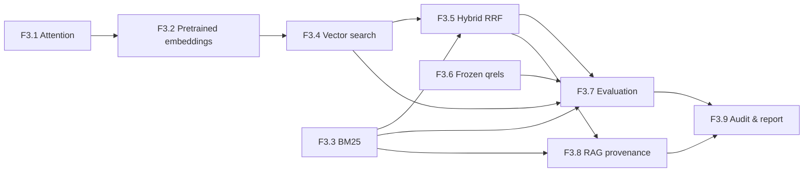

# ML Engineering Lab — F3.9: итоговый отчёт Фазы 3

## 1. Назначение и инженерный результат

Фаза 3 построила цепочку от Self-Attention и предобученных dense embeddings
до лексического, векторного и гибридного поиска, оценки на фиксированных
релевантностях и ограниченного RAG-конвейера с подтверждением источников.
Основное достижение — воспроизводимый эксперимент, а не доказанное
превосходство Transformer или готовая production RAG-система.

## 2. Связь этапов и архитектура

| Этап | Алгоритм/компонент | Проверяемый выход |
|---|---|---|
| F3.1 | Self-Attention и masks | Проверяемый механизм внимания на PyTorch |
| F3.2 | Pretrained embeddings и кеш | Pinned encoder с manifest и локальным CPU inference |
| F3.3 | BM25 | Лексический индекс и top-k выдача |
| F3.4 | Exact vector search | Dense embeddings, cosine и source_id |
| F3.5 | Hybrid RRF | Объединение рангов двух независимых методов |
| F3.6 | Frozen benchmark | 80 запросов, 88 документов и 160 qrels |
| F3.7 | Retrieval comparison | Аудируемое сопоставление Recall@K/MRR@K |
| F3.8 | RAG provenance | Дословные цитаты и extractive fallback |

## 3. Источники измерений и неизменность данных

- Источник измерений: `reports/public/f3_07/F3_07_comparison.json`,
  канонический SHA-256: `b1351e7448e52bed8e3476155c4e227d843815092c3a8061edee209633639557`.
- F3.6: `f3.6-synthetic-retrieval-v1`, manifest SHA-256 `a584868b8818552815151a85dfde714a762f14d959813e607bb4319cec70756c`.
- Объём: **88** документов, **80** запросов, **160** бинарных qrels.
- Замороженный протокол F3.7: SHA-256 `6682562919c46b608823689a34dfb5983ed671ad21e3ec844fbcacdb4e315fb7`.
- Encoder: `sentence-transformers/paraphrase-MiniLM-L3-v2` @ `4ca70771034acceecb2e72475f72050fcdde4ddc`.
- Лицензия из pinned спецификации: `apache-2.0`; размерность `384`.
- Признаки encoder: `masked_mean` pooling, L2 normalize `true`.
- Отпечаток manifest модели, сохранённый F3.7: `59cfd5c59c7e2e95cc670c80469809778691875b8f4fcd093914346af13ad7f5`.
- Сверены все запросы, `doc_id`/`source_id`, точные выдачи и метрики каждого запроса.
  Никакой запрос не исключён из макро-усреднения.

## 4. Определения и математика retrieval-оценки

Для запроса q и множества размеченных релевантных документов R(q):

\[\operatorname{Recall@K}(q)=\frac{|\operatorname{topK}(q)\cap R(q)|}{|R(q)|}\]

\[\operatorname{RR@K}(q)=\begin{cases}1/r_1,& r_1\leq K,\\0,&\text{иначе}\end{cases}\]

Здесь `r₁` — ранг первого релевантного документа. Macro Recall@K и
MRR@K — средние этих величин по всем 80 запросам. Например, если
есть 2 релевантных документа и в top-5 найден только один на позиции 3,
то Recall@5 = 1/2 = 0.5, а RR@5 = 1/3 ≈ 0.3333.

## 5. Фактические результаты F3.7

Результаты ниже заново рассчитаны по ранжированным спискам F3.7 на qrels F3.6.
Округление применяется только для отображения, не для аудита.

| Метод | K | Recall@K | MRR@K |
|---|---:|---:|---:|
| BM25 | 1 | 0.3250 | 0.6500 |
| BM25 | 5 | 0.6375 | 0.7223 |
| BM25 | 10 | 0.7312 | 0.7291 |
| VECTOR | 1 | 0.4000 | 0.8000 |
| VECTOR | 5 | 0.7875 | 0.8502 |
| VECTOR | 10 | 0.8938 | 0.8559 |
| HYBRID | 1 | 0.3812 | 0.7625 |
| HYBRID | 5 | 0.7688 | 0.8310 |
| HYBRID | 10 | 0.8750 | 0.8356 |

Hybrid минус BM25 по Recall@5: **+13.13 процентного пункта**.
Отрицательная дельта допустима: RRF объединяет порядки документов
и не гарантирует прирост по каждому методу или набору данных.

### 5.1. Различия между группами (K=5)

| Разрез | Группа | Метод | N | Recall@5 | MRR@5 |
|---|---|---|---:|---:|---:|
| Формулировка | lexical | bm25 | 40 | 0.8875 | 0.9875 |
| Формулировка | lexical | vector | 40 | 0.9125 | 0.9833 |
| Формулировка | lexical | hybrid | 40 | 0.9125 | 1.0000 |
| Формулировка | paraphrase | bm25 | 40 | 0.3875 | 0.4571 |
| Формулировка | paraphrase | vector | 40 | 0.6625 | 0.7171 |
| Формулировка | paraphrase | hybrid | 40 | 0.6250 | 0.6621 |
| Домен | databases | bm25 | 20 | 0.6250 | 0.6975 |
| Домен | databases | vector | 20 | 0.6500 | 0.7667 |
| Домен | databases | hybrid | 20 | 0.7750 | 0.8417 |
| Домен | linux | bm25 | 20 | 0.6000 | 0.6750 |
| Домен | linux | vector | 20 | 0.9500 | 0.9350 |
| Домен | linux | hybrid | 20 | 0.7750 | 0.8142 |
| Домен | programming | bm25 | 20 | 0.7250 | 0.7917 |
| Домен | programming | vector | 20 | 0.8250 | 0.9100 |
| Домен | programming | hybrid | 20 | 0.8000 | 0.8767 |
| Домен | systems | bm25 | 20 | 0.6000 | 0.7250 |
| Домен | systems | vector | 20 | 0.7250 | 0.7892 |
| Домен | systems | hybrid | 20 | 0.7250 | 0.7917 |

### 5.2. Разногласия по запросам при K=5

Считается изменение Recall@5 одного и того же запроса относительно BM25.
Равенство означает одинаковую долю обнаруженных релевантных документов,
а не одинаковые списки или оценки сходства.

| Метод vs BM25 | Лучше | Хуже | Без изменений |
|---|---:|---:|---:|
| vector | 28 | 8 | 44 |
| hybrid | 21 | 2 | 57 |

## 6. Проверка RAG/provenance F3.8

На отдельных синтетических текстах проверены: точная цитата с
`source_id` и SHA-256, отклонение неподтверждённой генерации и отказ
при отсутствии найденного свидетельства. Результат smoke:

- Дословная цитата и целостность источника: **PASS**.
- Неподтверждённая генерация → extractive fallback: **PASS**.
- Нет документов → no_evidence: **PASS**.

Это функциональная проверка на игрушечных данных, **не** измерение
точности, faithfulness или answer quality генеративной модели.

## 7. Ограничения и корректная интерпретация

1. Frozen benchmark F3.6 создан вручную и синтетичен: 80 запросов не
   представляют статистическую выборку всех реальных обращений пользователей.
2. Бинарные qrels содержат только отмеченные автором релевантные пары;
   потенциально полезные, но неразмеченные документы считаются нерелевантными
   в пределах этого протокола.
3. Изменение qrels, параметров, версии encoder либо корпуса требует нового
   зафиксированного эксперимента. Подбор параметров по test-qrels недопустим.
4. BM25 реализует лексическое совпадение, exact vector — косинусную
   близость dense embeddings, RRF — слияние рангов; ни одно значение
   score не является вероятностью истинности или релевантности.
5. SHA-256 фиксирует неизменность сравниваемого содержимого относительно
   сохранённых отпечатков; он не подтверждает происхождение первоисточника.
6. Версия encoder и manifest берутся из F3.7 и сверяются с pinned
   спецификацией F3.2; физические веса и локальный кеш на этом шаге
   независимо не перечитываются. Из аудита нельзя заключить, что
   encoder в самом деле исполнялся при создании JSON.
7. F3.8 пока не содержит обязательной LLM и измерения корректности
   полных генеративных ответов. Дословная цитата не обязательно релевантна
   вопросу, а простой контроль подстроки не заменяет factuality checks.
8. Нет доказательства производственной производительности, устойчивости
   к prompt injection, приватности и безопасности реального RAG-сервиса.
9. Исторические значения F1/F2 не приравниваются к retrieval-метрикам:
   классификация и поиск имеют разные цели, единицы оценки и разметку.
10. Статус Windows-регрессии и GitHub Actions нельзя получить из JSON F3.7;
    он подтверждается отдельно после выполнения соответствующих проверок.

## 8. Выводы

Фаза 3 даёт проверяемую реализацию Self-Attention, embeddings и трёх
способов retrieval, а также механизм для безопасного представления
дословных источников. Приведённые метрики относятся только к frozen
синтетической коллекции. Итоговый выбор поискового метода для реальных
технических запросов требует независимого тематического benchmark.

## 9. Файлы, с которыми стоит познакомиться

| Файл | Что изучить |
|---|---|
| `src/transformers_f3/attention.py` | Q/K/V, масштабирование, Softmax, padding masks |
| `src/transformers_f3/embeddings.py` | Encoder, masked mean pooling, нормализация выходных векторов |
| `src/transformers_f3/model_cache.py` | Pinned revision, локальная проверка весов и manifest |
| `src/transformers_f3/bm25.py` | TF/DF/IDF, BM25 и инвертированный индекс |
| `src/transformers_f3/vector_search.py` | Exact cosine search, top-k, doc_id/source_id |
| `src/transformers_f3/hybrid_search.py` | RRF, candidate pool, дедупликация |
| `src/transformers_f3/retrieval_benchmark.py` | Frozen qrels, Recall@K, MRR@K, SHA-256 |
| `src/transformers_f3/retrieval_comparison.py` | Формирование выдач отдельно от вычисления метрик |
| `src/transformers_f3/rag_provenance.py` | Evidence, validate quote, source provenance и fallback |
| `src/transformers_f3/phase_report.py` | Независимый повторный расчёт метрик и fail-closed аудит |
| `scripts/f3_phase_report.py` | Формирование отчёта из подтверждённого JSON F3.7 |
| `tests/test_f3_phase_report.py` | Согласованность метрик, защита от подмены, офлайн smoke |
