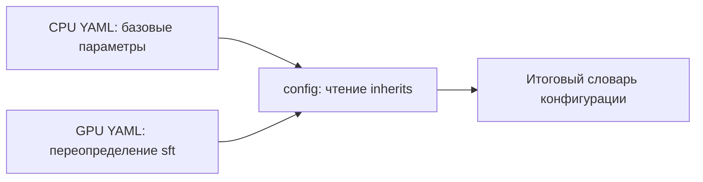

# F1.1 — Project Foundation: основа ML Engineering Lab

**Цель:** обеспечить управляемую конфигурацию, стабильные пути, единые форматы артефактов и воспроизводимые настройки экспериментов.

> Этот этап публикует инфраструктурный модуль. Он **не** воспроизводит обучение и метрики F1–F5. В исходной локальной документации F1.1 отмечен PASS; здесь отдельно проверяются функции foundation-модуля.

## Что реализовано

- [`src/common/io.py`](../../src/common/io.py) — чтение и запись JSON/JSONL, контрольные суммы, загрузка YAML-конфигураций, установка seed, запись событий.
- [`configs/local_cpu/lab.yaml`](../../configs/local_cpu/lab.yaml) — базовый профиль локальных экспериментов.
- [`configs/gpu/lab.yaml`](../../configs/gpu/lab.yaml) — профиль, наследующий CPU-настройки и переопределяющий `sft`.
- [`requirements.txt`](../../requirements.txt), [`requirements-lock.txt`](../../requirements-lock.txt), [`pyproject.toml`](../../pyproject.toml) — общие и зафиксированные зависимости, метаданные Python-проекта.
- [`requirements-foundation.txt`](../../requirements-foundation.txt) — только библиотеки, нужные для лёгких проверок F1.1 без обучения моделей.
- [`tests/test_foundation.py`](../../tests/test_foundation.py) — автономные тесты без датасетов, моделей и GPU.

## Устройство `src/common/io.py`

| Функция | Назначение | Важные детали |
|---|---|---|
| `ROOT` | Определить корень репозитория | `Path(__file__).resolve().parents[2]`, не зависит от текущей рабочей папки |
| `read_jsonl(path)` | Прочитать строки JSONL в список словарей | Пустые строки пропускаются, файл читается в память целиком |
| `save_json(path, value)` | Записать отчёт JSON | Создаёт родительские каталоги, UTF-8, запрещает `NaN` |
| `save_jsonl(path, rows)` | Записать строки JSONL | Создаёт каталоги; текущая версия не запрещает `NaN`, что требует отдельного ревью при F1.3 |
| `config(path)` | Прочитать YAML и унаследовать настройки | `inherits` и неглубокое объединение словарей верхнего уровня; файл должен быть доверенным |
| `seed_everything(seed)` | Задать Python / NumPy / PyTorch seed | Импортирует `torch` только при вызове; детерминизм не гарантируется между всеми платформами и версиями |
| `digest(path)` | Вычислить SHA-256 содержимого | Для проверки артефактов и исходных файлов |
| `log_event(...)` | Дописать событие в журнал | Время записывается в UTC; лог создаётся при первом событии |

## Как наследуются настройки



Из CPU-профиля наследуются `seed`, `data`, `classical`, `neural`, `retrieval`, `evaluation`, `api`; GPU-профиль меняет настройки блока `sft`, не меняя исходный YAML на диске. Наличие GPU этим тестом **не** подтверждается.

## Локальная проверка, Windows PowerShell

Из корня репозитория с установленным Python 3.12:

```powershell
py -3 -m pip install -r requirements-foundation.txt
py -3 -m pytest -q tests/test_foundation.py
py -3 scripts/check_repository.py
```

Установка зависимостей в `.venv` предпочтительнее глобальной установки. Для полного проекта предусмотрен отдельный `requirements.txt`; его не требуется устанавливать ради этих тестов.

## Принципы воспроизводимости и ограничения

1. Фиксируются `seed`, конфигурации, версии зависимостей, контрольные суммы исходных файлов.
2. Seed влияет на псевдослучайные генераторы, но не гарантирует байтовую идентичность обучения на разных версиях CUDA/PyTorch.
3. `requirements-lock.txt` отражает историческое Windows-окружение и содержит Windows-специфические пакеты; не использовать как универсальный Linux lock.
4. Тесты F1.1 **не запускают** `seed_everything`, чтобы не устанавливать PyTorch в лёгком CI. Это будет проверяться при публикации F2.
5. YAML-профили не являются схемой с полной валидацией значений; структурную валидацию можно добавить позже без смешивания с начальной публикацией.
6. Исходные данные и обученные модели пока не включены; никакие метрики F1–F5 здесь не пересчитываются.

## Контрольные вопросы

1. Почему вычисление `ROOT` от `__file__` надёжнее использования `Path.cwd()`?
2. Как работает наследование YAML и чем неглубокое объединение отличается от глубокого?
3. Почему одного seed недостаточно для гарантированной побитовой воспроизводимости обучения?
4. Для чего хранить одновременно `requirements.txt` и зафиксированный список установленных пакетов?
5. Почему CI для начального этапа должен проверять только независимые от моделей компоненты?

**Статус публикации F1.1:** целевые тесты выполняются локально; результат GitHub Actions подтверждается отдельно после `push`.
