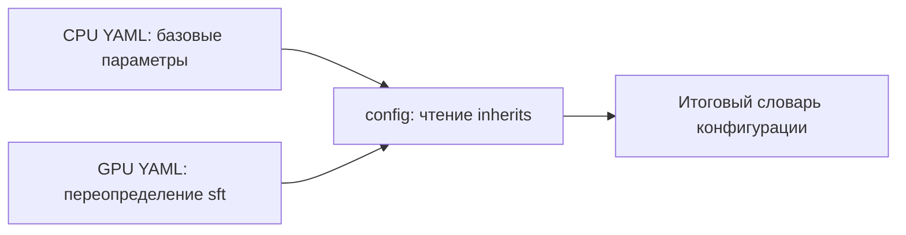
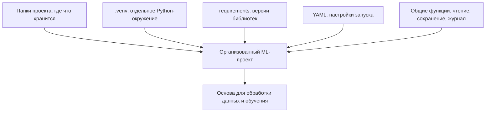

# F1.1 - Project Foundation: Основа ML-проекта

F1.1 - это подготовка рабочего места для ML-проекта. Создана основа: где хранить данные и код, каким Python пользоваться, как задавать настройки и записывать результаты запусков.

**Цель:** обеспечить управляемую конфигурацию, стабильные пути, единые форматы артефактов и воспроизводимые настройки экспериментов.

У каждой папки своя задача:

| Папка     | Что в ней хранится                                  |
| --------- | --------------------------------------------------- |
| `data`    | Данные, на которых учатся модели                    |
| `src`     | Python-код: обработка данных, обучение, поиск и API |
| `configs` | Настройки запусков                                  |
| `models`  | Сохранённые обученные модели                        |
| `tests`   | Проверки правильности работы кода                   |
| `reports` | Результаты экспериментов                            |
| `docs`    | Объяснения, схемы и учебные материалы               |

## Что реализовано

- [`src/common/io.py`](../../src/common/io.py) - чтение и запись JSON/JSONL, контрольные суммы, загрузка YAML-конфигураций, установка seed, запись событий.
- [`configs/local_cpu/lab.yaml`](../../configs/local_cpu/lab.yaml) - базовый профиль локальных экспериментов.
- [`configs/gpu/lab.yaml`](../../configs/gpu/lab.yaml) - профиль, наследующий CPU-настройки и переопределяющий `sft`.
- [`requirements.txt`](../../requirements.txt), [`requirements-lock.txt`](../../requirements-lock.txt), [`pyproject.toml`](../../pyproject.toml) - общие и зафиксированные зависимости, метаданные Python-проекта.
- [`requirements-foundation.txt`](../../requirements-foundation.txt) - только библиотеки, нужные для лёгких проверок F1.1 без обучения моделей.
- [`tests/test_foundation.py`](../../tests/test_foundation.py) - автономные тесты без датасетов, моделей и GPU.

## Как наследуются настройки



Из CPU-профиля наследуются `seed`, `data`, `classical`, `neural`, `retrieval`, `evaluation`, `api`; GPU-профиль меняет настройки блока `sft`, не меняя исходный YAML на диске. Наличие GPU этим тестом **не** подтверждается.


## Как связаны элементы F1.1




## Локальная проверка, Windows PowerShell

Из корня репозитория с установленным Python 3.12:

```powershell
py -3 -m pip install -r requirements-foundation.txt
py -3 -m pytest -q tests/test_foundation.py
py -3 scripts/check_repository.py
```

Установка зависимостей в `.venv` предпочтительнее глобальной установки. Для полного проекта предусмотрен отдельный `requirements.txt`; его не требуется устанавливать ради этих тестов.

## Принципы воспроизводимости и ограничения

1. Фиксируются `seed`, конфигурации, версии зависимостей, контрольные суммы исходных файлов.
2. Seed влияет на псевдослучайные генераторы, но не гарантирует байтовую идентичность обучения на разных версиях CUDA/PyTorch.
3. `requirements-lock.txt` отражает историческое Windows-окружение и содержит Windows-специфические пакеты; не использовать как универсальный Linux lock.
4. Тесты F1.1 **не запускают** `seed_everything`, чтобы не устанавливать PyTorch в лёгком CI. Это будет проверяться при публикации F2.
5. YAML-профили не являются схемой с полной валидацией значений; структурную валидацию можно добавить позже без смешивания с начальной публикацией.
6. Исходные данные и обученные модели пока не включены; никакие метрики F1–F5 здесь не пересчитываются.

> [!summary] Основная мысль
> ML-проект должен позволять понять, каким кодом, с какими библиотеками и настройками получен результат. Поэтому подготовка окружения и структуры — часть работы ML Engineer.
