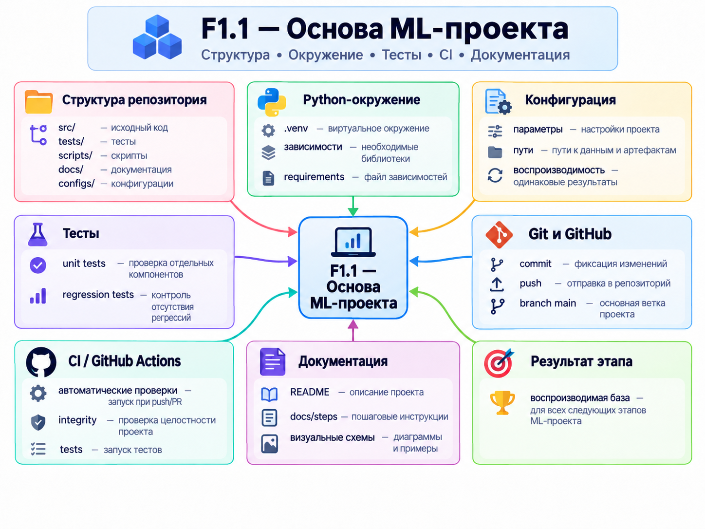
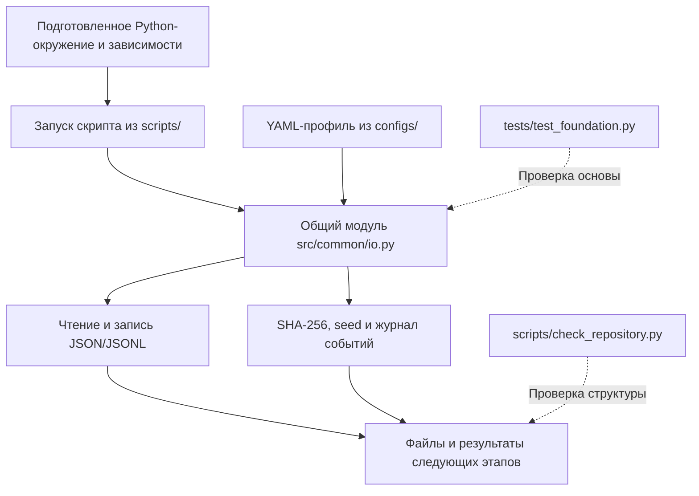

# F1.1 - Project Foundation: подготовка основы ML-проекта

<p align="center">

</p>

## 1. Цель этапа:

Проект должен загружать технические вопросы, очистить их, разделить на выборки, обучить классификатор и проверить его качество. При выполнении всех этих задач в одном большом Python-файле, возникнут проблемы: пути к данным будут разбросаны по коду, настройки придётся менять вручную, а результаты будет сложно повторить.

Поэтому начать необходимо с **организации самой разработки**. Необходимо определить, где лежат разные части проекта, как программы читают и сохраняют файлы, откуда берут настройки и как проверить что базовые механизмы работают правильно.

**Задача F1.1:** создать управляемую и проверяемую основу ML-проекта, чтобы дальнейшие эксперименты можно было проводить последовательно, а их входы, параметры и результаты - прослеживать.
## 2. Реализация: файлы этапа

Подготовлены следующие основные компоненты. Каждый решает конкретную задачу, необходимую для последующей обработки данных и обучения.

| Файл                                                               | Что в нём находится и для чего он нужен                                                                                                                                                                                                               |
| ------------------------------------------------------------------ | ----------------------------------------------------------------------------------------------------------------------------------------------------------------------------------------------------------------------------------------------------- |
| [`src/common/io.py`](../../src/common/io.py)                       | **Основной служебный модуль F1.1.** Содержит общие операции чтения и записи JSON/JSONL, загрузки YAML, расчёта контрольных сумм, задания seed и записи событий. Благодаря ему остальным этапам не нужно заново писать одинаковый вспомогательный код. |
| [`configs/local_cpu/lab.yaml`](../../configs/local_cpu/lab.yaml)   | Базовые настройки запуска в локальном CPU-окружении. Позволяет хранить параметры отдельно от Python-алгоритмов.                                                                                                                                       |
| [`configs/gpu/lab.yaml`](../../configs/gpu/lab.yaml)               | Отдельный профиль для GPU-сценария. Он наследует общие CPU-настройки и переопределяет параметры раздела `sft`.                                                                                                                                        |
| [`requirements.txt`](../../requirements.txt)                       | Общий перечень библиотек проекта.                                                                                                                                                                                                                     |
| [`requirements-lock.txt`](../../requirements-lock.txt)             | Зафиксированный набор версий из исторического Windows-окружения. Помогает восстановить контекст эксперимента, но не является универсальным lock-файлом для всех ОС.                                                                                   |
| [`requirements-foundation.txt`](../../requirements-foundation.txt) | Минимальные зависимости для лёгких проверок основы проекта без запуска моделей и обучения.                                                                                                                                                            |
| [`pyproject.toml`](../../pyproject.toml)                           | Метаданные Python-проекта и параметры его инструментов.                                                                                                                                                                                               |
| [`tests/test_foundation.py`](../../tests/test_foundation.py)       | Тесты работы базовых компонентов: их можно запускать отдельно от реального датасета, обученных моделей и GPU.                                                                                                                                         |


Отдельно в репозитории существует [`scripts/check_repository.py`](../../scripts/check_repository.py) - скрипт проверки структуры и метаданных репозитория. Он используется при локальной проверке F1.1, но не является алгоритмом обучения модели.

**Назначение основных каталогов**:

| Каталог    | Какую задачу решает                                            |
| ---------- | -------------------------------------------------------------- |
| `src/`     | Рабочая Python-логика, которую используют скрипты и тесты.     |
| `scripts/` | Точки входа: программы, которые запускают конкретные операции. |
| `configs/` | Параметры различных сценариев выполнения.                      |
| `tests/`   | Автоматические проверки поведения кода.                        |
| `data/`    | Локальные исходные и обработанные данные последующих этапов.   |
| `models/`  | Локальные артефакты обученных моделей, когда они появятся.     |
| `reports/` | Метрики, сводки и другие результаты экспериментов.             |
| `docs/`    | Объяснения решений, схемы и документация этапов.               |
## 3. Последовательность действий

### Шаг 1. Разделение проекта по назначению файлов
Определены, какие части будущей ML-системы необходимо хранить отдельно. Обработка данных и алгоритмы размещены в `src/`, способы запуска - в `scripts/`, настройки - в `configs/`, проверки - в `tests/`.

Это разделение решает практическую проблему. Например, когда позднее понадобится изменить правила очистки текста, надо будем работать с соответствующим модулем в `src/`, а не искать нужные строки внутри большого сценария, где одновременно загружаются данные и обучается модель.

Для результатов и входных данных предусмотрены отдельные каталоги. Это важно ещё и с точки зрения публикации: исходный код и документацию можно размещать на GitHub, а большие модели, кеши и исходные Q&A-записи с ограничениями распространения - оставлять локально.

**Зачем этот шаг:** разделить обязанности компонентов и подготовить структуру, которая выдержит последующее расширение проекта.

### Шаг 2. Фиксация окружения и зависимостей
Зафиксированы сведения о Python-проекте и его библиотеках в `requirements.txt`, `requirements-lock.txt`, `requirements-foundation.txt` и `pyproject.toml`.

Общий список зависимостей описывает, какие библиотеки нужны проекту в целом. Зафиксированный список версий помогает понять, с каким окружением проводились эксперименты. А отдельный лёгкий набор зависимостей позволяет проверять F1.1 без установки полного стека обучения нейросетей.

Локальное виртуальное окружение `.venv` изолирует библиотеки этого проекта от других программ на компьютере. Сам каталог `.venv` не следует воспринимать как результат ML-эксперимента или публиковать вместе с исходниками.

**Зачем этот шаг:** чтобы различия в окружении не превращались в непонятные ошибки и можно было восстановить условия запуска.

### Шаг 3. Вынос параметров запуска из Python-кода в YAML
После структуры и зависимостей подготовлены два конфигурационных профиля - `configs/local_cpu/lab.yaml` и `configs/gpu/lab.yaml`.

Идея простая: настройки должны храниться отдельно от алгоритма. Когда нужно будет сменить сценарий запуска или отдельный параметр эксперимента, лучше выбрать или изменить конфигурацию, чем исправлять сам код обработки данных.

CPU-профиль служит базовым. GPU-профиль использует его настройки и переопределяет параметры `sft`. Эта возможность пригодится в более поздних фазах, когда появятся задачи дообучения языковых моделей. В F1.1 подготовлен конфигурационный механизм - GPU-обучения здесь не было.

**Зачем этот шаг:** сделать параметры эксперимента явными и отделить выбор условий запуска от программной логики.

### Шаг 4. Создан общий модуль для чтения, записи и контроля файлов
Подготовлен [`src/common/io.py`](../../src/common/io.py). Он объединяет операции, которые будут многократно использоваться в следующих этапах.

**Работа с JSON и JSONL.** Эти форматы нужны для сохранения структурированных записей. В JSON обычно хранится один объект или массив, а в JSONL каждая строка представляет отдельную JSON-запись. Последний формат удобен для корпусов вопросов, потому что записи можно обрабатывать последовательно.

**Загрузка YAML.** Программы могут прочитать выбранный конфигурационный профиль и получить параметры запуска без жёстко заданных значений внутри алгоритма.

**Контрольные суммы.** Для файла можно вычислить SHA-256 - цифровой отпечаток его содержимого. Например, когда позже будет загружен исходный датасет, контрольная сумма поможет проверить, что при повторном эксперименте используется тот же файл.

**Запись событий.** Журнал помогает понять, что выполняла программа и какие действия произошли при запуске. Это полезно при отладке и последующем разборе эксперимента.

**Зачем этот шаг:** обеспечить общий способ работы с файлами и сделать повторные запуски удобнее для проверки.

### Шаг 5. Управление случайностью через seed
Во многих ML-алгоритмах есть случайные действия: например, выбор начальных весов модели или порядок обработки примеров. Если каждый раз использовать новые случайные значения, результаты экспериментов могут различаться.

Поэтому в общих функциях предусмотрена установка **seed** - начального значения для генераторов псевдослучайных чисел.

Но здесь есть важное ограничение: одинаковый seed **не гарантирует абсолютно одинаковые результаты на любых компьютерах**. На них также могут влиять версии библиотек, конкретные операции и устройство выполнения, например CPU или GPU.

Кроме того, тесты F1.1 намеренно не запускают `seed_everything`: для лёгкой проверки основы проекта не требуется загружать PyTorch. Соответствующий функционал проверяется позднее, при работе с Фазой 2.

**Зачем этот шаг:** подготовить управление случайностью и научиться честно разделять контролируемую воспроизводимость и её ограничения.

### Шаг 6. Автономные проверки основы проекта
Последним действием для F1.1 подготовлен [`tests/test_foundation.py`](../../tests/test_foundation.py). Тесты проверяют базовую инфраструктуру отдельно от будущего датасета и обученной модели.

Если неправильно работает чтение конфигурации или сохранение данных, ошибка проявится и в обучении. Значительно удобнее обнаружить её сразу, на небольшом тесте, чем разбираться с ней после длительного эксперимента.

Дополнительно использован `scripts/check_repository.py`, чтобы проверить структуру и метаданные репозитория. Это отдельная проверка, она не заменяет тестов поведения Python-функций.

**Зачем этот шаг:** подтвердить, что фундамент проекта работает до того, как начнётся построение на нём ML-конвейера.

## 4. Как элементы F1.1 работают вместе

В F1.1 нет алгоритма классификации. Поэтому здесь важнее показать путь выполнения обычной программы, который будет повторяться на следующих этапах.
1. Запуск скрипта из `scripts/` в подготовленном Python-окружении.
2. Скрипт обращается к общим функциям из `src/common/io.py`.
3. При необходимости программа загружает параметры из `configs/`.
4. Программа читает входной файл, выполняет свою операцию и сохраняет результат в нужный каталог.
5. При повторном запуске можно проверить исходный файл по контрольной сумме и изучить события в журнале.
6. Независимые тесты в `tests/` проверяют, что базовые операции работают так, как задумано.

Это общая схема использования подготовленной инфраструктуры.

## 5. Схема: фундамент для следующих этапов


Главное на схеме: **F1.1 предоставляет общие инструменты**. Конкретные алгоритмы очистки, разделения данных и обучения добавляются позднее и используют эту основу.

## 6. Локальная проверка в PowerShell: что запускать и как понимать результат

Команды ниже предназначены для уже подготовленного локального проекта. Они не устанавливают библиотеки, не изменяют конфигурации и не публикуют ничего на GitHub.

### 6.1. Перейти в корень проекта
```powershell
cd F:\DEVELOPMENT\ML\ml-engineering-lab
```
### 6.2. Проверить используемый Python
```powershell
.\.venv\Scripts\python.exe --version
```

**Что проверяется:** что команда обращается именно к Python локального окружения `.venv`. Конкретная версия зависит от текущего окружения проекта; не нужно считать исторический пример из документации универсальной нормой.

### 6.3. Запустить тесты F1.1
```powershell
.\.venv\Scripts\python.exe -m pytest -q tests/test_foundation.py
```

**Что проверяется:** поведение базовых служебных компонентов без обращения к рабочему датасету, обученным моделям и GPU.

**Исторически подтверждённый результат F1.1:** `7 passed`. Если файл тестов позднее изменился, фактическое число может отличаться. Ориентируемся на отсутствие `failed` и `errors`.

### 6.4. Проверить структуру репозитория
```powershell
.\.venv\Scripts\python.exe scripts/check_repository.py
```

**Что проверяется:** требования к структуре и метаданным публичного проекта.

Для этого скрипта в ранее подтверждённых запусках получено сообщение:
```text
Repository metadata check: PASS (no model training or runtime tests)
```

Оно специально уточняет границы проверки: **не запускается обучение, не пересчитываются ML-метрики и не выполняются все runtime-тесты**.

### 6.5. Проверить, что дальнейшие этапы не сломали основу
```powershell
.\.venv\Scripts\python.exe -m pytest -q
```

**Что проверяется:** регрессия всех тестов, имеющихся в текущем состоянии репозитория. Это уже не отдельная проверка F1.1. Количество тестов увеличивается по мере развития проекта, поэтому заранее фиксировать одно итоговое число для всех фаз неправильно.

Если какой-либо тест завершится с ошибкой, нужно изучить конкретное сообщение `pytest` и причину, а не считать этап успешно проверенным только по одному запуску скрипта.

## 7. Что подтверждено и какие ограничения

**Что сделано:** создана базовая структура проекта, выделены общие операции работы с данными и настройками, предусмотрены CPU/GPU-профили и автоматические проверки. Отдельные тесты F1.1 были пройдены в ходе первоначальной публикации этапа.

Отдельно стоит помнить о **трёх ограничениях**:
- Фиксация seed помогает повторять эксперименты, но сама по себе не обеспечивает побитовую одинаковость результатов на разных устройствах и версиях библиотек.
- `requirements-lock.txt` сформирован для исторического Windows-окружения и не должен восприниматься как универсальный lock для Linux.
- Существующие YAML-профили не являются полноценной системой строгой проверки всех возможных значений конфигурации.

## 8. Основная мысль раздела

**В F1.1  Подготавливается надёжная инженерная основа: разделение проекта на понятные компоненты, вынос настроек в YAML, создан общий модуль для работы с файлами и контрольными суммами, предусмотрен seed и журнал событий, а затем проверена инфраструктура автоматическими тестами. Благодаря этому следующие этапы могут заниматься собственно данными и ML-алгоритмами, не создавая одни и те же вспомогательные механизмы заново.**

## 9. Файлы этапа

Чтобы изучить код в логическом порядке, необходимо последовательно открыть следующие файлы:

| Порядок | Файл                                                                                                              | На что обратить внимание                                                                                        |
| ------- | ----------------------------------------------------------------------------------------------------------------- | --------------------------------------------------------------------------------------------------------------- |
| 1       | [`tests/test_foundation.py`](../../tests/test_foundation.py)                                                      | Какие требования предъявляются к базовым операциям проекта и как эти требования проверяются без рабочих данных. |
| 2       | [`src/common/io.py`](../../src/common/io.py)                                                                      | Как оформлены общие функции чтения и записи JSON/JSONL, загрузки YAML, SHA-256, seed и записи событий.          |
| 3       | [`configs/local_cpu/lab.yaml`](../../configs/local_cpu/lab.yaml)                                                  | Какие параметры вынесены из Python-кода в базовую конфигурацию.                                                 |
| 4       | [`configs/gpu/lab.yaml`](../../configs/gpu/lab.yaml)                                                              | Как используются общие настройки и какие параметры `sft` переопределяются для другого профиля.                  |
| 5       | [`requirements-foundation.txt`](../../requirements-foundation.txt) и [`requirements.txt`](../../requirements.txt) | Чем зависимости минимальной проверки отличаются от общего набора библиотек.                                     |
| 6       | [`requirements-lock.txt`](../../requirements-lock.txt) и [`pyproject.toml`](../../pyproject.toml)                 | Как фиксируются исторические версии зависимостей и метаданные проекта.                                          |
| 7       | [`scripts/check_repository.py`](../../scripts/check_repository.py)                                                | Какие условия структуры и метаданных проекта проверяются независимо от unit-тестов.                             |

**Итог F1.1:** Подготовлены и проверены инструменты, на которых будут строиться загрузка датасета (F1.3), очистка (F1.4), разделение (F1.6) и обучение baseline (F1.7). Это первый шаг от отдельного скрипта к организованной ML-системе.
