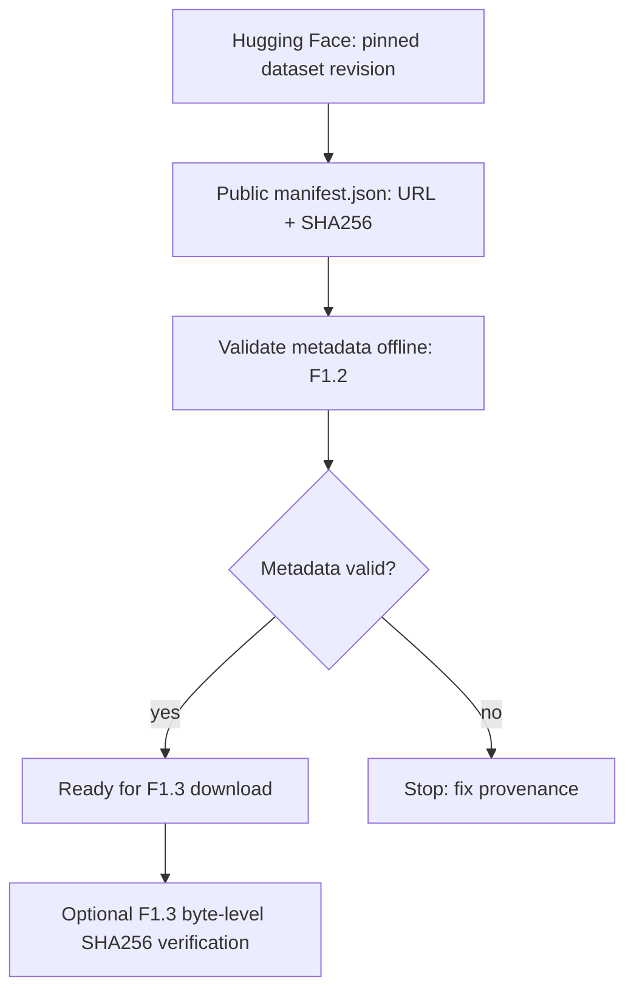
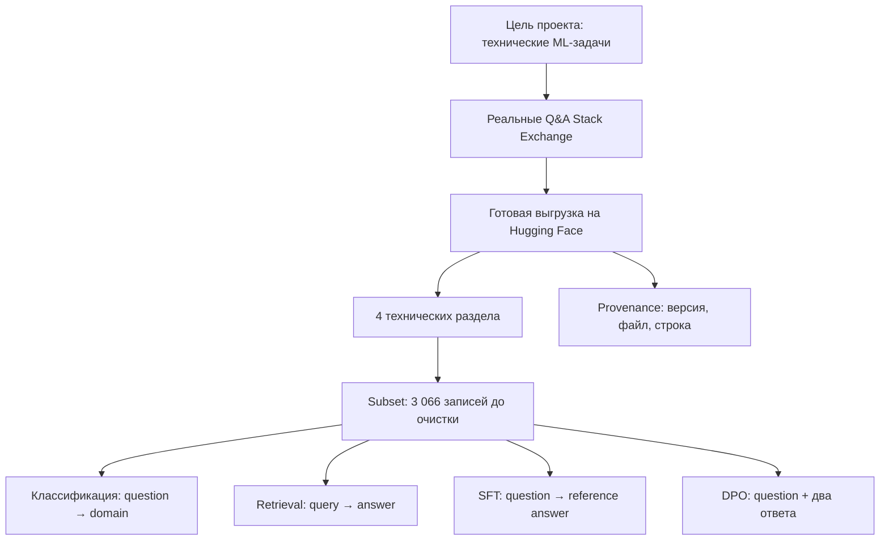

# F1.2 - Dataset Selection & Provenance: Выбор датасета

F1.2 - это выбор материала, на котором модель учится. Необходимо понять, что означают примеры и метки, для каких задач подходят данные и какие у них ограничения.

**Цель:** обосновать выбор источника для нескольких ML-задач и проверять его идентичность без скачивания сторонних текстов в публичный репозиторий.

F1.2 отвечает на вопросы «откуда данные?» и «какой версии можно доверять?». В исходном локальном проекте загрузчик есть в `scripts/download_data.py`.

## Выбранный источник
В проекте один пример содержит технический вопрос и ответы на него. Например, человек описывает проблему с Linux, а другие пользователи предлагают решение.
Необходимы такие данные, чтобы изучить несколько задач:
- определение темы вопроса;
- поиск подходящего ответа;
- обучение модели отвечать;
- обучение на предпочтениях между двумя ответами.

Dataset:
- Dataset: [Stack Exchange title/body and voted answers](https://huggingface.co/datasets/flax-sentence-embeddings/stackexchange_titlebody_best_and_down_voted_answer_jsonl).
- Зафиксированная ревизия: `32151f5480872e6db89ae147e1d727266f574606`.
- Правило: `seed=42`, максимум 800 валидных строк на сайт. `available_rows` - количество строк, допущенных исходным загрузчиком после проверки обязательных текстовых полей, а не общий размер всех источников Stack Exchange.

| Сайт / filename | Label (домен) | Доступно после фильтра | Выбрано |
|---|---|---:|---:|
| `unix.stackexchange.com.jsonl.gz` | `linux` | 6 173 | 800 |
| `dba.stackexchange.com.jsonl.gz` | `databases` | 2 502 | 800 |
| `serverfault.com.jsonl.gz` | `systems` | 7 969 | 800 |
| `codereview.stackexchange.com.jsonl.gz` | `programming` | 666 | 666 |
| **Итого** | **4 метки** | — | **3 066** |

## Почему датасет подходит для нескольких задач
- **Classification:** `title_body` - вход, `site -> domain` - метка. Это *раздел сообщества*, а не диагностический класс истинной причины проблемы; классы пересекаются по смыслу.
- **Retrieval / RAG:** вопрос - запрос, `upvoted_answer` - кандидат в документ/ответ. Рейтинг не гарантирует полноту и истинность.
- **SFT / preference experiments:** вопрос + `upvoted_answer` / `downvoted_answer` - слабые, шумные сигналы предпочтения. Нельзя без экспертов считать их «верно» / «неверно».

Поля исходного JSON: `title_body`, `upvoted_answer`, `downvoted_answer`; в загрузчике F1.3 они преобразуются в `context`, `answer`, `rejected`. В source export отсутствуют прямые URL и авторы оригинальных Q&A; `source_url` указывает на gzip-архив, а не на пост Stack Exchange.

## Как устроена проверка F1.2
- [`data/raw/manifest.json`](../../data/raw/manifest.json) - immutable reference для источника (не сами данные): ID, revision, seed, URL четырёх файлов, ожидаемые SHA-256, счётчики, замечание о лицензии.
- [`src/data/provenance.py`](../../src/data/provenance.py) - автономная проверка схемы и согласованности metadata. Не делает сетевых запросов и не скачивает Q&A.
- [`tests/test_provenance.py`](../../tests/test_provenance.py) - unit-тесты реального manifest и **синтетических** файлов. Проверяются pin URL, контрольные суммы, допустимые пути, счётчики, повреждённые байты.
- [GitHub Actions](../../.github/workflows/foundation-tests.yml) - включает эти тесты в существующий тестовый workflow, не создавая третий параллельный workflow.



## Как связаны элементы F1.2


## Что получилось в F1.2
Выбран реальный технический датасет, определены четыре класса, сформирована выборка из **3 066 записей** с объяснением, для каких задач она подходит.
Также подготовлен встроенный sample из **240 записей** и сохранены сведения о происхождении данных.

## Запуск на Windows (PowerShell)

Из корня репозитория, используя `.venv` после F1.1:
```powershell
.\.venv\Scripts\python.exe -m src.data.provenance
.\.venv\Scripts\python.exe -m pytest -q tests/test_provenance.py
.\.venv\Scripts\python.exe scripts/check_repository.py
```

**Важно:** `Dataset provenance: PASS` означает, что **метаданные согласованы**. Без исходных gzip-файлов строки `Raw files SHA-256: NOT CHECKED` - ожидаемый результат. После F1.3 появится вариант: `python -m src.data.provenance --verify-files`, который сравнивает реальные байты с закреплённым SHA-256.

## Известные ограничения
1. SHA-256 в манифесте не является доказательством целостности без физического файла и пересчёта его хеша.
2. Файл содержит Windows-пути вида `data\raw\...`: проверяющий код нормализует разделители для Linux CI, но не переписывает исторический manifest.
3. Seed обеспечивает повторяемость процедуры при неизменных файлах/алгоритме/версии Python; он не гарантирует неизменность исходного датасета без revision и hash.
4. Проверка provenance не измеряет точность классификатора или качество генерации.
5. Количество выбранных записей - документация первоначального локального эксперимента. В этом шаге обучение и загрузка не запускаются.

## Основная мысль F1.2
Прежде чем обучать модель, ML Engineer должен понять, что означают данные и метки, чему на них можно научиться и какие выводы они позволяют сделать.
- Датасет выбирают под задачу, а не только по размеру.
- Нужно понимать смысл каждого поля и метки.
- Один набор Q&A может подходить для нескольких ML-задач.
- Пользовательский рейтинг ответа не заменяет проверку корректности.
- Раздел источника и причина технической проблемы — разные понятия.
- Версия и происхождение данных нужны для воспроизводимости.
- Ограничения датасета влияют на интерпретацию результатов модели.

