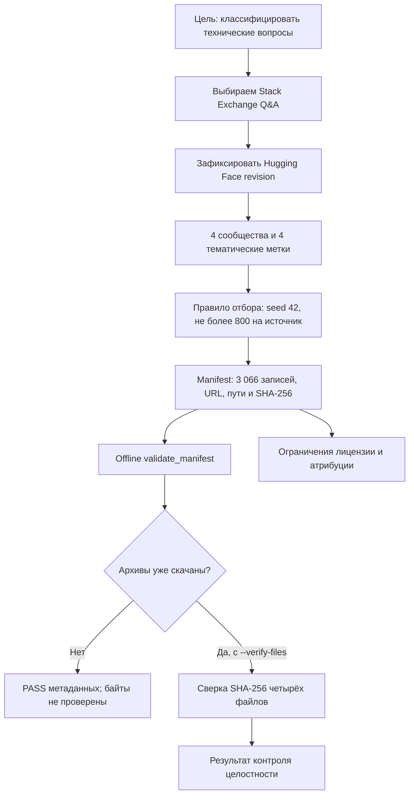

# F1.2 - Dataset Selection & Provenance: выбор и фиксация датасета

## 1. Цель этапа:

После F1.1 появилась основа ML-проекта: структура каталогов, конфигурации, общие операции чтения и записи файлов, механизм проверки контрольных сумм и автономные тесты. Но пока непонятно: **на каких данных будет учиться модель и какой правильный ответ ожидается от неё получить**.

Решино построить систему, способную классифицировать технические вопросы по тематике. Например, текст о работе с SQL должен чаще относиться к области баз данных, а вопрос о правах доступа к файлам - к Linux. Для такого эксперимента нужны не просто случайные тексты, а примеры, у которых можно определить целевую категорию.

Вместе с тем проект задуман как последовательное изучение ML и LLM. В следующих фазах понадобятся не только вопросы и их темы, но и ответы: для поиска похожих случаев, retrieval/RAG и небольших экспериментов с обучением языковой модели. Поэтому выгодно заранее выбрать **один корпус, который подходит для нескольких учебных задач**, и не менять предметную область при каждом переходе к новой технологии.

Возникла ещё одна проблема: публичный репозиторий должен содержать проверяемое описание данных, но нет возможности без оговорок публиковать чужие тексты вопросов и ответов. Нужны метаданные, по которым можно установить источник и повторить процедуру, не добавляя сами Q&A-записи в Git.

**Задача F1.2:** обосновать выбор датасета, зафиксировать его конкретную версию и состав, определить смысл меток и ограничений, а также написать код, который проверяет эти сведения без сетевых запросов.
## 2. Реализация: файлы этапа

Следующие основные файлы и изменения. Важно различать описание данных, проверку этого описания и проверку фактических файлов - последняя выполняется только при наличии скачанных архивов.

| Файл                                                                                     | Что сделали и зачем                                                                                                                                                                                                                               |
| ---------------------------------------------------------------------------------------- | ------------------------------------------------------------------------------------------------------------------------------------------------------------------------------------------------------------------------------------------------- |
| [`data/raw/manifest.json`](../../data/raw/manifest.json)                                 | **Главный артефакт F1.2.** Записан ID датасета, зафиксированная ревизия, `seed=42`, названия и URL четырёх архивов, ожидаемые SHA-256, число доступных и выбранных строк, исходные поля и замечание о лицензии. Самих текстов вопросов здесь нет. |
| [`src/data/provenance.py`](../../src/data/provenance.py)                                 | **Основной рабочий код F1.2.** Реализована загрузка manifest, проверка его структуры, закреплённая ревизия, URL, пути, счётчики и формат хешей. Отдельная функция умеет сверять SHA-256 с реальными архивами, если они уже получены.              |
| [`src/data/__init__.py`](../../src/data/__init__.py)                                     | Оформлен каталог `src/data` как Python-пакет для компонентов обработки и проверки данных.                                                                                                                                                         |
| [`tests/test_provenance.py`](../../tests/test_provenance.py)                             | Проверен настоящий manifest и типичные ошибки метаданных. Для проверки чтения байтов и SHA-256 использованы **синтетические файлы**, а не сторонние Q&A.                                                                                          |
| [`.github/workflows/foundation-tests.yml`](../../.github/workflows/foundation-tests.yml) | Подключены проверки provenance к существующему тестовому workflow, чтобы ошибки обнаруживались автоматически при последующих изменениях.                                                                                                          |

Дополнительно общий контекст происхождения и ограничений данных описан в [`docs/DATA_PROVENANCE.md`](../DATA_PROVENANCE.md).

## 3. Последовательность действий

### Шаг 1. Сформулирована задача классификации и требования к данным
Первая ML-модель должна: **получить текст технического вопроса и выбрать одну из четырёх тематических категорий**. В терминах машинного обучения это *supervised multiclass classification*: на обучении есть текст (`X`) и известная метка (`y`), а на новом примере модель должна предсказать метку самостоятельно.

Для этого желательно иметь реальные технические тексты, похожие на вопросы пользователей, а также понятный способ сформировать метку класса. Но одних меток недостаточно: в будущих фазах понадобятся ответы, чтобы изучать поиск релевантных материалов и варианты post-training.

Поэтому сформулированы два требования к исходному корпусу:
1. У примера должен быть технический вопрос и источник, по которому можно построить учебную тематическую метку.
2. Должны существовать связанные с вопросом ответы, которые позднее можно использовать в отдельных экспериментах с учётом ограничений качества и лицензирования.

**Зачем этот шаг:** выбрать данные под конкретную задачу, а не просто скачать большой популярный датасет.

### Шаг 2. Выбрали выгрузку Stack Exchange на Hugging Face
Выбран датасет [Stack Exchange title/body and voted answers](https://huggingface.co/datasets/flax-sentence-embeddings/stackexchange_titlebody_best_and_down_voted_answer_jsonl).

Один пример в такой выгрузке связан с техническим вопросом и вариантами ответа. В исходной схеме интересуют три поля:

| Поле в исходном JSON | Содержание                                     | Возможное учебное применение                             |
| -------------------- | ---------------------------------------------- | -------------------------------------------------------- |
| `title_body`         | Заголовок и тело технического вопроса          | Вход классификатора; запрос к поиску                     |
| `upvoted_answer`     | Ответ с более положительной оценкой сообщества | Кандидат в ответ для retrieval/SFT                       |
| `downvoted_answer`   | Ответ с менее положительной оценкой сообщества | Возможный контрастный пример для preference-эксперимента |

На последующем этапе загрузки F1.3 исходные поля преобразуются в рабочие `context`, `answer` и `rejected`. **Здесь только определен смысл полей и зафиксирована ожидаемая схема.**

Важно не сделать неверный вывод из названий: *upvoted* не равно «проверено экспертом как правильное», а *downvoted* не обязательно означает «заведомо неверное». Оценки пользователей дают шумный сигнал предпочтения, который требует осторожной интерпретации.

**Зачем этот шаг:** получить единый предметный корпус, пригодный как для первой классификации, так и для дальнейших учебных задач.

### Шаг 3. Выбраны четыре сообщества и определены метки
Сопоставлены четыре источника Stack Exchange четырём категориям, которые будет предсказывать классификатор.

| Сайт / исходный файл                    | Метка `domain` | Доступно после проверки обязательных полей | Выбрано для исходного эксперимента |
| --------------------------------------- | -------------- | -----------------------------------------: | ---------------------------------: |
| `unix.stackexchange.com.jsonl.gz`       | `linux`        |                                      6 173 |                                800 |
| `dba.stackexchange.com.jsonl.gz`        | `databases`    |                                      2 502 |                                800 |
| `serverfault.com.jsonl.gz`              | `systems`      |                                      7 969 |                                800 |
| `codereview.stackexchange.com.jsonl.gz` | `programming`  |                                        666 |                                666 |
| **Всего**                               | **4 класса**   |                                          — |                          **3 066** |

При первоначальном формировании поднабора использовано правило: `seed=42` и **не более 800 валидных записей от каждого сообщества**. Из первых трёх источников взяли по 800, а из Code Review - все 666, прошедшие исходные проверки.

Отсюда фиксированный общий объём:
```text
800 (linux) + 800 (databases) + 800 (systems) + 666 (programming)
= 3 066 записей до очистки F1.4
```

Здесь `available_rows` означает **число строк, допущенных исходным загрузчиком после проверки обязательных текстовых полей**, а не полное количество публикаций на всех сайтах Stack Exchange.

**Ключевое ограничение:** метка `linux` означает, что пример взят из соответствующего сообщества; это не гарантирует, что истинная причина технической проблемы относится исключительно к Linux. Например, вопрос из Server Fault тоже может обсуждать Linux. Поэтому эти классы - **тематические метки источника**, между которыми возможны содержательные пересечения.

**Зачем этот шаг:** определить понятный `target` для обучения и одновременно не выдавать тематическую метку источника за безусловную экспертную диагностику.

### Шаг 4. Зафиксирована конкретная ревизия источника
Нельзя строить воспроизводимый эксперимент на расплывчатом условии «возьми текущую версию датасета». Если владелец набора обновит файлы, последующий запуск может получить другие записи.

Поэтому в `manifest.json` записан **ID датасета** и конкретная ревизия:
```text
Dataset:
flax-sentence-embeddings/stackexchange_titlebody_best_and_down_voted_answer_jsonl

Revision:
32151f5480872e6db89ae147e1d727266f574606

Seed: 42
```

Для каждого из четырёх архивов сохранён URL вида:
```text
https://huggingface.co/datasets/<dataset>/resolve/<revision>/<site>.jsonl.gz
```

Важна именно часть `resolve/<revision>/`: она фиксирует запрашиваемую версию.

При этом **revision и seed решают разные задачи**:
- **Revision** закрепляет версию источника.
- **Seed** помогает повторить детерминированную процедуру выбора записей при тех же исходных данных и алгоритме.
- **SHA-256** позволяет позднее проверить фактическое содержимое скачанного файла по его байтам.

**Зачем этот шаг:** сделать идентичность исходного корпуса явной, чтобы результаты разных запусков можно было сопоставлять.

### Шаг 5. Составлен manifest и учтены ограничения публикации
Собраны необходимые сведения в `data/raw/manifest.json`. Каждая запись источника содержит URL архива, ожидаемый локальный путь, SHA-256 и два счётчика: `available_rows` и `selected_rows`.

Упрощённая структура одного элемента:
```json
{
  "file": "data\\raw\\unix.stackexchange.com.jsonl.gz",
  "sha256": "<зафиксированная SHA-256 длиной 64 символа>",
  "available_rows": 6173,
  "selected_rows": 800
}
```

Полные URL и реальные SHA-256 находятся в manifest проекта. Пример выше нужен лишь для понимания структуры записи.

Отдельно зафиксировано лицензионное замечание: карточка датасета указывает **CC BY-NC-SA 4.0**, а в данной выгрузке нет достаточных сведений для индивидуальной атрибуции оригинальных постов и авторов. В ней отсутствуют прямые URL исходных вопросов и имена авторов. Указанный `source_url` относится к gzip-архиву, **не к конкретному сообщению Stack Exchange**.

Из-за этого считается невозможным свободное оформление исходных текстов и ответов в публичный GitHub-репозиторий. Публикуется код, описание источников, контрольные суммы и тесты на синтетических данных; сами Q&A-файлы остаются за пределами Git.

**Зачем этот шаг:** сохранить необходимую информацию о происхождении данных, не публикуя материалы с неразрешёнными вопросами лицензии и атрибуции.

### Шаг 6. Подготовлена автономная проверка provenance
Реализован модуль [`src/data/provenance.py`](../../src/data/provenance.py). Его задача - **не скачивать данные, а проверять корректность уже сохранённого описания**.

Работа разделена на несколько функций:
1. **`load_manifest(path)`** читает JSON и убеждается, что на верхнем уровне находится объект.
2. **`validate_manifest(manifest)`** проверяет ожидаемый ID, формат 40-символьной ревизии, `seed=42`, список полей, лицензионную запись и ровно четыре уникальных источника.
3. Для каждого источника проверяются корректность имени и пути к `.jsonl.gz`, соответствие URL зафиксированной ревизии, формат 64-символьного SHA-256 и допустимость счётчиков: `0 < selected_rows <= available_rows` и `selected_rows <= 800`.
4. **`verify_raw_files(manifest, root)`** применяется отдельно, если архивы уже лежат локально: пересчитывает SHA-256 по реальным байтам каждого файла и сравнивает его с manifest.
5. **`main()`** предоставляет командный запуск и печатает итог `PASS` либо понятное сообщение `FAIL`.

Отдельная деталь реализации - **нормализация путей**. В историческом manifest пути записаны с Windows-разделителями `\\`, но автоматические тесты GitHub могут работать на Linux. Проверяющий код приводит разделители к `/` для проверки допустимого пути, не изменяя сам manifest.

Если метаданные содержат неправильный источник, URL без закреплённой ревизии или небезопасный путь, код сообщает о нарушении контракта через `ManifestError`.

**Зачем этот шаг:** обнаружить изменения и ошибки provenance до того, как они повлияют на будущий ML-эксперимент.

### Шаг 7. Проверка корректных и намеренно испорченных случаев
После основной реализации написан [`tests/test_provenance.py`](../../tests/test_provenance.py). Было недостаточно проверить только «хороший» manifest: такой тест не показал бы, умеет ли программа обнаруживать ошибки.

Поэтому проверки устроены как набор сценариев:
- **Настоящий manifest:** убедиться, что описаны четыре источника, 3 066 выбранных записей и ожидаемые числа для всех четырёх классов.
- **Несовпадение идентичности:** поменять ID датасета, ревизию, seed, список полей или лицензионное описание и убедиться, что проверка отклоняет изменения.
- **Некорректный URL:** подставить вместо закреплённой ревизии `main` и проверить, что такой источник не допускается.
- **Ошибки списка:** повторить один источник или указать неизвестный/небезопасный путь.
- **Ошибки счётчиков и хеша:** поставить недопустимое число выбранных записей или SHA-256 неверного формата.
- **Проверка реальных байтов на синтетике:** создать четыре маленьких тестовых файла, рассчитать их SHA-256, успешно проверить и затем испортить один файл, чтобы получить ожидаемую ошибку.

Последний сценарий особенно показателен: он доказывает, что функция сравнения хешей обнаруживает изменение содержимого, но не требует скачивания чужих технических текстов.

**Зачем этот шаг:** проверить не только успешный путь, но и способность программы останавливать работу на неподходящих метаданных.

## 4. Как устроена проверка F1.2 при запуске

Разбор последовательности, которая выполняется при команде `python -m src.data.provenance` **без** параметра `--verify-files`.
1. Python открывает `data/raw/manifest.json`.
2. Функция `load_manifest` читает и разбирает JSON.
3. `validate_manifest` последовательно проверяет идентичность датасета, ревизию, поля, лицензионную запись, четыре источника, URL, пути, хеши и счётчики.
4. Если хотя бы одно условие нарушено, возникает `ManifestError`, после чего команда выводит `Dataset provenance: FAIL: ...` и завершается с кодом 1.
5. Если всё согласовано, программа показывает, что файловые SHA-256 **пока не проверялись**, и выводит сводку `Dataset provenance: PASS; sources=4; selected=3066; seed=42`.

Это принципиальное разделение : **проверить корректность написанного SHA-256 - не то же самое, что пересчитать SHA-256 файла**.

## 5. Схема: от постановки задачи к закреплённому источнику



**Главное на схеме:** решение о выборе данных и контроль provenance предшествуют обучению модели. Наличие корректного manifest позволяет описать вход эксперимента, но не заменяет реальную загрузку и проверку файлов.

## 6. Локальная проверка в PowerShell: что запускать и как читать результат

Команды ниже предназначены для **уже подготовленного Windows-проекта**. Они не устанавливают библиотеки, не изменяют Git-историю, не обучают модель и не запускают загрузку Q&A.

### 6.1. Перейти в корень проекта
```powershell
cd F:\DEVELOPMENT\ML\ml-engineering-lab
```
### 6.2. Проверить manifest без скачивания данных
```powershell
.\.venv\Scripts\python.exe -m src.data.provenance
```

**Что проверяется:** что локальный manifest описывает закреплённый датасет, содержит четыре ожидаемых источника, согласованные поля, допустимые пути, правильный формат SHA-256 и корректные счётчики.

**Ожидаемые строки при успешной проверке метаданных:**
```text
Raw files SHA-256: NOT CHECKED (use --verify-files after F1.3)
Dataset provenance: PASS; sources=4; selected=3066; seed=42
```

Первая строка **не является ошибкой**: в этом режиме программа намеренно не читает исходные gzip-файлы.

### 6.3. Запустить тесты F1.2
```powershell
.\.venv\Scripts\python.exe -m pytest -q tests/test_provenance.py
```

**Что проверяется:** реальный manifest, отрицательные сценарии (неверный URL, путь, seed и другие поля), синтетическую проверку целостности файлов и обнаружение повреждения данных.

В первоначальном наборе F1.2 было **14 проверок** в `test_provenance.py` (с учётом параметризации). Если тесты позднее менялись, число может быть другим. Ориентир - отсутствие `failed` и `errors`.

### 6.4. Проверить структуру репозитория
```powershell
.\.venv\Scripts\python.exe scripts/check_repository.py
```

**Что проверяется:** требования к публичному репозиторию и его метаданным.

### 6.5. Дополнительная проверка реальных архивов после F1.3
**Выполнять только при наличии четырёх исходных файлов** в `data/raw/`:
```powershell
.\.venv\Scripts\python.exe -m src.data.provenance --verify-files
```

В случае успешной сверки файлов ожидается:
```text
Raw files SHA-256: PASS (4/4)
Dataset provenance: PASS; sources=4; selected=3066; seed=42
```

Если какого-либо архива нет, функция должна сообщить об отсутствующем файле. Это не ошибка выбора датасета F1.2, а отсутствие локальных входных артефактов для расширенной проверки.

### 6.6. Проверить отсутствие регрессии в остальных этапах
```powershell
.\.venv\Scripts\python.exe -m pytest -q
```

**Что проверяется:** что код по-прежнему согласован с другими установленными компонентами ML Engineering Lab. Общее число тестов зависит от текущего состояния проекта.

## 7. Что подтверждено и какие ограничения

**Что сделано:** выбран конкретный технический корпус, описаны четыре тематические метки и исходный объём 3 066 записей, зафиксированы ревизия и правила отбора, подготовлен manifest, а код и тесты проверяют его согласованность. Публичные тесты не требуют оригинальных Q&A-текстов.

Четыре важных ограничения:
1. **Лицензирование и атрибуция.** Карточка датасета указывает CC BY-NC-SA 4.0, при этом исходный export не предоставляет индивидуальные URL и авторов постов. Поэтому чужие тексты не включаются в GitHub без отдельного разрешения вопросов распространения.
2. **Смысл меток.** `linux`, `systems`, `databases`, `programming` обозначают сообщество происхождения; тематические области могут пересекаться.
3. **Границы проверки.** `validate_manifest` проверка формы и значений метаданных; SHA-256 фактических файлов проверяется только через `--verify-files`.
4. **Воспроизводимость.** Seed сам по себе недостаточен. Необходимо сохранять версию источника и проверять содержимое скачанных архивов, иначе исходная выборка может измениться.

## 8. Основная мысль раздела

**В F1.2 определено, чему модель будет учиться и как доказать происхождение входных данных. Выбран реальный технический корпус Stack Exchange, сопоставлены четыре сообщества тематическим меткам, зафиксирована ревизия, правила отбора и 3 066 исходных записей в manifest. Написан автономный Python-проверяющий модуль и тесты, которые обнаруживают ошибки в источниках, путях, счётчиках и контрольных суммах. Честно разделена проверка метаданных и проверка реальных архивов, а также зафиксированы ограничения качества ответов и их лицензирования.**

## 9. Файлы этапа

Анализировать от описания источника к коду проверки, а затем смотреть тесты.

| Порядок | Файл                                                                                     | На что смотреть в коде или данных                                                                                                                   |
| ------- | ---------------------------------------------------------------------------------------- | --------------------------------------------------------------------------------------------------------------------------------------------------- |
| 1       | [`data/raw/manifest.json`](../../data/raw/manifest.json)                                 | `dataset`, `revision`, `seed`, `fields`, `sources`, URL, SHA-256 и счётчики. Это зафиксированный договор о входных данных.                          |
| 2       | [`src/data/provenance.py`](../../src/data/provenance.py)                                 | Константы `DATASET`, `SITES`, `FIELDS`: какие источник, сайты и поля считаются допустимыми.                                                         |
| 3       | [`src/data/provenance.py`](../../src/data/provenance.py)                                 | `load_manifest()` и `validate_manifest()`: как проверяется JSON, ревизия, `seed`, лицензия, количество источников, URL, пути, хеши и числа записей. |
| 4       | [`src/data/provenance.py`](../../src/data/provenance.py)                                 | `verify_raw_files()`: как в отдельном режиме последовательно читаются байты архивов и сравниваются с SHA-256 из manifest.                           |
| 5       | [`src/data/provenance.py`](../../src/data/provenance.py)                                 | `main()`: что делает запуск `python -m src.data.provenance`, как работает `--verify-files` и какие сообщения выводятся.                             |
| 6       | [`tests/test_provenance.py`](../../tests/test_provenance.py)                             | Тесты реального manifest, изменённых полей, неподходящих URL/путей, синтетических файлов и обнаружения порчи содержимого.                           |
| 7       | [`.github/workflows/foundation-tests.yml`](../../.github/workflows/foundation-tests.yml) | Как проверки F1.2 включены в уже существующий CI, не требующий скачивать Q&A.                                                                       |
| 8       | [`docs/DATA_PROVENANCE.md`](../DATA_PROVENANCE.md)                                       | Подробное описание происхождения датасета, лицензионных оговорок и причин исключения чужих текстов из публичной публикации.                         |

**Итог F1.2:** Появился проверяемый контракт исходного датасета.
