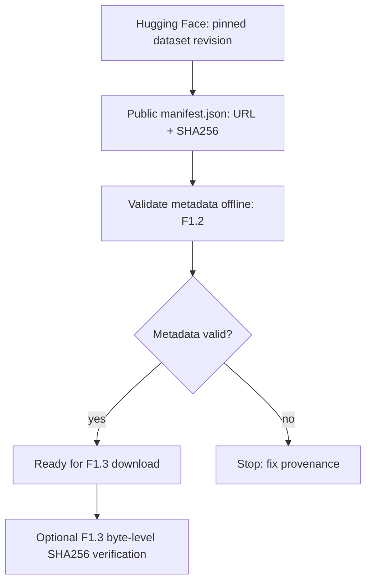

# F1.2 — Dataset Selection & Provenance

**Цель:** обосновать выбор источника для нескольких ML-задач и проверять его идентичность без скачивания сторонних текстов в публичный репозиторий.

**Граница этапа:** F1.2 отвечает на вопросы «откуда данные?» и «какой версии можно доверять?». Реальный download, gzip/JSONL-парсинг, row-level lineage, дедупликация/cleaning будут рассматриваться **в F1.3–F1.4**. В исходном локальном проекте загрузчик уже есть в `scripts/download_data.py`, но в GitHub он будет опубликован после отдельной проверки при F1.3.

## Выбранный источник

- Dataset: [Stack Exchange title/body and voted answers](https://huggingface.co/datasets/flax-sentence-embeddings/stackexchange_titlebody_best_and_down_voted_answer_jsonl).
- Зафиксированная ревизия: `32151f5480872e6db89ae147e1d727266f574606`.
- Правило: `seed=42`, максимум 800 валидных строк на сайт. `available_rows` — количество строк, допущенных исходным загрузчиком после проверки обязательных текстовых полей, а **не** общий размер всех источников Stack Exchange.

| Сайт / filename | Label (домен) | Доступно после фильтра | Выбрано |
|---|---|---:|---:|
| `unix.stackexchange.com.jsonl.gz` | `linux` | 6 173 | 800 |
| `dba.stackexchange.com.jsonl.gz` | `databases` | 2 502 | 800 |
| `serverfault.com.jsonl.gz` | `systems` | 7 969 | 800 |
| `codereview.stackexchange.com.jsonl.gz` | `programming` | 666 | 666 |
| **Итого** | **4 метки** | — | **3 066** |

Этот исходный subset позже стал 3 040 записями после очистки: эти числа из сохранённых локальных артефактов, в F1.2 **не пересчитываются**.

## Почему датасет подходит для нескольких задач

- **Classification:** `title_body` — вход, `site -> domain` — метка. Это *раздел сообщества*, а не диагностический класс истинной причины проблемы; классы пересекаются по смыслу.
- **Retrieval / RAG:** вопрос — запрос, `upvoted_answer` — кандидат в документ/ответ. Рейтинг не гарантирует полноту и истинность.
- **SFT / preference experiments:** вопрос + `upvoted_answer` / `downvoted_answer` — слабые, шумные сигналы предпочтения. Нельзя без экспертов считать их «верно» / «неверно».

Поля исходного JSON: `title_body`, `upvoted_answer`, `downvoted_answer`; в загрузчике F1.3 они преобразуются в `context`, `answer`, `rejected`. В source export отсутствуют прямые URL и авторы оригинальных Q&A; `source_url` указывает на gzip-архив, а не на пост Stack Exchange.

## Как устроена проверка F1.2

- [`data/raw/manifest.json`](../../data/raw/manifest.json) — immutable reference для источника (не сами данные): ID, revision, seed, URL четырёх файлов, ожидаемые SHA-256, счётчики, замечание о лицензии.
- [`src/data/provenance.py`](../../src/data/provenance.py) — автономная проверка схемы и согласованности metadata. Не делает сетевых запросов и не скачивает Q&A.
- [`tests/test_provenance.py`](../../tests/test_provenance.py) — unit-тесты реального manifest и **синтетических** файлов. Проверяются pin URL, контрольные суммы, допустимые пути, счётчики, повреждённые байты.
- [GitHub Actions](../../.github/workflows/foundation-tests.yml) — включает эти тесты в существующий тестовый workflow, не создавая третий параллельный workflow.



## Запуск на Windows (PowerShell)

Из корня репозитория, используя `.venv` после F1.1:

```powershell
.\.venv\Scripts\python.exe -m src.data.provenance
.\.venv\Scripts\python.exe -m pytest -q tests/test_provenance.py
.\.venv\Scripts\python.exe scripts/check_repository.py
```

**Важно:** `Dataset provenance: PASS` означает, что **метаданные согласованы**. Без исходных gzip-файлов строки `Raw files SHA-256: NOT CHECKED` — ожидаемый результат. После F1.3 появится вариант: `python -m src.data.provenance --verify-files`, который сравнивает реальные байты с закреплённым SHA-256.

## Лицензия и публикация

Карточка HF отмечена `cc-by-nc-sa-4.0`. Требования лицензии касаются атрибуции, некоммерческого использования и share-alike. Сами сообщения Stack Exchange имеют лицензии CC BY-SA, различающиеся по дате публикации/правки; dataset metadata **не заменяет** проверку лицензий отдельных постов. Экспорт не содержит URL постов и имён авторов. В публичном репозитории размещаем **только код и метаданные**, без raw, subset, cleaned и sample с чужими текстами, до выяснения прав и атрибуции.

См. [data provenance](../DATA_PROVENANCE.md). Это не юридическое заключение.

## Известные ограничения

1. SHA-256 в манифесте не является доказательством целостности без физического файла и пересчёта его хеша.
2. Файл содержит Windows-пути вида `data\raw\...`: проверяющий код нормализует разделители для Linux CI, но не переписывает исторический manifest.
3. Seed обеспечивает повторяемость процедуры при неизменных файлах/алгоритме/версии Python; он не гарантирует неизменность исходного датасета без revision и hash.
4. Проверка provenance не измеряет точность классификатора или качество генерации.
5. Количество выбранных записей — документация первоначального локального эксперимента. В этом шаге обучение и загрузка не запускаются.

## Контрольные вопросы

1. Что означает provenance и зачем ML Engineer хранит manifest?
2. Чем Git revision датасета отличается от SHA-256 скачанного gzip-файла?
3. Почему `seed=42` сам по себе недостаточен для воспроизводимости?
4. Почему `programming` здесь не является абсолютной «истиной» о содержании вопроса?
5. Почему CI не должен скачивать весь датасет ради проверки F1.2?
6. Почему высокий рейтинг ответа не делает пару пригодной для объективной оценки factual correctness?

**Статус:** `F1.2 PREPARED` — локальные проверки пакета должны быть повторены на Windows и в GitHub Actions; только после этого `F1.2 PASS`.
