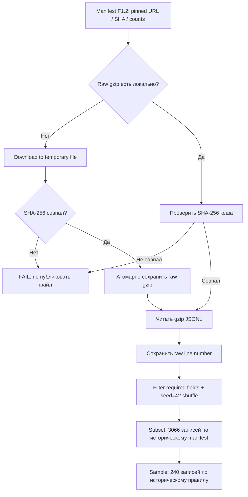

# F1.3 — Data Ingestion: проверяемая загрузка данных

**Цель:** научиться получать исходные данные, проверять их целостность и преобразовывать в воспроизводимый JSONL с сохранением происхождения каждой записи.

**Связь с предыдущим этапом:** F1.2 описал **что** загружаем (источник, pinned revision, URL, SHA-256, состав классов). F1.3 показывает **как** загружаем, сверяем и преобразуем. Очистка HTML/дубликатов и формирование train/val/test относятся к F1.4–F1.6, не к этому шагу.

## 1. Основные термины

- **Data ingestion** — получение данных из внешнего источника в собственную систему.
- **Raw data** — оригинальные файлы (`.jsonl.gz`), сохраняемые без изменений.
- **JSONL** — один JSON-объект на строку; удобно читать потоково.
- **gzip** — сжатие; исходный gzip сохраняем, а при чтении распаковываем в памяти.
- **SHA-256** — контрольная сумма файла; сравниваем реальные байты с ожидаемым хешем из манифеста.
- **Pinned revision** — конкретный SHA версии датасета, а не изменяющаяся ветка `main`.
- **Lineage** — связь каждой записи с её источником: URL архива, имя сайта и физический номер строки в gzip.
- **Seed** — начальное состояние псевдослучайного генератора, влияющее на порядок выборки.

## 2. Что реализовано

Исходным прототипом был `scripts/download_data.py` из локального проекта ML Engineering Lab. Его базовое поведение сохранено: четыре Stack Exchange-источника, `seed=42`, до 800 валидных записей на источник, `source_row` с нуля, `context / answer / rejected`, sample до 60 записей каждого класса.

Перед публикацией исправлены риски повторного запуска:

1. Манифест `data/raw/manifest.json` теперь **читается как неизменяемый контракт**; скрипт не получает новую ревизию по API и не перезаписывает исходные SHA-256.
2. У существующих raw gzip проверяется контрольная сумма. Повреждённый локальный файл не используется молча.
3. Если файл отсутствует, он скачивается по pinned URL во временный файл. Только совпавший SHA-256 допускается к переименованию в исходный путь. При сетевой ошибке предусмотрены три попытки.
4. Перед преобразованием проверяются SHA-256 всех четырёх raw-файлов, при разборе — количества валидных строк согласно манифесту.
5. `--offline` воспроизводит выборку с уже имеющимися gzip без сетевых запросов.
6. `subset.jsonl` и `technical_qa.jsonl` пишутся локально; **никакие тексты третьих лиц в Git не добавляются**.

Обрати внимание: это небольшой инженерный hardening исходного прототипа, а не новая схема датасета. Если реальные источники содержат неучтённые пограничные значения полей, их нужно исследовать при первом реальном запуске; его мы пока не выполняли в CI.

## 3. Пайплайн



## 4. Ключевые фрагменты кода

Полный исполняемый файл: [`scripts/download_data.py`](../../scripts/download_data.py).

**Повторяемость выборки** достигается независимым генератором для каждого источника:

```python
random.Random(manifest["seed"]).shuffle(site_rows)
chosen = site_rows[:record["selected_rows"]]
```

Это *не* очистка данных и *не* ML train/test split. Сначала выполняется отбор исходного поднабора, затем в F1.4–F1.6 будут cleaning, дедупликация и group split.

**След исходной строки** сохраняется до отбора:

```python
"id": f"{site}:{row}",
"source_url": url,
"source_row": row,
```

`source_url` указывает на архив Hugging Face, **не** на оригинальный пост Stack Exchange. `source_row` — нумерация строк 0, 1, 2 ... **до фильтрации**; поэтому ID остаётся связанным с конкретным файлом.

**Контроль целостности**: для пути `p` проверяется

\[\operatorname{SHA256}(\operatorname{bytes}(p)) = \operatorname{expected\_sha256}(p).\]

Совпадение доказывает идентичность байтов заданному манифесту, но не корректность ответов и не правомерность их распространения.

## 5. Как проверить на Windows

Из `F:\DEVELOPMENT\ML\ml-engineering-lab` после F1.2:

```powershell
.\.venv\Scripts\python.exe -m pytest -q tests/test_foundation.py tests/test_provenance.py tests/test_ingestion.py
.\.venv\Scripts\python.exe -m src.data.provenance
.\.venv\Scripts\python.exe scripts/check_repository.py
git status --short
```

Тесты F1.3 используют **только синтетические gzip-файлы** во временном каталоге; сетевых запросов в тестах нет. Они проверяют детерминизм отбора, lineage, повторный запуск, offline, повреждённый файл, отсутствие записи частичных артефактов и имитацию скачивания.

Для **реальной** загрузки вручную (в CI это не запускается):

```powershell
.\.venv\Scripts\python.exe -m scripts.download_data
.\.venv\Scripts\python.exe -m src.data.provenance --verify-files
```

Если четыре `.jsonl.gz` уже есть в другой рабочей папке проекта, можно скопировать их в **локальный** `data/raw/` и запустить без сети:

```powershell
.\.venv\Scripts\python.exe -m scripts.download_data --offline
.\.venv\Scripts\python.exe -m src.data.provenance --verify-files
```

Поскольку raw-файлы имеют ожидаемые хеши, скрипт откажется использовать повреждённый файл. Причину расхождения SHA стоит выяснить до повторной загрузки.

**Ожидаемый результат при совпадающих исторических исходниках:** 4 файла SHA PASS, 3 066 строк subset, 240 sample. Эти количества взяты из манифеста и сохранённых отчётов; они ещё должны быть подтверждены повторным реальным запуском в новой среде.

Рекомендуется дополнительно сверить SHA256 полученного `data/raw/subset.jsonl` с указанным в [`DATA_PROVENANCE.md`](../DATA_PROVENANCE.md) контрольным значением. Если он отличается, не объявляй полную воспроизводимость — расследуй различия.

## 6. Что публикуем

**Публикуем:** код загрузчика, инструкцию, автономные тесты, workflow и обновлённый README. Манифест F1.2 уже опубликован.

**Не публикуем:** `data/raw/*.jsonl.gz`, `data/raw/subset.jsonl`, `data/sample/technical_qa.jsonl`, `data/sample/manifest.json`, обработанные тексты и кеши.

Причина — не только размер файлов. В исходном экспорте нет полного набора ссылок на авторов и оригинальные посты для индивидуальной атрибуции. Лицензия датасета в карточке Hugging Face — CC BY-NC-SA 4.0. Для личных экспериментов и публичного кода используем только разрешённый режим; тексты в репозитории не размещаем без отдельной проверки прав.

## 7. Вопросы для самопроверки

1. Чем SHA-256 **содержимого gzip** отличается от Git SHA **версии датасета**?
2. Почему нельзя при каждом скачивании получать новую ревизию HF по API и перезаписывать `manifest.json`?
3. Что может произойти, если уже существующий `.jsonl.gz` не проверять перед использованием?
4. Почему `source_row` нужно записать **до фильтрации**, а не после?
5. Что делает `random.Random(42).shuffle(rows)` и гарантирует ли он неизменность выборки при изменившихся исходниках?
6. Почему тестирование ingestion в CI можно выполнить без загрузки 4 реальных архивов?
7. Чем ingestion отличается от data cleaning и train/validation/test split?

**Статус:** F1.3 PREPARED — автономные тесты проверены в среде подготовки пакета. Windows, real raw SHA-256 и GitHub Actions требуют подтверждения.
