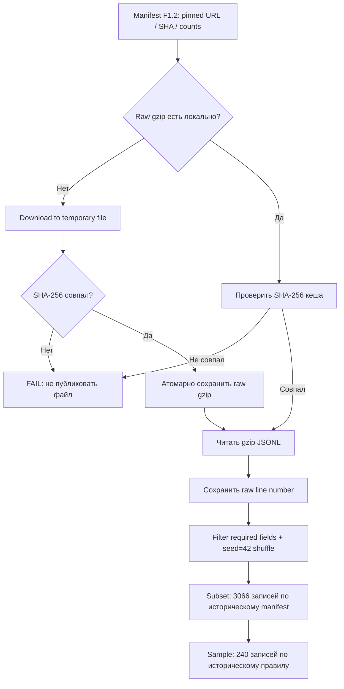
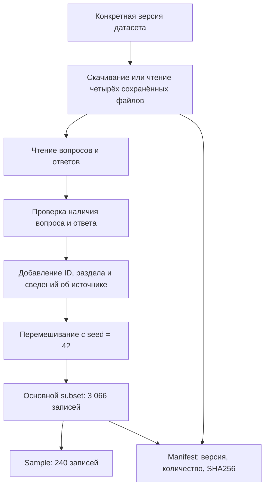

# F1.3 - Data Ingestion: Получение данных

F1.3 - это получение выбранных данных и сохранение их в проекте. Скачать исходные файлы, прочитать записи, сформировать воспроизводимую выборку и сохранить сведения о её происхождении.

**Цель:** научиться получать исходные данные, проверять их целостность и преобразовывать в воспроизводимый JSONL с сохранением происхождения каждой записи.

**Связь с предыдущим этапом:** F1.2 описано **что** загрузить (источник, pinned revision, URL, SHA-256, состав классов). F1.3 показывает **как** загрузить, сверить и преобразовать.

## Основные термины
- **Data ingestion** - получение данных из внешнего источника в собственную систему
- **Raw data** - оригинальные файлы (`.jsonl.gz`), сохраняемые без изменений
- **JSONL** - один JSON-объект на строку; удобно читать потоково
- **SHA-256** - контрольная сумма файла; сравнение реальных байы с ожидаемым хешем из манифеста
- **Pinned revision** - конкретный SHA версии датасета, а не изменяющаяся ветка `main`
- **Lineage** - связь каждой записи с её источником: URL архива, имя сайта и физический номер строки в gzip
- **Seed** - начальное состояние псевдослучайного генератора, влияющее на порядок выборки

## Что реализовано
Исходным прототипом был `scripts/download_data.py` из локального проекта ML Engineering Lab. Его базовое поведение сохранено: четыре Stack Exchange-источника, `seed=42`, до 800 валидных записей на источник, `source_row` с нуля, `context / answer / rejected`, sample до 60 записей каждого класса.

Зафиксировали версию датасета. Данные на сайте могут обновляться. Если сегодня скачать одну версию, а через месяц другую, результаты эксперимента могут измениться.

Перед публикацией исправлены риски повторного запуска:
1. Манифест `data/raw/manifest.json` теперь читается как неизменяемый; скрипт не получает новую ревизию по API и не перезаписывает исходные SHA-256.
2. У существующих raw gzip проверяется контрольная сумма. Повреждённый локальный файл не используется.
3. Если файл отсутствует, он скачивается по pinned URL во временный файл. Только совпавший SHA-256 допускается к переименованию в исходный путь. При сетевой ошибке предусмотрены три попытки.
4. Перед преобразованием проверяются SHA-256 всех четырёх raw-файлов, при разборе - количества валидных строк согласно манифесту.
5. `--offline` воспроизводит выборку с уже имеющимися gzip без сетевых запросов.
6. `subset.jsonl` и `technical_qa.jsonl` пишутся локально.

Это небольшой инженерный hardening исходного прототипа, а не новая схема датасета. Если реальные источники содержат неучтённые пограничные значения полей, их нужно исследовать при первом реальном запуске; он пока не выполнялся в CI.

## Пайплайн



## Проверка в Windows (PowerShell)

Из `F:\DEVELOPMENT\ML\ml-engineering-lab` после F1.2:

```powershell
.\.venv\Scripts\python.exe -m pytest -q tests/test_foundation.py tests/test_provenance.py tests/test_ingestion.py
.\.venv\Scripts\python.exe -m src.data.provenance
.\.venv\Scripts\python.exe scripts/check_repository.py
git status --short
```

Тесты F1.3 используют **только синтетические gzip-файлы** во временном каталоге; сетевых запросов в тестах нет. Они проверяют детерминизм отбора, lineage, повторный запуск, offline, повреждённый файл, отсутствие записи частичных артефактов и имитацию скачивания.

Для **реальной** загрузки вручную (в CI это не запускается):
```powershell
.\.venv\Scripts\python.exe -m scripts.download_data
.\.venv\Scripts\python.exe -m src.data.provenance --verify-files
```

Если четыре `.jsonl.gz` уже есть в другой рабочей папке проекта, можно скопировать их в **локальный** `data/raw/` и запустить без сети:
```powershell
.\.venv\Scripts\python.exe -m scripts.download_data --offline
.\.venv\Scripts\python.exe -m src.data.provenance --verify-files
```

Поскольку raw-файлы имеют ожидаемые хеши, скрипт откажется использовать повреждённый файл. Причину расхождения SHA стоит выяснить до повторной загрузки.

**Ожидаемый результат при совпадающих исторических исходниках:** 4 файла SHA PASS, 3 066 строк subset, 240 sample. Эти количества взяты из манифеста и сохранённых отчётов; они ещё должны быть подтверждены повторным реальным запуском в новой среде.

Рекомендуется дополнительно сверить SHA256 полученного `data/raw/subset.jsonl` с указанным в [`DATA_PROVENANCE.md`](../DATA_PROVENANCE.md) контрольным значением. Если он отличается, не объявляй полную воспроизводимость - расследуй различия.

## Алгоритм всего F1.3


## Что получилось в F1.3
Появились:
- четыре исходных сжатых файла;
- основная выборка из **3 066 записей до очистки**;
- маленький sample из **240 записей до очистки**;
- manifest с версией, размерами выборок и контрольными суммами;
- связь каждой выбранной записи с исходным файлом и строкой.

## Основная мысль F1.3
Получение данных - это не только их скачивание. ML Engineer должен сохранить версию источника, понятную структуру записей и возможность повторить подготовку выборки.
