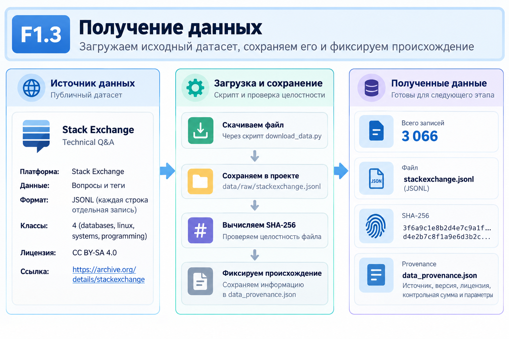
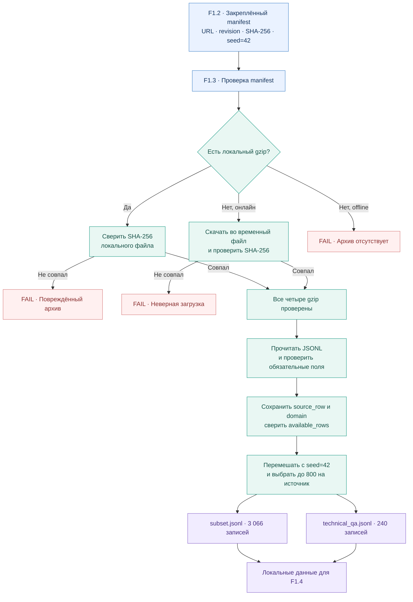

# F1.3 - Data Ingestion: воспроизводимое получение технических вопросов

## 1. Цель этапа: 

В F1.2 решено, **на каких данных будет работать проект**: выбрана выгрузка технических вопросов и ответов Stack Exchange, четыре тематических сообщества и конкретная ревизия датасета на Hugging Face. Для каждой части корпуса записан адрес архива, ожидаемая контрольная сумма и количество записей, которое необходимо получить.



Но на этом этапе ещё нет полноценного механизма, превращающего закреплённый источник в локальные данные. Нельзя просто один раз скачать файлы вручную и считать задачу решённой: спустя время файл на сервере может измениться, локальная копия может повредиться, а другая случайная выборка даст другой результат обучения.

**Задача F1.3:** реализовать управляемый процесс получения данных (*data ingestion*), который:
1. Читает заранее подготовленный `manifest.json`, а не выбирает новую версию датасета по собственному усмотрению.
2. Скачивает отсутствующие исходные архивы или повторно использует имеющиеся **только после проверки целостности**.
3. Преобразует вопросы и ответы из исходного формата в единую структуру проекта.
4. Сохраняет связь каждой записи с конкретным исходным файлом и номером строки.
5. Выбирает одни и те же записи при одинаковых исходных файлах и `seed=42`.
6. Создаёт основную выборку и небольшой sample, не добавляя тексты сторонних Q&A в публичный GitHub-репозиторий.

## 2. Реализация: файлы этапа

F1.3 опирается на материалы F1.2, но добавляет собственный исполняемый код. В публикационный пакет этапа вошли следующие **шесть файлов**:

| Файл                                                                                     | Что сделали и зачем                                                                                                                                                                                                     |
| ---------------------------------------------------------------------------------------- | ----------------------------------------------------------------------------------------------------------------------------------------------------------------------------------------------------------------------- |
| [`scripts/download_data.py`](../../scripts/download_data.py)                             | **Главный рабочий код F1.3.** Читает manifest, находит или скачивает четыре gzip-архива, проверяет SHA-256, преобразует записи, выполняет отбор и сохраняет JSONL. Поддерживает `--offline`.                            |
| [`tests/test_ingestion.py`](../../tests/test_ingestion.py)                               | Проверяет корректную загрузку и сбои на **синтетических gzip-файлах**: детерминизм, номера исходных строк, отсутствие сетевых обращений в offline, испорченные архивы, ошибки JSON и несоответствие количества записей. |
| [`docs/steps/F1_03_data_ingestion.md`](F1_03_data_ingestion.md)                          | Объясняет задачу, порядок выполнения, проверки и результат. Это текущая документация, которая перерабатывается.                                                                                                         |
| [`docs/DATA_PROVENANCE.md`](../DATA_PROVENANCE.md)                                       | Дополнен описанием получения закреплённых файлов, проверки байтов, локальных результатов и ограничений публикации исходных Q&A.                                                                                         |
| [`.github/workflows/foundation-tests.yml`](../../.github/workflows/foundation-tests.yml) | В существующий workflow включены тесты F1.3. CI проверяет алгоритм на синтетических данных и **не скачивает реальный датасет**.                                                                                         |


**Используются уже существующие компоненты F1.2:**
- [`data/raw/manifest.json`](../../data/raw/manifest.json) - неизменяемое описание источника, его ревизии, адресов архивов, SHA-256 и счётчиков.
- [`src/data/provenance.py`](../../src/data/provenance.py) - загрузка и проверка manifest; при `--verify-files` - сравнение реальных исходных файлов с ожидаемыми SHA-256.

**Локально после успешного запуска появляются данные, которые не публикуются в GitHub:**

| Локальный файл                   | Содержимое и назначение                                                                            |
| -------------------------------- | -------------------------------------------------------------------------------------------------- |
| `data/raw/*.jsonl.gz`            | Четыре исходных сжатых архива, сохраняемых без изменения содержимого.                              |
| `data/raw/subset.jsonl`          | Отобранная основная выборка из **3 066** технических записей.                                      |
| `data/sample/technical_qa.jsonl` | Небольшая выборка из **240** записей, по 60 на каждый тематический источник.                       |
| `data/sample/manifest.json`      | Локальная копия закреплённого manifest рядом с sample для совместимости с последующими сценариями. |

## 3. Последовательность действий

### Шаг 1. За основу взят выбор источников из F1.2
До начала загрузки уже был подготовлен `data/raw/manifest.json`. Он описывает датасет `flax-sentence-embeddings/stackexchange_titlebody_best_and_down_voted_answer_jsonl` и закрепляет ревизию:
`32151f5480872e6db89ae147e1d727266f574606`

Это называется **pinned revision** - ссылка на конкретное состояние набора данных, а не на изменяющуюся актуальную версию. В manifest также указаны `seed=42`, ожидаемые SHA-256 и условия отбора из четырёх сообществ.

| Источник Stack Exchange        | Класс в проекте | Валидных записей в исходной выгрузке |  Выбираем |
| ------------------------------ | --------------- | -----------------------------------: | --------: |
| `unix.stackexchange.com`       | `linux`         |                                6 173 |       800 |
| `dba.stackexchange.com`        | `databases`     |                                2 502 |       800 |
| `serverfault.com`              | `systems`       |                                7 969 |       800 |
| `codereview.stackexchange.com` | `programming`   |                                  666 |       666 |
| **Всего**                      | **4 класса**    |                                    — | **3 066** |

Число **3 066** получается из правила отбора: `800 + 800 + 800 + 666`. Это объём **до очистки F1.4**; с 3 040 очищенными записями его путать нельзя.

**Зачем этот шаг:** программа должна знать заранее, *какие именно файлы* и *в каком количестве* ожидаются. Иначе непреднамеренная смена датасета может остаться незамеченной.

### Шаг 2. Manifest сделан неизменяемым входом программы
В `scripts/download_data.py` функция `run(...)` начинает работу с чтения `data/raw/manifest.json` через `load_manifest(...)`, затем вызывает `validate_manifest(...)`.

Проверяющий код убеждается, что в документе указан правильный датасет, ровно четыре ожидаемых источника, корректная 40-символьная ревизия, закреплённые URL, формат SHA-256 и согласованные количества записей.

Принципиально важно: **скрипт загрузки не запрашивает новую ревизию Hugging Face и не переписывает исходный manifest**. Если источник изменился, получится явное расхождение.

**Зачем этот шаг:** сохранить неизменное описание того, что считалось исходными данными эксперимента.

### Шаг 3. Проверка локальных архивов
Далее выполняется функция `ensure_sources(...)`. Для каждого из четырёх файлов она проверяет, есть ли он в `data/raw/`.

**Если архив уже имеется:** программа вычисляет SHA-256 его реального содержимого и сравнивает с manifest. Если хеш не совпал, будет получена `IngestionError`: подозрительный файл не используется даже в том случае, если он успешно открывается как gzip.

**Если архива нет и разрешена сеть:** `_download_verified(...)` скачивает файл **во временный файл в том же каталоге**. После загрузки вычисляется SHA-256 временного файла:
- при совпадении с manifest файл перемещается в окончательный путь через `os.replace(...)`;
- при несовпадении загрузка считается ошибочной, временный файл удаляется;
- при сетевых сбоях предусмотрено до трёх попыток; неверный SHA-256 не считается обычным сетевым сбоем и автоматически не «исправляется» повторением.

**Если выбран `--offline`:** программа вообще не пытается обращаться в сеть. Отсутствие любого из четырёх архивов приводит к явной ошибке.

После проверки всех источников вызывается `verify_raw_files(...)`, то есть контроль целостности выполняется для всех четырёх исходных файлов.

**Зачем этот шаг:** не допустить тихого использования повреждённой копии или непроверенной загрузки.

### Шаг 4. Прочитан исходный gzip как последовательность JSON-записей
Функция `select_records(...)` открывает каждый архив через `gzip.open(..., "rt", encoding="utf-8")` и проходит по строкам последовательно.

Исходный экспорт содержит три смысловых поля:
- `title_body` - текст технического вопроса;
- `upvoted_answer` - ответ с положительной пользовательской оценкой;
- `downvoted_answer` - ответ с отрицательной пользовательской оценкой.

В самой выгрузке запись может выглядеть как JSON-массив из трёх значений или как JSON-объект с именованными полями. `_to_record(...)` поддерживает оба варианта, приводя их к одной структуре.

**Какие записи считаются валидными в F1.3:** у записи должен быть непустой текст вопроса и непустой выбранный ответ; оба значения должны быть строками. Отсутствующий или нестроковый отклонённый ответ сохраняется как пустая строка.

**Зачем этот шаг:** из неоднородной выгрузки получить записи с едиными полями, понятными остальным частям проекта.

### Шаг 5. Сохранить происхождение каждой записи - lineage
Когда программа читает исходный gzip, она использует `enumerate(handle)` и получает **физический номер строки**, начиная с нуля. Этот номер сохраняется как `source_row`.

Например, если строка с номером `2` была некорректной, следующая валидная строка сохранит номер `3`, а не станет искусственно «третьей» записью. Так можно найти её исходное положение в архиве.

Для каждого выбранного примера формируются следующие поля:

| Поле          | Что оно означает                                                                        |
| ------------- | --------------------------------------------------------------------------------------- |
| `id`          | Идентификатор вида `имя_сайта:номер_строки`, например `unix.stackexchange.com:3`.       |
| `source`      | Идентификатор закреплённого датасета.                                                   |
| `source_type` | Вид источника: `technical_qa`.                                                          |
| `source_url`  | Адрес **gzip-архива** с зафиксированной ревизией. Это **не ссылка на конкретный пост**. |
| `source_row`  | Исходный номер строки внутри архива, начиная с нуля.                                    |
| `language`    | `en` как metadata корпуса; отдельного автоматического определения языка здесь нет.      |
| `domain`      | Класс из четырёх: `linux`, `databases`, `systems`, `programming`.                       |
| `instruction` | Добавленная нами стандартная инструкция для будущих задач с ответами.                   |
| `context`     | Текст вопроса из `title_body`.                                                          |
| `answer`      | Текст из `upvoted_answer`.                                                              |
| `rejected`    | Текст из `downvoted_answer`, если он доступен строкой.                                  |

Фрагмент **синтетического** примера для пояснения структуры:
```json
{
  "id": "unix.stackexchange.com:3",
  "source_row": 3,
  "domain": "linux",
  "context": "Synthetic example: how to list files?",
  "answer": "Synthetic answer for testing",
  "rejected": ""
}
```

В настоящей записи дополнительно присутствуют `source`, `source_type`, `source_url`, `language` и `instruction`. Пример выше нужен для объяснения структуры, а **не является текстом исходного датасета**.

**Зачем этот шаг:** при проверке данных можно установить, из какого источника и какой строки появилась конкретная запись, не полагаясь на её текущее положение после перемешивания.

### Шаг 6. Воспроизводимо отобрано 3 066 записей и sample из 240
После чтения одного источника код проверяет, совпадает ли число валидных записей с полем `available_rows` из manifest. Если не совпало, он прерывает работу: это означает, что вход не соответствует закреплённому эксперименту.

Далее для **каждого источника отдельно** выполняется:
```python
random.Random(manifest["seed"]).shuffle(site_rows)
chosen = site_rows[:record["selected_rows"]]
```

`seed=42` задаёт воспроизводимый порядок перемешивания при одинаковых входных данных и той же реализации алгоритма. Выбирать первые `selected_rows` строк после перемешивания: для трёх источников это 800 записей, для Code Review - 666.

Для небольшой выборки `sample` берутся **первые 60 уже выбранных записей от каждого источника**. Итого `4 × 60 = 240`.

Важное различие:
- **`subset.jsonl` (3 066 записей)** - основной корпус до очистки;
- **`technical_qa.jsonl` (240 записей)** - небольшой локальный sample, который не заменяет полноценный корпус и не является автоматически безопасным для публичной публикации.

**Зачем этот шаг:** получать предсказуемую выборку и иметь маленький набор примеров для локального smoke-тестирования без необходимости каждый раз обрабатывать все данные.

### Шаг 7. Сохранить результаты без частично записанных JSONL-файлов
Функция `_atomic_jsonl(...)` записывает данные сначала во временный файл, а затем выполняет `os.replace(...)`.

Снижается риск получить **один наполовину записанный JSONL-файл**, если процесс прервётся во время сохранения. Операция выполняется отдельно для каждого выходного файла; это не общая транзакция сразу над несколькими файлами.

После успешного отбора `run(...)` сохраняет:
1. `data/raw/subset.jsonl` - основную выборку;
2. `data/sample/technical_qa.jsonl` - маленький sample;
3. `data/sample/manifest.json` - копию исходного manifest, без изменения `data/raw/manifest.json`.

При успехе выводится итоговая строка со счётчиками записей и проверенных источников.

**Зачем этот шаг:** сделать результаты пригодными для следующей фазы обработки и уменьшить риск повреждения файлов при записи.

### Шаг 8. Проверка алгоритма без скачивания реальных Q&A в CI
В `tests/test_ingestion.py` созданы **синтетические** gzip-архивы во временных каталогах. Они имеют нужную структуру, но содержат вымышленные тексты, а не данные Stack Exchange.

Тесты проверяют не только успешный сценарий, но и намеренно неправильные случаи:
- повторный offline-запуск даёт те же байты `subset.jsonl` и sample;
- при offline-запуске сеть не используется;
- `source_row` сохраняет исходный физический номер строки даже после исключения невалидной записи;
- испорченный локальный архив отклоняется;
- неподходящие скачанные байты не заменяют ожидаемый архив, а временный файл удаляется;
- расхождение `available_rows`, повреждённый JSON и отрицательный размер sample вызывают контролируемую ошибку;
- исходный manifest не перезаписывается даже при неудачной загрузке.

**Зачем этот шаг:** убедиться, что загрузчик сохраняет свой контракт в штатных и аварийных ситуациях. Для такой проверки не нужен большой датасет, сеть или GPU.

## 4. Как работает F1.3 при одном запуске

В предыдущем разделе разобрано, **в каком порядке разрабатывали компоненты**. Теперь посмотрим, что происходит непосредственно при вызове `run()`.

| Порядок | Вызов                                 | Что происходит                                                                                  |
| ------- | ------------------------------------- | ----------------------------------------------------------------------------------------------- |
| 1       | `load_manifest(...)`                  | Чтение закреплённых источников, адресов, SHA-256 и счётчиков.                                   |
| 2       | `validate_manifest(...)`              | Проверка, что metadata соответствует принятому контракту F1.2.                                  |
| 3       | `ensure_sources(...)`                 | Для каждого архива проверка локального SHA-256 или загрузка и проверка отсутствующего файла.    |
| 4       | `verify_raw_files(...)`               | Подтверждение совпадения SHA-256 всех четырёх реальных gzip-файлов.                             |
| 5       | `select_records(...)`                 | Чтение JSONL из gzip, проверка обязательных полей, сохранение lineage, сверка количества строк. |
| 6       | `random.Random(42).shuffle(...)`      | Получение зафиксированной последовательности кандидатов отдельно для каждого источника.         |
| 7       | `_atomic_jsonl(...)`                  | Записать основной subset и sample через временные файлы.                                        |
| 8       | Копирование manifest и печать статуса | Сохранить сопутствующую metadata и показать итоговые счётчики.                                  |

### Почему здесь два вида проверки
Предположим, что есть `unix.stackexchange.com.jsonl.gz`.

**Проверка SHA-256** отвечает на вопрос: «Это точно тот же файл, который закреплён в manifest?» Она не доказывает, что каждая запись содержательно правильна.

**Проверка записей** отвечает на другой вопрос: «Можно ли прочитать файл, присутствуют ли обязательные текстовые поля и совпадает ли количество валидных строк?» Даже файл с правильной контрольной суммой не обязан быть качественным обучающим корпусом.

Только после обеих проверок данные допускаются к отбору.

## 5. Схема: от manifest до локальной выборки



Главная мысль схемы: **не формировать выборку, пока нет уверенности, что получены правильные исходные файлы и прочитано ожидаемое количество валидных записей**.

## 6. Локальная проверка в PowerShell: что запускать и как читать результат

Команды ниже выполняются в **уже подготовленном Python-окружении** проекта. Они не содержат инструкций по установке пакетов и не изменяют Git-историю.

### 6.1. Перейти в корень репозитория
```powershell
cd F:\DEVELOPMENT\ML\ml-engineering-lab
```

### 6.2. Проверить тесты F1.3
```powershell
.\.venv\Scripts\python.exe -m pytest tests/test_ingestion.py -q
```

**Что проверяется:** алгоритм отбора, работу с синтетическими gzip, offline-режим, номера исходных строк, ошибки SHA-256, повреждённый JSON, проверки количества записей и сохранность manifest.

В исходном наборе тестов этапа было **10 тестовых функций**. Число после дальнейших изменений проекта может отличаться; ориентироваться нужно на отсутствие `failed` и `errors`.

### 6.3. Проверить metadata источника
```powershell
.\.venv\Scripts\python.exe -m src.data.provenance
```

Ожидается вывод:
```text
Raw files SHA-256: NOT CHECKED (use --verify-files after F1.3)
Dataset provenance: PASS; sources=4; selected=3066; seed=42
```

**Это нормальный результат:** проверен manifest, но в этой команде **специально не запрашивался** пересчёт SHA-256 исходных архивов.

### 6.4. Выполнить реальную загрузку или воспроизвести её offline
Если исходных архивов ещё нет и разрешено скачивание:
```powershell
.\.venv\Scripts\python.exe -m scripts.download_data
```

Если четыре исходных архива уже лежат в `data/raw/`, использовать запуск **без сети**:
```powershell
.\.venv\Scripts\python.exe -m scripts.download_data --offline
```

При успешной обработке закреплённой версии ожидается итоговая строка:
```text
Data ingestion: PASS; selected=3066; sample=240; raw_sha256=4/4
```

Это означает, что получены четыре ожидаемых файла и сформированы две выборки. Если архивы отсутствуют, повреждены или отличаются от закреплённой версии, вместо `PASS` должна быть ошибка с причиной.

### 6.5. Дополнительно проверить реальные SHA-256
```powershell
.\.venv\Scripts\python.exe -m src.data.provenance --verify-files
```

Ожидается:
```text
Raw files SHA-256: PASS (4/4)
Dataset provenance: PASS; sources=4; selected=3066; seed=42
```

Здесь, в отличие от пункта 6.3, программа читает реальные байты всех четырёх архивов. Если какого-то архива нет или SHA-256 отличается, проверка не пройдёт.

### 6.6. Проверить размеры сформированных файлов
```powershell
(Get-Content data/raw/subset.jsonl | Measure-Object -Line).Lines
(Get-Content data/sample/technical_qa.jsonl | Measure-Object -Line).Lines
```

Для закреплённого корпуса ожидается **3 066** и **240** соответственно. Эти команды лишь считают строки и **не заменяют** проверку содержимого, происхождения или SHA-256.

Контрольная сумма локального `subset.jsonl` также зафиксирована в [`docs/DATA_PROVENANCE.md`](../DATA_PROVENANCE.md). При необходимости её можно пересчитать:
```powershell
(Get-FileHash data/raw/subset.jsonl -Algorithm SHA256).Hash.ToLowerInvariant()
```

Если значение отличается от записанного в документации, не следует объявлять байтовую воспроизводимость подтверждённой - нужно выяснить причину.

### 6.7. Проверить отсутствие регрессии
Для совместной проверки F1.1–F1.3:
```powershell
.\.venv\Scripts\python.exe -m pytest -q tests/test_foundation.py tests/test_provenance.py tests/test_ingestion.py
```

В первоначальной публикации F1.3 это были **31 прошедший тест суммарно** (7 тестов F1.1, 14 тестов F1.2 и 10 тестов F1.3). В актуальном репозитории набор может измениться.

Проверить текущий проект целиком:
```powershell
.\.venv\Scripts\python.exe -m pytest -q
```

И отдельно проверить структуру публичного репозитория:
```powershell
.\.venv\Scripts\python.exe scripts/check_repository.py
```

`check_repository.py` - проверка структуры и metadata, **а не повторное обучение модели** и не подтверждение содержимого исходных Q&A.

## 7. Что подтверждено и какие ограничения

**Подтверждено логикой реализации и автоматическими тестами:**
- выборка строится по закреплённому manifest, без незаметного обновления ревизии;
- повторный запуск с теми же синтетическими файлами и параметрами даёт те же результаты;
- валидный локальный архив используется только при совпадении SHA-256;
- загрузка не подменяет повреждённый архив непроверенным содержимым;
- номера исходных строк сохраняются даже после фильтрации;
- повреждённые или несогласованные входы приводят к контролируемой ошибке;
- тесты F1.3 не обращаются к реальному источнику и не требуют GPU.

**Результат основного локального эксперимента, зафиксированный в документации:** четыре закреплённых исходных архива, 3 066 записей до очистки и 240 записей малого sample. Этот результат можно повторно проверить командами из раздела 6; успешный CI на синтетике сам по себе его не воспроизводит.

Из-за ограничений лицензирования и атрибуции, код и тесты публикуются на вымышленных примерах и агрегированных сведениях, **но не на исходных Q&A или текстовых производных корпуса**.

## 8. Основная мысль раздела

**F1.3 превращает выбранный в F1.2 источник в проверяемый локальный корпус. Не просто загружено четыре архива, а закреплены их версии и SHA-256, предусмотрена безопасная загрузка и offline-повторение, сохранено происхождение каждой записи, детерминированно отобрано 3 066 вопросов и подготовлен sample из 240 записей. Это обеспечивает надёжный вход для очистки и дальнейшего обучения.**

## 9. Файлы этапа

Аналтизировать код F1.3 лучше в следующем порядке - от видимого запуска к деталям реализации:

| Порядок | Файл                                                                                     | На что смотреть                                                                                                                                |
| ------- | ---------------------------------------------------------------------------------------- | ---------------------------------------------------------------------------------------------------------------------------------------------- |
| 1       | [`scripts/download_data.py`](../../scripts/download_data.py)                             | `main()` и `run()`: какие команды запускаются, как собирается полный сценарий от manifest до файлов и какие ошибки обрабатываются.             |
| 2       | [`data/raw/manifest.json`](../../data/raw/manifest.json)                                 | Четыре источника, `revision`, `seed`, `selected_rows`, `available_rows`, URL и ожидаемые SHA-256.                                              |
| 3       | [`src/data/provenance.py`](../../src/data/provenance.py)                                 | `load_manifest()`, `validate_manifest()`, `verify_raw_files()`: чем отличается проверка metadata от проверки реальных байтов.                  |
| 4       | [`scripts/download_data.py`](../../scripts/download_data.py)                             | `ensure_sources()` и `_download_verified()`: проверка кеша, pinned URL, временный файл, `os.replace`, `--offline`, обработка несовпадения SHA. |
| 5       | [`scripts/download_data.py`](../../scripts/download_data.py)                             | `_to_record()` и `select_records()`: обязательные поля, `source_row`, `domain`, `random.Random(seed).shuffle`, выбор subset и sample.          |
| 6       | [`scripts/download_data.py`](../../scripts/download_data.py)                             | `_atomic_jsonl()`: почему сначала пишем во временный файл, а затем заменяем целевой.                                                           |
| 7       | [`tests/test_ingestion.py`](../../tests/test_ingestion.py)                               | `synthetic_lab` и тесты воспроизводимости, ошибок SHA, пропущенных файлов, invalid JSON и физического номера строки.                           |
| 8       | [`docs/DATA_PROVENANCE.md`](../DATA_PROVENANCE.md)                                       | Лицензия, ограничения атрибуции, условия публикации, связь корпуса с контрольными суммами.                                                     |
| 9       | [`.github/workflows/foundation-tests.yml`](../../.github/workflows/foundation-tests.yml) | Где выполняются автономные тесты F1.3 и почему CI не скачивает сторонние Q&A.                                                                  |

**Итог F1.3:** Фиксация источника, проверка файлов, построение воспроизводимой текстовой выборки и доказана корректность механизма загрузки тестами.
