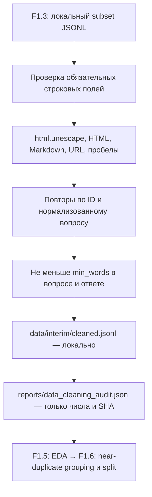
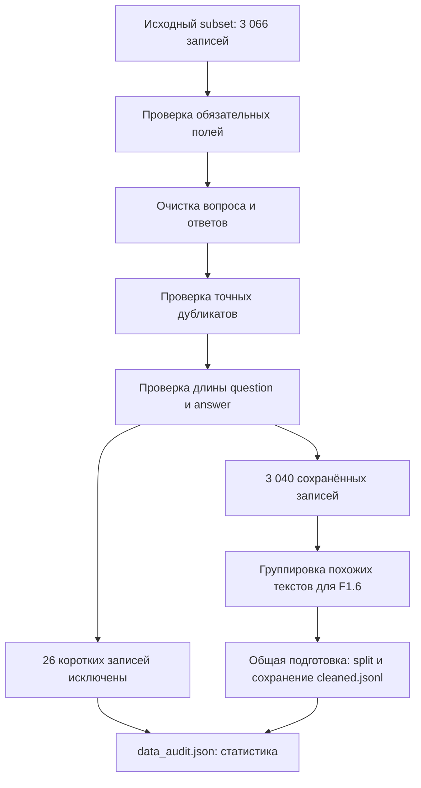

# F1.4 - Data Cleaning: Очистка данных

F1.4 - это подготовка полученных данных к работе с моделями. Необходимо убрать лишнюю разметку, проверить записи и исключить те, которые не подходят по выбранным правилам.

В F1.3 создан `data/raw/subset.jsonl` с 3 066 техническими парами «вопрос - ответ». До классификации и разделения данных требуется применить **одинаковый и воспроизводимый** набор правил ко всем примерам, проверить обязательные поля, удалить точные повторы и сохранить статистику исключений.

В этом шаге `data/interim/cleaned.jsonl` создаётся без `split` и `group_id`.

## Что пришло из исходного проекта

Из архивного `reports/data_audit.json`:
| Показатель | Сохранённый исторический результат |
|---|---:|
| Исходные записи | 3 066 |
| Исключены как короткие | 26 |
| Осталось после очистки | 3 040 |
| Связи между почти одинаковыми вопросами/ответами | 535 |

**Важно:** `near_duplicate_edges=535` - количество связей для объединения в группы перед split, **не число удалённых строк**. Сокращение с 3 066 до 3 040 в сохранённом отчёте объясняется `short_removed=26`. Новый запуск должен подтвердить это отдельно.

## Последовательность алгоритма



### Проверка обязательных полей
Для каждой записи проверка:
- `id` - идентификатор;
- `domain` - раздел источника;
- `context` - вопрос;
- `answer` - ответ.

### Приведение текста к более простому виду
Одна функция очистки применяется к трём полям:
- `context` - вопрос;
- `answer` - положительно оценённый ответ;
- `rejected` - отрицательно оценённый ответ.

### Проверка точных дубликатов
После очистки проверить:
- не встречался ли уже такой `id`;
- не встречался ли уже такой текст вопроса.

### Исключить слишком короткие вопросы и ответы
В настройках проекта задано:
```yaml
min_words: 8
```

## Алгоритм очистки



## Запуск обработки
Из корневой папки проекта `ML Engineering Lab`, в PowerShell:
```powershell
.\.venv\Scripts\python.exe -m src.cli data --offline
```

Эта команда выполняет всю подготовку данных:
- очистку;
- группировку похожих записей;
- split;
- построение графиков;
- сохранение отчёта.


### Нормализация текста
Функция `clean_text` из `src/data/cleaning.py` повторяет порядок действий в оригинальном проекте:
1. `html.unescape` превращает HTML entities (`&amp;`, `&nbsp;`) в символы.
2. Regex удаляет HTML-теги и заменяет их пробелом.
3. Markdown-ссылки `[текст](URL)` превращаются в `текст`.
4. Оставшиеся `http://` и `https://` URL удаляются.
5. Символы backtick, `#` и `*` заменяются пробелами.
6. Повторяющиеся пробельные символы сжимаются до одного пробела.

### Удаление записей
Обязательные поля - `id`, `domain`, `context`, `answer` - должны быть непустыми строками. `rejected` очищается, если это строка, а при отсутствии или другом типе становится пустой строкой. Метаданные (`source`, `source_url`, `source_row`, `language`) сохраняются.

Точная дедупликация выполняется **после очистки**: по `id` или по `context.casefold()`. Вопрос и ответ должны содержать не менее `min_words` слов каждый. Значение в [`configs/local_cpu/lab.yaml`](../../configs/local_cpu/lab.yaml) - 8. Отброшенная слишком короткая запись не резервирует свой ID: последующая полноценная запись с тем же ID всё ещё может пройти.


## Код и результаты
| Компонент | Смысл |
|---|---|
| [`src/data/cleaning.py`](../../src/data/cleaning.py) | Чистые функции `clean_text` и `clean_records`; ни файловой системы, ни сети |
| [`scripts/clean_data.py`](../../scripts/clean_data.py) | Чтение YAML и локального subset; запись cleaned JSONL и JSON-аудита |
| [`tests/test_cleaning.py`](../../tests/test_cleaning.py) | Синтетические unit и integration tests, без внешних Q&A |
| `data/interim/cleaned.jsonl` | Локальная очищенная копия, исключена `.gitignore` |
| `reports/data_cleaning_audit.json` | Локальные счётчики, SHA256, размеры по классам; текстов нет, исключён `.gitignore` |

Аудит проверяет сохранение количества строк:
`input_rows = invalid_or_missing + duplicates_removed + short_removed + output_rows`

Это контроль **арифметики отчёта**, не доказательство правильности очистки с точки зрения предметной области.

## Запуск на Windows после F1.3
Команды выполняются из корня `ml-engineering-lab`:
```powershell
.\.venv\Scripts\python.exe -m pytest -q tests/test_foundation.py tests/test_provenance.py tests/test_ingestion.py tests/test_cleaning.py
.\.venv\Scripts\python.exe -m scripts.clean_data --expect-input 3066 --expect-output 3040
.\.venv\Scripts\python.exe scripts/check_repository.py
```

**Важно:** скрипт по умолчанию **не использует fallback** на sample из 240 строк. Он требует полный локальный `data/raw/subset.jsonl` из F1.3. Если входных/выходных строк не 3 066/3 040, выполнение закончится FAIL **до записи результата**. Нужно исследовать причину, а не подгонять числа вручную.

При успешном запуске ожидаются примерно такие сообщения:
```text
Data cleaning: PASS; input=3066; short_removed=26; duplicates_removed=0; invalid_or_missing=0; output=3040
Near-duplicate grouping / train-val-test split: NOT RUN (F1.6)
```

**Это ожидание по архивному отчёту, а не уже измеренный результат нового запуска.** В отчёте `source_sha256` покажет SHA-256 текущего subset, что позволяет выяснять различия между версиями ingestion.

Для проверки повторяемости запусти ту же команду дважды и сравни вывод: по одинаковому входу и конфигурации байты файлов результата должны совпадать. CI запускает синтетические тесты, но не скачивает и не очищает полный корпус.

## Ограничения и риски
- Правило удаления символов `#` и backticks **может повредить техническую семантику**, в частности `C#`, Markdown и кодовые конструкции. URL в вопросе тоже иногда важен. Для production лучше code-aware parser и отдельные поля для текста/кода.
- Фильтр `min_words=8` может удалять короткие, но корректные команды. Нужен аудит распределения удалений и экспертная проверка.
- Совпадение текста после `.casefold()` - только **точный** дубликат после нормализации.
- Нельзя публиковать реальные Q&A без разрешённой атрибуции и лицензии. Код и синтетические fixtures безопаснее для публичных тестов.
- Здесь нет обучения моделей, split или leakage-анализа. Сводный исторический отчёт F1 не заменяет проверки этих будущих этапов.

**Критерий завершения:** локальный запуск на полном subset подтверждает 3 066 → 3 040, unit-тесты и проверка репозитория успешны, опубликован ограниченный набор файлов, CI проходит в GitHub Actions.

## Основная мысль F1.4
Очистка должна быть понятной и проверяемой. Важно знать не только, что было исключено, но и какую полезную информацию могли потерять.
- Наличие текста не гарантирует его смысловую корректность.
- HTML и Markdown могут добавлять лишнее оформление.
- Порядок преобразований влияет на результат.
- Точные дубликаты и похожие тексты обрабатываются разными способами.
- Порог длины - выбранное правило, а не универсальная оценка качества.
- Исходные данные сохраняются отдельно от подготовленной версии.
- Статистика очистки помогает обнаружить неожиданные потери данных.
- В технических данных символы и форматирование кода могут быть важны.
