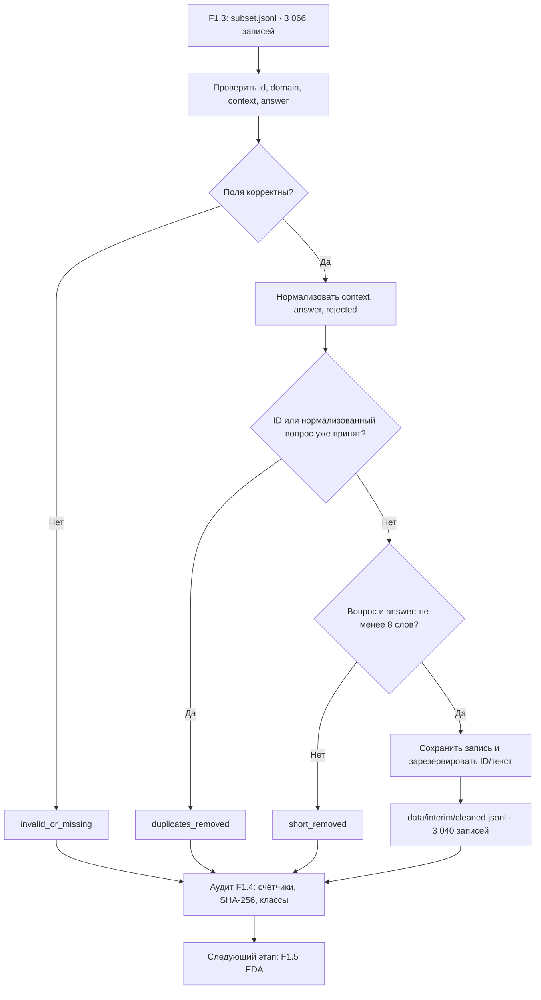

# F1.4 - Data Cleaning: подготовка технических вопросов к обучению

## 1. Цель этапа:

В F1.3 получена из закреплённых источников Stack Exchange воспроизводимая выборка из **3 066 технических вопросов и ответов**. Каждый пример уже имеет идентификатор, категорию (`linux`, `databases`, `systems` или `programming`), текст вопроса, ответ и сведения об источнике.

**Получить данные - не значит подготовить их к машинному обучению**. Вопрос может содержать HTML-теги, Markdown-ссылки, лишние пробелы или разметку фрагментов кода. Некоторые записи оказываются слишком короткими для выбранного правила отбора. Наконец, один и тот же вопрос может встретиться повторно под другим идентификатором.

Если передать такие тексты непосредственно в классификатор, он будет строить признаки не только по содержанию вопроса, но и по случайным особенностям оформления. А дубли способны исказить представление о составе датасета. Поэтому сначала требуется отдельный, контролируемый этап очистки.

**Задача F1.4:** реализовать процесс, который последовательно:
1. Проверяет, что запись имеет необходимую структуру и обязательные текстовые поля.
2. Приводит текст вопроса и ответов к согласованному виду.
3. Убирает **точные** дубли по идентификатору или нормализованному тексту вопроса.
4. Исключает примеры, где вопрос либо выбранный ответ слишком короток.
5. Сохраняет принятые записи, не теряя исходные сведения об их происхождении.
6. Формирует отдельный аудит: сколько записей получено, сколько отброшено по каждой причине и сколько осталось.
## 2. Реализация: файлы этапа

Разделен **сам алгоритм очистки**, **его запуск на файлах** и **проверка корректности**. Благодаря этому одну и ту же логику можно проверить на небольших искусственных примерах, не скачивая исходный датасет.

| Файл                                                     | Что реализовано и зачем                                                                                                                                                                                             |
| -------------------------------------------------------- | ------------------------------------------------------------------------------------------------------------------------------------------------------------------------------------------------------------------- |
| [`src/data/cleaning.py`](../../src/data/cleaning.py)     | **Основной алгоритм F1.4.** `clean_text()` нормализует строку, а `clean_records()` проверяет и фильтрует записи, убирает точные дубли и считает причины исключения. Функции не читают файлы и не обращаются к сети. |
| [`scripts/clean_data.py`](../../scripts/clean_data.py)   | **Исполняемый сценарий этапа.** Читает YAML-настройки и `subset.jsonl`, вызывает `clean_records()`, проверяет ожидаемые размеры и сохраняет очищенные данные с JSON-аудитом.                                        |
| [`tests/test_cleaning.py`](../../tests/test_cleaning.py) | Автоматические тесты на **синтетических** записях: нормализация, дубли, минимальная длина, сохранение метаданных, повторяемость, ошибки входа и работа скрипта целиком.                                             |

В пакете этого этапа также обновлялись [`docs/DATA_PROVENANCE.md`](../DATA_PROVENANCE.md), [`README.md`](../../README.md), [`.gitignore`](../../.gitignore) и [`.github/workflows/foundation-tests.yml`](../../.github/workflows/foundation-tests.yml). Они описывают правила работы с данными, исключают локальные артефакты из публикации и подключают тесты очистки к уже существующему CI. **Это вспомогательная инфраструктура; алгоритм находится в `src/data/cleaning.py`.**

### Что используется из предыдущих этапов
- `data/raw/subset.jsonl` - локальная основная выборка из F1.3. Для полного исторического прогона требуется **3 066 записей**, а не sample из 240 записей.
- [`configs/local_cpu/lab.yaml`](../../configs/local_cpu/lab.yaml) - YAML-профиль с путём входного файла и правилом `data.min_words: 8`.
- [`src/common/io.py`](../../src/common/io.py) - общие операции чтения JSONL и определения корня проекта.

### Какие локальные результаты создаются

| Результат                          | Содержание                                                                                                       | Публикуется ли в GitHub                                            |
| ---------------------------------- | ---------------------------------------------------------------------------------------------------------------- | ------------------------------------------------------------------ |
| `data/interim/cleaned.jsonl`       | Очищенные записи вместе с их идентификаторами, метками и provenance-полями.                                      | **Нет:** содержит исходные Q&A-тексты.                             |
| `reports/data_cleaning_audit.json` | Число входных/выходных записей, причины исключения, распределение классов, SHA-256 входного файла и порог длины. | **Нет:** локальный служебный результат, исключённый из публикации. |
Исходный `data/raw/subset.jsonl` не перезаписывается: новый очищенный набор сохраняется в другом каталоге.

## 3. Последовательность действий

### Шаг 1. Определен вход, выход и правило качества
На вход очистки поступают записи, подготовленные F1.3. Важные поля:

| Поле       | Что означает                                  | Что требуется в F1.4                                                                    |
| ---------- | --------------------------------------------- | --------------------------------------------------------------------------------------- |
| `id`       | Уникальный идентификатор исходного примера.   | Непустая строка.                                                                        |
| `domain`   | Тематическая категория вопроса.               | Непустая строка.                                                                        |
| `context`  | Текст технического вопроса.                   | Непустая строка до нормализации.                                                        |
| `answer`   | Выбранный положительно оценённый ответ.       | Непустая строка до нормализации.                                                        |
| `rejected` | Альтернативный, отрицательно оценённый ответ. | Необязательное поле; при отсутствии или неподходящем типе превращается в пустую строку. |

Сведения о происхождении (`source`, `source_url`, `source_row`, `language` и другие имеющиеся поля) **нужно сохранить**, иначе в следующих этапах станет сложно сопоставить очищенный пример с исходной записью.

В YAML-конфигурации предусмотрено правило:
```yaml
data:
  min_words: 8
```

Это значит, что для включения записи **и вопрос, и выбранный ответ** должны содержать как минимум восемь слов после нормализации. Важна логика `И`, а не `ИЛИ`: длинный вопрос с коротким ответом не проходит.

**Зачем этот шаг:** заранее установить одинаковые для всех записей критерии и не менять их незаметно во время обработки.

### Шаг 2. Выделена нормализация текста в отдельную функцию
В [`src/data/cleaning.py`](../../src/data/cleaning.py) создана функция `clean_text(text: str) -> str`. Она принимает одну строку и возвращает нормализованный текст.

Преобразования выполняются в определённом порядке:
1. **`html.unescape`** заменяет HTML-сущности (`&nbsp;`, `&amp;`, `&lt;`) соответствующими символами.
2. Регулярное выражение убирает **HTML-теги**, заменяя их пробелами.
3. Markdown-ссылку `[название](https://...)` превращает в видимый текст `название`.
4. Удаляет оставшиеся URL, начинающиеся с `http://` или `https://`.
5. Заменяет на пробелы последовательности символов разметки: обратные кавычки, `#` и `*`.
6. Сжимает повторяющиеся пробелы, табуляции и переносы строк до одного пробела и убирает пробелы по краям.

В тестах используется синтетический пример:
```text
До:    A&nbsp; <p>B</p> [guide](https://example.com) `code` #tag*
После: A B guide code tag
```

Содержимое тега или подпись ссылки сохраняется, а окружающая разметка удаляется. При этом такой способ **не является полноценным парсером технического кода**: некоторые значимые символы тоже могут пропасть.

**Зачем этот шаг:** уменьшить влияние случайного оформления на текстовые признаки, которые позднее будет вычислять TF-IDF.

### Шаг 3. Добавлена проверка обязательных полей каждой записи
Вторая ключевая функция - `clean_records(records, *, min_words)`. Она проходит по входным записям последовательно.

Сначала проверяются обязательные поля: `id`, `domain`, `context` и `answer`. Если элемент вообще не является словарём, обязательное поле отсутствует, имеет неподходящий тип или состоит только из пробелов, запись увеличивает счётчик `invalid_or_missing` и **не допускается к дальнейшей обработке**.

Для подходящей записи создаётся **копия словаря**: `item = dict(record)`. Следовательно, очистка изменяет новую запись, а не исходный объект в памяти. Это проверяется отдельным тестом.

**Зачем этот шаг:** не прерывать всю обработку из-за отдельной непригодной записи и не терять контроль над тем, почему она исключена.

### Шаг 4. Нормализация вопроса и обоих вариантов ответа
Для принятого на предыдущем шаге словаря отдельно вызывается `clean_text()`:
- для `context` - вопроса, который будет использоваться при классификации;
- для `answer` - выбранного ответа;
- для `rejected` - альтернативного ответа, если он представлен строкой.

Обязательными при фильтрации остаются **вопрос и `answer`**. Поле `rejected` не обязано присутствовать: при его отсутствии записывается пустая строка, не удаляя весь пример.

Все остальные поля копируются из входной записи, в том числе `domain` и данные о происхождении.

**Зачем этот шаг:** привести текстовые поля к одинаковой форме и одновременно сохранить данные, которые могут понадобиться в retrieval и LLM-экспериментах последующих фаз.

### Шаг 5. Проверка точных дублей после очистки
После нормализации два вопроса могут стать одинаковыми, хотя исходные строки отличались пробелами, регистром или оформлением.

Поэтому `clean_records()` ведёт два множества:
- `seen_ids` - идентификаторы **уже принятых** записей;
- `seen_texts` - нормализованные вопросы **уже принятых** записей, дополнительно приведённые через `.casefold()`.

Если в принятом наборе уже есть такой же `id` **или** такой же нормализованный вопрос, следующая запись считается точным дублем и увеличивает `duplicates_removed`.

Условный пример:
```text
Вопрос A: "ONE two three four five six seven eight"
Вопрос B: "one  two three four five six seven eight"

После очистки и casefold(): одинаковый ключ.
Результат: при достаточной длине и разных ID сохраняется первая запись.
```

**Важно:** здесь проверяется **точное совпадение после нормализации**, а не смысловая близость. Вопросы «Как перезапустить сервер?» и «Как перезагрузить сервер?» не обязаны совпасть по тексту. 

**Зачем этот шаг:** не допустить повторения одинаковых примеров и при этом не удалять записи просто потому, что они относятся к похожей теме.

### Шаг 6. Отфильтровать слишком короткие вопросы и ответы
Следующий контроль - количество слов после очистки. В коде используется разбиение `.split()` по пробелам и проверка меньшей из двух длин:
```python
min(len(item["context"].split()), len(item["answer"].split())) < min_words
```

Если хотя бы одна часть содержит **меньше восьми слов**, запись не сохраняется, а счётчик `short_removed` увеличивается.

Здесь есть важное инженерное решение: **ID и текст вопроса добавляются в `seen_ids` и `seen_texts` только после успешной проверки длины**.

Необходимо представить две записи с одинаковым `id`:
1. Первая содержит слишком короткий вопрос и не проходит фильтр.
2. Вторая содержит полноценный вопрос и ответ.

Если пометить `id` как «уже встреченный» до проверки длины, вторая запись была бы ошибочно удалена. В реализации короткая запись не резервирует идентификатор.

**Зачем этот шаг:** сохранять пригодные данные, даже если раньше в потоке встретился их некачественный вариант.

### Шаг 7. Подсчитаны причины исключения и проверка баланса
В ходе обработки используется счётчик `Counter` с пятью показателями:

| Показатель           | Что считает                                                       |
| -------------------- | ----------------------------------------------------------------- |
| `input_rows`         | Сколько элементов поступило на вход.                              |
| `invalid_or_missing` | Сколько записей отклонено из-за структуры или обязательных полей. |
| `duplicates_removed` | Сколько отклонено как точные дубли уже принятых записей.          |
| `short_removed`      | Сколько отклонено из-за длины вопроса или ответа.                 |
| `output_rows`        | Сколько записей осталось после очистки.                           |

В конце `clean_records()` проверяется арифметическая согласованность:
\[
\text{input\_rows} = \text{invalid\_or\_missing} + \text{duplicates\_removed} + \text{short\_removed} + \text{output\_rows}.
\]

По подтверждённым результатам F1.4:

| Показатель                  |  Значение |
| --------------------------- | --------: |
| Вход                        | **3 066** |
| Неверные/отсутствующие поля |     **0** |
| Точные дубли                |     **0** |
| Слишком короткие записи     |    **26** |
| Выход                       | **3 040** |

Проверка баланса: `3 066 = 0 + 0 + 26 + 3 040`.

**Отдельное уточнение про похожие записи:** число `near_duplicate_edges=535`, фигурировавшее в историческом сводном отчёте - это число обнаруженных **связей сходства**, а не удалённых строк. Оно относится к последующей группировке перед split, **не к очистке F1.4**. Его не следует добавлять к `duplicates_removed` или вычитать из 3 040.

**Зачем этот шаг:** результат очистки должен быть объяснимым: сколько данных потеряли и по каким правилам, а не просто «стало меньше записей».

### Шаг 8. Сделан отдельный скрипт запуска и безопасное сохранение
Связать алгоритм с файлами через [`scripts/clean_data.py`](../../scripts/clean_data.py).

Функция `run(...)` последовательно:
1. Загружает YAML-конфигурацию и проверяет корректность `data.min_words`.
2. Определяет путь к **полному** `data/raw/subset.jsonl`. Если файла нет, завершает работу с ошибкой; автоматической подмены на маленький sample нет.
3. Проверяет, что входной файл, выходной JSONL и файл аудита имеют разные пути.
4. Читает входные записи и, если передан `--expect-input`, проверяет их количество.
5. Запускает `clean_records(...)` с настройкой `min_words`.
6. Если передан `--expect-output`, проверяет число очищенных записей **до записи результатов**.
7. Формирует аудит: счётчики, распределение по классам, `source_sha256` исходного subset и указание, что группировка похожих записей и split ещё не выполнялись.
8. Сохраняет очищенный JSONL и аудит через `_atomic_write(...)`: сначала пишет временный файл, затем заменяет целевой.

**Зачем временный файл:** чтобы целевой файл не оказался частично записанным при ошибке во время одной операции сохранения. При этом запись двух отдельных файлов не образует единую транзакцию: атомарность обеспечена для каждого файла отдельно.

Если фактическое число входных или выходных строк отличается от ожидаемого, скрипт сообщает об ошибке до сохранения новой версии результата. Исправлять в такой ситуации нужно причину расхождения, а не вручную подгонять счётчики.

## 4. Алгоритм очистки: путь одной записи от входа до результата

Работа `clean_records()` как на последовательность решений для каждой записи. Именно этот алгоритм полезно мысленно воспроизводить при изучении исходников:

**Шаг A - проверка структуры.** Вход должен быть словарём с непустыми строковыми `id`, `domain`, `context`, `answer`. Неверная запись сразу попадает в `invalid_or_missing`.

**Шаг B - копирование.** Создать новый словарь, чтобы не менять исходную запись и не терять другие поля.

**Шаг C - очистка текста.** Нормализовать вопрос, положительный и доступный отрицательный ответ.

**Шаг D - точная дедупликация.** Сформировать `context.casefold()`. Если `id` или этот текст уже относятся к ранее принятой записи, увеличить `duplicates_removed`.

**Шаг E - проверка длины.** Подсчет слов в `context` и `answer`. Если хотя бы в одном поле меньше `min_words`, увеличить `short_removed`.

**Шаг F - принятие.** Добавить `id` и нормализованный текст в множества увиденных значений, затем сохранить очищенный словарь в итоговый список.

### Почему важен именно такой порядок
Если сначала убрать слишком короткую запись, а только потом учитывать её ID как занятый, другой корректный вариант сможет пройти. Если нормализовать текст после поиска дублей, можно не обнаружить два одинаковых вопроса с разной разметкой. Если допустить запись без обязательного ответа, последующее обучение или оценка на ответах может работать с неполными данными.

Поэтому F1.4 - это не один вызов «очистить строку», а **упорядоченная цепочка проверок и преобразований**.

## 5. Схема этапа: что происходит с данными



На схеме специально **нет** объединения похожих вопросов и формирования **Train/Validation/Test**. Это другой алгоритм, который будет реализован далее. Здесь только подготавливаются записи, чтобы их можно было исследовать и затем корректно разделить.

## 6. Локальная проверка в PowerShell: что запускать и как читать результат

Все команды ниже предназначены для **уже подготовленного локального проекта**. Они не устанавливают зависимости и не изменяют историю Git.

### 6.1. Перейти в корень проекта
```powershell
cd F:\DEVELOPMENT\ML\ml-engineering-lab
```

### 6.2. Запустить тесты только F1.4
```powershell
.\.venv\Scripts\python.exe -m pytest tests/test_cleaning.py -q
```

**Что проверяется:** нормализация HTML/Markdown/URL, отсутствие изменения исходных словарей, контроль обязательных полей, дубли по ID и тексту, фильтрацию по длине, повторяемость, безопасную обработку некорректного `min_words` и поведение при ошибках файлов.

Тесты используют синтетические записи и временные каталоги. **Реальные Q&A и Интернет для них не нужны.** Число прошедших тестов определяется текущим выводом `pytest`, потому что состав репозитория со временем меняется.

### 6.3. Выполнить полную очистку исторического корпуса
```powershell
.\.venv\Scripts\python.exe -m scripts.clean_data --expect-input 3066 --expect-output 3040
```

**Условие:** файл `data/raw/subset.jsonl` из F1.3 уже должен находиться локально. Использовать вместо него 240-строчный sample для этой проверки нельзя.

**Подтверждённый итог этапа для соответствующего исторического корпуса:**
```text
Data cleaning: PASS; input=3066; short_removed=26; duplicates_removed=0; invalid_or_missing=0; output=3040
```

Если вместо `PASS` появляется `FAIL`, особенно из-за несовпадения счётчиков, необходимо сначала сверить локальный subset, конфигурацию и контрольную сумму источника.

### 6.4. Проверить, что созданы результаты
```powershell
Test-Path data/interim/cleaned.jsonl
Test-Path reports/data_cleaning_audit.json
```

Обе команды должны возвращать `True` после успешного полного запуска.

Можно посмотреть **только агрегированные показатели** аудита, не выводя в консоль исходные тексты Q&A:
```powershell
$audit = Get-Content reports/data_cleaning_audit.json -Raw | ConvertFrom-Json
$audit.cleaning
$audit.by_domain
$audit.source_sha256
```

**Что здесь важно:** общий баланс сходится, у аудита есть контрольная сумма входа, распределение по доменам рассчитано по **уже очищенным** записям.

### 6.5. При необходимости проверить повторяемость сохранения
После первого успешного запуска запомнить SHA-256 двух результатов:

```powershell
Get-FileHash data/interim/cleaned.jsonl -Algorithm SHA256
Get-FileHash reports/data_cleaning_audit.json -Algorithm SHA256
```

Затем **повторить команду из пункта 6.3** и снова посмотреть два хеша. При одинаковых входных байтах, конфигурации и реализации они должны совпасть.

Так проверяется не только совпадение числа записей, но и стабильность самих сформированных файлов.

### 6.6. Проверить, что предыдущие этапы не нарушены
```powershell
.\.venv\Scripts\python.exe -m pytest -q
.\.venv\Scripts\python.exe scripts/check_repository.py
```

Полный `pytest` проверяет доступные тесты репозитория, а `check_repository.py` - правила структуры и публикации. Эти проверки не равнозначны повторной очистке полного корпуса: для неё нужна отдельная команда из пункта 6.3.

## 7. Что подтверждено и какие ограничения

**Подтверждено в работе над F1.4:** реализованы отдельные функции очистки, синтетические unit/integration-тесты и скрипт для локального полного корпуса. В подтверждённом запуске получено **3 040 записей из 3 066**, причём удалены 26 слишком коротких, а число удалений по другим двум причинам равно нулю.

**Отдельное инженерное ограничение:** функция `clean_text()` - намеренно простая историческая нормализация текста. Для промышленного анализа технических документов потребовалось бы осторожнее отделять обычный текст от фрагментов кода, команд, URL и форматирования.

## 8. Основная мысль раздела

**В F1.3 получен воспроизводимый набор технических вопросов; в F1.4 - превратили данный набор в проверяемый очищенный корпус. Не просто разметка удалена и 26 записей: заданы понятные правила, сохранено происхождение каждого принятого примера, подсчитаны причины исключения и предусмотрены автоматические проверки, чтобы затем строить EDA, split и baseline на согласованных данных.**

## 9. Файлы этапа

Для анализа кода F1.4 необходимо идти **в следующем порядке**:

| Порядок | Файл / функция                                                                                                                                                           | На что обратить внимание                                                                                                 |
| ------- | ------------------------------------------------------------------------------------------------------------------------------------------------------------------------ | ------------------------------------------------------------------------------------------------------------------------ |
| 1       | [`tests/test_cleaning.py`](../../tests/test_cleaning.py) - тесты `test_normalization_matches_original_pipeline()` и `test_short_context_and_short_answer_both_removed()` | По коротким синтетическим примерам легко увидеть, какие строки меняются и почему часть записей отбрасывается.            |
| 2       | [`src/data/cleaning.py`](../../src/data/cleaning.py) - `clean_text()`                                                                                                    | Порядок `html.unescape`, регулярных выражений и нормализации пробелов; ограничения для технических текстов.              |
| 3       | [`src/data/cleaning.py`](../../src/data/cleaning.py) - `clean_records()`                                                                                                 | Проверка обязательных полей, копирование записи, две структуры `seen_*`, порог длины и счётчики.                         |
| 4       | [`tests/test_cleaning.py`](../../tests/test_cleaning.py) - `test_short_unaccepted_id_does_not_block_later_valid_record()`                                                | Почему ID короткого отклонённого вопроса нельзя резервировать преждевременно.                                            |
| 5       | [`scripts/clean_data.py`](../../scripts/clean_data.py) - `run()`                                                                                                         | Чтение YAML и исходного JSONL, обязательный полный subset, `--expect-input`/`--expect-output`, формирование JSON-аудита. |
| 6       | [`scripts/clean_data.py`](../../scripts/clean_data.py) - `_atomic_write()` и `main()`                                                                                    | Как сохраняются файлы через временную копию и как ошибки превращаются в понятный CLI-результат.                          |
| 7       | [`tests/test_cleaning.py`](../../tests/test_cleaning.py) - `test_end_to_end_offline_audit_and_stable_bytes()` и тесты ошибок                                             | Повторяемость байтов, сохранение SHA-256 и отсутствие частичных результатов при несоответствии ожидаемых счётчиков.      |
| 8       | [`configs/local_cpu/lab.yaml`](../../configs/local_cpu/lab.yaml)                                                                                                         | Почему порог `min_words=8` хранится в конфигурации, а не спрятан в функции очистки.                                      |

**Итог F1.4:** Разобран способ, как из 3 066 исходных записей получается 3 040 очищенных, почему правила применяются именно в таком порядке и какими локальными проверками подтверждается результат.
