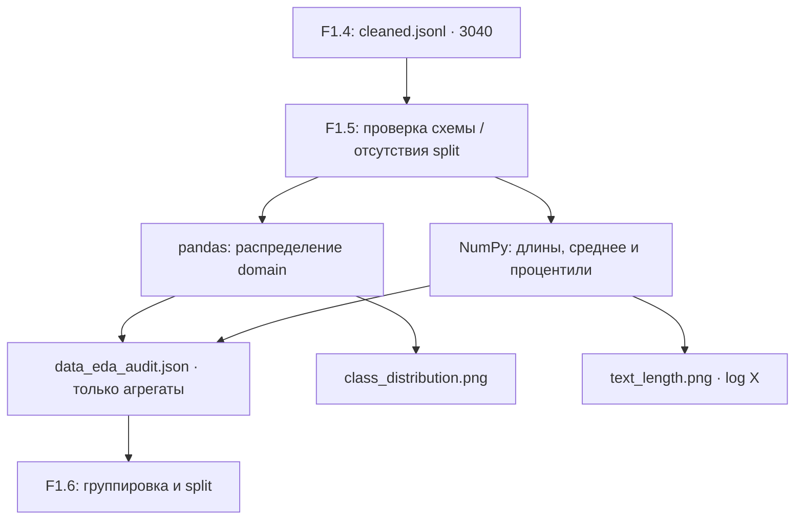

# F1.5 — Exploratory Data Analysis (EDA)

**Этап публикации:** пакет готов к проверке на Windows. **Исходный ML Engineering Lab:** F1.5 обозначен как «Разведочный анализ», имеет исторический статус PASS. Здесь он выделен в самостоятельный, проверяемый модуль. Подтверждение на полном корпусе и GitHub Actions выполняется отдельно.

## 1. Цель и границы

**Exploratory Data Analysis (EDA)** — разведочный анализ, который помогает до обучения понять распределение целевой метки `domain`, длину текстов, качество обязательных полей и возможный дисбаланс классов.

**Вход:** `data/interim/cleaned.jsonl` — результат F1.4, ожидаемые **3 040** очищенных записей.

**Не входит:** train/validation/test split, объединение близких дубликатов в группы и контроль data leakage. Согласно **оригинальной нумерации проекта** это F1.6. В исходном `src/data/pipeline.py` EDA и split выполнялись внутри общей функции `prepare`, поэтому там строились гистограммы по split. В публичной поэтапной версии F1.5 рисует статистику **по всему очищенному корпусу, до разделения**.

## 2. Что анализируем

| Показатель | Определение | Для чего нужен |
|---|---|---|
| `total_rows` | Количество очищенных записей | Контроль входного корпуса |
| `class_distribution` | `value_counts(domain)` | Дисбаланс классов, корректность оценки macro F1 |
| `class_imbalance_ratio_max_min` | Самый большой класс / самый маленький | Приближённая мера перекоса |
| `context_words`, `answer_words` | min/max/mean/median/p90/p95 длин в словах | Оценка длинных текстов, планирование token budget |
| `required_field_missing_or_empty` | Пропуски в `id`, `domain`, `context`, `answer` | Контроль контракта F1.4 |
| `source_sha256` | Контрольная сумма файла F1.4 | Сопоставимость EDA при повторном запуске |

**Процентили:** p90 — значение, ниже или на уровне которого находится примерно 90% текстов. **Медиана** — 50-й процентиль. **Macro F1** усредняет F1 по классам с равным весом независимо от их численности.

**Важно:** здесь считаем слова с помощью `str.split()`, а **не** токены BPE/WordPiece. Для Transformer максимальная длина в токенах может значительно отличаться. `context` и `answer` анализируются отдельно.

## 3. Архитектура



Исполняемые модули:

- [`src/data/eda.py`](../../src/data/eda.py) — `summarize_cleaned`: чистая аналитика; выдаёт только числа и статус `EDA_BEFORE_SPLIT`.
- [`scripts/eda_data.py`](../../scripts/eda_data.py) — CLI, проверка ожидаемого размера, хеширование входа, запись агрегатов и создание графиков.
- [`tests/test_eda.py`](../../tests/test_eda.py) — автономные тесты со **синтетическими** примерами.
- [`requirements-eda.txt`](../../requirements-eda.txt) — Python-зависимости этапа (`pandas`, `matplotlib` поверх foundation).

## 4. Графики

`docs/visuals/f1/class_distribution.png` — столбцы с количеством записей в каждом из четырёх классов. **Не путать** с точностью/качеством классификатора: EDA не обучает модель.

`docs/visuals/f1/text_length.png` — две гистограммы длины (вопрос и ответ). Горизонтальная ось **логарифмическая**, чтобы видеть одновременно короткие и очень длинные тексты. Это не сравнение по train/val/test: такого разбиения ещё нет.

Графики и отчёт генерируются локально и игнорируются Git. В публичном репозитории лежат код генерации, инструкции, тесты и метаданные. Перед отдельной публикацией агрегированных графиков следует дополнительно проверить условия использования датасета.

## 5. Исторические данные из исходного проекта

Сохранённый `reports/data_audit.json` из первоначального архива указывает:

| Метка `domain` | Очищенных записей (исторический отчёт) |
|---|---:|
| databases | 800 |
| linux | 793 |
| programming | 666 |
| systems | 781 |
| **Итого** | **3 040** |

Это **ожидания из прошлого выполнения**, а не результаты нового запуска F1.5. Новая версия должна самостоятельно пересчитать числа на локальном файле.

## 6. Как запустить на Windows

В корне репозитория после F1.4:

```powershell
.\.venv\Scripts\python.exe -m pip install -r requirements-eda.txt
.\.venv\Scripts\python.exe -m pytest -q tests/test_foundation.py tests/test_provenance.py tests/test_ingestion.py tests/test_cleaning.py tests/test_eda.py
.\.venv\Scripts\python.exe -m scripts.eda_data --expect-rows 3040
.\.venv\Scripts\python.exe scripts/check_repository.py
```

Скрипт должен вывести `EDA: PASS`, `rows=3040`, четыре класса и имена двух созданных графиков. Важно проверить фактические количества по каждому классу, а не подгонять параметры под сохранённые значения.

Локальные результаты:

- `reports/data_eda_audit.json` — JSON с агрегатами и SHA-256 входного файла;
- `docs/visuals/f1/class_distribution.png` — распределение классов;
- `docs/visuals/f1/text_length.png` — распределения длин.

Отчёт и изображения исключаются `.gitignore`; исходные тексты также остаются локальными. При повторном запуске на том же файле JSON-аудит должен быть побайтово идентичен.

## 7. Риски и ограничения

1. **Overlapping classes.** Темы Linux, администрирования систем и программирования могут пересекаться. `domain` отражает источник вопроса, а не экспертную классификацию.
2. **Word length != token length.** Для будущих нейросетевых моделей нужен отдельный анализ токенизатора.
3. **EDA не доказывает отсутствие leakage.** Группировка почти совпадающих вопросов/ответов и независимое разбиение — F1.6.
4. **Количество строк само по себе не подтверждает качество данных.** Нужны проверки правил очистки и экспертная оценка.
5. **Реальные Q&A не публикуем.** В репозитории тесты содержат только искусственно созданные строки.

## 8. Контрольные вопросы

1. Зачем исследовать распределение `domain` перед обучением классификатора?
2. Почему в отчёте нужны медиана и p95, а одного среднего недостаточно?
3. Чем число слов отличается от числа токенов Transformer?
4. Почему классовый дисбаланс делает accuracy менее информативной метрикой?
5. Почему нельзя строить статистику по `train/test`, пока F1.6 не выполнен?

**Критерии PASS:** все автономные тесты проходят; на полном корпусе EDA создаёт агрегированный JSON и два графика, количество записей и классов подтверждено; Git содержит только разрешённые файлы; GitHub Actions проходит.
