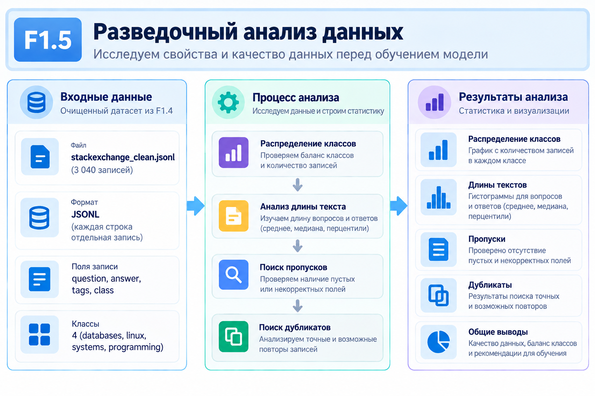
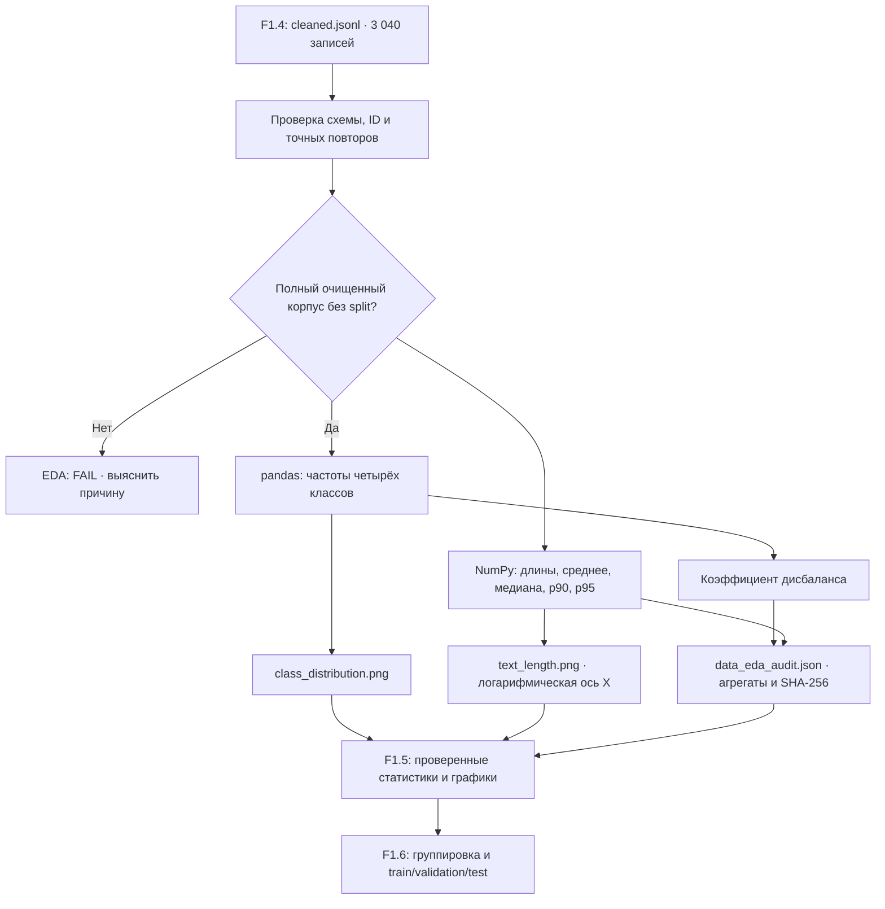

# F1.5 - Exploratory Data Analysis (EDA): изучение очищенного датасета перед обучением

## 1. Цель этапа:

В F1.4 получен файл `data/interim/cleaned.jsonl`: из исходных 3 066 записей оставлено 3 040, проверены обязательные поля, текст приведен к согласованному виду и исключены 26 слишком коротких примеров. После очистки данные стали пригодны для дальнейшей работы, но **ещё нет достаточной информации о составе самого корпуса**.



Две ситуации. В первой четыре категории представлены примерно одинаково: у модели будет достаточно примеров каждой темы. Во второй почти все вопросы относятся к Linux, а программирование встречается редко. Обычная точность классификации в таком случае может скрыть плохую работу с редкой категорией. Другой вопрос - длина текста. Если многие технические вопросы занимают сотни слов, будущая модель с ограничением длины входа может потерять часть полезной информации.

Чтобы принимать решения об обучении на основании фактов, а не предположений,  необходимо провести **Exploratory Data Analysis (EDA)** - разведочный анализ очищенного корпуса.

**Задача F1.5:** последовательно проверить вход, измерить состав и длины текстов, визуализировать результаты, сохранить только безопасные агрегированные показатели и подготовить информацию для следующих этапов.

Что необходимо выяснить:
1. Действительно ли на входе **3 040** записей, подготовленных F1.4?
2. Сколько записей относится к `databases`, `linux`, `systems` и `programming`?
3. Есть ли заметный **дисбаланс классов**, который потребуется учитывать при оценке модели?
4. Сколько слов содержат вопросы и ответы; насколько сильно различаются короткие и длинные тексты?
5. Не появились ли пустые обязательные поля, повторные ID или одинаковые нормализованные вопросы?
6. Можно ли получить отчёт и графики, **не публикуя исходные тексты Q&A**?

## 2. Реализация: файлы этапа

Разделить **аналитические вычисления**, **сценарий работы с файлами** и **тесты**. Статистику можно отдельно проверять на искусственных данных, не скачивая реальный датасет.

| Файл                                                 | Что сделали и зачем                                                                                                                                                                                                                                                                                          |
| ---------------------------------------------------- | ------------------------------------------------------------------------------------------------------------------------------------------------------------------------------------------------------------------------------------------------------------------------------------------------------------ |
| [`src/data/eda.py`](../../src/data/eda.py)           | **Основной алгоритм анализа.** Функция `summarize_cleaned()` проверяет входные записи, считает распределение классов и статистику длин, формирует словарь с агрегатами. `_length_statistics()` рассчитывает min/max/mean/median/p90/p95. `length_arrays()` готовит числовые последовательности для графиков. |
| [`scripts/eda_data.py`](../../scripts/eda_data.py)   | **Исполняемый сценарий этапа.** `run()` читает очищенный JSONL, проверяет количество строк, вычисляет SHA-256, вызывает аналитические функции, строит две картинки и сохраняет JSON-аудит. `main()` обрабатывает параметры командной строки и сообщает PASS/FAIL.                                            |
| [`tests/test_eda.py`](../../tests/test_eda.py)       | Автоматические проверки формул и инвариантов на **синтетических** записях: распределение классов, длины, ошибки входа, отсутствие утечек текстов в отчёт, создание графиков и повторяемость.                                                                                                                 |
| [`requirements-eda.txt`](../../requirements-eda.txt) | Перечень зависимостей данного шага, в частности `pandas` и `matplotlib` поверх уже существующих библиотек проекта.                                                                                                                                                                                           |

При публикации F1.5 также обновлялись файлы инфраструктуры: [`README.md`](../../README.md), [`docs/DATA_PROVENANCE.md`](../DATA_PROVENANCE.md), [`.gitignore`](../../.gitignore) и [`.github/workflows/foundation-tests.yml`](../../.github/workflows/foundation-tests.yml). Они описывают шаг, исключают локальные результаты из публичного Git и включают синтетические тесты в CI. **Сам анализ выполняется в `src/data/eda.py` и `scripts/eda_data.py`.**

### Что используется из предыдущего этапа
- `data/interim/cleaned.jsonl` - **полный очищенный корпус** после F1.4; для контрольного запуска это 3 040 записей. Файл содержит реальные Q&A и остаётся локальным.
- [`src/common/io.py`](../../src/common/io.py) - общая функция `read_jsonl()` и путь `ROOT` к проекту.
- Результаты F1.4 - чтобы понимать, почему вход EDA должен содержать именно 3 040 записей.

### Какие локальные файлы создаются

| Локальный файл                           | Содержание                                                                                                                    | Публикуем ли в GitHub                                                                   |
| ---------------------------------------- | ----------------------------------------------------------------------------------------------------------------------------- | --------------------------------------------------------------------------------------- |
| `reports/data_eda_audit.json`            | Число записей, классы, коэффициент дисбаланса, статистика длины вопросов и ответов, SHA-256 входа, сведения о границах этапа. | **Нет:** локальный аудит, исключённый `.gitignore`.                                     |
| `docs/visuals/f1/class_distribution.png` | Столбчатая диаграмма количества вопросов в каждом классе.                                                                     | **Не автоматически:** локально сгенерированная картинка исключена текущим `.gitignore`. |
| `docs/visuals/f1/text_length.png`        | Гистограммы длин вопросов и ответов по числу слов; ось X логарифмическая.                                                     | **Не автоматически:** локально сгенерированная картинка исключена текущим `.gitignore`. |
**Ни исходные `context` и `answer`, ни ID отдельных записей не записываются в JSON-аудит**. Для построения гистограммы программа временно использует длины отдельных текстов в памяти, но не сохраняет их как отдельный список в отчёте.

## 3. Последовательность действий

### Шаг 1. Взят полный очищенный корпус и определен контракт входа
Программа F1.5 должна работать на результате F1.4, а не на исходных 3 066 вопросах и не на маленьком sample. Поэтому стандартный вход `run()` - файл `data/interim/cleaned.jsonl`.

Перед анализом предусмотрены две проверки:
1. Файл действительно существует; если его нет, `run()` сообщает `missing full F1.4 cleaned corpus`, **не подменяя данные sample-выборкой**.
2. Если передан `--expect-rows 3040`, число прочитанных записей должно равняться 3 040. Иначе сценарий завершится ошибкой до создания новых графиков и аудита.

Сам алгоритм `summarize_cleaned(rows)` тоже не принимает пустой корпус. Для каждой записи он требует непустые строковые поля `id`, `domain`, `context` и `answer`.

**Зачем этот шаг:** невозможно делать осмысленные выводы о распределении классов, если случайно проанализировали другой набор или неполный файл.

### Шаг 2. Проверка, что записи ещё не проходили группировку и split
В F1.5 изучается **единый очищенный корпус до разделения**. Поэтому `summarize_cleaned()` проверяет, что у записей **нет полей `split` и `group_id`**. Если они встретятся, программа выбрасывает `EDAError` с сообщением о том, что F1.6 ещё не выполнялся.

Дополнительно необходимо проверить два свойства, оставшиеся от F1.4:
- Все `id` уникальны.
- Тексты `context`, приведённые к `.casefold()`, не содержат точных повторов.

Если обнаружится повтор, это не повод незаметно удалить его в F1.5. Анализ **останавливается**: сначала нужно разобраться, почему нарушен контракт очищенного набора.

**Зачем этот шаг:** EDA должен описывать подготовленные данные и выявлять проблемы, а не скрытно исправлять их и менять размер датасета.

### Шаг 3. Подсчитано распределение четырёх классов
В `summarize_cleaned()` преобразован список словарей в таблицу `pandas.DataFrame`. Затем подсчет, сколько раз встречается каждое значение поля `domain`.

В коде используется `Counter(frame["domain"])`, после чего результат сортируется по названию класса. В отчёте получается словарь вида:
```json
{
  "databases": 800,
  "linux": 793,
  "programming": 666,
  "systems": 781
}
```

Это результаты **подтверждённого корпуса из 3 040 записей**, которые также отражены в исходном документе F1.5. Проверка суммы: `800 + 793 + 666 + 781 = 3040`.

Теперь можно ответить не только «сколько данных», но и **«какие именно примеры увидит модель»**. Самый многочисленный класс - `databases` (800), наименее многочисленный - `programming` (666).

**Зачем этот шаг:** заранее увидеть, не будет ли модель чрезмерно ориентироваться на один класс, и осмысленно выбирать метрики для F1.7–F1.8.

### Шаг 4. Рассчитали коэффициент дисбаланса классов

Одних четырёх чисел недостаточно для быстрого сравнения. Поэтому добавлен показатель `class_imbalance_ratio_max_min`:

```math
\text{imbalance ratio} = \frac{\text{размер самого большого класса}}{\text{размер самого маленького класса}}
```

Для корпуса:

```math
\frac{800}{666} \approx 1{,}201
```

Это означает, что наиболее многочисленный класс примерно **в 1,2 раза** больше наименее многочисленного. Дисбаланс есть, но он не похож на ситуацию, где один класс занимает почти весь датасет.

**Важно:** коэффициент — только краткая характеристика количества примеров. Он не доказывает, что модель будет одинаково хорошо распознавать все категории.

### Шаг 5. Измерена длина вопросов и ответов отдельно
В технических Q&A вопрос может содержать несколько строк, описание окружения, команды и текст ошибки. Ответ тоже может быть коротким советом или большой инструкцией.

Поэтому измерены **два разных распределения**:
- `context_words` - длина каждого вопроса;
- `answer_words` - длина каждого выбранного ответа.

Для подсчёта используется простая операция Python:
```python
len(text.split())
```

Например, в строке `"How to restart nginx service"` пять слов при разделении по пробельным символам. Аналогично считаются длины реальных вопросов и ответов; сами тексты при этом не попадают в итоговый аудит.

Далее `_length_statistics()` рассчитывает для каждой группы:

| Показатель    | Что он показывает                                                              |
| ------------- | ------------------------------------------------------------------------------ |
| `min` / `max` | Самый короткий и самый длинный текст по числу слов.                            |
| `mean`        | Среднее арифметическое длины: сумма количеств слов, делённая на число записей. |
| `median`      | Центральная длина после сортировки всех значений.                              |
| `p90`         | Длина, на уровне которой или ниже которой расположено примерно 90% текстов.    |
| `p95`         | Аналогичная граница для примерно 95% текстов.                                  |
В расчётах применяются `NumPy` и `pandas`, а итоговые числа округляются до трёх знаков после запятой. Значения для **вопросов** из сохранённого материала F1.5:

| Характеристика длины вопроса | Значение |
|---|---:|
| Минимум | **17 слов** |
| Медиана | **128,5 слова** |
| Среднее | **около 157 слов** |
| 90-й процентиль | **около 308 слов** |
| Максимум | **668 слов** |

**Чем отличаются среднее и медиана:** если большинство вопросов средние по длине, а несколько - очень длинные, они увеличат среднее сильнее, чем медиану. Поэтому необходимо смотреть обе величины, а также p90/p95.

**Важное ограничение:** это число **слов по пробелам**, а не количество токенов BPE, WordPiece или другого токенизатора. Для нейросети из F2 или Transformer из F3 длина в токенах может значительно отличаться.

### Шаг 6. Проверка пропусков и сохранение только агрегированных показателей
В отчёт включено поле `required_field_missing_or_empty` для четырёх обязательных полей. Но здесь есть особенность реализации: **до расчёта статистики функция уже отклоняет любую запись с пустыми или неверно типизированными обязательными полями**. Поэтому при успешном EDA эти счётчики будут нулевыми по определению.

Это не доказательство безупречного качества всех технических ответов. Подтверждено лишь соответствие **формальным требованиям структуры**.

В итоговый словарь `summarize_cleaned()` добавляется также:
- `stage: F1.5` - номер этапа;
- `status: EDA_BEFORE_SPLIT` - анализ корпуса до разделения;
- `total_rows` - общий размер;
- `class_distribution` и `class_imbalance_ratio_max_min`;
- `context_words` и `answer_words` - числовая статистика;
- `length_measure` - напоминание, что считаем слова, не model tokens;
- `split_distribution: NOT RUN (F1.6)` и `near_duplicate_grouping: NOT RUN (F1.6)`.

**Зачем этот шаг:** сохранить проверяемую сводку, которую можно использовать в отчётах, не раскрывая лицензионно ограниченные тексты Stack Exchange и идентификаторы отдельных записей.

### Шаг 7. Построены два графика, чтобы увидеть распределения
Статистика удобна для сверки, но не всегда позволяет почувствовать форму распределения. Поэтому в `scripts/eda_data.py` реализованы две визуализации через `matplotlib`.

**Первый график - `class_distribution.png`.** По оси X - четыре категории `domain`, по оси Y - число записей в каждой. Над столбцами выводятся сами числа. Так быстро видно, насколько близки объёмы четырёх классов.

**Второй график - `text_length.png`.** На одном изображении накладываются гистограммы **вопросов и ответов**. По оси X - количество слов, причём используется **логарифмическая шкала**: она помогает одновременно показать распространённые сравнительно короткие тексты и более длинные технические описания. По оси Y - число записей, попавших в интервал длины.

Для автоматического создания картинок используется backend `Agg`: графики можно построить **без открытия графического окна**, в том числе в CI или на сервере.

**Зачем этот шаг:** увидеть распределения, которые скрываются за одним средним числом. Например, длинный «хвост» гистограммы может означать, что при дальнейшем ограничении длины входа некоторые вопросы будут обрезаться.

### Шаг 8. Связать анализ с файлами и сделать проверяемый запуск
В [`scripts/eda_data.py`](../../scripts/eda_data.py) функция `run()` связывает все части этапа:
1. Определяет пути к очищенному JSONL, будущему JSON-аудиту и папке графиков.
2. Проверяет наличие полного входа, допустимость `expect_rows` и отсутствие совпадения входного файла с путём аудита либо его попадания в каталог графиков.
3. Читает JSONL через `read_jsonl()`; некорректный JSON вызывает понятную ошибку.
4. Сверяет число строк с `--expect-rows`, если параметр передан.
5. Вызывает `summarize_cleaned()` и получает только агрегированные результаты.
6. Вычисляет SHA-256 **байтов входного `cleaned.jsonl`** и добавляет `source_file`/`source_sha256` в аудит.
7. Получает временные массивы длин через `length_arrays()` и строит две PNG-картинки.
8. Записывает JSON-аудит через `_write_json_atomic()`: сначала временный файл, затем замена целевого файла через `os.replace()`.

**Зачем SHA-256:** если позднее значения отчёта изменятся, можно проверить, использовались ли те же самые входные байты. Это связывает результаты EDA с конкретной версией очищенного корпуса.

**Зачем временный JSON-файл:** снизить риск оставить частично записанный аудит при ошибке сохранения. При этом **вся операция создания двух PNG и JSON не является единой транзакцией**: если ошибка возникла между записью графиков и аудита, некоторые локальные результаты могут уже существовать.

Перед построением файлов выполняются проверки входа и вычисление статистики. Таким образом, неправильное число строк или некорректные записи не должны приводить к новым артефактам этого запуска.

## 4. Алгоритм F1.5: как программа считает результаты

**Один запуск** от начала до конца, не смешивая его с обучением модели.

**Действие A - чтение очищенного корпуса.** Из `data/interim/cleaned.jsonl` загружается список словарей: у каждой записи есть ID, категория, текст вопроса и ответа.

**Действие B - проверка контракта.** Корпус не пуст, обязательные строки корректны, точные дубли по ID/вопросу отсутствуют, поля `split` и `group_id` ещё не добавлены.

**Действие C - считать классы.** `pandas.DataFrame` представляет записи как таблицу, а `Counter` собирает четыре частоты. Получаем, например, `databases=800`, `linux=793`, `programming=666`, `systems=781`.

**Действие D - считать статистику длин.** Для каждого вопроса и ответа измерить `len(text.split())`; затем `NumPy` находит среднее, медиану, минимумы, максимумы и процентили.

**Действие E - измерение дисбаланса.** Делить самый большой размер класса на самый маленький: `800 / 666 ≈ 1.201`.

**Действие F - сохранить проверяемую сводку.** В итоговый словарь добавить SHA-256 входа и перечень PNG. Тексты вопросов и ответы в JSON не копируются.

**Действие G - строить визуализации.** Первая показывает четыре класса, вторая - распределения длин вопросов и ответов.

**Действие H - завершить с PASS.** Скрипт сообщает количество строк, число классов, короткий префикс SHA-256 и имена графиков. На этом EDA заканчивается. **Группировка похожих текстов и split ещё не запущены.**

### Небольшой числовой пример дисбаланса
Представить, что после очистки получено только шесть записей: три `linux`, две `systems` и одну `databases`. Тогда счётчик классов будет `3, 2, 1`, а коэффициент дисбаланса - `3 / 1 = 3`. Это заметно сильнее, чем **примерно 1,201** у корпуса.

Такой расчёт отвечает на вопрос **«насколько различается число примеров?»**.

## 5. Схема: от очищенного корпуса к статистике и графикам



Обратить внимание: **F1.5 описывает корпус целиком**, не назначая запись ни в Train, ни в Validation, ни в Test. EDA может подсказать, что стоит учитывать в дальнейшей работе, но **словарь TF-IDF, параметры нормализации, обучаемые статистики и выбор гиперпараметров должны соблюдать границы выборок после split**, чтобы не получить утечку.

## 6. Локальная проверка в PowerShell: что запускать и как читать результат

Команды приведены для **существующего Windows-проекта с уже подготовленным `.venv`**. Они не устанавливают пакеты, не изменяют Git-историю и не скачивают исходные данные.

### 6.1. Перейти в корень проекта
```powershell
cd F:\DEVELOPMENT\ML\ml-engineering-lab
```

### 6.2. Запустить только тесты F1.5
```powershell
.\.venv\Scripts\python.exe -m pytest tests/test_eda.py -q
```

**Что проверяется:** подсчёт четырёх классов, коэффициент дисбаланса, статистику слов, защиту от неверных записей и повторных ID, запрет `split`/`group_id`, отсутствие исходного текста в JSON, создание обоих графиков, повторяемость и обработку ошибочного JSONL.

Тесты используют **синтетические примеры и временные каталоги**, поэтому им не нужны реальный корпус и доступ в интернет. Число прошедших тестов определяется фактическим выводом `pytest` в текущем репозитории.

### 6.3. Повторить EDA на полном корпусе
```powershell
.\.venv\Scripts\python.exe -m scripts.eda_data --expect-rows 3040
```

**Условие:** после F1.4 локально существует `data/interim/cleaned.jsonl` с полным набором **3 040 записей**. Не нужно подставлять маленький sample.

Ожидаемый формат успешного вывода:
```text
EDA: PASS; rows=3040; classes=4; source_sha256=<первые 12 символов SHA-256>...
Class distribution: databases=800, linux=793, programming=666, systems=781
Plots: class_distribution.png, text_length.png (local only)
Near-duplicate grouping / train-val-test split: NOT RUN (F1.6)
```

Здесь **`EDA: PASS`** значит, что программа приняла очищенный корпус, посчитала статистику и записала результаты.

Если вывод будет `row count mismatch` или `invalid F1.4 cleaned record`, не следует исправлять значение `--expect-rows` ради получения PASS. Нужно проверить корректность результата предыдущего этапа.

### 6.4. Убедиться, что все три файла созданы
```powershell
Test-Path reports/data_eda_audit.json
Test-Path docs/visuals/f1/class_distribution.png
Test-Path docs/visuals/f1/text_length.png
```

После успешного запуска каждая команда должна вернуть `True`.

Графики можно открыть напрямую:
```powershell
Invoke-Item docs/visuals/f1/class_distribution.png
Invoke-Item docs/visuals/f1/text_length.png
```

**Что смотреть:** четыре столбца сопоставимых размеров на первом рисунке и диапазон длин с длинными вопросами/ответами на втором. Гистограмма описывает **число слов**, а не model tokens.

### 6.5. Прочитать числовой аудит без показа Q&A
```powershell
$audit = Get-Content reports/data_eda_audit.json -Raw | ConvertFrom-Json
$audit.total_rows
$audit.class_distribution
$audit.class_imbalance_ratio_max_min
$audit.context_words
$audit.answer_words
$audit.source_sha256
```

**Проверяется:** `total_rows = 3040`, четыре частоты суммарно дают 3 040; отношение самого большого класса к самому маленькому близко к `1.201`; у вопросов и ответов присутствуют `min`, `max`, `mean`, `median`, `p90`, `p95`.

Для сопоставления контрольной суммы исходного очищенного файла с аудитом:
```powershell
(Get-FileHash data/interim/cleaned.jsonl -Algorithm SHA256).Hash.ToLower()
$audit.source_sha256
```

Обе строки должны совпадать. Это доказывает, что отчёт ссылается на **текущие байты очищенного файла**, а не на произвольную другую версию.

### 6.6. Проверить повторяемость JSON-аудита
```powershell
Get-FileHash reports/data_eda_audit.json -Algorithm SHA256
.\.venv\Scripts\python.exe -m scripts.eda_data --expect-rows 3040
Get-FileHash reports/data_eda_audit.json -Algorithm SHA256
```

При том же входном файле и реализации контрольная сумма JSON-аудита должна остаться прежней. Графики также должны отражать те же распределения; побайтовая идентичность PNG на разных версиях `matplotlib` не является отдельной гарантией данного этапа.

### 6.7. Проверить остальные тесты и структуру репозитория
```powershell
.\.venv\Scripts\python.exe -m pytest -q
.\.venv\Scripts\python.exe scripts/check_repository.py
```

**Что проверяется:** отсутствие регрессий в доступных тестах и соблюдение правил публичного репозитория. CI F1.5 выполняет синтетические CPU-тесты, но **не скачивает полный Stack Exchange и не запускает EDA на 3 040 реальных записях**.

## 7. Что подтверждено и какие ограничения

**Подтверждённый результат этапа F1.5:** анализируемый корпус содержит **3 040 записей** четырёх классов: `databases=800`, `linux=793`, `programming=666`, `systems=781`. Для вопросов измерены длины: медиана 128,5 слова, средняя около 157, 90-й процентиль около 308 и максимум 668 слов. Созданы JSON-аудит и два графика, реализованы синтетические тесты корректности расчётов и CLI.

Отдельный методологический нюанс: здесь **исследование всего очищенного датасета до split**, чтобы увидеть общие свойства источника. Это допустимо как описательный аудит, но любые решения по выбору или настройке модели, которые могут использовать свойства отложенных примеров, требуют осторожности: при построении обучаемых преобразований F1.7 используется только Train, а Validation/Test остаются ограниченными по назначению.

## 8. Основная мысль раздела

**В F1.4 очищены исходные данные, а в F1.5 - проверка, какие данные получились.  Модель не обучали: измерение размеров и распределение классов, отдельно исследованы длины вопросов и ответов, проверка формальных инвариантов, построены графики и сохранен воспроизводимый числовой аудит. Это позволило перейти к F1.6 с конкретным пониманием корпуса, а не с предположениями.**

## 9. Файлы этапа

Для анализа кода в F1.5, необходимо изучать код **в таком порядке**:

| Порядок | Файл / функция                                                                                                           | Что искать в коде                                                                                                     |
| ------- | ------------------------------------------------------------------------------------------------------------------------ | --------------------------------------------------------------------------------------------------------------------- |
| 1       | [`tests/test_eda.py`](../../tests/test_eda.py) - `test_class_distribution_sorted_and_imbalance_ratio()`                  | На трёх синтетических строках видно, как считаются классы и отношение максимума к минимуму.                           |
| 2       | [`src/data/eda.py`](../../src/data/eda.py) - `summarize_cleaned()`                                                       | Входной контракт, проверки ID/дубликатов, запрет `split`/`group_id`, `pandas.DataFrame`, `Counter`, итоговый словарь. |
| 3       | [`src/data/eda.py`](../../src/data/eda.py) - `_length_statistics()`                                                      | Применение `NumPy`: `mean`, `median`, `percentile`, округление чисел и интерпретация статистик.                       |
| 4       | [`src/data/eda.py`](../../src/data/eda.py) - `length_arrays()`                                                           | Почему вопросы и ответы измеряются отдельно; какие числа временно передаются построителю гистограмм.                  |
| 5       | [`scripts/eda_data.py`](../../scripts/eda_data.py) - `_plot_bars()` и `_plot_lengths()`                                  | `matplotlib`, столбчатая диаграмма, гистограммы и логарифмическая шкала длин.                                         |
| 6       | [`scripts/eda_data.py`](../../scripts/eda_data.py) - `run()`                                                             | Чтение полного JSONL, `--expect-rows`, SHA-256 входа, вызов аналитики, запись отчёта и графиков.                      |
| 7       | [`scripts/eda_data.py`](../../scripts/eda_data.py) - `_write_json_atomic()` и `main()`                                   | Как пишется аудит через временный файл, как устроены CLI-параметры и сообщения PASS/FAIL.                             |
| 8       | [`tests/test_eda.py`](../../tests/test_eda.py) - `test_full_offline_run_saves_aggregate_only_artifacts()` и тесты ошибок | Как проверяются реальное создание PNG/JSON, отсутствие Q&A-текстов в отчёте, повторяемость и отказ от плохого входа.  |
| 9       | [`requirements-eda.txt`](../../requirements-eda.txt)                                                                     | Какие библиотеки понадобились для табличных расчётов и визуализации.                                                  |

**Итог F1.5:** теперь не просто можно назвать размер очищенного корпуса, а **объяснить его состав, распределение длин текстов, способ вычисления статистики и набор проверок**, подтверждающих корректность разведочного анализа.
