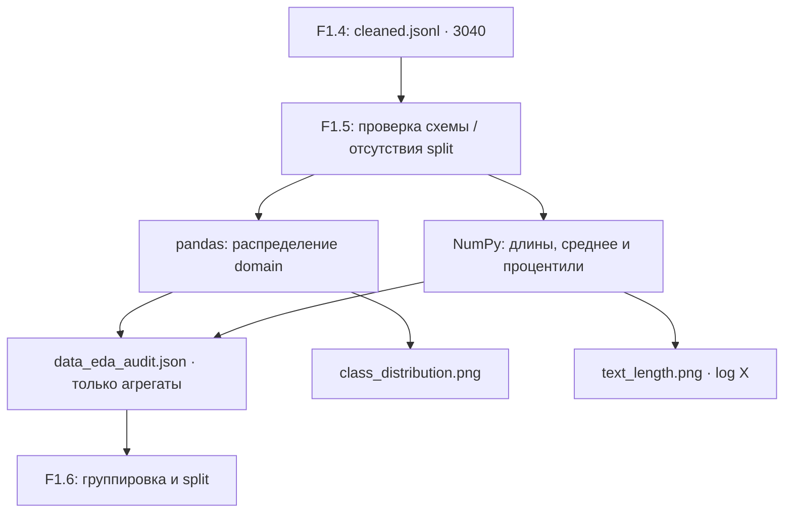
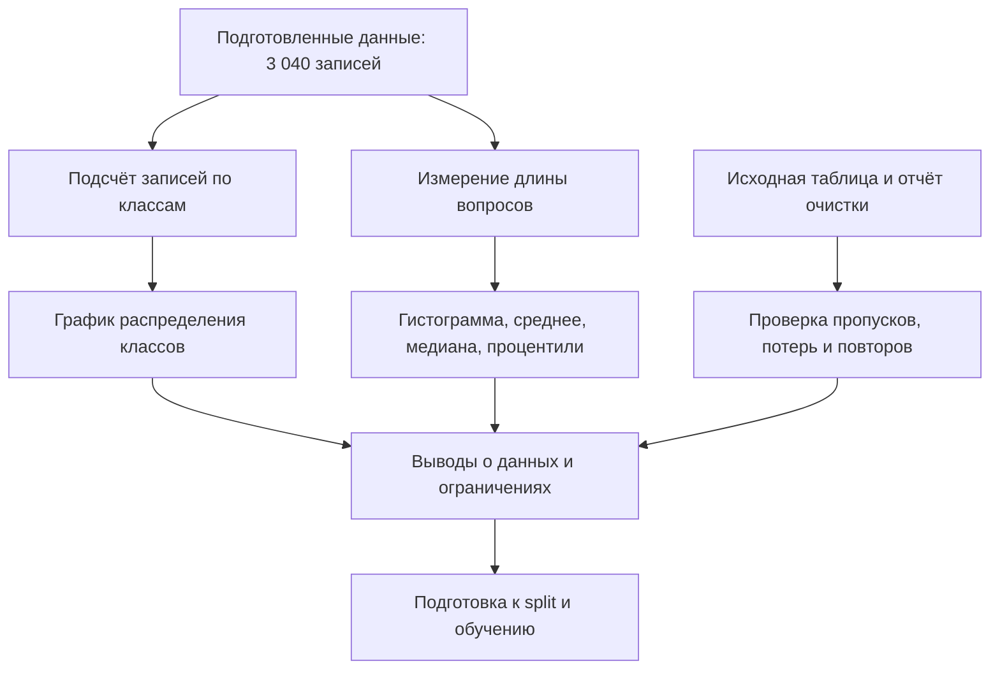

# F1.5 - Exploratory Data Analysis (EDA): Разведочный анализ данных

F1.5 - это знакомство с подготовленными данными перед обучением модели. Анализ, сколько в них примеров, какие темы встречаются, насколько длинные вопросы и нет ли заметных проблем.

**Exploratory Data Analysis (EDA)** - разведочный анализ, который помогает до обучения понять распределение целевой метки `domain`, длину текстов, качество обязательных полей и возможный дисбаланс классов.

**Вход:** `data/interim/cleaned.jsonl` - результат F1.4, ожидаемые **3 040** очищенных записей.


## Анализ
| Показатель | Определение | Для чего нужен |
|---|---|---|
| `total_rows` | Количество очищенных записей | Контроль входных данных |
| `class_distribution` | `value_counts(domain)` | Дисбаланс классов, корректность оценки macro F1 |
| `class_imbalance_ratio_max_min` | Самый большой класс / самый маленький | Приближённая мера перекоса |
| `context_words`, `answer_words` | min/max/mean/median/p90/p95 длин в словах | Оценка длинных текстов, планирование token budget |
| `required_field_missing_or_empty` | Пропуски в `id`, `domain`, `context`, `answer` | Контроль |
| `source_sha256` | Контрольная сумма файла F1.4 | Сопоставимость EDA при повторном запуске |

### Определение длины вопросов
Вопросы могут быть короткими или содержать подробное описание, команды и сообщения об ошибках.
Посчитана длина очищенных вопросов в словах, разделяя текст по пробелам:
| Показатель | Результат |
|---|---:|
| Самый короткий вопрос | 17 слов |
| Медиана | 128,5 слова |
| Средняя длина | Около 157 слов |
| 90-й процентиль | Около 308 слов |
| Самый длинный вопрос | 668 слов |

Эти показатели рассчитаны по сохранённому `data/interim/cleaned.jsonl`, содержащему 3 040 записей.

**Процентили:** p90 - значение, ниже или на уровне которого находится примерно 90% текстов. 
**Медиана** - 50-й процентиль. 
**Macro F1** - усредняет F1 по классам с равным весом независимо от их численности.

Многие вопросы содержат довольно подробные описания. При ограничении длины входа модель может потерять часть вопроса.

**Важно:** здесь считаем слова с помощью `str.split()`, а не* токены BPE/WordPiece. Для Transformer максимальная длина в токенах может значительно отличаться. `context` и `answer` анализируются отдельно.


## Архитектура


Исполняемые модули:
- [`src/data/eda.py`](../../src/data/eda.py) — `summarize_cleaned`: чистая аналитика; выдаёт только числа и статус `EDA_BEFORE_SPLIT`.
- [`scripts/eda_data.py`](../../scripts/eda_data.py) — CLI, проверка ожидаемого размера, хеширование входа, запись агрегатов и создание графиков.
- [`tests/test_eda.py`](../../tests/test_eda.py) — автономные тесты со **синтетическими** примерами.
- [`requirements-eda.txt`](../../requirements-eda.txt) — Python-зависимости этапа (`pandas`, `matplotlib` поверх foundation).

## Графики
`docs/visuals/f1/class_distribution.png` - столбцы с количеством записей в каждом из четырёх классов. Не путать с точностью/качеством классификатора: EDA не обучает модель.
`docs/visuals/f1/text_length.png` - две гистограммы длины (вопрос и ответ). Горизонтальная ось логарифмическая, чтобы видеть одновременно короткие и очень длинные тексты. Это не сравнение по train/val/test: такого разбиения ещё нет.

## Исторические данные из исходного проекта
Сохранённый `reports/data_audit.json` из первоначального архива указывает:

| Метка `domain` | Очищенных записей (исторический отчёт) |
|---|---:|
| databases | 800 |
| linux | 793 |
| programming | 666 |
| systems | 781 |
| **Итого** | **3 040** |

Это ожидания из прошлого выполнения, а не результаты нового запуска F1.5. Новая версия должна самостоятельно пересчитать числа на локальном файле.

## Запуск в Windows
В корне репозитория после F1.4:
```powershell
.\.venv\Scripts\python.exe -m pip install -r requirements-eda.txt
.\.venv\Scripts\python.exe -m pytest -q tests/test_foundation.py tests/test_provenance.py tests/test_ingestion.py tests/test_cleaning.py tests/test_eda.py
.\.venv\Scripts\python.exe -m scripts.eda_data --expect-rows 3040
.\.venv\Scripts\python.exe scripts/check_repository.py
```
Скрипт должен вывести `EDA: PASS`, `rows=3040`, четыре класса и имена двух созданных графиков. Важно проверить фактические количества по каждому классу, а не подгонять параметры под сохранённые значения.

Локальные результаты:
- `reports/data_eda_audit.json` - JSON с агрегатами и SHA-256 входного файла;
- `docs/visuals/f1/class_distribution.png` - распределение классов;
- `docs/visuals/f1/text_length.png` - распределения длин.


## Риски и ограничения
1. **Overlapping classes.** Темы Linux, администрирования систем и программирования могут пересекаться. `domain` отражает источник вопроса, а не экспертную классификацию.
2. **Word length != token length.** Для будущих нейросетевых моделей нужен отдельный анализ токенизатора.
3. **EDA не доказывает отсутствие leakage.** Группировка почти совпадающих вопросов/ответов и независимое разбиение - F1.6.
4. **Количество строк само по себе не подтверждает качество данных.** Нужны проверки правил очистки и экспертная оценка.
5. **Реальные Q&A не публикуем.** В репозитории тесты содержат только искусственно созданные строки.

## Как проходит разведочный анализ


## Основная мысль F1.5
Прежде чем обучать модель, нужно понять данные. Разведочный анализ помогает заметить проблемы и выбрать разумные настройки, но сам по себе ещё не показывает качество будущей модели.
- EDA - исследование характеристик и особенностей набора.
- Распределение классов помогает заметить дисбаланс.
- Среднее, медиана и процентили описывают разные стороны распределения длины.
- Слова и токены не всегда совпадают.
- Длинные вопросы могут терять информацию при обрезании входа.
- Нулевые пропуски не гарантируют качественные ответы.
- Высота гистограммы зависит от размера части данных.
- Найденные похожие тексты нужно учитывать при split.
