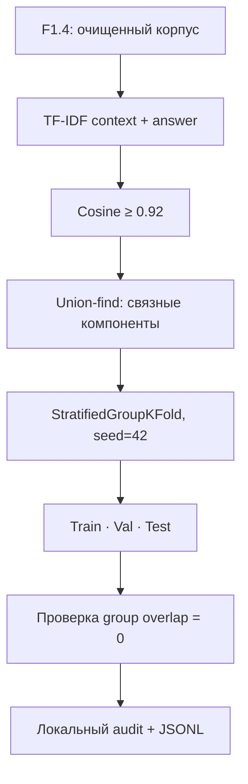
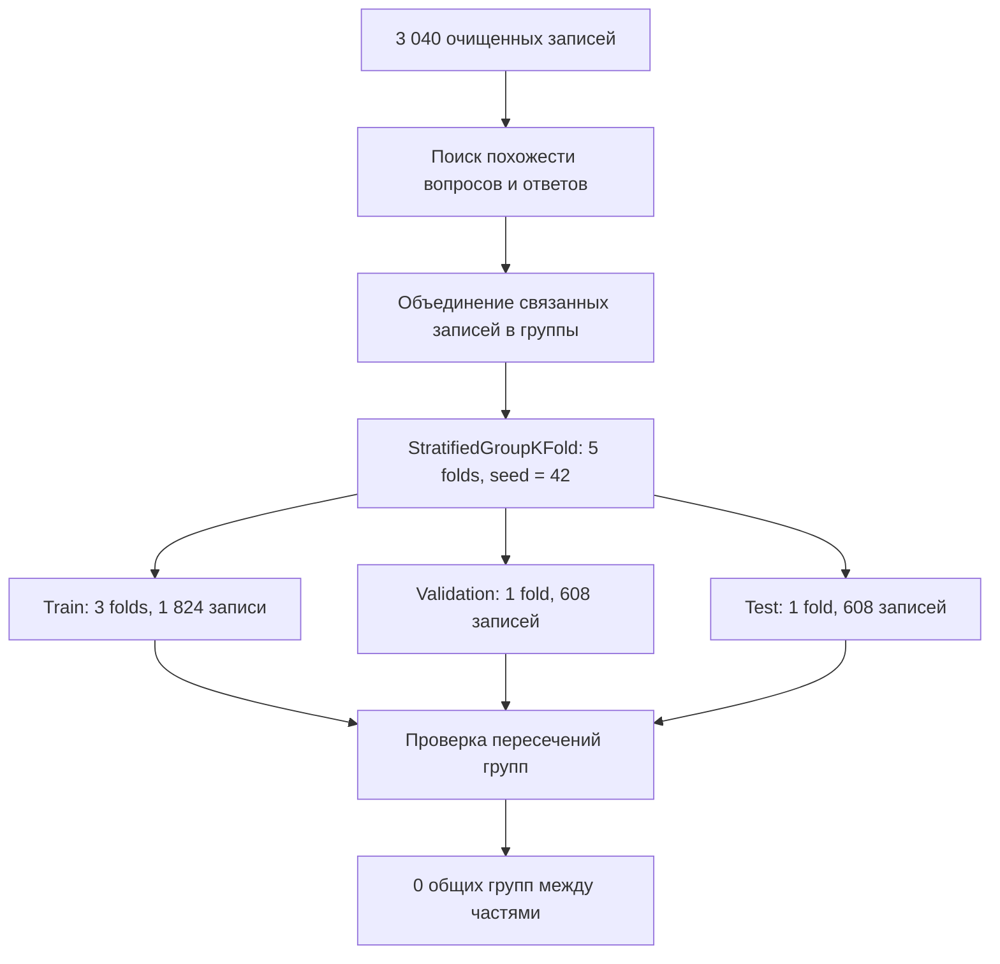

# F1.6 - Data Splitting & Leakage Prevention: Разделение данных и предотвращение утечек

F1.6 - это разделение данных на части, чтобы честно проверить модель. Нужно убедиться, что на проверке она решает новые примеры, а не узнаёт уже знакомые.

## Цель

Разделить **3 040 очищенных технических вопросов** из F1.4 на обучение, валидацию и финальное тестирование так, чтобы обнаруженные почти одинаковые вопросы или ответы попадали только в одну выборку. F1.5 уже построил EDA на всей выборке, но не делал split.

- **Train** - обучение параметров модели.
- **Validation** - выбор гиперпараметров, контроль переобучения и отбор checkpoint.
- **Test** - отложенная итоговая оценка после принятия решений по train/val.

Если одинаковые ответы или варианты одного вопроса окажутся и в train, и в test, оценка качества может стать завышенной: модель узнаёт уже виденный текст вместо обобщения на новые примеры.

## Оригинальный алгоритм проекта
Исходный `src/data/pipeline.py` из полного локального проекта выполняет:
1. **Char TF-IDF:** для каждого поля `context` (вопрос) и `answer` (ответ) отдельно строит TF-IDF-векторы по символьным n-граммам длины **3–5** (`analyzer='char_wb'`, `max_features=18000`). `char_wb` выделяет символьные n-граммы в границах слов и учитывает добавленное заполнение по краям.
2. **Cosine similarity:** сравнивает записи разреженными блоками по **128** строк. Векторы TF-IDF нормируются L2 по умолчанию, поэтому скалярное произведение соответствует cosine similarity.
3. **Union-find:** при `similarity >= 0.92` для разных записей связывает их **в одну группу**. Срабатывания в *любом* из полей достаточно. Связь транзитивна: A≈B и B≈C объединяет A, B, C, даже если A и C напрямую не похожи.
4. **StratifiedGroupKFold:** `n_splits=5, shuffle=True, random_state=42`. Первая fold назначается **validation**, вторая - **test**, остальные три - **train**. Стратификация стремится сохранять доли классов `domain` при соблюдении групп, но точные пропорции **не гарантируются**.
5. **Аудит:** проверяется отсутствие общих `group_id` у разных выборок, записываются размеры и распределение по классам.



### Почему именно *группы*, а не только `stratify=domain`?
Обычный стратифицированный случайный split сохраняет баланс классов, но не знает, что два похожих вопроса могут быть почти одним и тем же примером. `StratifiedGroupKFold` одновременно учитывает метки и не разделяет одну группу между разными folds.

### Пример на синтетических данных
| ID | Вопрос | Ответ | Группа |
|---|---|---|---|
| A | Как подключить сервис X? | Выполни команду Q | 10 |
| B | Как подключить сервис X на сервере? | Выполни команду Q | 10 |
| C | Как настроить сервис Y? | Используй конфигурацию Z | 11 |
A и B должны оказаться в одной выборке, даже если относятся к разным классам. Числа 10 и 11 здесь условные.


## Запуск в Windows
В корне `F:\DEVELOPMENT\ML\ml-engineering-lab`:
```powershell
.\.venv\Scripts\python.exe -m pip install -r requirements-splitting.txt
.\.venv\Scripts\python.exe -m pytest -q tests/test_foundation.py tests/test_provenance.py tests/test_ingestion.py tests/test_cleaning.py tests/test_eda.py tests/test_splitting.py
.\.venv\Scripts\python.exe -m scripts.split_data --expect-rows 3040
.\.venv\Scripts\python.exe scripts/check_repository.py
```

Не нужно повторно скачивать выборку, если после F1.4 уже существует `data/interim/cleaned.jsonl`.

По исходному `reports/data_audit.json` ориентиры: **train=1824, val=608, test=608; 535 near-duplicate edges; group overlap = 0**. Они относятся к предыдущему исполнению оригинального скрипта и не подменяют фактический результат нового запуска. Если значения отличаются, сначала сравниваем scikit-learn, исходный SHA-256 очищенного корпуса и состав объединённых групп; не подгоняем вывод под ожидания.

После фактического сравнения можно усилить проверку дополнительными аргументами CLI:
```powershell
.\.venv\Scripts\python.exe -m scripts.split_data --expect-rows 3040 --expect-train 1824 --expect-val 608 --expect-test 608
```

**Эту дополнительную команду запускать только если предшествующий запуск показал именно такие размеры выборок.** 

### Контрольный запуск на Windows (24.10.2026)
- Тесты F1.1–F1.6: **97/97 PASS**.
- Очищенный корпус: **3 040** записей; **train=1 824, val=608, test=608**.
- Число близких совпадений `near_duplicate_edges`: **536**; исторический `reports/data_audit.json`: **535**.
- Количество групп: **2 983**.
- Пересечения между train/val/test по рассчитанным группам: **0**.
- Проверка структуры репозитория: **PASS**.

## Доказательства и границы проверки
**Что именно подтверждает `group_overlap = 0`:** ни одна вычисленная этим алгоритмом группа не попала одновременно в train/val/test.

**Чего это не подтверждает:** отсутствия любых семантических перефразировок; независимости вопросов от шаблонов одинакового содержания с cosine ниже 0.92; отсутствия временной/авторской утечки; корректности labels. Даже пять folds не гарантируют строго пропорциональное число записей по классам.

**Не делать утечку на следующих этапах:** TF-IDF классификатора, словарь токенизации, любые статистики, использующие данные для обучения, следует `fit` на train и только применять к val/test. Группировка до split - отдельный механизм предотвращения дублирования, а не разрешение обучать модель на всём корпусе.

## Алгоритм разделения


## Основная мысль F1.6
Качество модели нужно измерять на независимых примерах. Хороший split защищает от ситуации, когда модель выглядит успешной на тесте благодаря знакомым данным.
- Train, validation и test решают разные задачи.
- Случайного разделения строк недостаточно при повторяющемся содержании.
- Похожие записи объединяются до split и остаются в одной части.
- Стратификация помогает сохранять соотношение классов.
- Порог сходства не является вероятностью дубликата.
- Нулевое пересечение групп подтверждает только проверенный контракт.
- Преобразования classifier обучаются на train.
- Подбор настроек по test нарушает независимость итоговой оценки.
