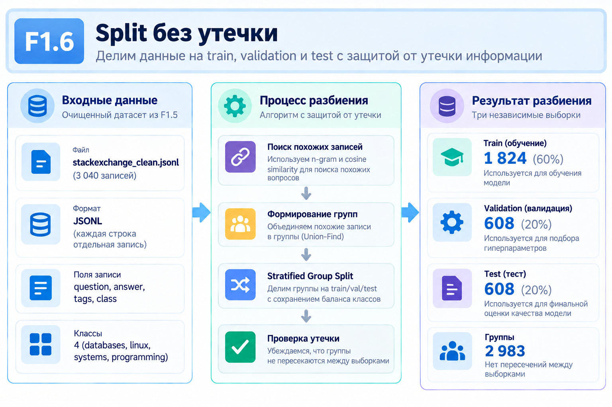
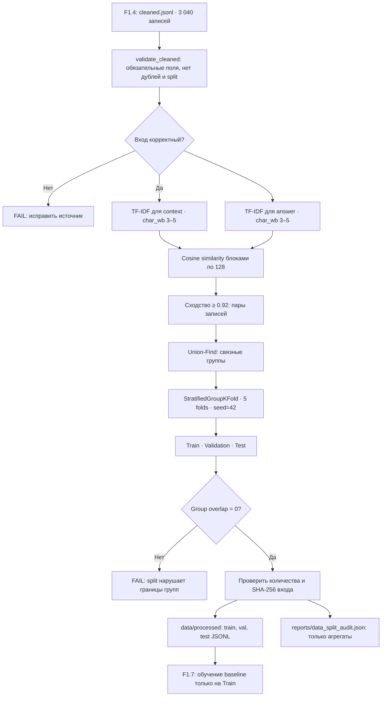

# F1.6 - Data Splitting & Leakage Prevention: разделение датасета без пересечения похожих записей

## 1. Цель этапа:

В F1.4 исходные технические вопросы и ответы очищены и получено **3 040 записей**. В F1.5 изучено распределение четырёх классов и длины текстов. Теперь можно было бы случайным образом разделить все строки на три части и сразу перейти к обучению. Но для корпуса такой подход создаёт риск **data leakage - утечки информации между выборками**.



Вопрос «Как исправить ошибку подключения PostgreSQL?» находится в Train, а «Как устранить ошибку подключения к PostgreSQL?» - в Test. Это два разных текста, но они могут описывать фактически одну и ту же проблему. Ещё хуже, если вопросы различаются, а ответы почти дословно совпадают. Классификатор может получать искусственное преимущество на тесте, поскольку часть информации он уже встречал во время обучения.

Обычное случайное разбиение этого не замечает: оно считает каждую строку независимой. Поэтому **сначала нужно найти связанные записи, а уже потом распределить их по выборкам**.

**Задача F1.6:** построить воспроизводимый алгоритм, который:
1. Получает полный очищенный корпус F1.4, а не отдельный sample.
2. Измеряет лексическое сходство **вопросов (`context`) и ответов (`answer`)**.
3. Объединяет близкие записи в группы, включая транзитивные связи.
4. Делит корпус на Train, Validation и Test **без разрыва найденных групп**.
5. По возможности сохраняет соотношение четырёх классов `domain`.
6. Проверяет отсутствие общих групп между выборками и сохраняет результаты в локальные файлы.

Три выборки выполняют разные роли:

| Выборка        | Для чего нужна                                                         | Как использовать правильно                                                 |
| -------------- | ---------------------------------------------------------------------- | -------------------------------------------------------------------------- |
| **Train**      | Обучать параметры модели и преобразования, которые требуют `fit()`     | По этим примерам модель вправе подстраиваться                              |
| **Validation** | Подбирать гиперпараметры, выбирать модель, контролировать переобучение | Можно сравнивать варианты, но нельзя незаметно включать примеры в обучение |
| **Test**       | Один раз дать итоговую оценку выбранному решению                       | Не использовать для выбора настроек и многократной подгонки                |
## 2. Реализация: файлы этапа

В F1.6 разделение **алгоритмической части**, **запуска на файлах** и **автоматической проверки0**. Поэтому работу группировки можно проверять на искусственных вопросах без реального Stack Exchange и доступа к сети.

### Основные файлы

| Файл                                                             | Что сделали и зачем                                                                                                                                                                                                                                            |
| ---------------------------------------------------------------- | -------------------------------------------------------------------------------------------------------------------------------------------------------------------------------------------------------------------------------------------------------------- |
| [`src/data/splitting.py`](../../src/data/splitting.py)           | **Основной алгоритм.** `validate_cleaned()` проверяет исходные записи; `group_near_duplicates()` вычисляет сходство TF-IDF и объединяет записи через Union-Find; `split_cleaned()` назначает Train/Validation/Test и собирает аудит.                           |
| [`scripts/split_data.py`](../../scripts/split_data.py)           | **Исполняемый сценарий.** Функция `run()` читает YAML и очищенный JSONL, вызывает алгоритм, проверяет ожидаемые количества, рассчитывает SHA-256 входа и записывает три выборки с аудитом. `main()` принимает аргументы командной строки и печатает PASS/FAIL. |
| [`tests/test_splitting.py`](../../tests/test_splitting.py)       | Автоматические тесты на **синтетических Q&A**: похожие вопросы, одинаковые ответы, транзитивные группы, отсутствие пересечений, ошибки входа, повторяемость, сохранение файлов и отказ при неверных ожидаемых значениях.                                       |
| [`requirements-splitting.txt`](../../requirements-splitting.txt) | Перечень библиотек, используемых на этапе; алгоритм опирается на `scikit-learn` и `NumPy`.                                                                                                                                                                     |

Настройки берутся из существующего [`configs/local_cpu/lab.yaml`](../../configs/local_cpu/lab.yaml): **`seed=42`**, **`data.near_duplicate_threshold=0.92`**. В предоставленной реализации лимит признаков TF-IDF - **18 000 на векторизатор**, размер блока сравнения - **128 строк**.

В инфраструктуре этого шага также использованы [`.gitignore`](../../.gitignore) и [`.github/workflows/foundation-tests.yml`](../../.github/workflows/foundation-tests.yml): локальные Q&A не должны случайно попадать в публичный репозиторий, а синтетические тесты включены в общую проверку проекта.

### Взять из предыдущих этапов
- **F1.1:** `src/common/io.py` предоставляет общие функции чтения JSONL и определение корня проекта.
- **F1.4:** `data/interim/cleaned.jsonl` - полный очищенный набор с полями `id`, `domain`, `context`, `answer` и метаданными источника. Для контрольного корпуса - 3 040 строк.
- **F1.5:** результаты EDA объясняют состав классов, но **не содержат готовых `split` и `group_id`**.

### Какие локальные файлы создаются

| Путь | Что в нём находится |
|---|---|
| `data/processed/train.jsonl` | Исходные очищенные поля плюс `split="train"` и `group_id` для обучающей части |
| `data/processed/val.jsonl` | Такие же записи с `split="val"`, предназначенные для выбора модели |
| `data/processed/test.jsonl` | Такие же записи с `split="test"`, отложенные для итоговой оценки |
| `reports/data_split_audit.json` | Только агрегаты: количество строк, групп, найденных связей, классов, пересечений, настройки и SHA-256 входного файла |
**Важно:** исходный `cleaned.jsonl` сохраняется отдельно; `split_cleaned()` возвращает новые словари с дополнительными полями, не изменяя исходный список. Тексты вопросов и ответов присутствуют в трёх локальных JSONL, но **не копируются в JSON-аудит**.

## 3. Последовательность действий

### Шаг 1. Зафиксирован вход и запрет повторного разделения
Написан `validate_cleaned(rows)`, чтобы следующий алгоритм работал только с ожидаемым результатом F1.4.

Для каждой записи проверить:
1. Вход - непустой список словарей.
2. `id`, `domain`, `context`, `answer` - непустые строки.
3. Нет повторных `id`.
4. Нет точных повторов вопросов после `context.casefold()`.
5. В записях ещё нет `split` и `group_id`.

Последняя проверка особенно важна. Если случайно подать уже разбитые файлы и назначить группы заново, можно получить другую структуру разделения и перестать понимать происхождение тестовых результатов.

**Зачем этот шаг:** обнаруживать нарушение контракта сразу, а не получать правдоподобное, но методологически неправильное разбиение.

### Шаг 2. Преобразованы вопросы и ответы в символьные TF-IDF-векторы
Компьютер не может напрямую посчитать cosine similarity между двумя строками. Поэтому тексты преобразованы в числовые векторы через `TfidfVectorizer` из `scikit-learn`.

Использованы два **отдельных** векторизатора: один для `context`, второй для `answer`. Для каждого задаём:
```python
TfidfVectorizer(
    analyzer="char_wb",
    ngram_range=(3, 5),
    max_features=18000,
)
```

Значение каждого параметра:
- `char_wb` - извлечь **символьные** n-граммы в границах слов; на краях слова учитывается пробельное дополнение.
- `(3, 5)` - использовать фрагменты длиной **3, 4 и 5 символов**.
- `max_features=18000` - ограничить словарь признаков каждого поля максимум 18 тысячами.
- TF-IDF повышает вес характерных фрагментов и снижает влияние распространённых.

Для технических вопросов это практичный лексический подход: похожие написания команд, названий пакетов и сообщений об ошибках часто дают общие символьные фрагменты. Он устойчивее к небольшим изменениям написания, чем сравнение полных строк.

**Но это не семантическая модель.** Две фразы с одинаковым смыслом, написанные разными словами, могут получить низкое сходство. И наоборот, общий шаблон текста может создать высокое лексическое сходство без полной смысловой эквивалентности.

**Зачем этот шаг:** получить числовое представление, на котором можно искать близкие записи **до split**.

### Шаг 3. Рассчитан cosine similarity без плотной матрицы всего корпуса
После TF-IDF каждая запись представлена разреженным вектором. Сравнить его с векторами других записей через скалярное произведение.

Для двух векторов `a` и `b` косинусное сходство определяется так:
```math
\operatorname{cosine}(a,b) = \frac{a \cdot b}{\lVert a\rVert\,\lVert b\rVert}.
```

По умолчанию `TfidfVectorizer` нормирует строки по L2. Поэтому **для полученных векторов** выражение `a · b` соответствует cosine similarity.

В коде сравнение выполняется **блоками по 128 строк**:
```python
sims = (matrix[start:start + batch_size] @ matrix.T).tocoo()
```

Работая с разреженными матрицами и небольшими блоками, необходимо уменьшить пиковое потребление памяти. Однако количество потенциальных пар по-прежнему растёт примерно квадратично с числом записей: это учебное решение для корпуса, а не бесконечно масштабируемый поиск.

Для каждой пары **разных** записей проверить:
```math
\operatorname{cosine}(i,j) \ge 0{,}92.
```

Чтобы не считать одну и ту же пару дважды, взять только случаи `i < j`. Проверку выполнить **отдельно для вопросов и для ответов**. Достаточно высокого сходства хотя бы в одном поле.

**Зачем этот шаг:** найти не только почти одинаковые вопросы, но и разные вопросы с фактически повторяющимися ответами.

### Шаг 4. Объединить найденные связи с помощью Union-Find
Теперь есть пары записей, которые похожи по вопросу **или** по ответу. Но пары сами по себе ещё не решают задачу разделения.

Необходимо представить три записи:
- **A** - вопрос похож на вопрос **B**.
- **B** - ответ похож на ответ **C**.
- **A** и **C** напрямую могут иметь сходство ниже порога.

Если разнести A и C по разным выборкам, оставив B рядом с одной из них, часть общего содержимого может оказаться по разные стороны split. Поэтому необходимо строить **транзитивные группы**.

Для этого использовать **Union-Find (Disjoint Set Union, DSU)**. У каждой записи сначала собственная группа. При обнаружении связи выполняем объединение групп, а `find(i)` возвращает корень группы с сокращением пути (`path compression`). В результате:
```text
A -- похожий вопрос -- B -- похожий ответ -- C
|_____________________________________________|
                одна группа

D -- нет обнаруженных связей --> отдельная группа
```

Если A связана с B, а B с C, все трое получают один `group_id`, даже когда A и C не проходят порог прямого сходства.

**Зачем этот шаг:** не позволить алгоритму split разорвать цепочку связанных примеров.

### Шаг 5. Разобрать, что именно считает `near_duplicate_edges`
При поиске связей программа увеличивает счётчик `near_duplicate_edges` **за каждую обнаруженную пару в каждом поле** (`context` и `answer`). Это **не** число удалённых строк и **не** количество итоговых групп.

Простой пример: у четырёх разных вопросов одинаковый ответ. Между четырьмя записями есть шесть уникальных пар:
\[
\binom{4}{2} = \frac{4 \cdot 3}{2} = 6.
\]

Значит, один только столбец `answer` даст **шесть связей**, но все четыре записи останутся в датасете и образуют **одну группу**. Если та же пара достаточно похожа ещё и по `context`, она может добавить отдельное срабатывание счётчика второго поля.

Именно поэтому значения `near_duplicate_edges` и `group_count` нельзя складывать или использовать как количество отброшенных строк.

В исходных материалах есть два результата:
- **535 связей** - исторический аудит первоначального проекта.
- **536 связей** - контрольный запуск Windows **24.10.2026**.

Оба значения необходимо показывать **с указанием происхождения**. Здесь нет утверждения, что разница автоматически означает ошибку или изменение данных: для выяснения причины нужно сравнить SHA-256 входного `cleaned.jsonl`, версию `scikit-learn`, настройки и конкретные совпавшие пары.

**Зачем этот шаг:** корректно читать аудит и не делать ложный вывод, будто F1.6 «удалил 536 вопросов».

### Шаг 6. Назначить группы в Train, Validation и Test
После группировки вызов `StratifiedGroupKFold` из `scikit-learn`:
```python
StratifiedGroupKFold(
    n_splits=5,
    shuffle=True,
    random_state=42,
)
```

Алгоритм учитывает сразу две вещи:
1. **Группы:** записи с одним `group_id` нельзя делить между folds.
2. **Классы:** стараемся сохранить доли `domain` - `databases`, `linux`, `systems`, `programming`.

Пять folds использовать следующим образом:
- **Первая** тестовая часть (`folds[0][1]`) становится **Validation**.
- **Вторая** (`folds[1][1]`) становится **Test**.
- Все записи, не вошедшие в эти две части, становятся **Train**.

Таким образом, получается приблизительное соотношение **60% / 20% / 20%**. Оно **не гарантируется математически**: группы имеют разную численность, а сохранение границ групп важнее попадания ровно в квоту.

Каждая итоговая запись сохраняет исходные поля и получает два новых:
```json
{
  "id": "synthetic:example-1",
  "domain": "linux",
  "context": "Синтетический пример технического вопроса достаточной длины",
  "answer": "Синтетический пример ответа с описанием шагов решения проблемы",
  "split": "train",
  "group_id": 17
}
```

Это **схематический пример**, а не строка реального корпуса. `group_id=17` здесь условный: в реализации ID группы соответствует корню Union-Find и зависит от порядка входных записей.

**Зачем этот шаг:** сделать распределение одновременно воспроизводимым, приблизительно стратифицированным и защищённым от **обнаруженных** повторов.

### Шаг 7. Проверить, что группы не пересекаются
После назначения `split_cleaned()` собирает множества `group_id` отдельно для Train, Validation и Test и проверяет попарные пересечения:
\[
G_{train}\cap G_{val}=\varnothing,\qquad
G_{train}\cap G_{test}=\varnothing,\qquad
G_{val}\cap G_{test}=\varnothing.
\]

Если хоть одно пересечение ненулевое, программа выдаёт `SplitError`. Также проверяется, что все три выборки непустые, и считаются распределения классов внутри каждой.

В аудит попадают:
- `total_rows` - сколько записей получено от F1.4;
- `near_duplicate_threshold`, `seed`, `ngram_range`, `max_features` - настройки группировки и split;
- `near_duplicate_edges` - число найденных срабатываний пар/полей;
- `group_count`, `max_group_size` - количество групп и размер наибольшей;
- `split_counts` - сколько строк в Train, Validation, Test;
- `splits` - распределение четырёх `domain` по частям;
- `group_overlap` - три попарных пересечения групп;
- `leakage_scope` - явная оговорка о **лексическом**, а не всеобщем семантическом контроле.

**Зачем этот шаг:** не просто надеяться на корректную работу библиотеки, а программно проверить главный инвариант.

### Шаг 8. Добавить запуск на файлах, SHA-256 и контроль ожидаемых размеров
Математический алгоритм находится в `src/data/splitting.py`. Чтобы запускать его на локальном корпусе, сделан `scripts/split_data.py`.

Функция `run()` последовательно:
1. Проверяет наличие `data/interim/cleaned.jsonl` и YAML-конфигурации.
2. Считывает `seed` и `near_duplicate_threshold`, проверяет корректность параметров.
3. Читает JSONL и, если задано, проверяет `--expect-rows`.
4. Вызывает `split_cleaned()` для группировки и разделения.
5. Сравнивает результат с необязательными `--expect-train`, `--expect-val`, `--expect-test`, `--expect-edges`.
6. Вычисляет **SHA-256 входного очищенного корпуса**, чтобы связать аудит с конкретными байтами файла.
7. Только **после всех проверок входа и ожидаемых счётчиков** записывает `train.jsonl`, `val.jsonl`, `test.jsonl` и JSON-аудит.

Каждый файл записывается через временный файл с последующим `os.replace()`. Это защищает конкретный выходной файл от частично записанного содержимого. **Но четыре разных файла не образуют единую атомарную транзакцию:** этот нюанс нельзя путать с полной транзакционностью всей процедуры.

**Зачем этот шаг:** получать одинаковый результат на одном и том же корпусе и останавливать выполнение при расхождениях, а не незаметно публиковать некорректный split.

### Шаг 9. Написать тесты без доступа к реальному датасету
В `tests/test_splitting.py` использовать синтетические Q&A с заранее известными связями. Это позволяет проверить принцип работы, даже если локальные архивы Stack Exchange отсутствуют.

Тестами покрыты:
- неверные записи, повторные ID и одинаковые вопросы;
- повторное использование уже размеченных `split`/`group_id`;
- недопустимые параметры (`threshold`, `batch_size`, `max_features`, `seed`);
- два разных вопроса с одинаковым ответом;
- два почти одинаковых вопроса с разными ответами;
- транзитивное объединение трёх связанных записей;
- различие между числом совпавших пар и числом сохранённых строк;
- запрет пятичастного split при недостатке независимых групп;
- отсутствие пересечений групп и сохранение всех исходных строк;
- воспроизводимость повторного запуска и отсутствие сырых Q&A в аудите;
- отказ от создания результатов при неверных ожидаемых количествах или конфликтующих путях.

**Итог разработки:** реализован не только алгоритм поиска близких текстов, но и проверяемый путь от очищенного корпуса до трёх независимых по обнаруженным группам частей.

## 4. Алгоритм F1.6: как проходит один полный запуск

Путь одной записи и всего набора, не смешивая этап подготовки данных с будущим обучением модели.

**Действие A - читать F1.4.** Получить 3 040 очищенных словарей с вопросами, ответами и метками `domain`. Проверить, что в них ещё нет `split` и `group_id`.

**Действие B - создать два пространства признаков.** Преобразовать все вопросы в символьные TF-IDF-векторы. Отдельно сделать то же для ответов. Эти векторы используются **только для выявления близких записей перед разделением**.

**Действие C - поиск пар.** Для каждого поля сравнить разреженные векторы блоками, отобрать случаи с cosine `>= 0.92` и исключить сравнения записи с самой собой.

**Действие D - собрать группы.** Для каждой найденной пары выполнить Union-Find. Если записи связаны через промежуточный пример, они тоже получают общий `group_id`.

**Действие E - применить групповой split.** Запустить `StratifiedGroupKFold` на метках `domain` и вычисленных группах. Первую fold назначаем Validation, вторую Test, остальные Train.

**Действие F - проверить инварианты.** У всех частей есть записи, сумма размеров равна исходному количеству, а множества `group_id` разных частей не пересекаются.

**Действие G - связать результат с исходными данными.** Вычисляем SHA-256 очищенного JSONL, формируем аудит с количеством групп, срабатываний и распределением классов.

**Действие H - сохранить локальные результаты.** Записать три JSONL для последующих этапов и отдельный JSON без исходных вопросов и ответов.

### Наглядный пример: почему нужен Union-Find
Взять **четыре придуманных записи**. Порог и совпадения в таблице условные - это демонстрация логики, а не измерение TF-IDF для показанных фраз.

| Запись | Связь, найденная алгоритмом | Итоговая группа |
|---|---|---|
| A | Вопрос почти совпадает с вопросом B | Группа X |
| B | Вопрос похож на A, ответ похож на C | Группа X |
| C | Ответ почти совпадает с ответом B | Группа X |
| D | Ни вопрос, ни ответ не связаны с A–C | Группа Y |

Даже если A и C напрямую не очень похожи, **размещать их независимо уже нельзя**: они входят в одну цепочку. Правильная схема - назначить всю группу X в одну часть, например Train. Группу Y можно назначить независимо.

И ещё один важный момент: **ни одна запись не удаляется**. Изменяется только то, как их группировать и размещать в выборках.

## 5. Схема: от очищенного корпуса к независимым выборкам



**Главное на схеме:** **сначала обнаружить и объединить** близкие записи, а затем поделить на части. Обратный порядок не обеспечивает такого же контроля утечек.

## 6. Локальная проверка в PowerShell: что запускать и как читать результат

Ниже приведены команды для **существующего проекта на Windows с подготовленным `.venv`**. Они не устанавливают пакеты, не скачивают данные и не изменяют Git-историю. Для запуска на полном корпусе требуется локальный `data/interim/cleaned.jsonl` после F1.4.

### 6.1. Перейти в корень проекта
```powershell
cd F:\DEVELOPMENT\ML\ml-engineering-lab
```

### 6.2. Проверить только алгоритмы F1.6 на синтетических данных
```powershell
.\.venv\Scripts\python.exe -m pytest tests/test_splitting.py -q
```

**Что проверяется:** корректность группировки по вопросам и ответам, транзитивность Union-Find, назначение split, отсутствие пересечений, повторяемость результатов, отказ от неверных параметров и отсутствие реальных Q&A в тестовых артефактах.

Для этих тестов не нужны локальные 3 040 записей и Интернет. Если код или тесты в текущем репозитории позднее менялись, **ориентироваться на фактический вывод pytest**, а не на фиксированное количество тестов из старого отчёта.

### 6.3. Выполнить группировку и split полного корпуса
```powershell
.\.venv\Scripts\python.exe -m scripts.split_data --expect-rows 3040
```

Команда проверяет число входных записей, запускает группировку, назначает три выборки и сохраняет четыре локальных файла.

**Формат успешного вывода по контрольному запуску Windows 24.10.2026:**
```text
Data splitting: PASS; rows=3040; train=1824; val=608; test=608
Near-duplicate edges=536; groups=2983; threshold=0.92
Group overlap: {'train/test': 0, 'train/val': 0, 'val/test': 0}
Files: data/processed/{train,val,test}.jsonl and aggregate-only local audit
```

Это **зафиксированный результат конкретного запуска**, а не обещание, что любая версия библиотек и данных обязательно даст те же числа.

Как его интерпретировать:
- `train=1824`, `val=608`, `test=608` - все 3 040 записей распределены по трём частям.
- `groups=2983` - найдено 2 983 независимые по построенному графу группы; число меньше 3 040, поскольку некоторые записи объединены.
- `edges=536` - число обнаруженных срабатываний пар/полей, не число удалённых строк.
- `group_overlap` с тремя нулями - ни одна обнаруженная группа не распределена между несколькими выборками.

Если запуск выдаёт `FAIL`, сначала выяснить причину: недостаток групп, неверное число строк, не валидная конфигурация или расхождение с ожидаемыми значениями. Не стоит подгонять параметры ради зелёной строки `PASS`.

### 6.4. Проверить созданные файлы
```powershell
Test-Path data/processed/train.jsonl
Test-Path data/processed/val.jsonl
Test-Path data/processed/test.jsonl
Test-Path reports/data_split_audit.json
```

После удачного выполнения все четыре вызова должны вернуть `True`.

Чтобы проверить число строк, не печатая технические вопросы и ответы:
```powershell
(Get-Content data/processed/train.jsonl | Measure-Object -Line).Lines
(Get-Content data/processed/val.jsonl | Measure-Object -Line).Lines
(Get-Content data/processed/test.jsonl | Measure-Object -Line).Lines
```

В контрольном запуске ожидаемые значения - **1824**, **608**, **608**. Сумма равна **3040**. Если вход или версия алгоритма отличаются, сравнивай с фактическим аудитом.

### 6.5. Открыть аудит и проверить пересечение групп
```powershell
$audit = Get-Content reports/data_split_audit.json -Raw | ConvertFrom-Json
$audit.total_rows
$audit.split_counts
$audit.near_duplicate_edges
$audit.group_count
$audit.group_overlap
$audit.splits
```

Свойство `group_overlap` должно содержать три нуля. `splits` показывает распределение каждого класса по Train/Validation/Test и позволяет понять, насколько близко сохранились пропорции `domain`.

Для проверки SHA-256 входного корпуса:
```powershell
(Get-FileHash data/interim/cleaned.jsonl -Algorithm SHA256).Hash.ToLower()
$audit.source_sha256
```

Обе строки должны совпадать. Это связывает отчёт с **конкретным файлом F1.4**, а не только с числом 3 040.

### 6.6. Проверить отсутствие общих `group_id` самостоятельно
Следующая команда читает **только служебные поля** из JSONL и сравнивает множества групп:
```powershell
$groups = @{}
foreach ($name in @('train', 'val', 'test')) {
    $groups[$name] = @{}
    Get-Content "data/processed/$name.jsonl" | ForEach-Object {
        $record = $_ | ConvertFrom-Json
        $groups[$name][[string]$record.group_id] = $true
    }
}
"train/val: " + @($groups['train'].Keys | Where-Object { $groups['val'].ContainsKey($_) }).Count
"train/test: " + @($groups['train'].Keys | Where-Object { $groups['test'].ContainsKey($_) }).Count
"val/test: " + @($groups['val'].Keys | Where-Object { $groups['test'].ContainsKey($_) }).Count
```

Ждать **трёх нулей**. Это независимая проверка главного условия этапа, а не просто чтение уже готового аудита.

### 6.7. Уточнить исторические ожидания только после обычного запуска
Если твой фактический запуск подтвердил **именно** 1 824 / 608 / 608, можно включить строгий контроль этих чисел:
```powershell
.\.venv\Scripts\python.exe -m scripts.split_data --expect-rows 3040 --expect-train 1824 --expect-val 608 --expect-test 608
```

Параметр `--expect-edges` поддерживается отдельно. **Не фиксировать автоматически ни 535, ни 536**, пока не сравнить текущие данные и аудит: в предоставленных материалах встречаются оба значения.

### 6.8. Проверить регрессию и структуру проекта
```powershell
.\.venv\Scripts\python.exe -m pytest -q
.\.venv\Scripts\python.exe scripts/check_repository.py
```

**Что проверяется:** предыдущие этапы не перестали работать; структура репозитория соответствует правилам проекта. Исторический контроль на Windows **24.10.2026** подтвердил **97/97 PASS** для тестов F1.1–F1.6 и PASS проверки структуры. В текущем, уже расширенном репозитории число тестов будет другим - важнее отсутствие `failed` и `errors`.

## 7. Что подтверждено и какие ограничения

### Подтверждённые результаты контрольного запуска

| Показатель | Результат Windows 24.10.2026 | Что означает |
|---|---:|---|
| Очищенных записей | **3 040** | Все записи переданы в процедуру группировки |
| Train | **1 824** | Примеры для обучения |
| Validation | **608** | Примеры для настройки и выбора модели |
| Test | **608** | Отложенные примеры для итоговой оценки |
| Независимых групп | **2 983** | Число связных компонент после Union-Find |
| `near_duplicate_edges` | **536** | Срабатывания сравнения пар/полей |
| Общих групп между частями | **0** | Главный групповой инвариант выполнен |
| Тесты F1.1–F1.6 | **97/97 PASS** | Контрольная проверка той версии этапов |

Разница с историческим аудитом в **535 связей** сохранена как отдельная точка для воспроизводимого сравнения. **Нельзя утверждать, что 536 строк были удалены:** F1.6 сохраняет исходные 3 040 записей и лишь назначает им группы и части.
### Правило, которое важно соблюдать в F1.7 и далее
**Группировка до split и обучение модели - разные операции.** На F1.6  используется все доступные тексты только для обнаружения связей и построения границ независимости. Но в F1.7 **TF-IDF-классификатор должен обучить свой собственный векторизатор только на Train**, а затем лишь преобразовывать Validation и Test. Аналогично с обучаемыми словарями токенов, статистиками нормализации и параметрами моделей.

Иначе можно соблюсти `group_overlap = 0`, но всё равно получить утечку через `fit()` на будущих тестовых данных.

## 8. Основная мысль раздела

**В F1.6 3 040 строк разделены случайным образом и обнаружены лексически близкие вопросы и ответы. Для этого необходимо построить символьные TF-IDF-представления, измерить cosine similarity, связать похожие записи через Union-Find и применить StratifiedGroupKFold. В результате получен Train, Validation и Test, между которыми нет пересечения по найденным группам. Это делает будущую оценку модели честнее в рамках проверенного условия, но не доказывает отсутствия всех возможных утечек.**

## 9. Файлы этапа

Для анализа кода в F1.6 необходимо идти в следующем порядке - от маленького тестового примера к полному запуску:

| Порядок | Файл / функция                                                                                                                                                                                    | На что смотреть в коде                                                                                              |
| ------- | ------------------------------------------------------------------------------------------------------------------------------------------------------------------------------------------------- | ------------------------------------------------------------------------------------------------------------------- |
| 1       | [`tests/test_splitting.py`](../../tests/test_splitting.py) - `test_same_answer_connects_different_questions()`                                                                                    | Почему два разных вопроса должны попасть в одну группу, если их ответы совпадают.                                   |
| 2       | [`tests/test_splitting.py`](../../tests/test_splitting.py) - `test_transitive_groups_preserve_connections()`                                                                                      | Как связь A–B и B–C превращается в одну группу через Union-Find.                                                    |
| 3       | [`src/data/splitting.py`](../../src/data/splitting.py) - `validate_cleaned()`                                                                                                                     | Какие поля обязательны, как отсекаются точные дубли и повторное разделение уже обработанных строк.                  |
| 4       | [`src/data/splitting.py`](../../src/data/splitting.py) - `group_near_duplicates()`                                                                                                                | `TfidfVectorizer(char_wb, 3–5)`, разреженное умножение блоками, порог cosine, функции `find()` и объединение групп. |
| 5       | [`src/data/splitting.py`](../../src/data/splitting.py) - `split_cleaned()`                                                                                                                        | Создание пяти folds, выбор Validation/Test, назначение `split` и `group_id`, расчёт `group_overlap`.                |
| 6       | [`scripts/split_data.py`](../../scripts/split_data.py) - `run()`                                                                                                                                  | Чтение YAML/JSONL, проверка `--expect-*`, SHA-256, локальные файлы и аудит.                                         |
| 7       | [`scripts/split_data.py`](../../scripts/split_data.py) - `_write_atomic()` и `main()`                                                                                                             | Защита от частичного содержимого одного файла и понятные сообщения CLI PASS/FAIL.                                   |
| 8       | [`tests/test_splitting.py`](../../tests/test_splitting.py) - `test_edges_are_not_number_of_removed_rows()`                                                                                        | Почему шесть похожих пар могут объединить четыре записи в одну группу **без удаления строк**.                       |
| 9       | [`tests/test_splitting.py`](../../tests/test_splitting.py) - `test_split_is_deterministic_group_disjoint_and_does_not_mutate()` и `test_local_run_creates_split_files_and_aggregate_only_audit()` | Повторяемость, неизменность входа, сохранение JSONL, отсутствие пересечений и текстов в аудите.                     |
| 10      | [`configs/local_cpu/lab.yaml`](../../configs/local_cpu/lab.yaml)                                                                                                                                  | Где задаются `seed` и `near_duplicate_threshold`; почему их изменение требует повторного аудита.                    |

**Итог F1.6:** Появились **три подготовленные выборки для машинного обучения**, а не просто три случайных файла. Теперь можно назвать алгоритмы, объяснить их последовательность, проверить контрольные числа и доказать отсутствие пересечения **обнаруженных лексических групп**.
