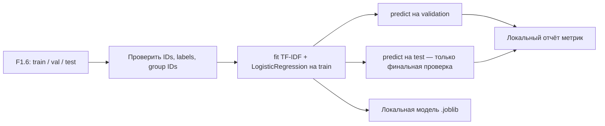
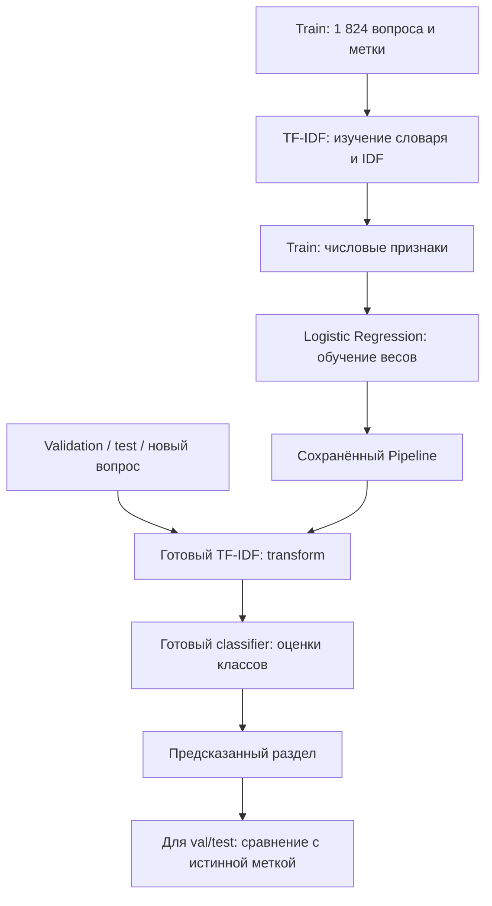

# F1.7 - Classical ML Baseline: TF-IDF + Logistic Regression: Простая модель

F1.7 - это обучение первой модели, которая определяет тему технического вопроса. TF-IDF превращает текст в числа, а Logistic Regression выбирает класс.

В F1.6 разделили данные на train, validation и test. Теперь используется train, чтобы научить модель выбирать один из четырёх классов:
```text
linux
databases
systems
programming
```

Для этого объединили два инструмента:
```text
Текст вопроса
      ↓
TF-IDF - превращает текст в числа
      ↓
Logistic Regression - выбирает класс
```



## Работа baseline

**TF-IDF** конвертирует слова текста в числовые признаки. `TF` описывает частоту термина в документе, `IDF` снижает вес частых во многих документах терминов. Условно:
\[
\operatorname{TFIDF}(t,d) = \operatorname{TF}(t,d) \cdot \log\left(\frac{N+1}{df(t)+1}\right)
\]

В `scikit-learn` используются особенности нормализации и сглаживания; это иллюстрация идеи, а не точная формула всей реализации. Берём отдельные слова и пары слов (`ngram_range=(1,2)`) и логарифмический вариант TF (`sublinear_tf=True`). `max_features=18000` ограничивает словарь.

**Logistic Regression** - линейный классификатор. Для многоклассовой задачи он строит вероятности меток по взвешенным TF-IDF-признакам. Параметр `C=2.0` управляет обратной силой регуляризации, `max_iter=500` - предел итераций оптимизации. Значения взяты из оригинальной конфигурации, а не подобраны на тесте.

### Правило предотвращения data leakage (утечки)
- `model.fit(X_train, y_train)` вызывает `fit_transform` TF-IDF **только на train**.
- К validation/test применяется `model.predict`, использующий уже зафиксированный словарь и IDF.
- Проверить, что `group_id` не пересекаются между тремя файлами, все `id` уникальны, метки validation/test известны train.
- **Нельзя** делать `fit_transform` на всех 3 040 записях: это меняет словарь и IDF с учётом отложенных данных.

## Метрики
- **Accuracy:** доля верно предсказанных меток. Наиболее частый класс может сильно влиять на accuracy при дисбалансе.
- **Precision / Recall / F1:** precision - доля правильных объектов среди предсказанных для класса; recall - доля найденных среди истинных объектов. `F1 = 2PR/(P+R)`.
- **Macro F1:** среднее F1 по классам, все классы равноправны, независимо от частоты.
- **Weighted F1:** среднее по классам, взвешенное по числу их истинных записей.
- **Confusion matrix:** числа переходов «истинный класс → предсказанный класс». В F1.7 записывается агрегатная матрица; её графический разбор относится к F1.8.
- **Bootstrap CI:** 500 повторных выборок из validation/test с возвращением и `seed=42`. Интервал характеризует лишь разброс по **отдельным строкам при фиксированной модели**; не учитывает зависимость внутри групп, возможное изменение обучения и качество разметки.
Все значения сохраняются раздельно для validation и test. Не используй test для последующего подбора `C`, словаря или архитектуры: иначе итоговый показатель перестанет быть независимой оценкой.

## Преемственность с исходным проектом
Исходный [`src/classical_ml/train.py`](../../src/classical_ml/train.py) был основой адаптации. Сохраняем `TfidfVectorizer(max_features=18000, ngram_range=(1,2), sublinear_tf=True)` + `LogisticRegression(C=2.0, max_iter=500, random_state=42)`.

**Исторические результаты** сохранённого локального эксперимента: val Macro F1 **0.8746**, test Macro F1 **0.8822**, test accuracy **0.8783**, test weighted F1 **0.8787** (608 записей). Они **не являются** гарантированным результатом твоего нового запуска: версии библиотек и фактический состав F1.6-групп могут различаться (в новом F1.6 зафиксированы 536 парных связей против исторических 535). Сравниваем значения, но не подгоняем ни код, ни гиперпараметры к исторической метрике.

Новый модуль отдельно проверяет данные и не сохраняет полные тексты ошибок; они остаются только в локальном входном корпусе.

## Запуск из PowerShell (из корня репозитория)
```powershell
.\.venv\Scripts\python.exe -m pip install -r requirements-classical.txt
.\.venv\Scripts\python.exe -m pytest -q tests/test_foundation.py tests/test_provenance.py tests/test_ingestion.py tests/test_cleaning.py tests/test_eda.py tests/test_splitting.py tests/test_classical.py
.\.venv\Scripts\python.exe -m scripts.train_classical --expect-train 1824 --expect-val 608 --expect-test 608
.\.venv\Scripts\python.exe scripts/check_repository.py
git status --short --untracked-files=all
```

**Важно:** F1.6 должен быть выполнен на том же локальном корпусе. Используем `data/processed/`, **не** `data/sample/`. Обучение реальной модели в GitHub Actions **не запускаем**: там только автономные синтетические тесты.

## Как проходит обучение и предсказание

## Локальные артефакты
| Файл | Что хранит | Публикация |
|---|---|---|
| `models/classical.joblib` | Обученный pipeline | Локально, не коммитить |
| `reports/classical.json` | Агрегированные метрики, конфигурация, SHA-256 трёх выборок | Локально, не коммитить |
| `reports/classical_predictions.json` | ID и метки, без текстов вопросов | Локально, не коммитить |

`joblib.load` использует механизм десериализации Python: **не загружай модели из недоверенных источников**. В отчётах не хранится исходный текст. ID также пока остаются локальными до ревью происхождения данных.

## Что подтверждает PASS
PASS подтверждает возможность обучить и воспроизвести первую **source-domain classifier** на фиксированных выборках с тестами утечек, корректной конфигурацией и агрегированными метриками. Это не гарантия того, что модель понимает технические проблемы или умеет решать задачи администратора.
Сохранённый `model_bytes` - **размер файла**, не потребление RAM. Время обучения и inference зависит от машины; эта версия публикует только устойчивые метрики и не делает сравнительных заявлений о latency.

## Основная мысль F1.7
Сначала стоит построить простой измеримый baseline. Он помогает понять, есть ли полезный сигнал в данных и оправдано ли дальнейшее усложнение модели.
- Модель работает с числовыми признаками текста.
- TF-IDF сочетает частоту признака в вопросе и его редкость в обучающем корпусе.
- Logistic Regression здесь решает задачу классификации.
- Pipeline объединяет преобразование и classifier.
- Оба этапа обучаются только по train.
- Accuracy и F1 имеют разный смысл.
- Macro-усреднение даёт классам одинаковый вес.
- Метрики классификации раздела не оценивают правильность технического ответа.
- Модель, предсказания и ошибки сохраняются для проверки и сравнения.
