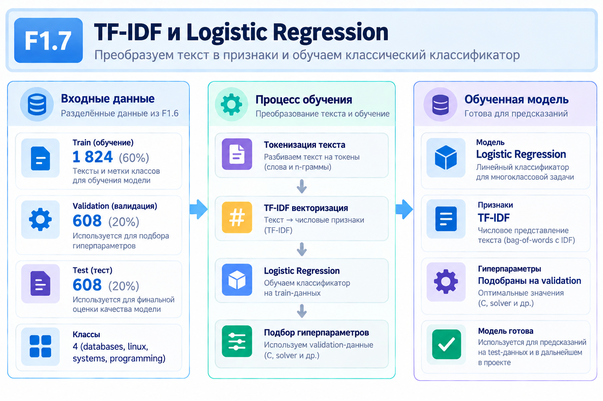
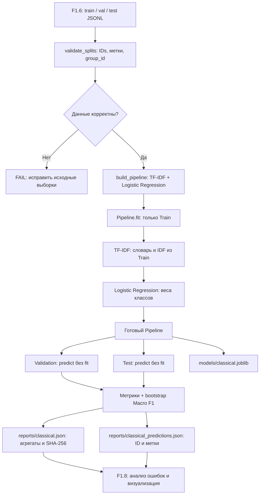

# F1.7 - Classical ML Baseline: обучение первого классификатора на TF-IDF и Logistic Regression

## 1. Цель этапа:

В предыдущих этапах последовательно подготовлены данные. F1.3 получены технические вопросы и ответы из выбранных источников, F1.4 произведена их очистка, F1.5 исследованы распределения, а F1.6 сделано разделение **3 040 записей** на независимые по обнаруженным группам части: **Train - 1 824, Validation - 608, Test - 608** в контрольном запуске.



Теперь есть данные, но ещё нет модели, которая делает предсказания. Прежде чем строить нейросеть, нужно получить **baseline - простой, понятный и измеримый исходный результат**. Он нужен для сравнения: если в дальнейшем сложный метод окажется хуже baseline, усложнение само по себе пользы не принесет.

Сформулирована конкретная задача: по **тексту технического вопроса** (`context`) определить, в каком из четырёх разделов Stack Exchange он был опубликован:

| Метка `domain` | Что обозначает в нашем корпусе |
|---|---|
| `linux` | Раздел Unix/Linux |
| `databases` | Раздел администрирования баз данных |
| `systems` | Раздел серверного и системного администрирования |
| `programming` | Раздел Code Review |

Например, вопрос о медленном запросе PostgreSQL модель может отнести к `databases`, а вопрос о правах доступа в Linux - к `linux`. Это иллюстрации задачи, **не гарантированные результаты конкретных предсказаний**.

Очень важно правильно понимать целевую метку. `domain` получена из **источника записи**, а не из экспертного анализа причины технической проблемы. Один и тот же вопрос мог бы затрагивать сразу Linux, серверы и базы данных. Поэтому необходимо обучить **source-domain classifier**: модель предсказывает раздел, а не решает описанную проблему.

**Задача F1.7:**
1. Прочитать три готовые выборки F1.6 и проверить, что они действительно разделены корректно.
2. Превратить тексты вопросов Train в числовые признаки с помощью **TF-IDF**.
3. Обучить на этих признаках **Logistic Regression** для четырёх классов.
4. Получить предсказания для Validation и Test **без повторного обучения преобразования текста**.
5. Рассчитать Accuracy, Precision, Recall, F1, матрицу ошибок и интервальную оценку Macro F1.
6. Сохранить обученную модель, настройки, контрольные суммы входных файлов и результаты локально.
7. Проверить реализацию автономными тестами, которые не требуют настоящего датасета.

## 2. Реализация: файлы этапа

Разделение **математического алгоритма**, **работы с локальными файлами** и **автоматических проверок**. Это помогает изучать классификатор отдельно от путей, форматов и командной строки.
### Основные исходники

| Файл                                                                 | Что сделали и зачем                                                                                                                                                                                                                                                         |
| -------------------------------------------------------------------- | --------------------------------------------------------------------------------------------------------------------------------------------------------------------------------------------------------------------------------------------------------------------------- |
| [`src/classical_ml/train.py`](../../src/classical_ml/train.py)       | **Основной алгоритм:** `validate_splits()` проверяет Train/Val/Test; `build_pipeline()` создаёт TF-IDF + Logistic Regression; `fit_and_evaluate()` обучает модель на Train и оценивает её на Val/Test; `classification_metrics()` и `bootstrap_macro_f1()` считают метрики. |
| [`src/classical_ml/__init__.py`](../../src/classical_ml/__init__.py) | Обозначен отдельный Python-пакет для классической модели.                                                                                                                                                                                                                   |
| [`scripts/train_classical.py`](../../scripts/train_classical.py)     | **Сценарий локального запуска:** `run()` читает YAML и три JSONL, проверяет ожидаемые размеры, вызывает обучение, рассчитывает SHA-256 и записывает модель и отчёты; `main()` обрабатывает аргументы PowerShell и печатает PASS/FAIL.                                       |
| [`tests/test_classical.py`](../../tests/test_classical.py)           | **Автономные тесты:** правильные и неправильные выборки, утечки, параметры модели, обучение только на Train, метрики, повторяемость, сохранение артефактов и ошибки CLI-сценария.                                                                                           |
| [`requirements-classical.txt`](../../requirements-classical.txt)     | Фиксирует набор используемых библиотек классического этапа поверх предыдущей инфраструктуры, включая `joblib` для локального сохранения модели.                                                                                                                             |

Использован существующий файл [`configs/local_cpu/lab.yaml`](../../configs/local_cpu/lab.yaml). Из секций `classical` и `evaluation` сценарий получает настройки обучения и оценки, а из общего поля `seed` - фиксированное начальное значение генератора.

**Параметры, зафиксированные для F1.7 в предоставленной реализации:**

| Настройка                      | Значение | Зачем она нужна                                      |
| ------------------------------ | -------- | ---------------------------------------------------- |
| `classical.max_features`       | `18000`  | Верхняя граница числа словарных признаков TF-IDF     |
| `ngram_range`                  | `(1, 2)` | Отдельные слова и соседние пары слов                 |
| `sublinear_tf`                 | `True`   | Логарифмическое масштабирование частоты термина      |
| `classical.C`                  | `2.0`    | Обратная сила регуляризации Logistic Regression      |
| `classical.max_iter`           | `500`    | Предельное число итераций оптимизатора               |
| `seed`                         | `42`     | Воспроизводимость операций, использующих случайность |
| `evaluation.bootstrap_samples` | `500`    | Количество bootstrap-повторов для интервала Macro F1 |

Значения взяты из исходного эксперимента. **В F1.7 автоматический поиск гиперпараметров не реализован**: обучение одной заранее определённой конфигурации.

### Входом служат результаты F1.6:

| Локальный файл               | Роль              | Что используем                                      |
| ---------------------------- | ----------------- | --------------------------------------------------- |
| `data/processed/train.jsonl` | Обучение          | `context` как текст и `domain` как правильный класс |
| `data/processed/val.jsonl`   | Контроль качества | Те же поля, но только для предсказания и оценки     |
| `data/processed/test.jsonl`  | Отложенная оценка | Те же поля, но без включения в `fit()`              |
Каждая запись также содержит `id`, `split` и `group_id`. Эти поля нужны для контроля корректности разделения и связи предсказания с конкретной записью; **модель не получает их как текстовые признаки**. Поле `answer` в модель F1.7 тоже не передаётся: классификация вопроса по его `context`.

| Результат                            | Что сохраняем                                                                                                  |
| ------------------------------------ | -------------------------------------------------------------------------------------------------------------- |
| `models/classical.joblib`            | Обученный `Pipeline`: TF-IDF-векторизатор с его словарём/IDF и классификатор с весами                          |
| `reports/classical.json`             | Отдельные агрегированные метрики Val/Test, конфигурацию, состав выборок, SHA-256 входных файлов, размер модели |
| `reports/classical_predictions.json` | Для каждой записи Validation/Test только `id`, `true` и `predicted`, без текста вопроса                        |
**Важно:** все три выходных артефакта предназначены для локальной работы. Реальные Q&A и сериализованную модель не требуется публиковать в репозитории.

## 3. Последовательность действий

### Шаг 1. Приняты готовые выборки F1.6 и зафиксирован их контракт
Начать не с обучения, а  с `validate_splits(datasets)` в `src/classical_ml/train.py`.

На вход приходит словарь с **тремя ключами**: `train`, `val`, `test`. Для каждой части проверить, что это непустой список корректных записей. У записи должны быть непустые строковые `id`, `context` и `domain`, правильный маркер `split`, а также допустимый `group_id`.

Затем провести более важные проверки, которые защищают результат обучения:
1. **Уникальность ID:** одна и та же запись не должна оказаться в нескольких выборках или повториться внутри одной.
2. **Независимость групп:** множества `group_id` для Train, Validation и Test не должны пересекаться попарно.
3. **Наличие классов в обучении:** в Train должны быть минимум два класса.
4. **Известные метки:** в Validation и Test не должно появиться класса, которого нет в Train.

Например, если `group_id=17` обнаружится в Train и Test, `validate_splits()` выдаст ошибку, а обучение **не начнётся**. Это полезнее, чем получить высокую метрику и только потом обнаружить, что модель видела близкие записи.

Функция возвращает служебный аудит с размерами выборок, списком классов Train, распределением Train по меткам и нулевыми пересечениями групп.

**Зачем этот шаг:** методологически корректная модель начинается с проверки данных. Даже самый хороший классификатор не исправит ошибку разделения корпуса.

### Шаг 2. Создать единый Pipeline из двух алгоритмов
Следующий шаг - функция `build_pipeline(...)`. Она сначала проверяет корректность параметров (`max_features`, `max_iter`, `seed`, `C`), а затем создаёт объект `sklearn.pipeline.Pipeline` из двух последовательных компонентов:
```python
Pipeline([
    (
        "tfidf",
        TfidfVectorizer(
            max_features=18000,
            ngram_range=(1, 2),
            sublinear_tf=True,
        ),
    ),
    (
        "classifier",
        LogisticRegression(C=2.0, max_iter=500, random_state=42),
    ),
])
```

Это пример с конкретными настройками F1.7. В реальном `build_pipeline()` они приходят через аргументы функции.

Такой Pipeline удобен тем, что он содержит **и преобразование текста в числа, и сам классификатор**. Не нужно отдельно вручную сохранять словарь, отдельно преобразовывать Test или беспокоиться, что при повторном запуске используем чужую настройку TF-IDF.

**Зачем этот шаг:** один объект задаёт полный маршрут от сырой строки вопроса до предсказанной метки.

### Шаг 3. Превратить тексты Train в TF-IDF-признаки
Алгоритму Logistic Regression нельзя передать строку `"postgresql query is slow"` напрямую. Ему нужен числовой вектор.

Для этого на Train обучить `TfidfVectorizer`:
1. Извлечь из вопросов токены по правилам словарного анализатора `scikit-learn`.
2. Учесть **униграммы** - отдельные слова, и **биграммы** - пары соседних слов. Например, из `postgresql slow query` могут получиться признаки `postgresql`, `slow`, `query`, `postgresql slow`, `slow query`.
3. Считать, насколько часто каждый признак встречается в конкретном вопросе (**TF**).
4. Снизить относительный вес признаков, встречающихся во многих обучающих вопросах (**IDF**).
5. Сформировать разреженный числовой вектор, ограничивая словарь максимумом **18 000 признаков**.

Здесь работает именно **словный TF-IDF**. Не следует путать его с **символьным TF-IDF из F1.6**: там векторы нужны для обнаружения похожих вопросов и формирования групп, а здесь - для предсказания категории текста.

**Зачем этот шаг:** научить программу выделять лексические признаки вопроса, не обучая тяжёлую нейросеть.

### Шаг 4. Обучить Logistic Regression на метках Train
После преобразования текста классификатор получает пары:
- **X_train** - TF-IDF-векторы технических вопросов;
- **y_train** - правильные значения `domain` для этих вопросов.

В `fit_and_evaluate()` это реализовано одним вызовом:
```python
model.fit(
    [r["context"] for r in train],
    [r["domain"] for r in train],
)
```

Метод `Pipeline.fit()` последовательно обучает TF-IDF на **только обучающих текстах**, преобразует их и оптимизирует веса Logistic Regression.

Для каждого класса классификатор учится определять, какие признаки увеличивают, а какие уменьшают его оценку. Например, слова, типичные для вопросов о SQL, могут стать полезными признаками `databases`. Но модель **не хранит готовые правила вида «встретилось SQL → всегда databases»**: она использует много признаков с обученными весами.

**Зачем этот шаг:** получить первую систему, которая делает предсказания на основании измеримых закономерностей в обучающих данных.

### Шаг 5. Отдельно получить предсказания на Validation и Test
После `model.fit()` веса и словарь уже зафиксированы. Для двух остальных выборок вызвать только:
```python
model.predict([r["context"] for r in rows])
```

Внутри обученного Pipeline это означает:
1. Преобразовать новый текст **готовым** TF-IDF: используется уже изученный на Train словарь и IDF.
2. Передать полученный вектор обученному Logistic Regression.
3. Выбрать метку класса из результатов классификатора.

**Ни на Validation, ни на Test повторный `fit()` не вызывается.** Это центральное правило F1.7.

Представить, что в Test появился специфический термин, которого не было в Train. **Не добавлять его в словарь задним числом**. Иначе модель получит информацию из отложенной выборки и сравнение перестанет быть честным.

В коде Test вычисляется в том же запуске, что и Validation, но **не используется для выбора `C`, состава признаков или вариантов алгоритма**. Если решить настраивать модель по Validation, итоговую Test-оценку следует интерпретировать лишь после окончательной фиксации решения, а не подбирать параметры по Test.

### Шаг 6. Рассчитать метрики качества классификации
Теперь для каждой записи Validation/Test есть две метки:
- `true` - исходный `domain`;
- `predicted` - ответ модели.

В `classification_metrics()` рассчитать **Accuracy**, Macro/Weighted Precision, Recall и F1, матрицу ошибок и число записей. Считать их **отдельно для Validation и Test**.

Почему нельзя ограничиться Accuracy? Потому что четыре класса разного размера, и модель может хорошо предсказывать многочисленный класс, но плохо распознавать менее представленный.

**Macro F1** поэтому особенно полезна как сопоставимая метрика: она даёт каждому классу одинаковый вес. Но даже высокий Macro F1 означает только способность предсказывать **раздел источника**, не корректность решения технической задачи.

### Шаг 7. Добавить интервальную оценку Macro F1 через bootstrap
Одна метрика, например `0.88`, - это число, полученное на конкретном отложенном наборе. Чтобы оценить её изменчивость при повторной выборке похожего размера, создан `bootstrap_macro_f1()`.

Алгоритм на уже готовых предсказаниях выполняет:
1. Берёт пары `(true, predicted)` для Validation или Test.
2. **500 раз** случайно выбирает из этих пар столько же строк **с возвращением** (`seed=42`).
3. Для каждой повторной выборки заново считает Macro F1 **без переобучения** классификатора.
4. Возвращает **2,5-й и 97,5-й процентили** распределения: `macro_f1_ci95`.

Это **построчный bootstrap при фиксированной модели**, а не полная оценка всей возможной неопределённости. Он не учитывает зависимость между строками одной исходной группы, разброс при другом Train и ошибки самой разметки. Поэтому интервал нельзя трактовать как универсальную гарантию качества.

**Зачем этот шаг:** научиться смотреть на точность измерения результата, а не только на одну красивую цифру.

### Шаг 8. Сохранить воспроизводимые артефакты, не раскрывая исходные тексты
Наконец, `scripts/train_classical.py` превращает работу чистых функций в повторяемый запуск из PowerShell.

Функция `run()` последовательно:
1. Загружает `configs/local_cpu/lab.yaml` и читает параметры.
2. Проверяет существование `data/processed/train.jsonl`, `val.jsonl`, `test.jsonl`.
3. Следит, чтобы входные и выходные пути не совпадали.
4. При заданных `--expect-*` проверяет точное количество строк **до обучения**.
5. Вызывает `fit_and_evaluate()`.
6. Вычисляет SHA-256 каждого из трёх исходных JSONL и добавляет их в отчёт.
7. Сохраняет Pipeline через `joblib` в `models/classical.joblib`.
8. Записывает агрегированный `reports/classical.json` и текстово-безопасный `reports/classical_predictions.json`.
9. Печатает сообщение `Classical baseline: PASS` и метрики двух выборок.

Для записи используются временные файлы и `os.replace()`: это уменьшает риск оставить **частично записанный отдельный артефакт** при прерывании. При этом все три артефакта не являются одной атомарной транзакцией - при ошибке между записями их версии могут отличаться.

**Зачем этот шаг:** получить не только разовый показатель в терминале, но и сохранённую модель вместе с информацией, **какими данными и настройками** он был получен.

### Шаг 9. Подтвердить поведение автономными тестами
В `tests/test_classical.py` специально используется **синтетические** вопросы двух классов, например про `kernel shell process` и `sql table query`. Это позволяет проверить реализацию без скачивания Stack Exchange.

Тесты подтверждают:
- отказ от некорректных входов и неправильной структуры Train/Val/Test;
- обнаружение одинаковых ID и общих `group_id`;
- запрет неизвестных классов в Validation/Test;
- проверку параметров `max_features`, `C`, `max_iter`, `seed`;
- отсутствие слов из Val/Test в словаре обученного TF-IDF;
- корректность метрик на примере с заранее известной матрицей ошибок;
- повторяемость метрик и bootstrap при фиксированных данных;
- корректное сохранение `joblib`, JSON-отчётов и предсказаний;
- отказ от записи результатов при отсутствующей выборке, неверных ожидаемых размерах или утечке групп.

**Итог разработки:** не только получен классификатор, но и осуществлена проверка, что он обучается **на правильной части данных** и что формат его результатов подходит для следующих этапов.

## 4. Алгоритмы F1.7: как текст превращается в предсказание

Необходимо разобрать внутренние вычисления, чтобы понимать не только вызовы `scikit-learn`, но и **математический смысл** модели.

### 4.1. TF-IDF: что означают числа в векторе вопроса

Есть три придуманных вопроса:

| Вопрос | Текст |
|---|---|
| 1 | `linux kernel error` |
| 2 | `linux file permission` |
| 3 | `postgresql query error` |

Вопросы здесь исключительно **для объяснения**, не из настоящего корпуса. Слово `linux` встречается в двух текстах, `postgresql` - в одном. Поэтому, при прочих равных, редкий термин `postgresql` получает больший IDF.

Идея TF-IDF:
```math
\mathrm{TFIDF}(t,d) = \mathrm{TF}(t,d) \cdot \mathrm{IDF}(t)
```

Для стандартного `TfidfVectorizer` из нашей реализации с `sublinear_tf=True` и сглаженным IDF можно подробнее записать до итоговой нормализации:

```math
\mathrm{TF}(t,d) = 1 + \ln(f_{t,d}), \qquad f_{t,d} > 0
```

```math
\mathrm{IDF}(t) = \ln\left(\frac{1+N}{1+\mathrm{df}(t)}\right)+1
```

где `f` - число появлений признака в данном вопросе; `N` - число обучающих документов; `df` - в скольких из них признак встретился. Если термин отсутствует, его вес равен нулю. По умолчанию `TfidfVectorizer` дополнительно выполняет **L2-нормализацию** итогового вектора.

Что дают отдельные настройки:
- **`ngram_range=(1, 2)`**: учитываем слово `query` и сочетание `slow query`. Это важно, поскольку смысл технических терминов часто зависит от соседнего слова.
- **`sublinear_tf=True`**: десятикратное повторение слова не даёт ему десятикратного влияния по TF.
- **`max_features=18000`**: размер словаря ограничен; точное число признаков может быть меньше, если в Train их недостаточно.

Результат TF-IDF - обычно **разреженная матрица**: у каждого текста ненулевые веса есть лишь у небольшой части общего словаря.

### 4.2. Logistic Regression: почему это классификатор

Название *Logistic Regression* может вводить в заблуждение: здесь **не предсказывается непрерывное число**, а решается задача классификации на четыре категории.

Для класса `k` модель вычисляет линейную оценку:
```math
s_k(x) = w_k^{\mathsf{T}}x + b_k
```

где `x` - TF-IDF-вектор вопроса, `w_k` - обученные веса признаков для класса, `b_k` - свободный параметр. По этим оценкам выбирается предсказываемый класс. Многоклассовая логистическая модель оптимизирует классификационную функцию потерь с регуляризацией.

Роль двух параметров:
- `C=2.0` - **обратная сила регуляризации**: большее `C` обычно означает менее сильное ограничение весов, а не «более качественную модель».
- `max_iter=500` - **предел числа итераций** оптимизатора, а не обещание, что обучение обязательно выполнит 500 шагов.

**Важная граница:** линейная модель на TF-IDF умеет использовать устойчивые текстовые закономерности, но не строит полноценное контекстное понимание и не знает истинной причины технической неисправности.

### 4.3. Почему TF-IDF из F1.6 нельзя просто обучить на всех данных для F1.7

В F1.6 уже использован TF-IDF, но там задача была другая: **выявить текстовые связи, чтобы не разорвать их при split**. Для этого анализировались вопросы и ответы всего корпуса; векторы служили только организации выборок.

В F1.7 TF-IDF - **обучаемая часть классификатора**. Если при `fit()` использовать Val или Test, словарь и IDF начнут зависеть от текстов, которые должны оставаться неизвестными при обучении. Даже без явного использования их меток это нарушит независимость оценки.

Поэтому реальный порядок строго такой:
```text
Train: контексты + метки
        |
        v
Pipeline.fit() на Train
        |
        +--> TF-IDF.fit_transform(): словарь, IDF, числовые признаки
        |
        +--> LogisticRegression.fit(): веса классов
        |
        v
      Готовая модель
        |
        +--> Validation: только transform + predict + метрики
        |
        +--> Test:       только transform + predict + метрики
```

**Нельзя:** `TFIDF.fit_transform(train + val + test)` перед классификацией. **Можно:** `model.predict(...)` на Val/Test, потому что он использует уже обученные компоненты.

### 4.4. Как вычисляются основные метрики

Для одного класса можно представить предсказания как «этот класс / не этот класс»:
- **TP** - записи данного класса, которые правильно отнесены к нему;
- **FP** - записи других классов, которые ошибочно названы данным классом;
- **FN** - записи данного класса, которым присвоена другая метка.

Тогда:
**Precision и Recall:**

```math
\mathrm{Precision} = \frac{TP}{TP+FP}, \qquad
\mathrm{Recall} = \frac{TP}{TP+FN}
```

**F1-score:**

```math
F_1 = \frac{2 \cdot \mathrm{Precision} \cdot \mathrm{Recall}}{\mathrm{Precision}+\mathrm{Recall}}
```

Если знаменатель равен нулю, в нашей реализации `scikit-learn` используется `zero_division=0`.

**Macro F1 для четырёх классов:**

```math
\mathrm{MacroF1} = \frac{F_{1,1}+F_{1,2}+F_{1,3}+F_{1,4}}{4}
```

**Weighted F1** учитывает число истинных записей каждого класса, а **Accuracy** - долю всех правильно предсказанных записей независимо от класса.

Взять маленький **синтетический тест**, который действительно присутствует в `tests/test_classical.py`:
```text
Истинные метки:     A, A, B, B
Предсказанные:      A, B, B, B
```

Три из четырёх ответов правильные, поэтому **Accuracy = 3/4 = 0.75**. Матрица ошибок при порядке классов `[A, B]` получается:

| Истинный класс ↓ / предсказанный → | A | B |
|---|---:|---:|
| A | 1 | 1 |
| B | 0 | 2 |

Из четырёх ячеек сразу видно, **где именно модель ошиблась**: один объект класса A она назвала B. В F1.7 сохраняем численную матрицу; её более подробное графическое изучение оставляем F1.8.

### 4.5. Что именно измеряет bootstrap-интервал

`bootstrap_macro_f1()` **не переобучает** ни TF-IDF, ни Logistic Regression. Функция повторно выбирает пары «правильная метка - готовое предсказание» и каждый раз пересчитывает Macro F1. Итоговый `macro_f1_ci95` - два эмпирических квантиля получившихся 500 значений при `seed=42`.

Интервал полезен для оценки вариации **на уровне строк текущей выборки**, но не устраняет ограничения групповой зависимости, разметки и выбора модели.

## 5. Схема: от F1.6 до обученной модели и отчётов



**Главное на схеме:** проверка независимости данных стоит **перед обучением**, обучение TF-IDF и классификатора выполняется **только на Train**, а Validation/Test проходят лишь через готовую модель.

## 6. Локальная проверка в PowerShell: что запускать и как читать результат

Все команды выполняются для **уже подготовленного проекта** на Windows. Они не устанавливают библиотеки и не изменяют Git-историю.

### 6.1. Перейти в корень репозитория
```powershell
cd F:\DEVELOPMENT\ML\ml-engineering-lab
```

Предполагаем, что здесь уже есть виртуальное окружение `.venv` и выполнен F1.6, то есть присутствуют `data/processed/train.jsonl`, `val.jsonl`, `test.jsonl`.

### 6.2. Запустить только автоматические тесты F1.7
```powershell
.\.venv\Scripts\python.exe -m pytest tests/test_classical.py -q
```

**Что проверяется:** контроль утечек, обучение только по Train, отсутствие слов Val/Test в словаре TF-IDF, математические метрики, bootstrap, повторяемость и создание локальных артефактов на синтетических примерах.

Успех - завершение без `failed` и `errors`. Точное число тестов зависит от текущей версии репозитория. Тестовый набор **не скачивает реальные Stack Exchange Q&A** и **не обучает модель на полном корпусе**.

### 6.3. Убедиться, что входные файлы F1.6 существуют
```powershell
Test-Path data/processed/train.jsonl
Test-Path data/processed/val.jsonl
Test-Path data/processed/test.jsonl
```

Ожидание трех `True`. Если какой-либо файл отсутствует, необходимо завершить F1.6; не нужно подменять обучающие данные малым `data/sample/`.

Посмотреть только количество строк, не раскрывая тексты:
```powershell
(Get-Content data/processed/train.jsonl | Measure-Object -Line).Lines
(Get-Content data/processed/val.jsonl | Measure-Object -Line).Lines
(Get-Content data/processed/test.jsonl | Measure-Object -Line).Lines
```

Для контрольного состава F1.6 это **1 824 / 608 / 608**. Числа следует сверять с текущим аудитом F1.6; одинаковый суммарный объём без совпадения данных ещё не доказывает их идентичности.

### 6.4. Обучить baseline на готовых выборках
```powershell
.\.venv\Scripts\python.exe -m scripts.train_classical --expect-train 1824 --expect-val 608 --expect-test 608
```

**Что происходит:** сценарий читает три JSONL и YAML, проверяет размеры и группы, обучает Pipeline на Train, отдельно прогнозирует Val/Test, рассчитывает метрики и записывает модель с отчётами.

Если F1.6 действительно создал другую допустимую разбивку, не нужно подгонять её к этим числам: сначала уточнить состав данных и запускай F1.7 без строгих ожиданий:
```powershell
.\.venv\Scripts\python.exe -m scripts.train_classical
```

**Форма успешного вывода:**
```text
Classical baseline: PASS; fit=train; train=1824; val=608; test=608
Validation: accuracy=...; macro_F1=...
Test: accuracy=...; macro_F1=...; weighted_F1=...
Model and aggregate report: local only; error analysis reserved for F1.8
```

Многоточия здесь намеренны: **фактические метрики зависят от текущих файлов**, и нет необходимости выдавать исторические значения за свежий запуск. Если вход нарушает контракт, появится `Classical baseline: FAIL: ...`, а не формальный PASS.

### 6.5. Проверить, что артефакты записаны
```powershell
Test-Path models/classical.joblib
Test-Path reports/classical.json
Test-Path reports/classical_predictions.json
```

Ожидание трех `True`.

Открыть отчёт, не печатая технические тексты:
```powershell
$report = Get-Content reports/classical.json -Raw | ConvertFrom-Json
$report.stage
$report.fit_split
$report.config
$report.data_contract.split_counts
$report.data_contract.group_overlap
$report.val.accuracy
$report.val.macro_f1
$report.test.accuracy
$report.test.macro_f1
$report.test.weighted_f1
$report.test.macro_f1_ci95
```

Проверить, что `fit_split` равен `train`, размеры соответствуют входу, а `group_overlap` содержит три нуля. `macro_f1_ci95` представляет два числа: нижнюю и верхнюю эмпирические границы bootstrap-интервала.

### 6.6. Сверить SHA-256 входных выборок с отчётом
```powershell
foreach ($name in @('train', 'val', 'test')) {
    $actual = (Get-FileHash "data/processed/$name.jsonl" -Algorithm SHA256).Hash.ToLower()
    $expected = $report.split_source_sha256.$name
    "$name : " + ($actual -eq $expected)
}
```

**Ожидание трех `True`.** Это подтверждает, что отчёт относится к тем же **байтам трёх входных JSONL**, которые лежат в текущей рабочей папке. Если файл изменился после обучения, сравнение покажет расхождение.

### 6.7. Посмотреть сохранённые предсказания без текстов
```powershell
$predictions = Get-Content reports/classical_predictions.json -Raw | ConvertFrom-Json
$predictions.val.Count
$predictions.test.Count
$predictions.test | Select-Object -First 5 id, true, predicted
```

Для контрольного корпуса ждать **608** записей в Validation и **608** в Test. У каждой записи показываются ID, исходная и предсказанная метки; текст вопроса в этот файл не включается.

### 6.8. Проверить полную регрессию проекта
```powershell
.\.venv\Scripts\python.exe -m pytest -q
.\.venv\Scripts\python.exe scripts/check_repository.py
```

**Что проверяется:** изменения предыдущих и последующих этапов не нарушили работу F1.7, а структура проекта остаётся корректной. Реальное обучение полного корпуса не выполняется внутри этих автономных тестов. В нынешнем проекте число тестов может быть значительно больше первоначального - важнее отсутствие `failed`/`errors`.

## 7. Что подтверждено и какие ограничения

### Исторический ориентир исходного эксперимента
В предоставленном документе F1.7 сохранены следующие результаты **первоначального локального запуска**:

| Показатель          | Историческое значение | Что означает                                               |
| ------------------- | --------------------: | ---------------------------------------------------------- |
| Validation Macro F1 |            **0.8746** | Средняя F1 четырёх классов с одинаковым весом              |
| Test Macro F1       |            **0.8822** | Та же метрика на отложенной Test-выборке                   |
| Test Accuracy       |            **0.8783** | Доля верных прогнозов по всем 608 Test-записям             |
| Test Weighted F1    |            **0.8787** | Средняя F1 с весами по количеству истинных записей классов |

Это **исторические**, а не заново вычисленные здесь метрики. В F1.6 зафиксировано изменение числа найденных связей между первоначальным экспериментом (**535**) и контрольным Windows-запуском (**536**). Даже если размеры итоговых выборок одинаковые, их состав и результат обучения могут отличаться. Версии `scikit-learn` тоже способны влиять на численные детали.

**Правильное действие:** сравнить новый `reports/classical.json` с историческими ориентирами, а при расхождении сначала проверить SHA-256, конфигурацию и состав выборок. Не менять код или гиперпараметры ради совпадения с исторической цифрой и тем более не подбирать их по Test.

### Что подтверждает успешная проверка F1.7
- Есть работающий **классический текстовый классификатор** TF-IDF + Logistic Regression.
- Проверены основные контракты независимых выборок до обучения.
- Словарь и IDF модели обучаются **только на Train**, а не на отложенных текстах.
- Для Val и Test рассчитываются сравнимые метрики и матрицы ошибок.
- Сохранённая модель объединяет преобразователь и классификатор в один Pipeline.
- Отчёт содержит конфигурацию и SHA-256, а список предсказаний не раскрывает тексты вопросов.
- Автономные тесты способны проверить реализацию на полностью искусственных данных.

Есть и содержательные ограничения: словный TF-IDF чувствителен к лексике и не умеет полноценно учитывать порядок и контекст фразы за пределами заданных n-грамм. Кроме того, технические токены вроде `C#`, путей и фрагментов команд могут обрабатываться стандартным токенизатором не так, как хотелось бы. Эти ограничения дают понятную мотивацию к следующим этапам исследования.

## 8. Основная мысль раздела

**В F1.7 подготовленный и разделённый технический корпус конвертирован в первый измеримый ML-baseline. Сначала осуществлена проверка целостности трёх выборок, затем создан Pipeline из словного TF-IDF и Logistic Regression, обучены оба компонента только на Train, получены предсказания на Validation/Test и измерили Accuracy, Macro F1 и другие показатели. Результат сохранен вместе с настройками и SHA-256, чтобы дальше сравнивать новые методы с известной точкой отсчёта.**

## 9. Файлы этапа

Анализировать код необходимо в следующем порядке - от простого тестового случая к полному обучению на реальных выборках:

| Порядок | Файл / функция                                                                                                                                     | Что нужно понять                                                                                                                     |
| ------- | -------------------------------------------------------------------------------------------------------------------------------------------------- | ------------------------------------------------------------------------------------------------------------------------------------ |
| 1       | [`tests/test_classical.py`](../../tests/test_classical.py) - `samples()`                                                                           | Как устроены искусственные Train/Val/Test: `context`, `domain`, `split`, `group_id` и уникальные ID.                                 |
| 2       | [`src/classical_ml/train.py`](../../src/classical_ml/train.py) - `validate_splits()`                                                               | Проверка структуры выборок, пересечений групп, уникальности ID и известных классов.                                                  |
| 3       | [`src/classical_ml/train.py`](../../src/classical_ml/train.py) - `build_pipeline()`                                                                | Как соединены `TfidfVectorizer` и `LogisticRegression`; что означают `max_features`, `(1, 2)`, `C` и `max_iter`.                     |
| 4       | [`src/classical_ml/train.py`](../../src/classical_ml/train.py) - `fit_and_evaluate()`                                                              | Где именно вызывается `model.fit()` и почему туда передаётся только Train; как выполняется `predict()` для Val/Test.                 |
| 5       | [`tests/test_classical.py`](../../tests/test_classical.py) - `test_train_only_fit_and_test_vocabulary_not_seen()`                                  | Прямое доказательство того, что специальный термин из Validation/Test **не попал** в словарь TF-IDF.                                 |
| 6       | [`src/classical_ml/train.py`](../../src/classical_ml/train.py) - `classification_metrics()`                                                        | Как считаются Accuracy, Macro/Weighted Precision–Recall–F1 и матрица ошибок.                                                         |
| 7       | [`tests/test_classical.py`](../../tests/test_classical.py) - `test_metrics_known_answer_and_matrix()`                                              | Ручной пример с четырьмя метками и заранее известной матрицей `[[1,1],[0,2]]`.                                                       |
| 8       | [`src/classical_ml/train.py`](../../src/classical_ml/train.py) - `bootstrap_macro_f1()`                                                            | Повторная выборка индексов с возвращением, 500 пересчётов Macro F1 и два квантиля интервала.                                         |
| 9       | [`scripts/train_classical.py`](../../scripts/train_classical.py) - `run()` и `main()`                                                              | Путь от YAML/JSONL до обученной модели, CLI PASS/FAIL, SHA-256 и трёх артефактов.                                                    |
| 10      | [`tests/test_classical.py`](../../tests/test_classical.py) - `test_run_local_smoke_artifacts_and_text_free_report()`                               | Как тест проверяет сохранение, чтение доверенного тестового `joblib`, предсказания и отсутствие текста вопросов в агрегатном отчёте. |
| 11      | [`tests/test_classical.py`](../../tests/test_classical.py) - `test_data_group_leakage_blocks_training()` и `test_expected_count_blocks_training()` | Почему при нарушении входного контракта обучение должно останавливаться **до создания итоговой модели**.                             |
| 12      | [`configs/local_cpu/lab.yaml`](../../configs/local_cpu/lab.yaml)                                                                                   | Где управляются параметры классификатора, bootstrap и `seed`; почему изменения требуют нового, отдельно обозначенного эксперимента.  |
| 13      | [`src/data/splitting.py`](../../src/data/splitting.py)                                                                                             | Чем отличается символьный TF-IDF, использованный F1.6 для группировки, от словного TF-IDF F1.7 для классификации.                    |

**Итог F1.7:** в проекте появилась **первая обученная модель**, для которой можно точно назвать входы, параметры, механизм преобразования текста, способ обучения, метрики, ограничения и локальные доказательства правильности реализации.
