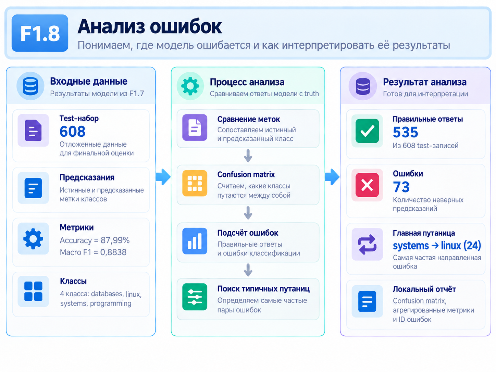
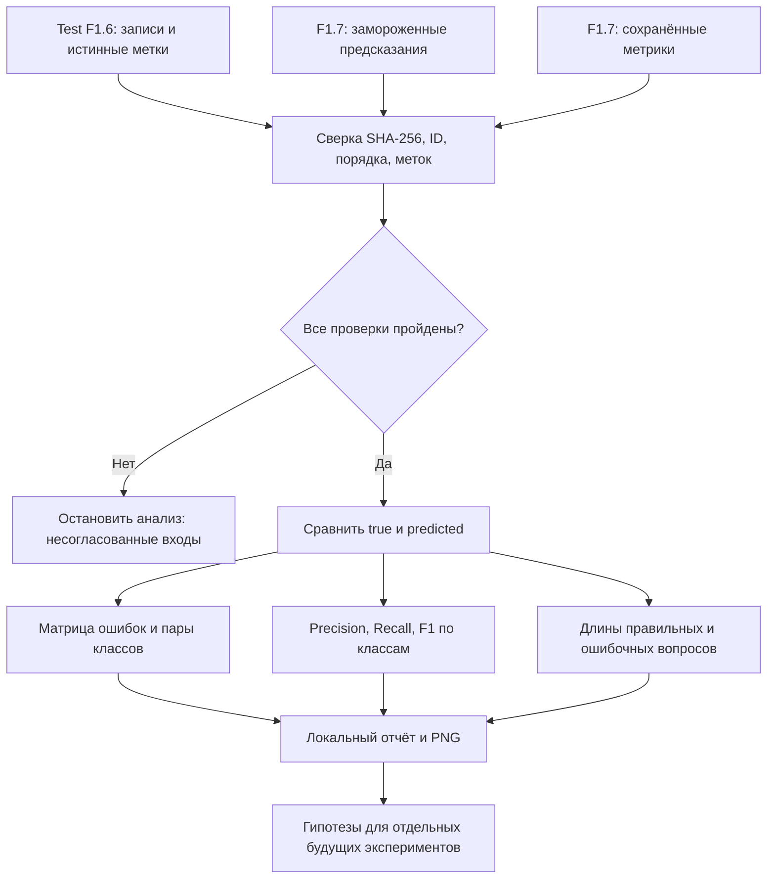

# F1.8 - Error Analysis: пошаговый разбор ошибок классического классификатора

## 1. Цель этапа:

На F1.7 обучена модель классификации технических вопросов по четырём разделам Stack Exchange: `databases`, `linux`, `programming`, `systems`. Для обучения использован только `train`, а качество определено на `validation` и `test`.

У модели уже появились численные показатели - **Accuracy**, **Macro F1** и другие метрики. Но общая оценка вроде `Accuracy ≈ 0.88` отвечает лишь на вопрос: «Какую долю тестовых вопросов модель классифицировала правильно?» Она почти ничего не говорит о том, **в каких случаях модель ошибается**.

Представить две ситуации с одинаковым количеством ошибок:
- В первом случае ошибки равномерно распределены по всем четырём классам.
- Во втором почти все ошибки приходятся на пару `linux` и `systems`, а `programming` определяется заметно надёжнее.

Одинаковая Accuracy здесь скрывает **разные проблемы**. Во втором случае полезно изучить пересечение тем: вопрос об администрировании Linux может подходить сразу к двум разделам. При этом нельзя сразу объявлять причиной ошибки «недостаток понимания»: метка `domain` обозначает **исходный раздел сайта**, а не экспертно установленную техническую причину проблемы.



**Задача F1.8:** взять **уже сохранённые** предсказания F1.7, проверить, что они действительно относятся к текущему `test.jsonl`, затем разобрать ошибки по классам и сформулировать проверяемые гипотезы о слабых местах модели и данных.

## 2. Реализация: файлы этапа

F1.8 опирается на результаты F1.6 и F1.7. **Новый этап не пересоздаёт датасет и не обучает классификатор.** Он читает существующие артефакты и проверяет их согласованность.
### Основные исходники

| Файл                                                                             | Что сделали и зачем                                                                                                                                                                                                                       |
| -------------------------------------------------------------------------------- | ----------------------------------------------------------------------------------------------------------------------------------------------------------------------------------------------------------------------------------------- |
| [`src/classical_ml/error_analysis.py`](../../src/classical_ml/error_analysis.py) | Вынесены аналитические вычисления в отдельный модуль: получение агрегированных характеристик ошибок из готовых меток и предсказаний, а также построение изображения матрицы ошибок. Это **основной алгоритмический код F1.8**.            |
| [`scripts/analyze_classical.py`](../../scripts/analyze_classical.py)             | Создана точка запуска анализа: чтение тестового корпуса и результатов F1.7, сверка SHA-256, порядка ID, меток и метрик, затем сохранение результатов.                                                                                     |
| [`tests/test_error_analysis.py`](../../tests/test_error_analysis.py)             | Добавлены автономные проверки на синтетических примерах. Тесты проверяют обработку правильных и ошибочных предсказаний, согласованность входов и поведение при нарушении проверяемых условий. Реальные Q&A и сетевой доступ не требуются. |

### 2.2. Входом служат результаты предыдущих этапов:

| Входной файл                         | Откуда появился | Зачем используется в F1.8                                                                                 |
| ------------------------------------ | --------------- | --------------------------------------------------------------------------------------------------------- |
| `data/processed/test.jsonl`          | F1.6            | Содержит тестовые записи, их ID и истинные метки `domain`; по тексту вопроса можно посчитать длину.       |
| `reports/classical_predictions.json` | F1.7            | Сохранённые `id`, `true` и `predicted` - предсказания уже обученной модели.                               |
| `reports/classical.json`             | F1.7            | Зафиксированные метрики, список классов, матрица ошибок и SHA-256 тестового файла для независимой сверки. |
**Отдельно о `models/classical.joblib`.** На F1.8 этот файл **не открывать**. Сейчас не нужны веса модели: исследуются замороженные результаты F1.7, а не запуск обучения или новое предсказание. Это также исключает риск десериализации недоверенного `joblib`-файла при таком анализе.

## 3. Последовательность действий

### Шаг 1. Зафиксировать границу анализа: только готовые предсказания
На предыдущем этапе `Pipeline` обучены TF-IDF-векторизатор и Logistic Regression на `train`. Затем модель получила тестовые вопросы и сохранила их предсказанные классы.

Здесь нет вызова `.fit()` и нет смены словаря TF-IDF, коэффициенты классификатора или параметр регуляризации `C`.

**Почему это важно:** иначе получится смешать два разных эксперимента - обучение модели и разбор ошибок. Когда веса не меняются, можно объяснить полученный отчёт именно поведением **зафиксированной модели** на **зафиксированной тестовой выборке**.

### Шаг 2. Проверить, что идет анализ того же самого test
Сначала скрипт читает `data/processed/test.jsonl` и рассчитанный для него **SHA-256**. Затем сверяет контрольную сумму со значением, сохранённым на F1.7 в `reports/classical.json`.

SHA-256 нужен не для оценки качества модели. Это цифровой отпечаток **байтов файла**. Даже если другой тестовый корпус содержит то же число записей, это ещё не означает, что он идентичен исходному.

Если SHA-256 отличается, анализ останавливается. **Нельзя подменять файл** и подгонять его под старые предсказания.

**Зачем этот шаг:** предотвратить ситуацию, когда показатели рассчитаны по одной версии `test`, а анализ ошибок случайно выполняется по другой.

### Шаг 3. Сопоставить записи и предсказания по ID и меткам
Одна совпавшая контрольная сумма ещё не проверяет структуру файла предсказаний. Для каждой тестовой строки нужно удостовериться, что:
1. Запись существует в ожидаемой позиции последовательности.
2. Её `id` совпадает с сохранённым `id` предсказания.
3. Сохранённая истинная метка `true` соответствует `domain` в `test.jsonl`.
4. Количество предсказаний равно количеству тестовых записей.
5. Используются ожидаемые классы, а сохранённые метрики согласуются с данными.

Почему нельзя опираться только на номер строки? Если перепутать порядок тестовых примеров, предсказание для `id=A` можно ошибочно сравнить с правильной меткой для `id=B`. Модель при этом не изменилась, но подсчитанная ошибка будет ложной.

**Зачем этот шаг:** получить уверенность, что оценивается корректные пары **«истинный класс - предсказанный класс»**.

### Шаг 4. Отделить правильные предсказания от ошибок
Теперь для каждой записи используется простое условие:
```python
is_correct = true_label == predicted_label
```

Если значения совпадают - предсказание правильное. Если не совпадают - это ошибка классификации.

Затем посчитать общее число правильных и ошибочных предсказаний и проверить равенство:
\[
N_{test}=N_{correct}+N_{errors}.
\]

Для архивной матрицы F1.8 эти значения равны `608 = 534 + 74`. Для более позднего запуска F1.7 с Accuracy `0.8799` получается другое соотношение - `608 = 535 + 73`. **Это не противоречие: результаты относятся к разным исполнениям.** Подробное сравнение приведено в разделе 7.

**Зачем этот шаг:** получить контролируемую основу для всех следующих вычислений.

### Шаг 5. Построить матрицу ошибок
Простого количества ошибок недостаточно. Поэтому необходимо подсчитать, **какой класс модель предсказывает вместо каждого истинного класса**.

В матрице ошибок (*confusion matrix*):
- **строки** соответствуют истинным меткам;
- **столбцы** - предсказанным меткам;
- элементы **диагонали** означают правильные предсказания;
- остальные элементы показывают направления путаницы.

Например, запись `linux → systems` означает, что исходный вопрос из раздела `linux` модель поместила в `systems`. Обратное направление `systems → linux` - отдельный тип ошибки.

**Зачем этот шаг:** выяснить не только сколько модель ошибается, но и **между какими именно классами**.

### Шаг 6. Рассчитать Precision, Recall и F1 для каждого класса
Матрица ошибок позволяет изучить поведение модели отдельно по `databases`, `linux`, `programming` и `systems`.

Для конкретного класса необходимо подсчитать:
- **TP (True Positive)** - сколько вопросов этого класса распознано правильно;
- **FP (False Positive)** - сколько вопросов других классов ошибочно получили эту метку;
- **FN (False Negative)** - сколько вопросов данного класса модель отнесла к другим;
- **Support** - сколько истинных вопросов этого класса содержится в тесте.

Из них получить Precision, Recall и F1. Затем усреднить F1 по четырём классам, чтобы получить **Macro F1**.

**Зачем этот шаг:** увидеть, какие классы модель определяет надёжно, а какие - хуже, даже если общий Accuracy выглядит приемлемо.

### Шаг 7. Сравнили длины правильных и ошибочных вопросов
Модель F1.7 использует TF-IDF: текст преобразуется в числовые признаки по словам и парам слов. При этом возникает естественный вопрос: **не чаще ли модель ошибается на длинных технических описаниях?**

Чтобы проверить эту гипотезу хотя бы на уровне наблюдения, необходимо поделить тестовые вопросы на две группы:
1. Те, у которых `true == predicted`.
2. Те, у которых `true != predicted`.

Для каждой группы посчитать **среднюю и медианную длину вопроса в словах**.

Если длины отличаются, это лишь отправная точка для дальнейшего исследования. Разница **не доказывает**, что именно длина вызвала ошибку: на результат могут одновременно влиять класс, лексика, наличие кода, неоднозначность текста и размер групп.

### Шаг 8. Сохранить агрегаты и построить изображение матрицы
Аналитический модуль формирует данные для локального отчёта и графическое представление матрицы ошибок. Изображение помогает быстро увидеть яркие ячейки вне диагонали - направления, где классификатор ошибается чаще.

Для отдельного разбора ошибочных примеров сохраняются или используются **идентификаторы записей**. Полные тексты технических Q&A не переносятся в публичный отчёт: их можно изучать локально по ID в исходном тестовом корпусе.

**Зачем этот шаг:** сделать выводы проверяемыми, не дублируя чужой контент и не теряя связь с конкретными примерами.

### Шаг 9. Проверить расчёты автономными тестами
В `tests/test_error_analysis.py` используются синтетические вопросы и предсказания. Проверить аналитические функции можно **без обучения классификатора, без реального датасета и без сетевых запросов**.

Проверки должны обнаруживать не только ошибки вычислений, но и несогласованные входные артефакты. Правильная реакция на испорченные или несовпадающие данные - **понятная ошибка и прекращение анализа**.

**Итог последовательности:** Получен отдельный этап диагностики, который принимает только согласованные результаты F1.7 и превращает их в объяснимые характеристики ошибок.

## 4. Как работает анализ: матрица, формулы и конкретный пример

### 4.1. Матрица ошибок из исторического отчёта
Ниже приведены **архивные данные первоначального F1.8**, а не матрица текущего запуска:

| Истинный класс ↓ / Предсказанный → | databases | linux | programming | systems | Всего в классе |
|---|---:|---:|---:|---:|---:|
| **databases** | **147** | 4 | 1 | 8 | 160 |
| **linux** | 2 | **134** | 1 | 22 | 159 |
| **programming** | 2 | 1 | **129** | 1 | 133 |
| **systems** | 7 | 25 | 0 | **124** | 156 |
| **Всего предсказано** | 158 | 164 | 131 | 155 | **608** |

Проверить матрицу вручную.

**Действие 1. Найти правильные ответы.** Сложить диагональ:
\[
N_{correct}=147+134+129+124=534.
\]

**Действие 2. Найти ошибки.** Всего в test 608 записей:
\[
N_{errors}=608-534=74.
\]

**Действие 3. Посчитать Accuracy.**
\[
Accuracy=\frac{534}{608}\approx 0.8783=87.83\%.
\]

**Действие 4. Поиск самых заметных направлений путаницы.**
- `systems → linux`: **25** ошибок;
- `linux → systems`: **22** ошибки;
- суммарно между двумя направлениями: **47** ошибок.

Это `47 / 74 ≈ 63.5%` всех ошибок исторического запуска. Однако **направления неравнозначны**: 25 и 22 - разные ячейки матрицы, и для анализа модели их надо сохранять отдельно.

### 4.2. Пример расчёта метрик для класса `linux`
Анализ строки и столбца `linux` в исторической матрице:
- **TP = 134** - правильно распознанные вопросы Linux;
- **FN = 159 − 134 = 25** - вопросы Linux, ошибочно отнесённые к другим классам;
- **FP = 164 − 134 = 30** - вопросы других классов, ошибочно предсказанные как Linux.

Рассчитать Precision:
\[
Precision_{linux}=\frac{TP}{TP+FP}=\frac{134}{164}\approx0.8171.
\]

То есть среди всех вопросов, которым модель **назначила метку `linux`**, примерно **81.7%** действительно относятся к этому разделу.

Recall:
\[
Recall_{linux}=\frac{TP}{TP+FN}=\frac{134}{159}\approx0.8428.
\]

Это означает, что модель нашла около **84.3%** настоящих вопросов Linux, присутствующих в тестовой выборке.

F1 объединяет Precision и Recall гармоническим средним:
\[
F1_{linux}=\frac{2PR}{P+R}\approx0.8297.
\]

Для сравнения по той же исторической матрице:

| Класс | Precision | Recall | F1 |
|---|---:|---:|---:|
| databases | 0.9304 | 0.9188 | 0.9245 |
| linux | 0.8171 | 0.8428 | 0.8297 |
| programming | 0.9847 | 0.9699 | 0.9773 |
| systems | 0.8000 | 0.7949 | 0.7974 |

Отсюда исторический **Macro F1**:
\[
MacroF1=\frac{0.9245+0.8297+0.9773+0.7974}{4}\approx0.8822.
\]

**Инженерная интерпретация:** в этом историческом запуске `programming` распознавался лучше остальных классов, а у `systems` F1 был ниже. Это **не доказывает**, что вопросы `systems` объективно сложнее: возможны пересечение тематик, особенности выборки и неоднозначность метки источника.
### 4.3. Что даёт анализ длины текста
Представить, что после расчёта оказалось, что ошибочно классифицированные вопросы в среднем длиннее правильных. Корректное утверждение будет таким:

В данной тестовой выборке наблюдается различие средних длин правильно и неправильно классифицированных вопросов. Необходимо отдельно проверить, связано ли оно с классом, тематикой, кодовыми вставками или другими факторами.

Некорректно утверждать: «Длинный вопрос вызывает ошибку», если мы не провели эксперимент, изолирующий влияние длины.

Здесь измеряется **количество слов**, а не BPE-токенов будущего Transformer. Поэтому длина в этом отчёте не равна длине входной последовательности LLM.
### 4.4. Что нельзя выводить из матрицы
**Модель F1.7 решает задачу определения раздела Stack Exchange.** Она не определяет, верен ли технический ответ, не устанавливает истинную причину ошибки в Linux и не оценивает пригодность документа для RAG.

Например, `systems → linux` не обязательно означает, что модель «не поняла вопрос». Иногда один и тот же вопрос естественно относится к нескольким техническим областям, а исходная метка указывает лишь на сайт публикации.

## 5. Схема: от предсказаний F1.7 к диагностике F1.8

**Путь данных в проекте:**
```text
F1.6: data/processed/test.jsonl
        |
        | ID, истинный класс, текст вопроса
        v
F1.7: готовый классификатор TF-IDF + Logistic Regression
        |
        | сохранённые предсказания и метрики
        v
F1.8: проверка SHA-256, ID, порядка, классов и метрик
        |
        +--> true == predicted? --> число правильных / ошибок
        |
        +--> confusion matrix --> ошибки по направлениям
        |
        +--> Precision / Recall / F1 --> сравнение классов
        |
        +--> длины вопросов --> наблюдения и гипотезы
        |
        v
Локальный отчёт + PNG-матрица + ID ошибок
```

**Внутренняя логика проверки и анализа:**


Главная особенность схемы: **на F1.8 нет ветки обучения модели**. Вся работа происходит после того, как предсказания уже сохранены.

## 6. Локальная проверка в PowerShell: что запускать и как читать результат

Ниже приведены команды для существующего проекта под Windows. Они **не устанавливают библиотеки**, не выполняют Git-операции и не изменяют параметры классификатора.

### 6.1. Перейти в корень проекта
```powershell
cd F:\DEVELOPMENT\ML\ml-engineering-lab
```

### 6.2. Проверить наличие результатов предыдущих этапов
```powershell
Test-Path .\data\processed\test.jsonl
Test-Path .\reports\classical_predictions.json
Test-Path .\reports\classical.json
```

Для всех трёх команд ожидаем `True`. Если какого-либо файла нет, сначала нужно получить соответствующий результат F1.6 или F1.7. **F1.8 не создаёт test и не запускает обучение вместо F1.7.**

### 6.3. Запустить только тесты F1.8
```powershell
.\.venv\Scripts\python.exe -m pytest tests/test_error_analysis.py -q
```

**Что проверяется:** аналитическую логику и защиту от несогласованных входов на искусственных данных. Количество прошедших тестов зависит от текущей версии репозитория; критерий успешности - отсутствие `failed` и `errors`.

### 6.4. Выполнить анализ сохранённых предсказаний
```powershell
.\.venv\Scripts\python.exe -m scripts.analyze_classical --expect-test 608
```

**Что происходит:** скрипт открывает три входных файла, проверяет их согласованность, рассчитывает статистику ошибок и сохраняет результаты локально.

**Как читать результат:**
- Число тестовых записей должно соответствовать ожидаемым **608**.
- Скрипт должен сообщить фактическое количество ошибок и наиболее частую **направленную** пару классов.
- Сохранённые метрики должны совпадать с теми, что получаются из сохранённых предсказаний.
- Если SHA-256, порядок ID или метки расходятся, корректное поведение - **ошибка проверки**, а не успешный отчёт.

**Важно:** параметр `--expect-test 608` проверяет **размер test**, а не заставляет программу выдать историческое количество ошибок.

### 6.5. Проверить контрольную сумму тестового файла
```powershell
Get-FileHash .\data\processed\test.jsonl -Algorithm SHA256
```

Сравнить полученную SHA-256 со значением тестового файла, сохранённым в `reports/classical.json`. **Совпадение контрольных сумм подтверждает идентичность байтов**, но само по себе ещё не доказывает, что все предсказания имеют правильные метки; для этого нужна полная проверка из шага 6.4.

### 6.6. Открыть PNG-матрицу после успешного запуска
Найти созданную визуализацию, не зная её полного пути:
```powershell
Get-ChildItem -Path . -Recurse -File -Filter confusion_matrix.png
```

Команда покажет расположение файла, если он сохранён под указанным в исходном описании именем `confusion_matrix.png`. Затем открыть найденный файл обычным просмотрщиком изображений и проверить порядок классов на обеих осях. **Не путать строку с колонкой:** это меняет смысл ошибки на противоположный.

### 6.7. Проверить, что предыдущие этапы не сломались
```powershell
.\.venv\Scripts\python.exe scripts/check_repository.py
.\.venv\Scripts\python.exe -m pytest -q
```

**Что проверяется:** структура репозитория и полная регрессия доступных тестов. Один успешно построенный PNG-файл не заменяет проверку исходных данных и аналитических вычислений.

## 7. Что подтверждено и какие ограничения

### 7.1. Не смешивать два запуска F1.7/F1.8
В документации проекта зафиксированы **два разных набора результатов**:

| Показатель | Исторический эксперимент | Более поздний локальный F1.7 |
|---|---:|---:|
| Размер test | 608 | 608 |
| Правильных предсказаний | 534 | 535 (следует из Accuracy и размера test) |
| Ошибок | 74 | 73 (следует из Accuracy и размера test) |
| Test Accuracy | 0.8783 | 0.8799 |
| Test Macro F1 | 0.8822 | 0.8838 |
| Полная матрица ошибок | Приведена в разделе 4 | В данном исходном документе не приведена |

**Откуда различие:** ранний и последующий запуски могли использовать несколько отличающиеся составы групп F1.6 или программные окружения. Это **возможные объяснения**, а не доказанная причина конкретного изменения. На F1.6 также наблюдалось расхождение числа near-duplicate edges: **535 в историческом отчёте против 536 в контрольном запуске**.

Поэтому таблицу из раздела 4 нельзя автоматически считать матрицей текущих предсказаний F1.7. Новую матрицу нужно получить из соответствующих файлов, выполнив команду F1.8.

### 7.2. Что подтверждает успешный F1.8
Если скрипт и тесты завершились успешно, подтверждено, что:
1. Анализ выполняется над **тем же тестовым файлом**, для которого сохранены предсказания F1.7.
2. ID, метки и порядок записей согласованы, а сохранённые метрики не противоречат предсказаниям.
3. Количество ошибок, матрица и Precision/Recall/F1 рассчитаны на согласованном наборе данных.
4. Результаты можно изучить локально, не открывая веса модели и не обучая классификатор заново.
5. Полученные наблюдения пригодны для формулирования **гипотез**, но не для объявления причин ошибок без дополнительной проверки.

## 8. Основная мысль раздела

**F1.7 показал, насколько хорошо первая модель классифицирует технические вопросы в целом. F1.8 показал, как исследовать её ошибки: взять сохранённые предсказания, проверить совпадение тестовых данных, построить матрицу ошибок, рассчитать показатели по каждому классу и сравнить длины правильных и неправильных примеров. Так осуществлен переход от одной общей оценки к конкретным наблюдениям, которые можно проверять в дальнейших экспериментах.**

## 9. Файлы этапа

Для изучения реализации F1.8 необходимо просматривать файлы **в следующем порядке**:

| Порядок | Файл                                                                             | Что именно изучить                                                                                                                      |
| ------- | -------------------------------------------------------------------------------- | --------------------------------------------------------------------------------------------------------------------------------------- |
| 1       | `reports/classical_predictions.json`                                             | Формат сохранённых результатов F1.7: как для каждого ID представлены истинная и предсказанная метки; этот файл **только читаем**.       |
| 2       | `data/processed/test.jsonl`                                                      | Как устроена исходная тестовая запись: ID, `domain` и текст `context`, который используется для оценки длины.                           |
| 3       | `reports/classical.json`                                                         | Как F1.7 хранит Accuracy, Macro F1, матрицу ошибок, порядок классов и SHA-256 test.                                                     |
| 4       | [`scripts/analyze_classical.py`](../../scripts/analyze_classical.py)             | Последовательность CLI: чтение входов, проверка SHA-256, ID, меток и метрик, запуск анализа и сохранение файлов результата.             |
| 5       | [`src/classical_ml/error_analysis.py`](../../src/classical_ml/error_analysis.py) | Подсчёт правильных/ошибочных предсказаний, формирование матрицы, метрики по классам, статистика длин и визуализация.                    |
| 6       | [`tests/test_error_analysis.py`](../../tests/test_error_analysis.py)             | Как синтетические примеры доказывают корректность вычислений и выявляют несогласованность входных данных.                               |
| 7       | [`src/classical_ml/train.py`](../../src/classical_ml/train.py)                   | Как на F1.7 обучалась модель и формировались предсказания, которые теперь анализируются **без повторного обучения**.                    |


**Итог F1.8:** Теперь возможно не только сообщить общую точность классификатора, но и объяснить, **какие классы он путает, какими вычислениями это подтверждается и почему наблюдения об ошибках ещё не равны доказательству их причин**. Это необходимая часть полноценного ML-эксперимента.
