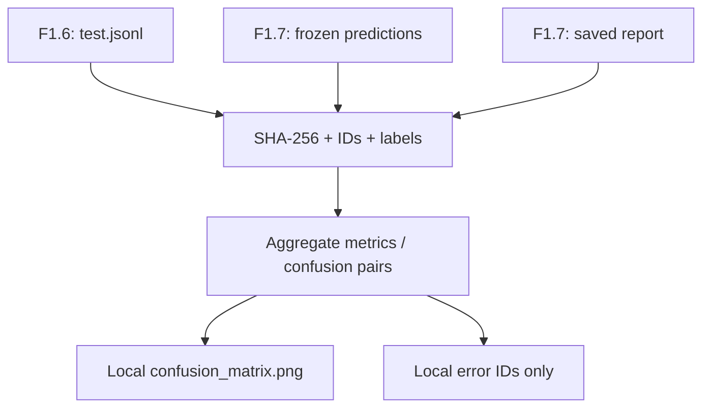
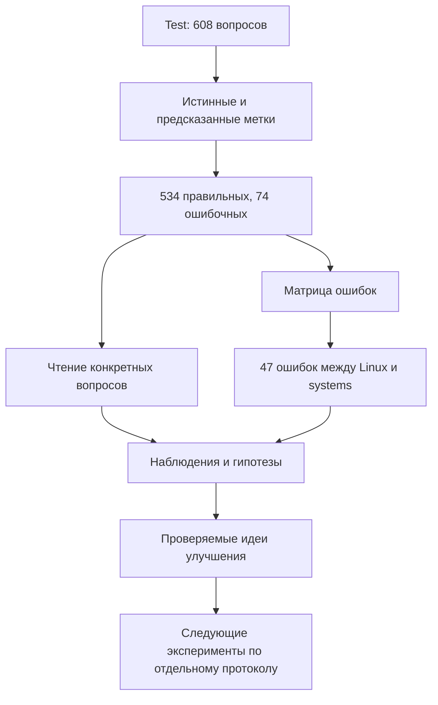

# F1.8 - Error Analysis: Разбор ошибок Классического ML Baseline

F1.8 - это разбор того, где модель ошибается и что можно улучшить. Метрика показывает размер проблемы, а анализ конкретных примеров помогает понять её характер.

Анализ ошибок - изучение неправильных предсказаний, чтобы сформулировать обоснованные идеи для следующих проверок и экспериментов.

## Цель
На F1.7 обучен фиксированный классификатор TF-IDF + Logistic Regression **исключительно на train** и проведена оценка его на validation/test. Теперь необходимо изучить **ошибки уже сохранённых предсказаний test**, не обучая модель повторно и не выбирая параметры по test.

Основные вопросы:
1. Сколько ошибок допущено в каждом классе?
2. Какие направленные пары `истинный класс → предсказанный класс` встречаются чаще?
3. Как выглядят Precision, Recall и F1 для каждого из четырёх классов?
4. Отличаются ли длины правильно и неправильно классифицированных вопросов?
5. Какие объяснения правдоподобны, но ещё требуют ручной проверки?

## На каких данных работает этап
Используются только локальные артефакты, созданные в F1.6 и в F1.7:
| Файл | Для чего |
|---|---|
| `data/processed/test.jsonl` | Истинная категория, ID, длина текста и порядок test |
| `reports/classical_predictions.json` | Замороженные `id`, `true`, `predicted` от F1.7 |
| `reports/classical.json` | Сохранённые accuracy, Macro F1, confusion matrix, список классов и SHA-256 test |

Скрипт сверяет SHA-256 **побайтово** и дополнительно проверяет порядок ID, метки, количество строк и сохранённые метрики. При несоответствии прекращает работу: он не пытается «подправить» исходные предсказания.

**Веса `models/classical.joblib` не читаются и не загружаются.** Это исключает повторное обучение и риски десериализации недоверенного файла.

## Чтение confusion matrix
Матрица ошибок (*confusion matrix*) показывает количество элементов в каждой паре классов.
- **Строка** - истинная метка (*True*).
- **Столбец** - предсказанная метка (*Predicted*).
- **Диагональ** - правильные предсказания.
- **За пределами диагонали** - ошибки.

| Истинный ↓ / Предсказанный → | databases |   linux | programming | systems |
| ---------------------------- | --------: | ------: | ----------: | ------: |
| databases                    |   **147** |       4 |           1 |       8 |
| linux                        |         2 | **134** |           1 |      22 |
| programming                  |         2 |       1 |     **129** |       1 |
| systems                      |         7 |      25 |           0 | **124** |

Например, ячейка `linux → systems = 22` означает, что 22 вопроса из раздела Linux модель отнесла к системному администрированию. Это не равно обратной ошибке `systems → linux`.

### Precision, Recall и F1
- **TP** - примеры класса, определённые правильно.
- **FP** - другие классы, ошибочно отнесённые к этому.
- **FN** - примеры класса, ошибочно отнесённые к другим.
- **Support** - число настоящих примеров класса.
- **Macro F1** - среднее F1 по классам с одинаковыми весами. Это полезно даже при умеренной несбалансированности источников.

### Анализ длины вопроса
В отчёте фиксируется медианная и средняя длина вопроса в словах для правильно и неправильно классифицированных записей. Разница может стать гипотезой, но **сама по себе не доказывает причину** ошибок.

## Реализация
- [`src/classical_ml/error_analysis.py`](../../src/classical_ml/error_analysis.py): чистая функция анализа сохранённых предсказаний + генератор изображения матрицы.
- [`scripts/analyze_classical.py`](../../scripts/analyze_classical.py): сверка SHA-256, чтение файлов и сохранение результатов.
- [`tests/test_error_analysis.py`](../../tests/test_error_analysis.py): автономные тесты на синтетических примерах (без сети и настоящего датасета).

Схема:


## Локальный запуск на Windows
Из корня `F:\DEVELOPMENT\ML\ml-engineering-lab`, **после выполненного F1.7**:
```powershell
.\.venv\Scripts\python.exe -m pip install -r requirements-error-analysis.txt
```
```powershell
.\.venv\Scripts\python.exe -m pytest -q tests/test_foundation.py tests/test_provenance.py tests/test_ingestion.py tests/test_cleaning.py tests/test_eda.py tests/test_splitting.py tests/test_classical.py tests/test_error_analysis.py
```
```powershell
.\.venv\Scripts\python.exe -m scripts.analyze_classical --expect-test 608
```

Последняя команда выводит фактическое количество ошибок и самую распространённую направленную пару. Затем:
```powershell
.\.venv\Scripts\python.exe scripts/check_repository.py
git status --short --untracked-files=all
```

## Результаты, которые нужно сравнить
Исходный исторический F1.8 указывал **74 ошибки** на test, а классический эксперимент F1.7 имел Macro F1 примерно **0,8822**. В новом локальном F1.7 Macro F1 был **0,8838**, Accuracy **0,8799** при `test=608`.

Это **разные исполнения**, поэтому допустимо различие количества ошибок, матриц и пар. Числа нового F1.8 появятся только после выполнения команды на твоём компьютере. Не записываем исторические 74 как результат нового запуска.

## Что считать инженерным выводом
Правильная формулировка:
> На test максимальная направленная путаница наблюдается между классами X и Y. Причину ещё предстоит проверить ручным просмотром соответствующих локальных ID: вероятны общие термины или неоднозначность исходных меток.

Метки описывают **раздел Stack Exchange**, а не правильность ответов. Тексты отдельных ошибок доступны лишь в локальном датасете; при их чтении анализируй их как гипотезы без переноса в публичный отчёт.

**Ограничения**: наблюдения только на одном зафиксированном test; нет повторных обучений или оценки устойчивости по нескольким seed; семантические утечки F1.6 не исключены полностью; признаки TF-IDF могут не отражать смысл кодовых фрагментов; выбор гипотез по test не должен превращаться в настройку модели на test.

## Как проходит анализ ошибок


## Основная мысль F1.8
Метрика показывает размер проблемы, а анализ ошибок помогает понять её характер и выбрать следующий обоснованный эксперимент.
- Средняя метрика скрывает различия между классами и примерами.
- Матрица ошибок показывает направления путаницы.
- Диагональ матрицы содержит правильные предсказания.
- Реальные вопросы помогают понять, насколько однозначны классы.
- Наблюдение и гипотеза — разные вещи.
- Ошибка может быть связана с данными, постановкой задачи или моделью.
- Подозрение на плохую метку требует проверки источника.
- Анализ test-ошибок не должен превращаться в бесконечный подбор по test.
- Идеи улучшения нужно проверять отдельными экспериментами.
