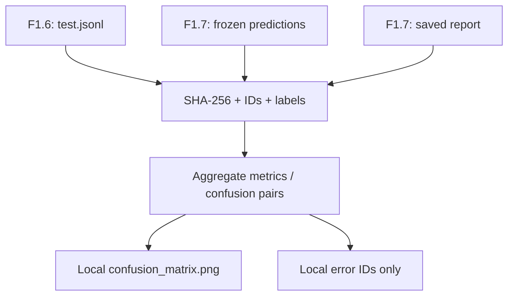

# F1.8 — Error Analysis: разбор ошибок Classical ML Baseline

> **Статус:** пакет подготовлен и проверен offline на синтетических данных. Полный локальный запуск на Windows и GitHub CI ещё не подтверждены.

## 1. Цель

На F1.7 мы обучили фиксированный классификатор TF-IDF + Logistic Regression **исключительно на train** и оценили его на validation/test. Теперь изучаем **ошибки уже сохранённых предсказаний test**, не обучая модель повторно и не выбирая параметры по test.

Основные вопросы:

1. Сколько ошибок допущено в каждом классе?
2. Какие **направленные** пары `истинный класс → предсказанный класс` встречаются чаще?
3. Как выглядят Precision, Recall и F1 для каждого из четырёх классов?
4. Отличаются ли длины правильно и неправильно классифицированных вопросов?
5. Какие объяснения правдоподобны, но **ещё требуют ручной проверки**?

## 2. На каких данных работает этап

Используются только локальные артефакты, созданные F1.6 и F1.7:

| Файл | Для чего |
|---|---|
| `data/processed/test.jsonl` | Истинная категория, ID, длина текста и порядок test |
| `reports/classical_predictions.json` | Замороженные `id`, `true`, `predicted` от F1.7 |
| `reports/classical.json` | Сохранённые accuracy, Macro F1, confusion matrix, список классов и SHA-256 test |

Скрипт сверяет SHA-256 **побайтово** и дополнительно проверяет порядок ID, метки, количество строк и сохранённые метрики. При несоответствии прекращает работу: он не пытается «подправить» исходные предсказания.

**Веса `models/classical.joblib` не читаются и не загружаются.** Это исключает повторное обучение и риски десериализации недоверенного файла.

## 3. Как читать confusion matrix

Матрица ошибок (*confusion matrix*) показывает количество элементов в каждой паре классов.

- **Строка** — истинная метка (*True*).
- **Столбец** — предсказанная метка (*Predicted*).
- **Диагональ** — правильные предсказания.
- **За пределами диагонали** — ошибки.

Например, ячейка `linux → systems = 12` означает, что 12 вопросов из раздела Linux модель отнесла к системному администрированию. Это **не равно** обратной ошибке `systems → linux`.

### Precision, Recall и F1

Для каждого класса рассчитываем:

\[
Precision=\frac{TP}{TP+FP},\quad Recall=\frac{TP}{TP+FN}
\]

\[
F1=\frac{2\cdot Precision\cdot Recall}{Precision+Recall}
\]

- **TP** — примеры класса, определённые правильно.
- **FP** — другие классы, ошибочно отнесённые к этому.
- **FN** — примеры класса, ошибочно отнесённые к другим.
- **Support** — число настоящих примеров класса.

**Macro F1** — среднее F1 по классам с одинаковыми весами. Это полезно даже при умеренной несбалансированности источников.

### Анализ длины вопроса

В отчёте фиксируется медианная и средняя длина вопроса в словах для правильно и неправильно классифицированных записей. Разница может стать гипотезой, но **сама по себе не доказывает причину** ошибок.

## 4. Реализация

- [`src/classical_ml/error_analysis.py`](../../src/classical_ml/error_analysis.py): чистая функция анализа сохранённых предсказаний + генератор изображения матрицы.
- [`scripts/analyze_classical.py`](../../scripts/analyze_classical.py): сверка SHA-256, чтение файлов и сохранение результатов.
- [`tests/test_error_analysis.py`](../../tests/test_error_analysis.py): автономные тесты на синтетических примерах (без сети и настоящего датасета).

Схема:



## 5. Локальный запуск на Windows

Из корня `F:\DEVELOPMENT\ML\ml-engineering-lab`, **после выполненного F1.7**:

```powershell
.\.venv\Scripts\python.exe -m pip install -r requirements-error-analysis.txt
```

```powershell
.\.venv\Scripts\python.exe -m pytest -q tests/test_foundation.py tests/test_provenance.py tests/test_ingestion.py tests/test_cleaning.py tests/test_eda.py tests/test_splitting.py tests/test_classical.py tests/test_error_analysis.py
```

```powershell
.\.venv\Scripts\python.exe -m scripts.analyze_classical --expect-test 608
```

Последняя команда выводит фактическое количество ошибок и самую распространённую направленную пару. Затем:

```powershell
.\.venv\Scripts\python.exe scripts/check_repository.py
git status --short --untracked-files=all
```

Не меняй `test` и предсказания ради совпадения с первоначальным отчётом. При SHA-256 mismatch сначала проверь, каким запуском F1.7 был сформирован `reports/classical.json`.

## 6. Локальные артефакты (НЕ публиковать)

| Файл | Содержимое |
|---|---|
| `reports/classical_error_analysis.json` | Агрегаты, классы, ошибки, пары, длины, контрольная сумма |
| `reports/classical_error_ids.json` | Только ID, `true`, `predicted`, длина вопроса — для локального ручного разбора |
| `docs/visuals/f1/confusion_matrix.png` | Confusion matrix с числом ошибок, без текстов |

Все три пути исключены `.gitignore`. **Не загружай в GitHub полный test, тексты ошибок, sample или модель** без отдельной проверки прав на данные. Исходный F1.8 сохранял контексты ошибочных вопросов; текущая публичная версия намеренно этого не делает.

## 7. Результаты, которые нужно сравнить

Исходный исторический F1.8 указывал **74 ошибки** на test, а классический эксперимент F1.7 имел Macro F1 примерно **0,8822**. В новом локальном F1.7 Macro F1 был **0,8838**, Accuracy **0,8799** при `test=608`.

Это **разные исполнения**, поэтому допустимо различие количества ошибок, матриц и пар. Числа нового F1.8 появятся только после выполнения команды на твоём компьютере. Не записываем исторические 74 как результат нового запуска.

## 8. Что считать инженерным выводом

Правильная формулировка:

> На test максимальная направленная путаница наблюдается между классами X и Y. Причину ещё предстоит проверить ручным просмотром соответствующих локальных ID: вероятны общие термины или неоднозначность исходных меток.

Некорректная формулировка:

> Модель путает X и Y потому, что в датасете неправильные ответы.

Метки описывают **раздел Stack Exchange**, а не правильность ответов. Тексты отдельных ошибок доступны лишь в локальном датасете; при их чтении анализируй их как гипотезы без переноса в публичный отчёт.

**Ограничения**: наблюдения только на одном зафиксированном test; нет повторных обучений или оценки устойчивости по нескольким seed; семантические утечки F1.6 не исключены полностью; признаки TF-IDF могут не отражать смысл кодовых фрагментов; выбор гипотез по test не должен превращаться в настройку модели на test.

## 9. Контрольные вопросы

1. Чем Precision одного класса отличается от Recall этого же класса?
2. Почему `linux → systems` и `systems → linux` — разные ошибки?
3. Что позволяет проверить сверка SHA-256 перед анализом предсказаний?
4. Почему Macro F1 лучше рассматривать вместе с confusion matrix?
5. Можно ли объявить причиной ошибки «малую длину вопроса» только потому, что её медиана у ошибочных ниже?
6. Почему нельзя многократно менять гиперпараметры ради улучшения результатов **test**?

## 10. Критерии PASS

- Все тесты F1.1–F1.8 выполняются без ошибок.
- Скрипт анализирует **существующие** F1.7 предсказания без `fit` и без загрузки joblib.
- Test SHA-256 совпадает с F1.7 отчётом; числа в матрице согласуются с сохранёнными метриками.
- Получены локальные отчёт, список ID и PNG; исходные тексты не сохранены.
- Git содержит только исходники, документацию и тесты; GitHub Actions завершается успешно.

**Переход:** F1.9 — заключительный отчёт по F1: методика, измеренные результаты, ограничения, выводы и готовность к собеседованию.
