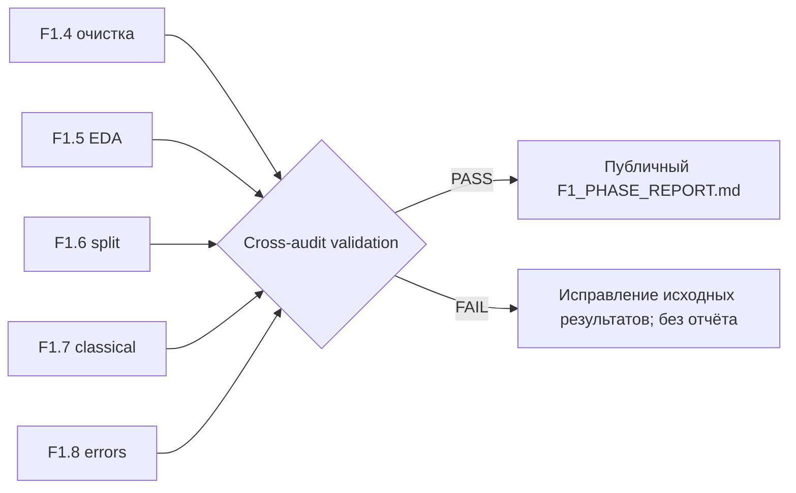

# F1.9 — Final Phase Report: доказательная сборка итогов F1

> **Статус:** локальный offline-пакет подготовлен; полная проверка агрегатных JSON-аудитов и GitHub CI должна быть подтверждена на Windows. GitHub Release `v0.1-f1` создаётся только после успешной публикации F1.9.

## 1. Цель и инженерный результат

Связать этапы **F1.1–F1.8** в один отчёт, в котором каждое утверждение можно проверить по исходному JSON-аудиту конкретного запуска. Это не новая модель и не ещё одна оценка test, а **контроль согласованности** уже зафиксированных результатов.

Простыми словами: если отчёт говорит «608 вопросов в test и 73 ошибки», генератор должен убедиться, что F1.6 создал 608 test-записей, F1.7 оценил те же 608, а F1.8 получил 73 ошибки при согласующейся матрице ошибок. При несоответствии отчёт не должен собираться.

## 2. Источники (локально, вне Git)

| Этап | Локальный источник | Основной контракт |
|---|---|---|
| F1.2–F1.3 | `data/raw/manifest.json` | Четыре источника, количество отобранных записей |
| F1.4 | `reports/data_cleaning_audit.json` | Вход = выход + причины исключений |
| F1.5 | `reports/data_eda_audit.json` | Число и распределение очищенных записей; SHA-256 |
| F1.6 | `reports/data_split_audit.json` | Размеры разбиений, группы, пересечения, SHA-256 |
| F1.7 | `reports/classical.json` | Train-only fit, контроль выборок, Accuracy/F1, confusion matrix |
| F1.8 | `reports/classical_error_analysis.json` | Совпадение метрик и матрицы ошибок с F1.7, число ошибок |

В F1.9 **не читаются** `classical_predictions.json`, `classical_error_ids.json`, модель `.joblib` и содержание Q&A. Байты `data/interim/cleaned.jsonl` и `data/processed/{train,val,test}.jsonl` читаются **только для расчёта SHA-256** без десериализации исходных текстов.

## 3. Что валидирует `scripts/build_f1_report.py`

1. Положительные размеры и согласованность `selected = cleaned + removed`.
2. Распределение четырёх классов между EDA, cleaning и split.
3. `train + val + test = cleaned`; все вычисленные группы разнесены без пересечений.
4. Обучение F1.7 — только `fit_split=train`; размеры validation и test совпадают с F1.6.
5. SHA-256 локальных файлов совпадают с записанными в результатах эксперимента. SHA EDA и split для очищенного корпуса совпадают.
6. F1.8 использует **тот же test**, что F1.7; диагональ и суммы confusion matrix соответствуют количеству правильных и ошибочных прогнозов.
7. `test Accuracy`, `Macro F1` и направленные пары ошибок F1.8 согласуются с F1.7.

При расхождении скрипт возвращает `FAIL` и не перезаписывает Markdown. Внутри отчёта используются только заранее определённые скалярные поля: исходные тексты, ID и произвольные строки из аудитов не переносятся.



## 4. Запуск на Windows

Из `F:\DEVELOPMENT\ML\ml-engineering-lab` после выполнения F1.1–F1.8:

```powershell
.\.venv\Scripts\python.exe -m pytest -q tests/test_foundation.py tests/test_provenance.py tests/test_ingestion.py tests/test_cleaning.py tests/test_eda.py tests/test_splitting.py tests/test_classical.py tests/test_error_analysis.py tests/test_f1_report.py
```

```powershell
.\.venv\Scripts\python.exe -m scripts.build_f1_report --expect-rows 3040 --expect-test 608
```

Отчёт будет записан в `docs/reports/F1_PHASE_REPORT.md`. Это **публичный** файл — его допустимо коммитить **после ручной проверки**, поскольку код генерирует только агрегаты и SHA-256. Сырые данные и локальные JSON-аудиты по-прежнему исключены из Git.

Проверка, что уже созданный файл соответствует текущим локальным аудитам (без перезаписи):

```powershell
.\.venv\Scripts\python.exe -m scripts.build_f1_report --expect-rows 3040 --expect-test 608 --check
```

Примечание: GitHub CI запускает только автономные тесты на синтетических данных и не может подтвердить **реальный** полный запуск, пока исходные Q&A и веса остаются локальными.

## 5. Что должно попасть в итоговый отчёт

- Данные: 3 066 отобранных → 3 040 после очистки; распределение по четырём классам.
- Split: 1 824 / 608 / 608, вычисленных групп 2 983, пересечение = 0, в текущем запуске 536 близких связей (исторический отчёт: 535).
- Модель: TF-IDF + Logistic Regression; fit только на train.
- Тест: Accuracy около 0.8799, Macro F1 около 0.8838, 535 правильных из 608, 73 ошибки.
- Наиболее частая ошибка: `systems → linux`, 24 случая — **наблюдение, не причинное объяснение**.
- Ограничения: лицензии Q&A, приближённая лексическая группировка, одна выборка/seed, различия с историческим прогоном, CI без реального датасета.

Здесь перечислены **контрольные ориентиры из подтверждённого локального Windows-прогона**. Генератор не подставляет их вслепую: численные значения берутся из JSON-аудитов на твоём компьютере.

## 6. Почему «отчёт» отличается от «результата»

**Результат** — конкретное число, например 0.8838 Macro F1 на test. **Отчёт** — проверяемое объяснение, что измеряли, на каких данных, в какой процедуре, с какими ограничениями и к какому выводу это приводит.

Нельзя интерпретировать Accuracy 87.99% как «модель правильно отвечает на 87.99% технических вопросов»: целевой класс обозначает источник публикации, а не корректность технического ответа.

## 7. Подготовка релиза `v0.1-f1`

После локальной проверки F1.9, Git-коммита и двух зелёных проверок GitHub Actions:

1. Открыть [черновик release notes](../releases/v0.1-f1.md) и проверить числа, ссылки и ограничения.
2. Создать **annotated tag** `v0.1-f1` на текущем проверенном коммите F1.9.
3. Отправить тег отдельно (`git push origin v0.1-f1`) и создать GitHub Release из него.
4. В описание релиза перенести проверенный Markdown из `docs/releases/v0.1-f1.md`.

Тег **не создаём до** подтверждения CI для F1.9. Публикуем только исходники, синтетические тесты, документацию и агрегированный отчёт. Не загружаем model weights и датасет в Assets.

## 8. Вопросы для самопроверки

1. Зачем Markdown формировать из сохранённых JSON-аудитов, а не вручную?
2. Почему совпадение количества test-примеров не гарантирует, что использован тот же тестовый набор?
3. Чем отличается проверка хеша от проверки корректности исходных данных?
4. Зачем сверять confusion matrix с количеством ошибок и Accuracy?
5. Что именно CI может подтвердить без доступа к полному датасету?
6. Почему технически воспроизводимый эксперимент не обязательно пригоден для коммерческого применения?

**Критерии PASS:** автономные тесты, генерация и `--check` на реальных локальных артефактах, отсутствие исходных Q&A в публичном отчёте, корректный Git-коммит и две зелёные проверки GitHub Actions.
