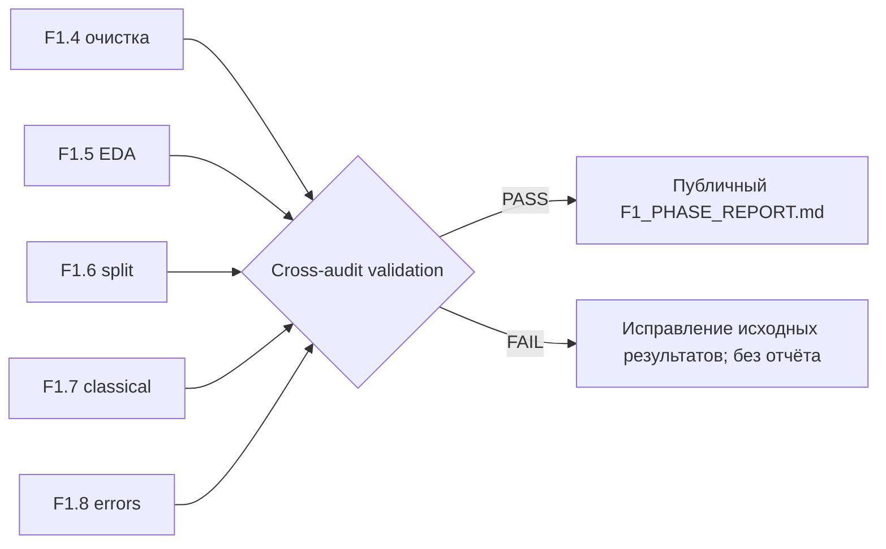
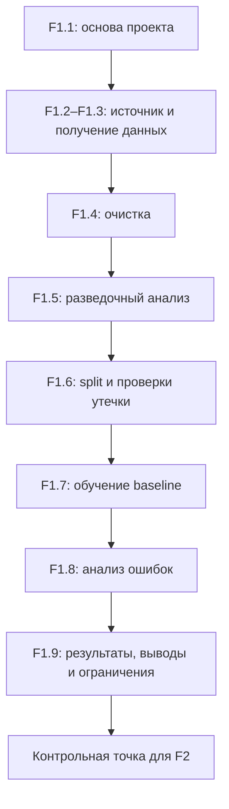

# F1.9 - Final Phase Report: Доказательная сборка итогов F1

F1.9 - это подведение итогов всей первой фазы. Сбор в одном отчёте: какие данные использованы, как их подготовили, какую модель обучили и что получилось.

## Инженерный результат
Связать этапы **F1.1–F1.8** в один отчёт, в котором каждое утверждение можно проверить по исходному JSON-аудиту конкретного запуска. Это не новая модель и не ещё одна оценка test, а **контроль согласованности** уже зафиксированных результатов.

Простыми словами: если отчёт говорит «608 вопросов в test и 73 ошибки», генератор должен убедиться, что F1.6 создал 608 test-записей, F1.7 оценил те же 608, а F1.8 получил 73 ошибки при согласующейся матрице ошибок. При несоответствии отчёт не должен собираться.

## Источники
| Этап | Локальный источник | Основной контракт |
|---|---|---|
| F1.2–F1.3 | `data/raw/manifest.json` | Четыре источника, количество отобранных записей |
| F1.4 | `reports/data_cleaning_audit.json` | Вход = выход + причины исключений |
| F1.5 | `reports/data_eda_audit.json` | Число и распределение очищенных записей; SHA-256 |
| F1.6 | `reports/data_split_audit.json` | Размеры разбиений, группы, пересечения, SHA-256 |
| F1.7 | `reports/classical.json` | Train-only fit, контроль выборок, Accuracy/F1, confusion matrix |
| F1.8 | `reports/classical_error_analysis.json` | Совпадение метрик и матрицы ошибок с F1.7, число ошибок |

## Что валидирует `scripts/build_f1_report.py`
1. Положительные размеры и согласованность `selected = cleaned + removed`.
2. Распределение четырёх классов между EDA, cleaning и split.
3. `train + val + test = cleaned`; все вычисленные группы разнесены без пересечений.
4. Обучение F1.7 — только `fit_split=train`; размеры validation и test совпадают с F1.6.
5. SHA-256 локальных файлов совпадают с записанными в результатах эксперимента. SHA EDA и split для очищенного корпуса совпадают.
6. F1.8 использует **тот же test**, что F1.7; диагональ и суммы confusion matrix соответствуют количеству правильных и ошибочных прогнозов.
7. `test Accuracy`, `Macro F1` и направленные пары ошибок F1.8 согласуются с F1.7.

При расхождении скрипт возвращает `FAIL` и не перезаписывает Markdown. Внутри отчёта используются только заранее определённые скалярные поля: исходные тексты, ID и произвольные строки из аудитов не переносятся.


## Запуск в Windows
Из `F:\DEVELOPMENT\ML\ml-engineering-lab` после выполнения F1.1–F1.8:
```powershell
.\.venv\Scripts\python.exe -m pytest -q tests/test_foundation.py tests/test_provenance.py tests/test_ingestion.py tests/test_cleaning.py tests/test_eda.py tests/test_splitting.py tests/test_classical.py tests/test_error_analysis.py tests/test_f1_report.py
```
```powershell
.\.venv\Scripts\python.exe -m scripts.build_f1_report --expect-rows 3040 --expect-test 608
```

Отчёт будет записан в `docs/reports/F1_PHASE_REPORT.md`. Это **публичный** файл - его допустимо коммитить **после ручной проверки**, поскольку код генерирует только агрегаты и SHA-256. Сырые данные и локальные JSON-аудиты по-прежнему исключены из Git.

Проверка, что уже созданный файл соответствует текущим локальным аудитам (без перезаписи):
```powershell
.\.venv\Scripts\python.exe -m scripts.build_f1_report --expect-rows 3040 --expect-test 608 --check
```

## Что должно попасть в итоговый отчёт
- Данные: 3 066 отобранных → 3 040 после очистки; распределение по четырём классам.
- Split: 1 824 / 608 / 608, вычисленных групп 2 983, пересечение = 0, в текущем запуске 536 близких связей (исторический отчёт: 535).
- Модель: TF-IDF + Logistic Regression; fit только на train.
- Тест: Accuracy около 0.8799, Macro F1 около 0.8838, 535 правильных из 608, 73 ошибки.
- Наиболее частая ошибка: `systems → linux`, 24 случая - **наблюдение, не причинное объяснение**.
- Ограничения: лицензии Q&A, приближённая лексическая группировка, одна выборка/seed, различия с историческим прогоном, CI без реального датасета.
Здесь перечислены **контрольные ориентиры из подтверждённого локального Windows-прогона**. Генератор не подставляет их вслепую: численные значения берутся из JSON-аудитов на твоём компьютере.

## Почему «отчёт» отличается от «результата»
**Результат** - конкретное число, например 0.8838 Macro F1 на test. **Отчёт** - проверяемое объяснение, что измеряли, на каких данных, в какой процедуре, с какими ограничениями и к какому выводу это приводит.
Нельзя интерпретировать Accuracy 87.99% как «модель правильно отвечает на 87.99% технических вопросов»: целевой класс обозначает источник публикации, а не корректность технического ответа.

## Алгоритм Фазы 1


## Основная мысль F1.9
Хороший ML-отчёт позволяет понять не только число качества, но и то, каким способом оно получено, что оно означает и где заканчиваются наши выводы.
- В отчёте сначала объясняют задачу и критерий правильного ответа.
- Данные, preprocessing и split являются частью результата эксперимента.
- Метрики нужно связывать с конкретной выборкой и условиями запуска.
- Размер файла модели и потребление RAM — разные показатели.
- Bootstrap оценивает часть неопределённости и имеет ограничения.
- Наблюдения, гипотезы и выводы должны быть различимы.
- Ссылки на артефакты позволяют проверить историю результата.
- Baseline становится контрольной точкой для более сложных подходов.

