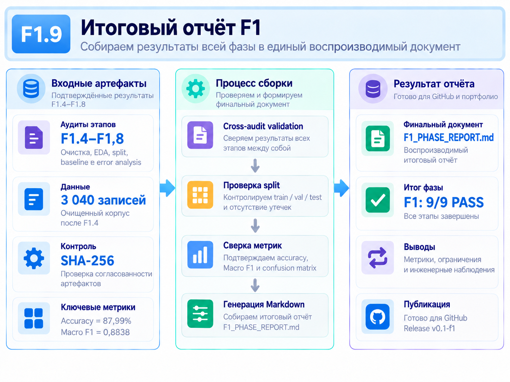
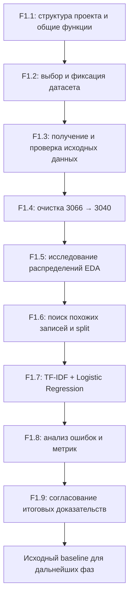
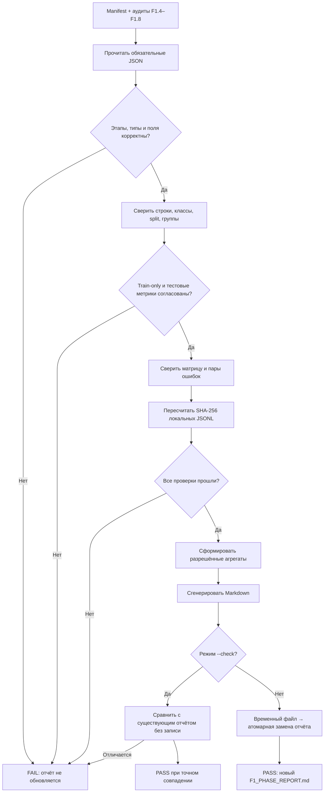

# F1.9 - Final Phase Report: пошаговая сборка и проверка итогов Фазы 1

## 1. Цель этапа:

К концу F1.8 имеется полный путь данных: выбраны технические вопросы и ответы Stack Exchange, загружены, очищены, исследованы, разделены на независимые по найденным группам выборки, обучен классификатор и проанализированы его ошибки.

Но результаты хранятся в **разных файлах**. Например, F1.4 знает, сколько строк было удалено, F1.6 - сколько записей попало в test, F1.7 - какую Accuracy показала модель, а F1.8 - сколько и каких ошибок она совершила.

Если просто выписать эти числа вручную в итоговый отчёт, возможны ошибки:
1. Указать 3 040 очищенных записей из одного запуска и размеры выборок из другого.
2. Взять новую Accuracy, но оставить старую матрицу ошибок.
3. Считать, что анализ F1.8 относится к текущему `test.jsonl`, хотя файл уже изменился.
4. Перепутать исторические результаты: **74 ошибки** из более раннего опыта с **73 ошибками** из контрольного прогона.
5. Нечаянно включить в публичный отчёт тексты технических вопросов или ID конкретных публикаций.



**Задача F1.9:** превратить набор разрозненных результатов в **единый доказательный отчёт**. Каждое включённое число должно быть получено из согласованных аудитов, а сам отчёт должен воспроизводимо собираться из локальных файлов.

Простая проверка смысла: если написать «в test 608 вопросов, из них 535 классифицированы правильно», программа должна подтвердить, что **F1.6, F1.7 и F1.8 говорят об одном test**, а матрица ошибок действительно содержит 535 значений на диагонали.

## 2. Реализация: файлы этапа

### 2.1. Код, тесты и итоговый документ F1.9
В F1.9 логика проверки и логика запуска разделены. Это позволяет проверять расчёты на синтетических примерах и независимо от этого формировать реальный итоговый документ.

| Файл                                                             | Что сделали и зачем                                                                                                                                                                                                                              |
| ---------------------------------------------------------------- | ------------------------------------------------------------------------------------------------------------------------------------------------------------------------------------------------------------------------------------------------ |
| [`src/reporting/f1.py`](../../src/reporting/f1.py)               | Реализована проверка согласованности аудитов `validate_audits(...)`, защита типов и допустимых значений, а также `render_markdown(...)`, который формирует отчёт только из заранее разрешённых агрегатов. **Основной алгоритмический код F1.9.** |
| [`src/reporting/__init__.py`](../../src/reporting/__init__.py)   | Оформлен отдельный пакет `reporting` для функций формирования итоговых отчётов.                                                                                                                                                                  |
| [`scripts/build_f1_report.py`](../../scripts/build_f1_report.py) | Создан командный сценарий: чтение файлов, проверка SHA-256 настоящих локальных JSONL, сборка Markdown, безопасная запись и режим `--check`. **Точка запуска этапа.**                                                                             |
| [`tests/test_f1_report.py`](../../tests/test_f1_report.py)       | Написаны автономные тесты успешной сборки и отказов: несовпадение размеров, метрик, хешей, матриц, нарушение train-only, изменение готового отчёта и попытки включить запрещённые данные.                                                        |

**Важно:** существующие файлы предыдущих этапов здесь не переобучаются и не пересоздаются. F1.9 **читает их результаты** и проверяет связи между ними.

### 2.2. Какие файлы использовать из предыдущих этапов

| Предыдущий этап | Файл | Что из него проверяем |
|---|---|---|
| F1.2–F1.3 | `data/raw/manifest.json` | Ровно четыре исходных источника, уникальность файлов и количество выбранных записей. |
| F1.4 | `reports/data_cleaning_audit.json` | Сколько строк поступило на очистку, сколько удалено по каждой причине, сколько осталось и как они распределены по классам. |
| F1.5 | `reports/data_eda_audit.json` | Размер очищенного корпуса, распределение классов и SHA-256 файла, по которому выполнялся EDA. |
| F1.6 | `reports/data_split_audit.json` | Размеры train/val/test, число групп и похожих связей, распределение классов, пересечения групп и SHA-256 очищенного корпуса. |
| F1.7 | `reports/classical.json` | Зафиксированный train-only контракт, размеры выборок, SHA-256 train/val/test, метрики, порядок классов и confusion matrix. |
| F1.8 | `reports/classical_error_analysis.json` | Метрики и матрица ошибок для **того же test**, количество правильных/ошибочных предсказаний и направленные пары ошибок. |
Кроме JSON-аудитов генератор сверяет **реальные байты** следующих локальных файлов:

| Локальный файл | Для чего читается |
|---|---|
| `data/interim/cleaned.jsonl` | Пересчитать SHA-256 и сравнить его с аудитом очищенного корпуса. |
| `data/processed/train.jsonl` | Пересчитать SHA-256 и сравнить с хешем train в F1.7. |
| `data/processed/val.jsonl` | Пересчитать SHA-256 и сравнить с хешем validation в F1.7. |
| `data/processed/test.jsonl` | Пересчитать SHA-256 и сравнить с хешем test в F1.7. |

**Не путать:** проверка этих четырёх файлов **не означает**, что F1.9 повторно скачал или проверил каждый исходный gzip-архив Stack Exchange. Проверка исходных архивов относится к F1.3.

## 3. Последовательность действий

### Шаг 1. Определить, какие результаты можно объединять
Сначала зафиксирована граница: итоговый отчёт имеет смысл только тогда, когда в локальной папке уже есть результаты F1.4–F1.8. Например, F1.7 не может корректно оценить модель, если нет train/val/test, а F1.8 не может разобрать ошибки, если не сохранены предсказания предыдущего этапа.

Поэтому в `scripts/build_f1_report.py` составлен словарь `AUDIT_FILES`: шесть обязательных JSON-документов - пять этапных аудитов и `manifest.json`.

Функция `read_report_inputs(root)` читает каждый файл как JSON. Если файл отсутствует или содержимое нельзя разобрать, возникает `F1ReportError` и дальнейшая сборка прекращается.

**Зачем:** неполный набор отчётов не должен выглядеть как полностью подтверждённый эксперимент.

### Шаг 2. Проверить происхождение записей и арифметику очистки
В `validate_audits(...)` сначала проверить, что документы соответствуют своим этапам (`stage = F1.4`, `F1.5` и так далее), а в manifest содержатся **четыре разных источника**.

Затем суммировать `selected_rows` по четырём источникам и сравнить с входом очистки.

**Проверить баланс:**

```math
N_{\mathrm{selected}} = N_{\mathrm{cleaned}} + N_{\mathrm{short}} + N_{\mathrm{duplicates}} + N_{\mathrm{invalid}}
```

**Для контрольного прогона:**

```math
3066 = 3040 + 26 + 0 + 0
```

Если, например, F1.4 неожиданно сообщает «27 удалённых коротких записей», но количество очищенных остаётся 3040, равенство нарушается - итоговый отчёт **не создаётся**.

**Зачем:** убедиться, что при очистке не появились необъяснимые потери или лишние строки.

### Шаг 3. Сопоставить очистку и EDA
После F1.4 на F1.5 изучалось распределение очищенных текстов. Необходимо удостовериться, что EDA относится именно к тому корпусу, который прошёл очистку.

Проверить:
1. `eda.total_rows` совпадает с `cleaning.output_rows`.
2. Есть ровно четыре ожидаемые метки: `databases`, `linux`, `programming`, `systems`.
3. Сумма значений `class_distribution` равна числу очищенных записей.
4. Распределение по классам **в точности** совпадает с `cleaning.by_domain`.

Контрольный состав корпуса:

| Класс | Количество |
|---|---:|
| `databases` | 800 |
| `linux` | 793 |
| `programming` | 666 |
| `systems` | 781 |
| **Всего** | **3 040** |

**Зачем:** одинаковое общее число записей ещё не гарантирует одинаковый состав. Можно случайно потерять вопросы из `systems` и добавить столько же из `linux`, не изменив общую сумму.

### Шаг 4. Сопоставить EDA и разделение train/val/test
Чтение F1.6. Необходимо подтвердить, что использовал тот же очищенный корпус и корректно разложил его по трём выборкам.

Сначала сравнить `source_sha256` из F1.5 и F1.6 - это контрольная сумма **одного и того же файла `cleaned.jsonl`**. Затем проверить равенство:
**Проверить баланс выборок:**

```math
N_{\mathrm{train}} + N_{\mathrm{val}} + N_{\mathrm{test}} = N_{\mathrm{cleaned}}
```

**Для контрольного прогона:**

```math
1824 + 608 + 608 = 3040
```

Далее сопоставить распределение каждого класса между train, val и test с распределением в EDA.

Наконец, проверить три значения `group_overlap`: `train/test`, `train/val`, `val/test`. **Все должны быть равны нулю**.

В контрольном запуске было **2 983 группы** и **536 обнаруженных близких связей**. Эти числа описывают разные вещи: 536 - связи, по которым алгоритм объединял записи, 2 983 - количество получившихся групп. Ни одно из чисел не является количеством удалённых записей.

**Зачем:** в следующем этапе модель должна обучаться на корректно отделённом train, не получая найденные почти одинаковые примеры из test.

### Шаг 5. Проверить, что классификатор F1.7 обучался только на train
В `reports/classical.json` есть сведения о том, где выполнялся `fit` и какие выборки использовались для оценки.

Проверить два конкретных условия:
```text
fit_split = "train"
evaluation_splits = ["val", "test"]
```

Также размеры выборок из `classical.data_contract.split_counts` должны совпадать с F1.6, а показатели `val.n` и `test.n` - с соответствующими размерами.

Это важно: для F1.7 TF-IDF изучает словарь и веса IDF только на **train**. Validation и test используются для применения готового преобразования и готового классификатора.

Если в аудите вдруг написано `fit_split = "test"`, функция отклоняет результат. Она **не переобучает** модель правильно - она сигнализирует, что полученный эксперимент нельзя подтверждать этим отчётом.

**Зачем:** итоговое качество имеет смысл лишь при соблюдении протокола обучения и оценки.

### Шаг 6. Подтвердить, что F1.8 проанализирован тот же test, что F1.7
F1.8 используются сохранённые предсказания. Значит, необходимо сравнить их аудит с итогами F1.7.

Проверить последовательно:
1. В аудите F1.8 указано `frozen_model = "F1.7"` и `data_split = "test"`.
2. `errors.test_source_sha256` равен SHA-256 test, записанному F1.7.
3. Списки четырёх меток в validation, test и анализе ошибок совпадают, включая порядок.
4. Матрицы ошибок F1.7 и F1.8 **совпадают поэлементно**.
5. Сумма всех ячеек матрицы равна размеру test.

**Зачем:** исключить ситуацию, когда итоговая таблица составлена из результатов двух разных запусков.

### Шаг 7. Проверить арифметику Accuracy и направленных ошибок
По матрице ошибок рассчитать количество верных предсказаний как сумму диагональных ячеек:

```math
N_{\mathrm{correct}} = \sum_i C_{ii}
```

Количество ошибок получить как разность:

```math
N_{\mathrm{errors}} = N_{\mathrm{test}} - N_{\mathrm{correct}}
```

Отсюда независимо рассчитать точность:

```math
\mathrm{Accuracy} = \frac{N_{\mathrm{correct}}}{N_{\mathrm{test}}}
```

Для подтверждённого контрольного результата:

```math
\mathrm{Accuracy} = \frac{535}{608} \approx 0.8799
```

Сохранённая Accuracy в F1.7 и F1.8 должна совпадать с этим расчётом в пределах числовой погрешности, установленной кодом.

**А как проверяется Macro F1?** Реализация F1.9 сравнивает **сохранённые значения Macro F1 из F1.7 и F1.8** и проверяет их допустимый числовой диапазон. В отличие от Accuracy, она **не пересчитывает Macro F1 самостоятельно по матрице ошибок**. Это важно корректно объяснять: здесь подтверждается согласованность двух аудитов, а не третье независимое вычисление F1.

Кроме того, из каждой **внедиагональной ячейки** матрицы формируется ожидаемая направленная пара: `true → predicted` и её счётчик. Эти пары должны полностью совпадать с `confusion_pairs` в F1.8. Дубли, пропущенные или лишние пары вызывают ошибку.

**Зачем:** подтвердить, что итоговые цифры не противоречат подробным данным об ошибках.

### Шаг 8. Проверить физические файлы, а не только поля JSON
До этого сопоставляются **сведения из аудитов**. Но даже согласованные JSON-файлы могут остаться от старого запуска, если рабочие данные уже заменены.

Поэтому в `build_report(...)` предусмотрена ещё одна проверка: функция `sha256(path)` последовательно читает байты файла и рассчитывает SHA-256.

Проверяются:
- `data/interim/cleaned.jsonl` - относительно хеша из EDA;
- `data/processed/train.jsonl` - относительно хеша, записанного F1.7;
- `data/processed/val.jsonl` - аналогично;
- `data/processed/test.jsonl` - аналогично.

Если файла нет или байтовый хеш не совпадает, сборка завершается `FAIL`.

**Зачем:** документ должен описывать **те файлы, которые действительно находятся в текущем рабочем каталоге**, а не только красиво согласованные старые отчёты.

### Шаг 9. Сформирован безопасный набор значений и Markdown
В `validate_audits(...)` после всех проверок собирается новый словарь с разрешёнными показателями: размеры выборок, распределение классов, статистика групп, метрики, число ошибок, ведущая пара путаницы и контрольные суммы.

Этот словарь передаётся в `render_markdown(...)`. Функция добавляет поясняющий текст, таблицы, ограничения и ссылки на методику.

**Принципиальное ограничение:** произвольные поля аудитов не переносятся в Markdown. Даже если кто-то добавит в JSON список исходных вопросов или частные ID, они не попадут в публичный отчёт через предусмотренный генератор. В отчёте присутствуют только зафиксированные агрегаты и допустимые строковые метки.

**Зачем:** совместить полезный технический отчёт с контролем содержимого публикуемого документа.

### Шаг 10. Добавить безопасную запись и проверку уже созданного отчёта
При обычном запуске `run(...)` сначала полностью строит и проверяет содержимое. Только после успешного завершения `save_report(...)` записывает Markdown во **временный файл** в целевом каталоге и заменяет им `docs/reports/F1_PHASE_REPORT.md` через `os.replace(...)`.

Такой порядок помогает избежать частично записанного отчёта при сбое записи. Сам генератор также ограничивает целевой путь: результат должен находиться именно в `docs/reports/F1_PHASE_REPORT.md`.

Отдельно реализован `--check`. В этом режиме программа **заново вычисляет ожидаемый документ, но не записывает его**. Она сравнивает его с уже существующим Markdown. Если файл отсутствует или текст отличается, возвращается `FAIL`.

**Зачем:** можно проверить, соответствует ли опубликованный отчёт текущим доказательствам, и не перезаписывать его при каждой проверке.

## 4. Алгоритм проверки: как связаны числа и файлы

### 4.1. Основной путь одного вызова
Весь запуск удобно представить как четыре последовательных операции:
```text
read_report_inputs(root)
        ↓
validate_audits(...)
        ↓
Проверка SHA-256 cleaned / train / val / test
        ↓
render_markdown(summary)
        ↓
run(): либо save_report(...), либо --check
```

Здесь нет `.fit()`, `.predict()`, перерасчёта TF-IDF-признаков или загрузки модели из `.joblib`. Это **контроль воспроизводимости и согласованности результатов**, а не повторное выполнение всего машинного обучения.

### 4.2. Три уровня доказательств

| Уровень                     | Что сравниваем                                           | Какую проблему обнаруживает                                       |
| --------------------------- | -------------------------------------------------------- | ----------------------------------------------------------------- |
| **1. Арифметика**           | Суммы строк, размеры выборок, диагональ confusion matrix | Потерянные строки, невозможные метрики, несогласованные ошибки    |
| **2. Межэтапные контракты** | Метки, split, `fit_split`, SHA-256 в аудитах             | Результаты от разных датасетов или нарушенный train-only протокол |
| **3. Физические файлы**     | SHA-256 текущих `cleaned/train/val/test.jsonl`           | Файлы на диске отличаются от тех, по которым создавались аудиты   |

Например, при равенстве `1824 + 608 + 608 = 3040` проверен лишь **баланс размеров**. Чтобы доказать, что F1.7 действительно использовал текущий test, нужна дополнительная сверка SHA-256. А чтобы связать ошибки F1.8 с этим test - сверка матрицы, порядка меток и соответствующего хеша.

### 4.3. Почему нельзя считать 87,99% качеством технических ответов
В F1.7 задача была задана как:
```text
Вопрос Stack Exchange → категория источника
```

Модель выбирала одну из меток `databases`, `linux`, `programming`, `systems`. **Правильным** считалось совпадение с разделом, из которого взят вопрос, а не создание правильного решения технической проблемы.

Поэтому формулировка «Accuracy 0.8799» означает примерно **87,99% правильных предсказаний исходного раздела** на конкретном test из 608 примеров. Она не означает «модель правильно решает 87,99% технических вопросов».

Это разграничение - обязательная часть доказательного отчёта: число без точного определения целевой переменной может ввести читателя в заблуждение.

### 4.4. Почему проверка Macro F1 и Accuracy устроена по-разному
В реализации F1.9 Accuracy проверяется **математически по диагонали confusion matrix**. Поэтому для зафиксированного test:
```text
535 верных / 608 всех = 0.879934... → Accuracy 0.8799
```

А Macro F1, примерно `0.8838`, здесь **сопоставляется между двумя сохранёнными аудитами**. Текущий генератор не содержит полного независимого расчёта per-class Precision/Recall/F1 по матрице; он опирается на вычисления F1.7 и F1.8.

Следовательно, корректно говорить: **«F1.9 проверил согласованность сохранённого Macro F1 между этапами»**, а не «F1.9 заново вычислил Macro F1».

## 5. Схемы: от всей Фазы 1 к итоговому отчёту

### 5.1. Что происходило в Фазе 1 до F1.9



Главное: F1.9 **не заменяет** F1.1–F1.8. Он показывает, как части единого эксперимента связаны между собой и как мы проверяем эту связь.

### 5.2. Что происходит внутри генератора F1.9



**На что смотреть:** проверка данных выполняется **до записи**, а `--check` вообще не меняет отчёт. При расхождении доказательств правильное поведение - `FAIL`, а не создание красивой таблицы с недостоверными числами.

## 6. Локальная проверка в PowerShell: что запускать и как читать результат

Ниже приведены команды для уже существующего проекта на Windows. Они **не устанавливают пакеты**, не скачивают данные и не изменяют Git-историю.

### 6.1. Перейти в проект
```powershell
cd F:\DEVELOPMENT\ML\ml-engineering-lab
```

Все следующие команды запускаются из корня репозитория.

### 6.2. Проверить наличие локальных результатов F1.4–F1.8
```powershell
@(
  'data/raw/manifest.json'
  'reports/data_cleaning_audit.json'
  'reports/data_eda_audit.json'
  'reports/data_split_audit.json'
  'reports/classical.json'
  'reports/classical_error_analysis.json'
  'data/interim/cleaned.jsonl'
  'data/processed/train.jsonl'
  'data/processed/val.jsonl'
  'data/processed/test.jsonl'
) | ForEach-Object { "$(Test-Path $_)  $_" }
```

**Что проверяется:** все десять обязательных файлов присутствуют на диске. У каждого должен появиться `True`. Если хотя бы один отсутствует, сначала нужно получить результат соответствующего предыдущего этапа. **F1.9 не создаёт недостающий корпус или модель вместо него.**

### 6.3. Запустить только тесты F1.9
```powershell
.\.venv\Scripts\python.exe -m pytest tests/test_f1_report.py -q
```

**Что проверяется:** на синтетических данных программа должна успешно собрать корректный отчёт и отклонить некорректные аудиты, повреждённые файлы, несовпадающие матрицы, изменения уже готового Markdown и нарушения условий обучения. Тесты не обращаются к Stack Exchange и не требуют реальных Q&A.

Критерий успеха - отсутствие `failed` и `errors`. Число тестов зависит от текущей версии репозитория.

### 6.4. Проверить полную регрессию проекта
```powershell
.\.venv\Scripts\python.exe -m pytest -q
```

**Что проверяется:** совместимость текущей реализации с остальными тестами репозитория. Историческое количество прошедших тестов Фазы 1 нельзя автоматически считать актуальным для проекта, где уже добавлены F2 и F3.

### 6.5. Сформировать итоговый отчёт из реальных локальных аудитов
**Внимание:** следующая команда **может заменить существующий** `docs/reports/F1_PHASE_REPORT.md`. 
```powershell
Copy-Item .\docs\reports\F1_PHASE_REPORT.md "$env:TEMP\F1_PHASE_REPORT.before_regeneration.md"
```

Эта команда нужна только если отчёт уже существует. Затем запуск сборки:
```powershell
.\.venv\Scripts\python.exe -m scripts.build_f1_report --expect-rows 3040 --expect-test 608
```

**Что происходит:** скрипт сверяет аудиты, реальные JSONL, разрешённые показатели и затем создаёт `docs/reports/F1_PHASE_REPORT.md`.

**Ожидаемое начало успешного вывода:**
```text
F1.9 Final Phase Report: PASS; generated=...
Source checks: audits F1.4-F1.8, source SHA-256, train-only contract, confusion matrix
Published content: aggregate metrics only; original Q&A and record IDs excluded
```

Здесь `PASS` означает успешное **согласование доступных доказательств и формирование отчёта**, а не новое обучение классификатора.

### 6.6. Проверить уже сформированный отчёт без перезаписи
```powershell
.\.venv\Scripts\python.exe -m scripts.build_f1_report --expect-rows 3040 --expect-test 608 --check
```

**Ожидаемое начало успешного вывода:**
```text
F1.9 Final Phase Report: PASS; verified=...
```

Если получено `FAIL` со словами `missing or differs from regenerated evidence`, это значит, что текущий Markdown отсутствует или **не совпадает буквально** с документом, который генератор строит по нынешним аудитам. Например, даже ручное изменение формулировки приведёт к несовпадению. Это не обязательно ошибка вычислений - сначала сравнить содержимое и решить, нужно ли возвращать генераторный вариант.

**Важно:** `--check` не создаёт и не обновляет файл. Поэтому сразу после изменения аудитов нужно либо пересобрать отчёт, либо обоснованно разбираться с обнаруженным отличием.

### 6.7. Открыть итоговый отчёт и проверить содержимое
```powershell
Get-Content .\docs\reports\F1_PHASE_REPORT.md -Encoding UTF8
```

При успешной сборке проверить, что в документе есть:
- 3 066 отобранных и 3 040 очищенных записей;
- три выборки: 1 824 / 608 / 608;
- нулевое пересечение найденных групп;
- TF-IDF + Logistic Regression, обученные на train;
- метрики Validation и Test, число правильных и ошибочных предсказаний;
- ограничения интерпретации результатов и происхождения текстов;
- SHA-256 очищенного корпуса и test.

**Не подгонять параметры генератора под желаемый результат.** Если фактические локальные аудиты не соответствуют ожидаемым 3 040/608, нужно выяснять, какой этап изменился и почему.

### 6.8. При необходимости проверить SHA-256 самостоятельно
```powershell
Get-FileHash .\data\interim\cleaned.jsonl -Algorithm SHA256
Get-FileHash .\data\processed\test.jsonl -Algorithm SHA256
```

**Что проверяется:** байтовые отпечатки двух ключевых файлов. Их значения должны соответствовать хешам, включённым в корректно собранный итоговый отчёт. Если файлы разные по байтам, одинаковое число строк этого различия не отменяет.

### 6.9. Проверить структуру репозитория

```powershell
.\.venv\Scripts\python.exe scripts/check_repository.py
```

Эта проверка дополняет тесты и сборку, но **не заменяет** сверку реальных аудитов: структурно корректный репозиторий может не иметь нужных локальных данных для F1.9.

## 7. Что подтверждено и какие ограничения

### 7.1. Контрольные результаты завершённой Фазы 1
В документации зафиксированы следующие показатели **контрольного локального Windows-прогона**. Они служат ориентиром при проверке, но генератор берёт фактические числа **из текущих файлов**, а не подставляет эту таблицу как константы.

| Показатель | Контрольное значение | Что означает |
|---|---:|---|
| Выбрано исходных записей | **3 066** | Результат отбора F1.2–F1.3 до очистки. |
| Очищено | **3 040** | Записи после F1.4. |
| Исключено коротких | **26** | Причина сокращения корпуса в данном прогоне. |
| Train | **1 824** | Данные для обучения F1.7. |
| Validation | **608** | Отдельная проверочная выборка. |
| Test | **608** | Отложенная итоговая оценка. |
| Групп F1.6 | **2 983** | Компоненты, сформированные по найденным связям похожести. |
| Найдено близких связей | **536** | Результат контрольного F1.6; в историческом отчёте было 535. |
| Пересечения найденных групп | **0** | Ни одна вычисленная группа не разделена между train/val/test. |
| Test Accuracy | **≈ 0.8799** | Доля правильно определённых разделов сайта. |
| Test Macro F1 | **≈ 0.8838** | Средний F1 четырёх классов с одинаковым весом. |
| Правильных / ошибок на test | **535 / 73** | Результат контрольного анализа предсказаний. |
| Наиболее частая направленная ошибка | **`systems → linux`: 24** | Наблюдаемая путаница, а не доказанная причина. |

Сохранилось различие с ранним экспериментом: **535 против 536 близких связей F1.6** и **74 против 73 ошибок F1.8** в разных запусках. Эти числа нельзя смешивать в одном эксперименте. F1.9 предназначен как раз для того, чтобы один итоговый документ основывался на **одном согласованном комплекте** результатов.

### 7.2. Что подтверждает успешная сборка
Если `build_f1_report.py` завершился `PASS`, можно утверждать, что:
1. Все обязательные JSON-аудиты присутствуют и содержат ожидаемые структурные поля.
2. Количества записей согласуются от выбора источников до train/val/test.
3. Распределения классов между очисткой, EDA и split согласованы.
4. Аудит разбиения сообщает нулевые пересечения **вычисленных** групп.
5. Контракт F1.7 указывает обучение только на train и отдельную оценку на val/test.
6. Анализ F1.8 относится к тому же test, а его матрица и направленные пары ошибок совпадают с аудитом F1.7.
7. Записанная Accuracy согласуется с количеством правильных предсказаний.
8. Текущие файлы `cleaned/train/val/test.jsonl` имеют SHA-256, указанные в соответствующих аудитах.
9. Итоговый Markdown сформирован из разрешённых агрегатов, без копирования исходных текстов Q&A и отдельных ID.

**Важная точность:** F1.9 подтверждает согласованность сохранённых результатов и локальных файлов. Он **не воспроизводит все вычисления F1.1–F1.8 заново** и не гарантирует правильность самого содержания меток или ответов.

## 8. Основная мысль раздела

**На F1.1–F1.8 построен ML-конвейер - от технического датасета до первой обученной модели и анализа её ошибок. На F1.9 связаны результаты этих этапов в единый проверяемый отчёт: сопоставлены размеры и распределения данных, подтверждено train-only обучение, сверка метрик и confusion matrix, проверка SHA-256 локальных файлов и сформирован безопасный для публикации Markdown. Главное достижение этого этапа - не новая цифра качества, а возможность объяснить и проверить, откуда уже полученная цифра взялась.**


## 9. Файлы этапа

Для изучения F1.9 необходимо идти **от результата к его источникам и проверкам**:

| Порядок | Файл | На что обратить внимание |
|---|---|---|
| 1 | [`docs/reports/F1_PHASE_REPORT.md`](../reports/F1_PHASE_REPORT.md) | Какие итоговые показатели читатель видит, как они сгруппированы, какие ограничения описаны. Различай предварительный ручной вариант и документ, реально собранный генератором. |
| 2 | [`scripts/build_f1_report.py`](../../scripts/build_f1_report.py) | `AUDIT_FILES`, `read_report_inputs()`, `build_report()` и `run()`: как связаны чтение аудитов, проверка физических файлов, генерация текста и режим `--check`. |
| 3 | [`src/reporting/f1.py`](../../src/reporting/f1.py) | `validate_audits()`: последовательные инварианты от manifest и очистки до Accuracy и confusion pairs; это главное место межэтапной валидации. |
| 4 | [`src/reporting/f1.py`](../../src/reporting/f1.py) | `_integer()`, `_number()`, `_digest()`, `_labels()`: как код не допускает отрицательные счётчики, неверные SHA-256, чужие классы и `NaN`. |
| 5 | [`src/reporting/f1.py`](../../src/reporting/f1.py) | `render_markdown()`: формирование отчёта **только из разрешённых показателей**, без копирования произвольного содержимого входных JSON. |
| 6 | [`scripts/build_f1_report.py`](../../scripts/build_f1_report.py) | `sha256()` и `save_report()`: потоковый подсчёт контрольной суммы и безопасная запись через временный файл с последующей заменой. |
| 7 | [`tests/test_f1_report.py`](../../tests/test_f1_report.py) | `payload()`, `test_valid_reconciliation()`, тесты отказов и round-trip для `run(..., check=True)`: как на синтетических данных проверяют корректные и нарушенные контракты. |
| 8 | `data/raw/manifest.json`, `reports/data_cleaning_audit.json`, `reports/data_eda_audit.json`, `reports/data_split_audit.json` | Откуда берутся источники, количество выбранных и очищенных записей, распределение четырёх классов, размеры выборок и сведения о группах. **Локальные аудиты только читаем.** |
| 9 | `reports/classical.json`, `reports/classical_error_analysis.json` | Где зафиксированы `fit_split`, test SHA-256, Accuracy, Macro F1, confusion matrix и направленные пары ошибок. |
| 10 | [`docs/steps/F1_07_classical_baseline.md`](F1_07_classical_baseline.md) и [`docs/steps/F1_08_error_analysis.md`](F1_08_error_analysis.md) | Как фактически получены предсказания и метрики, которые F1.9 проверяет, **но не вычисляет через повторное обучение**. |

**Итог F1.9:** вся Фаза 1 получила проверяемую связку **«исходные данные → очистка → исследование → разделение → модель → ошибки → итоговый отчёт»**. Это надёжная отправная точка для последующего сравнения классического baseline с нейронными подходами Фазы 2.
