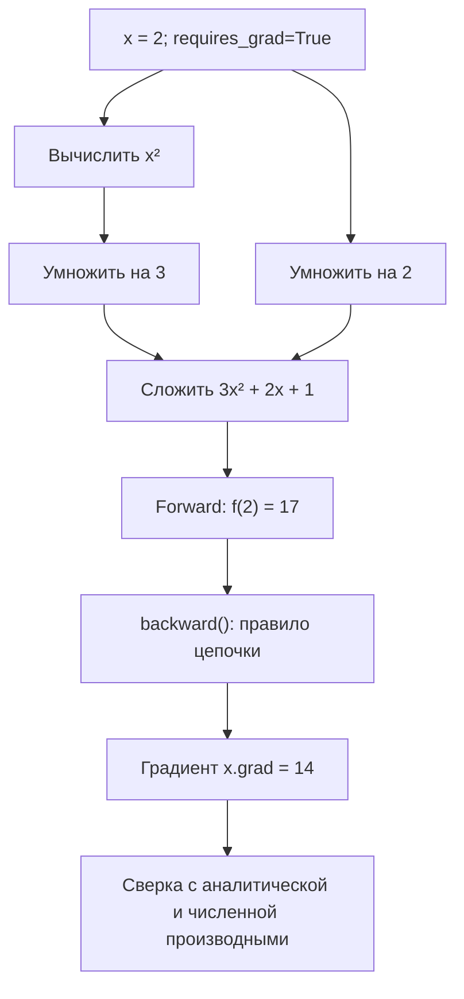

# F2.1 - Как работают тензоры и Autograd: пошаговая реализация

## 1. Цель этапа:

В Фазе 1 обучен классификатор технических вопросов с помощью `TF-IDF + LogisticRegression`. Библиотека scikit-learn выполнет оптимизацию внутри готового алгоритма: ей передается подготовленные данные, вызывается обучение и получаются предсказания. Но чтобы самостоятельно написать обучение нейросети, нужно понять, **как вычисляется влияние параметра на результат**.

Представить, что нейросеть получила неправильный ответ. Позднее будет измеряться ошибка числом - `loss` и изменять веса так, чтобы эта ошибка уменьшалась. Для этого сначала нужно найти производные: они показывают, как изменится результат при небольшом изменении каждого веса.

**Задача F2.1:** разобраться, как PyTorch хранит числа в тензорах, запоминает последовательность математических операций и автоматически получает производные при вызове `backward()`.

Сознательно взят не настоящий датасет, а одна понятная функция:

```math
f(x) = 3x^2 + 2x + 1
```

При `x = 2` её значение и производная известны заранее. Благодаря этому можно независимо проверить PyTorch, а не просто доверять числу, которое вернула библиотека.
## 2. Реализация: файлы этапа

В F2.1 вошли **шесть файлов**. Основная логика сосредоточена в одном модуле; остальные обеспечивают запуск, проверку и объяснение результата.

| Файл                                | Что сделали и зачем                                                                                                                                                                                                                                                     |
| ----------------------------------- | ----------------------------------------------------------------------------------------------------------------------------------------------------------------------------------------------------------------------------------------------------------------------- |
| `src/pytorch_f2/autograd_demo.py`   | Реализованы операции с тензорами, вычисление функции, аналитической и численной производных, `backward()`, накопление градиентов, `detach()` и `no_grad()`. Модуль также формирует результат демонстрации и поддерживает запуск с `--check`. **Это основной код F2.1.** |
| `src/pytorch_f2/__init__.py`        | Добавлен файл пакета `pytorch_f2`, в котором размещены модули нейросетевой части проекта.                                                                                                                                                                               |
| `tests/test_autograd.py`            | Написаны тесты значений и форм тензоров, совпадения градиентов, накопления и очистки `.grad`, отключения отслеживания, ошибочных входов, воспроизводимости и запуска демонстрации.                                                                                      |
| `docs/steps/F2_01_autograd.md`      | Описан, зачем нужен Autograd, как устроен эксперимент, что проверяют тесты и как интерпретировать вывод. Это текущий учебный материал.                                                                                                                                  |
| `requirements-autograd.txt`         | Выделен отдельный файл для минимального окружения этого упражнения, без необходимости запускать остальные компоненты ML/LLM-проекта.                                                                                                                                    |
| `.github/workflows/f2-autograd.yml` | Добавлена автоматическая CPU-проверка этапа и регрессии в CI, чтобы обнаруживать поломки после изменений проекта.                                                                                                                                                       |

**Важно:** F2.1 не изменял модели и метрики F1, не читал исходные технические вопросы и не обучал нейросеть. Все вычисления в этом этапе выполняются на синтетических числах.

## 3. Последовательность действий

### Шаг 1. Определить, что такое тензор и как читать его форму

Тензор - это объект PyTorch, который хранит числа и поддерживает математические операции. У него есть три важные характеристики:
- **`shape`** - сколько элементов находится вдоль каждой оси;
- **`dtype`** - какого типа числа хранятся в тензоре;
- **`device`** - где выполняются вычисления, например на CPU.

Начать с простых примеров, чтобы убедиться, что есть понимание не только значения, но и размеры результатов.

| Что создаётся | Пример                     | Форма    |
| ------------- | -------------------------- | -------- |
| Скаляр        | `2.0`                      | `[]`     |
| Вектор        | `[1.0, 2.0, 3.0]`          | `[3]`    |
| Матрица       | `[[1.0, 2.0], [3.0, 4.0]]` | `[2, 2]` |

Затем проверить две операции. Прибавление `2` к вектору `[1, 2, 3]` даёт `[3, 4, 5]`. Матричное произведение `[[1, 2], [3, 4]] @ [[2], [1]]` даёт `[[4], [10]]` с формой `[2, 1]`.

**Зачем:** перед обучением нейросети нужно уверенно понимать, что означает форма тензора. В следующих этапах несоответствие размеров входов и выходов будет одной из основных причин ошибок.

### Шаг 2. Включить отслеживание операций
Для основного эксперимента создан скалярный тензор с `requires_grad=True`:
```python
x = torch.tensor(2.0, dtype=torch.float64, requires_grad=True)
y = 3 * x.square() + 2 * x + 1
```

Первая строка задаёт число `2.0` и сообщает PyTorch: **по этому числу потребуется производная**. Вторая вычисляет `f(x)`.

PyTorch одновременно строит динамический вычислительный граф - цепочку зависимостей между операциями. У результата `y` появляется `grad_fn`, связанный с графом. При этом `x` - исходный листовой тензор, и после обратного прохода его градиент будет доступен через `x.grad`.

**Зачем:** без отслеживания операций `backward()` не смог бы пройти по цепочке вычислений и получить нужную производную по `x`.

### Шаг 3. Выполнить прямое вычисление функции
Сначала вычислить результат без градиентов - обычной подстановкой:
```math
f(2) = 3 \cdot 2^2 + 2 \cdot 2 + 1 = 12 + 4 + 1 = 17
```

Затем получить то же число из PyTorch-тензора `y`.

Это называется **прямым проходом (forward)**: от входного значения через операции к результату. Здесь нет нейросети; принцип прямого вычисления тот же, что позднее используется в `model(...)`.

### Шаг 4. Получить градиент с помощью `backward()`
У функции есть точная аналитическая производная:
```math
f'(x) = 6x + 2
```

Поэтому при `x = 2` ожидается:
```math
f'(2) = 6 \cdot 2 + 2 = 14
```

Теперь запускается автоматическое дифференцирование:
```python
y.backward()
gradient = x.grad.item()
```

`backward()` проходит по графу от результата к исходному тензору и применяет **правило цепочки**. Полученная производная записывается в `x.grad`; для нашего примера это `14.0`.

**Принципиальное различие:** `backward()` **считает градиент**, но **не меняет значение `x`** и не обновляет веса. Обновление параметров будет отдельной задачей F2.4.

### Шаг 5. Проверить производную тремя независимыми способами
Одного совпадения с ожидаемым числом недостаточно для хорошей технической проверки. Поэтому сопоставлены:
1. **Аналитическая производная** - известная формула `6x + 2`.
2. **Численная производная** - приближение, рассчитанное из нескольких значений самой функции.
3. **Autograd-производная** - результат `backward()`.

Для численной оценки используется *центральная конечная разность*:
```math
f'(x) \approx \frac{f(x+h)-f(x-h)}{2h}, \qquad h = 0.0001
```

Смысл простой: слегка сдвигается `x` влево и вправо, анализировать, как изменилась функция, и оценить её наклон. Это **не тот же алгоритм**, что Autograd, поэтому сравнение полезно.

| Способ | Результат при `x = 2` |
|---|---:|
| Аналитическая формула | `14.0` |
| PyTorch Autograd | `14.0` |
| Численная разность | примерно `14.00000000002` |

Маленькое отличие численного результата объясняется арифметикой с плавающей точкой. Для проверки F2.1 аналитический результат и Autograd сравниваются с допуском `1e-12`, а численный - с допуском `1e-6`.

Используется `torch.float64` на CPU, чтобы уменьшить влияние погрешностей и получить устойчивый воспроизводимый пример. Тесты отдельно отклоняют недопустимые численные значения и слишком маленький шаг `h`.

### Шаг 6. Разобрано накопление градиентов и их обнуление
Один из неочевидных моментов PyTorch: последовательные вызовы `backward()` **накапливают** градиенты в `.grad`, а не автоматически заменяют предыдущее значение.

Проверить это на том же `x = 2`:

| Действие | Что происходит с `x.grad` |
|---|---:|
| До первого обратного прохода | `None` |
| `f(x).backward()` | `14` |
| Новый расчёт `x.square().backward()` | `14 + 4 = 18` |
| `x.grad.zero_()` | `0` |
| Ещё один новый расчёт `x.square().backward()` | `4` |

У `x²` производная `2x`, поэтому при `x = 2` она равна `4`. Второй обратный проход добавляет её к предыдущим `14`.

**Почему выражение создаётся заново:** после обычного `backward()` PyTorch освобождает часть промежуточной информации, поэтому повторять обратный проход по тому же графу без специальных условий нельзя. В данном упражнении правильнее построить новый граф для нового выражения.

**Зачем:** в F2.4 необходимо очищать градиенты перед обычным шагом обучения, чтобы новый батч случайно не прибавлял свои градиенты к предыдущему.

### Шаг 7. Показать, когда граф вычислений не нужен
Отдельно изучены два механизма:
- **`detach()`** возвращает тензор, отсоединённый от истории вычислений. Обычно он разделяет данные с исходным тензором, поэтому изменение значений *на месте* требует осторожности.
- **`torch.no_grad()`** временно отключает запись большинства операций в вычислительный граф. Это используется, например, во время оценки модели, когда нужно получить результат, но не обучать веса.

В обоих экспериментах проверено `requires_grad=False` для полученных результатов. При этом исходный отслеживаемый тензор не должен терять собственный `requires_grad=True`.

**Зачем:** нет необходимости тратить память на граф там, где не собирается вычисляться градиенты. Позднее это пригодится для validation и inference.

### Шаг 8. Написать тесты и отдельную демонстрацию
В `tests/test_autograd.py` проверяется не только главное число `14`. Тесты охватывают операции с тензорами, формы и типы, правильность трёх способов дифференцирования в нескольких точках, накопление и очистку градиентов, отключение отслеживания, некорректные входы, воспроизводимость и CLI-запуск.

Демонстрация в `autograd_demo.py` собирает результаты в JSON, чтобы можно было увидеть одновременно значения функции, формы тензоров и все состояния градиента.

**Итог разработки:** получен маленький самодостаточный эксперимент, где каждый важный результат либо заранее известен математически, либо проверяется отдельным тестом.

## 4. Алгоритм Autograd: что происходит внутри одного вызова

Чтобы связать отдельные действия, необходимо рассмотреть полный путь `x → f(x) → df/dx`.

**Прямой проход:** PyTorch последовательно вычисляет `x²`, `3x²`, `2x`, сумму и добавление единицы. Одновременно сохраняется информация, необходимая для будущего расчёта производных.

**Обратный проход:** начиная с результата `f`, Autograd применяет правило цепочки. Поскольку `x` участвует в двух ветвях (`3x²` и `2x`), их вклады в производную **складываются**: `6x + 2`.

**Результат:** при `x=2` получаем `f=17` и `x.grad=14`. Это и есть механизм, благодаря которому позже можно будет вычислять градиенты весов нейросети, даже если её прямой проход состоит из большого количества слоёв.

## 5. Схема вычислений



На схеме важно различать **две фазы**: сначала вычисляется значение функции, а затем по связям между операциями рассчитываем её производную. В F2.1 градиент только изучается и проверяется; оптимизатор здесь не используется.

## 6. Локальная проверка в PowerShell: что запускать и как читать результат

Эти команды рассчитаны на уже подготовленный проект на Windows. Они **не устанавливают пакеты, не изменяют Git-историю и не обучают модель**.

### 6.1. Перейти в корневую папку проекта
```powershell
cd F:\DEVELOPMENT\ML\ml-engineering-lab
```

Все следующие команды запускаются из этой папки.

### 6.2. Проверить только F2.1
```powershell
.\.venv\Scripts\python.exe -m pytest -v tests/test_autograd.py
```

**Что проверяется:** формы тензоров, правильность вычислений и производных, накопление градиентов, `detach()`/`no_grad()`, граничные значения и воспроизводимость.

**Исторический результат при завершении F2.1 на Windows:** `19 passed`. Это число относится только к тестовому файлу F2.1. Если тесты впоследствии изменялись, ориентир на фактический вывод.

### 6.3. Запустить математическую демонстрацию
```powershell
.\.venv\Scripts\python.exe -m src.pytorch_f2.autograd_demo --check
```

**На какие значения смотреть в JSON:**
```text
"value": 17.0
"analytic_gradient": 14.0
"numerical_gradient": 14.000000000020663
"autograd_gradient": 14.0
"accumulated_gradient": 18.0
"gradient_after_zero": 0.0
"gradient_after_new_backward": 4.0
```

Также должны быть признаки построенного вычислительного графа (`has_computational_graph: true`), первоначально пустого градиента (`gradient_initially_none: true`) и отключённого отслеживания для результатов `detach()` / `no_grad()` (`false`).

**Контрольная строка:**
```text
F2.1 Autograd CHECK: PASS
```

**Как читать результат:** `17` - значение функции; `14` - её производная; `18 → 0 → 4` - эксперимент с накоплением, очисткой и новым обратным проходом. Небольшое отличие численной производной от `14` - ожидаемая вычислительная погрешность.

### 6.4. Проверить, что остальные этапы не сломались
```powershell
.\.venv\Scripts\python.exe -m pytest -q
```

Это полная регрессия **текущей** рабочей копии репозитория. На момент первоначального завершения F2.1 было `205 passed` (186 предыдущих тестов и 19 новых). К завершению всей Фазы 2 тестов стало `528`; после добавления этапов Фазы 3 их может быть ещё больше. Поэтому главное - отсутствие `failed` и `errors`, а не прежнее число тестов.

Один успешный запуск демонстрации не заменяет автоматические тесты: CLI показывает один понятный сценарий, а тесты проверяют множество ситуаций.

## 7. Что подтверждено и какие ограничения

**Подтверждено:** тензорные операции дают ожидаемые значения и формы; Autograd вычисляет производную, совпадающую с аналитической и численной; `.grad` накапливается и обнуляется; `detach()` и `no_grad()` отключают запись нужных операций в граф; демонстрация воспроизводится на CPU. Корректность этапа была подтверждена тестами на Windows.

**Ограничения примера:** рассматривается простая функция одного переменного и синтетические тензоры. Для численной производной важен разумный шаг `h`; слишком маленький шаг приводит к ошибкам округления. В реальной нейросети параметров много, но основной принцип применения правила цепочки остаётся тем же.

## 8. Основная мысль раздела

**В F2.1 осуществлен разбор с математическим механизмом обучения: тензоры хранят данные, PyTorch во время прямого прохода формирует граф операций, а `backward()` использует этот граф, чтобы получить градиенты. Не было ограничений вызовом готовой функции - проверены производные аналитически и численно, изучено накопление `.grad` и показан, когда граф нужно отключать. Именно эти действия станут основой собственного Training Loop в F2.4.**

## 9. Файлы этапа

Для изучения кода удобнее идти от наблюдаемого результата к реализации.

| Порядок | Файл | На что смотреть в коде |
|---|---|---|
| 1 | `src/pytorch_f2/autograd_demo.py` | Точка запуска CLI: как собирается JSON с результатами и как работает флаг `--check`. |
| 2 | `src/pytorch_f2/autograd_demo.py` | `tensor_examples()`: создание вектора и матрицы, прибавление скаляра, матричное умножение, формы и типы результатов. |
| 3 | `src/pytorch_f2/autograd_demo.py` | Расчёт многочлена и три способа получения производной: аналитика, конечная разность и `backward()`. |
| 4 | `src/pytorch_f2/autograd_demo.py` | Демонстрация накопления `14 → 18`, обнуления `.grad` и нового значения `4`, затем `detach()` и `torch.no_grad()`. |
| 5 | `tests/test_autograd.py` | Тесты математического эталона, нескольких значений `x`, недопустимого шага `h`, форм тензоров, режимов отслеживания и запуска CLI. |
| 6 | `src/pytorch_f2/__init__.py` | Расположение модуля F2.1 внутри Python-пакета `pytorch_f2`. |
| 7 | `src/pytorch_f2/training_loop.py` | Уже реализованный в F2.4 следующий шаг: как градиенты, полученные через `backward()`, затем используются оптимизатором для обновления весов. **Этот файл не изменялся в F2.1.** |

**Итог F2.1:** не просто изучены определения Tensor и Autograd, а воспроизведена их работа на конкретной функции, осуществлено сравнение результата тремя методами и проверка поведения градиентов. Это необходимая база для понимания обучения нейросетей в последующих этапах.
