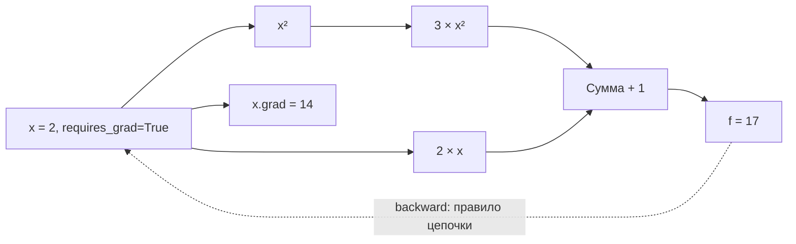
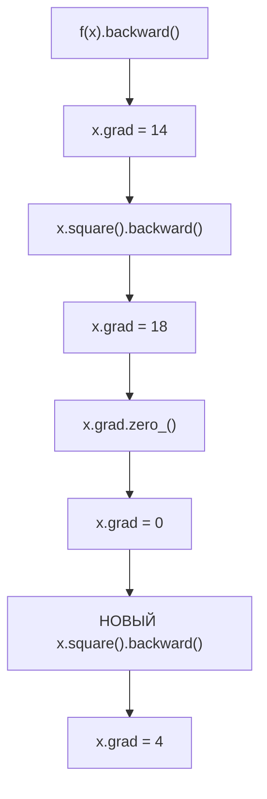

# F2.1 - PyTorch: Tensor and autograd (Тензоры, вычислительный граф и градиенты)

F2.1 - это знакомство с двумя основами PyTorch: тензорами и автоматическим вычислением градиентов. Тензоры хранят числа, autograd вычисляет производные, а optimizer использует градиенты для изменения обучаемых параметров.

## Связь с F1
В F1 классическая модель `TF-IDF + LogisticRegression` использовала готовый механизм оптимизации в scikit-learn. F2 начинается с понимания математических операций, лежащих в основе обучения нейросетей. F2.1 не обучает модель, не изменяет ранее обученные модели и не читает Q&A-датасет. Он показывает автоматическое вычисление производных в PyTorch.

**Вход:** синтетическое число `x=2.0` (можно передать другое конечное число). **Выход:** JSON с формами тензоров, значением функции и градиентами, а также проверка `CHECK: PASS/FAIL`.

## Что такое тензор
**Тензор - объект для хранения чисел и выполнения вычислений над ними.**
| Пример              | Представление      | Форма - `shape` |
| ------------------- | ------------------ | --------------- |
| Одно число - скаляр | `5`                | `()`            |
| Вектор              | `[2, 3]`           | `(2,)`          |
| Матрица             | `[[1, 2], [3, 4]]` | `(2, 2)`        |

`torch.Tensor` - многомерный массив с формой (`shape`), типом элементов (`dtype`) и устройством (`device`). Нульмерный тензор `torch.tensor(2.0)` - скаляр (`shape=[]`); вектор `[1,2,3]` имеет `shape=[3]`; матрица 2×2 - `shape=[2,2]`. Демо использует `torch.float64` и `cpu` для численного сравнения производных. Даже если на компьютере есть GPU, в F2.1 CUDA не используется.

`tensor_examples()` показывает:
| Операция | Входы | Выход и форма |
|---|---|---|
| Прибавить скаляр | `[1,2,3] + 2` | `[3,4,5]`, `[3]` |
| Матрично умножить | `[[1,2],[3,4]] @ [[2],[1]]` | `[[4],[10]]`, `[2,1]` |

Тензор в проекте:
```python
x = torch.tensor([2., 3.], requires_grad=True)
```
- `[2., 3.]` - два числа с плавающей точкой;
- `shape` равен `(2,)` - вектор из двух элементов;
- `dtype` равен `torch.float32` - тип чисел, использующий 32 бита;
- `requires_grad=True` - просим PyTorch отслеживать вычисления, чтобы затем найти производные по `x`.

## Что такое Autograd
**Autograd - механизм PyTorch, который автоматически вычисляет производные.**
**Градиент показывает, как изменение входных значений влияет на результат.** Точнее, он объединяет частные производные по отдельным элементам.
Если создать `x = torch.tensor(2.0, dtype=torch.float64, requires_grad=True)`, PyTorch будет отслеживать дифференцируемые операции с ним. Результат `y` хранит информацию о вычислениях (`grad_fn`). Выполнение `y.backward()` применяет *правило цепочки* от выхода к входам и сохраняет производную в `x.grad`, если `x` - листовой тензор (leaf tensor).

Для учебной функции:
\[
f(x) = 3x^2 + 2x + 1,\qquad f(2)=17
\]

Аналитическая производная:
\[
f'(x) = 6x+2,\qquad f'(2)=14
\]

PyTorch получает тот же ответ без прописанной вручную формулы производной.



Это *упрощённая* схема: в реальности Autograd формирует динамический граф операций. `.backward()` после обычного вычисления идёт **от результата к параметрам**, а не вычисляет численную разность.

## Три метода получения производной
1. **Аналитически:** `6*x+2` - точное выражение для данного многочлена.
2. **Численно:** центральная конечная разность: `[f(x+h)-f(x-h)]/(2h)` при `h=0.0001`. Это приближение с погрешностью округления и усечения; при слишком маленьком `h` погрешность округления растёт.
3. **Autograd:** `y.backward()` и чтение `x.grad`. Механизм использует производные отдельных операций и правило цепочки, а не конечные разности.

В F2.1 проверяется совпадение аналитического и Autograd-градиента с допуском `1e-12` и численного с допуском `1e-6`. Для демонстрации используется `float64`. `gradcheck` из PyTorch существует, но здесь необходимо намеренно реализовать независимую конечную разность, чтобы продемонстрировать её формулу.

### Почему это важно для нейросетей
У нейросетей бывает миллионы параметров. Выписывать частные производные вручную невозможно. Autograd вычисляет их по сформированному графу. В будущем optimizer использует эти градиенты, чтобы изменить веса и уменьшить loss. Пока F2.1 **не содержит** loss классификатора и optimizer.
**Loss - функция потерь, которая даёт числовую оценку ошибки предсказания.**
**Optimizer - алгоритм, который использует градиенты для обновления обучаемых параметров.**

## Накопление и обнуление градиента
После первого `backward()` для `f(x)` при `x=2` в `.grad` записано **14**. Затем вызывается обратный проход для **нового** выражения `x²`, у которого производная `2x=4`. PyTorch **добавляет**, а не заменяет производную: `x.grad=18`. Обнуление `x.grad.zero_()` возвращает **0**, а новый `x.square().backward()` даёт **4**.



Почему **новый** граф? PyTorch по умолчанию освобождает сохранённые промежуточные значения после `backward()`. Повторный backward по прежнему графу часто приводит к ошибке без `retain_graph=True`. В учебной задаче не надо включать `retain_graph=True`: корректнее построить новые вычисления.

## `detach()` и `torch.no_grad()`

- `tensor.detach()` возвращает тензор, отсоединённый от истории вычислений. Он обычно разделяет данные с исходным тензором, поэтому *in-place* изменение может повлиять на оба объекта. Демонстрация **не** изменяет значения на месте.
- `with torch.no_grad():` отключает запись большинства операций в граф внутри контекста. Удобно для inference/validation, где градиенты не нужны; есть исключения для factory-функций, задающих `requires_grad` самостоятельно.

Тесты проверяют, что результаты обеих операций имеют `requires_grad=False`; исходный `x` остаётся отслеживаемым.


| Файл | Роль |
|---|---|
| `src/pytorch_f2/autograd_demo.py` | Вычисления, сравнение градиентов, CLI |
| `tests/test_autograd.py` | Unit-тесты, regression-independent checks и CLI smoke test |
| `docs/steps/F2_01_autograd.md` | Настоящий учебный документ и инструкция |
| `requirements-autograd.txt` | Минимальный профиль PyTorch + pytest (без LLM-зависимостей) |
| `.github/workflows/f2-autograd.yml` | Отдельные CPU-only тесты F2 и всего существующего набора pytest |

## Windows-тесты
Из корня проекта:
```powershell
# Отдельный набор F2.1
.\.venv\Scripts\python.exe -m pytest -v tests/test_autograd.py

# Основной воспроизводимый числовой пример
.\.venv\Scripts\python.exe -m src.pytorch_f2.autograd_demo --check

# Полный набор F1 + F2.1 (фактическое число зависит от текущей ветки)
.\.venv\Scripts\python.exe -m pytest -q

# Сохранение  F1, если локальные audit JSON существуют
.\.venv\Scripts\python.exe -m scripts.build_f1_report --expect-rows 3040 --expect-test 608 --check
```

Важно: **новые, ещё не проиндексированные Git файлы не входят в `git diff --stat` и `git diff --check`**. До staging дополнительно можно проверить имена всех неотслеживаемых файлов через `git status`; после явного staging выполнить `git diff --cached --check`, `git diff --cached --stat`, `git diff --cached --name-only`.

Ожидаемый демонстрационный ответ при `x=2`: `value=17`, `analytic_gradient=14`, `numerical_gradient≈14`, `autograd_gradient=14`, `accumulated_gradient=18`, `gradient_after_zero=0`, `gradient_after_new_backward=4`, оба флага отключённого градиента — `false`. Последняя строка CLI: `F2.1 Autograd CHECK: PASS`.

Точное общее число тестов до запуска неизвестно; прежний подтверждённый ориентир — 186 тестов F1. Новых pytest cases в этом файле **19** (учитывая параметризацию), но окончательный подсчёт делается фактическим запуском.

## Основная мысль F2.1
Тензоры хранят числа, autograd вычисляет, как эти числа влияют на результат, а optimizer использует градиенты для изменения обучаемых параметров.
- `shape` описывает размеры тензора по осям.
- `dtype` задаёт тип чисел.
- `requires_grad=True` включает отслеживание вычислений для производных по тензору.
- Вычислительный граф хранит связи операций.
- Градиент состоит из производных по отдельным элементам.
- `backward()` вычисляет градиенты, но не обновляет веса.
- `optimizer.step()` выполняет обновление параметров.
- Градиенты накапливаются; перед обычным новым шагом их очищают.
