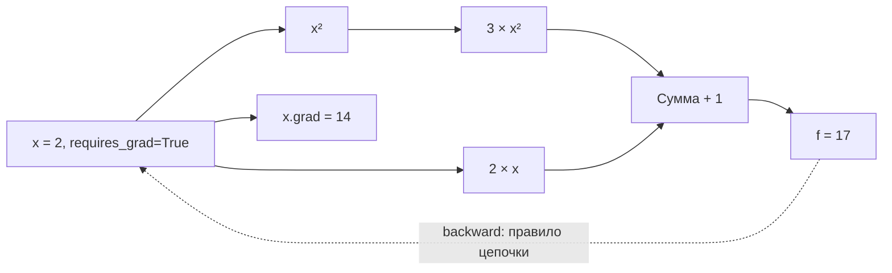
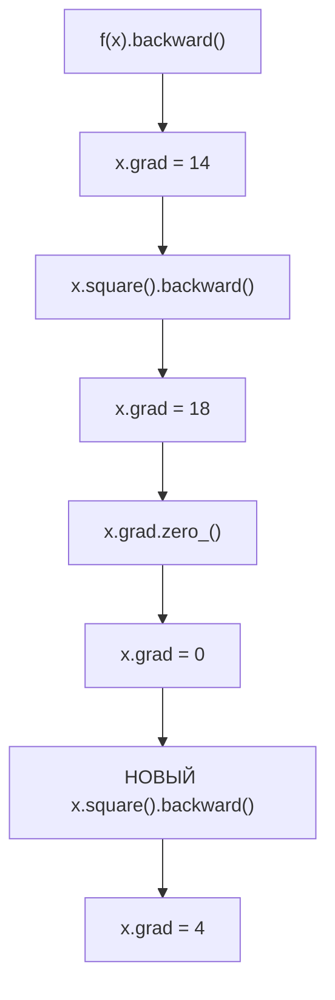

# F2.1 — PyTorch Autograd: тензоры, вычислительный граф и градиенты

> Статус поставки: **READY FOR LOCAL VALIDATION**, не PASS. Шаг считается завершённым только после Windows-проверки, commit/push и успешных GitHub Actions.

## 1. Цель и связь с F1

В F1 классическая модель `TF-IDF + LogisticRegression` использовала готовый механизм оптимизации в scikit-learn. F2 начинается с понимания математических операций, лежащих в основе обучения нейросетей. **F2.1 не обучает модель**, не изменяет ранее обученные модели и не читает Q&A-датасет. Он показывает автоматическое вычисление производных в PyTorch.

**Вход:** синтетическое число `x=2.0` (можно передать другое конечное число). **Выход:** JSON с формами тензоров, значением функции и градиентами, а также проверка `CHECK: PASS/FAIL`.

## 2. Что такое тензор

`torch.Tensor` — многомерный массив с формой (`shape`), типом элементов (`dtype`) и устройством (`device`). Нульмерный тензор `torch.tensor(2.0)` — скаляр (`shape=[]`); вектор `[1,2,3]` имеет `shape=[3]`; матрица 2×2 — `shape=[2,2]`. Демо использует `torch.float64` и `cpu` для численного сравнения производных. Даже если на компьютере есть GPU, в F2.1 CUDA не используется.

`tensor_examples()` показывает:

| Операция | Входы | Выход и форма |
|---|---|---|
| Прибавить скаляр | `[1,2,3] + 2` | `[3,4,5]`, `[3]` |
| Матрично умножить | `[[1,2],[3,4]] @ [[2],[1]]` | `[[4],[10]]`, `[2,1]` |

## 3. Что такое Autograd

Если создать `x = torch.tensor(2.0, dtype=torch.float64, requires_grad=True)`, PyTorch будет отслеживать дифференцируемые операции с ним. Результат `y` хранит информацию о вычислениях (`grad_fn`). Выполнение `y.backward()` применяет *правило цепочки* от выхода к входам и сохраняет производную в `x.grad`, если `x` — листовой тензор (leaf tensor).

Для учебной функции:

\[
f(x) = 3x^2 + 2x + 1,\qquad f(2)=17
\]

Аналитическая производная:

\[
f'(x) = 6x+2,\qquad f'(2)=14
\]

PyTorch получает тот же ответ без прописанной вручную формулы производной.



Это *упрощённая* схема: в реальности Autograd формирует динамический граф операций. `.backward()` после обычного вычисления идёт **от результата к параметрам**, а не вычисляет численную разность.

## 4. Три метода получения производной

1. **Аналитически:** `6*x+2` — точное выражение для данного многочлена.
2. **Численно:** центральная конечная разность: `[f(x+h)-f(x-h)]/(2h)` при `h=0.0001`. Это приближение с погрешностью округления и усечения; при слишком маленьком `h` погрешность округления растёт.
3. **Autograd:** `y.backward()` и чтение `x.grad`. Механизм использует производные отдельных операций и правило цепочки, а не конечные разности.

В F2.1 проверяется совпадение аналитического и Autograd-градиента с допуском `1e-12` и численного с допуском `1e-6`. Для демонстрации используется `float64`. `gradcheck` из PyTorch существует, но здесь мы намеренно реализуем независимую конечную разность, чтобы продемонстрировать её формулу.

### Почему это важно для нейросетей

У нейросети часто миллионы параметров. Выписывать частные производные вручную сложно и легко ошибиться. Autograd вычисляет их по сформированному графу. В будущем optimizer использует эти градиенты, чтобы изменить веса и уменьшить loss. Пока F2.1 **не содержит** loss классификатора и optimizer.

## 5. Накопление и обнуление градиента

После первого `backward()` для `f(x)` при `x=2` в `.grad` записано **14**. Затем вызывается обратный проход для **нового** выражения `x²`, у которого производная `2x=4`. PyTorch **добавляет**, а не заменяет производную: `x.grad=18`. Обнуление `x.grad.zero_()` возвращает **0**, а новый `x.square().backward()` даёт **4**.



Почему **новый** граф? PyTorch по умолчанию освобождает сохранённые промежуточные значения после `backward()`. Повторный backward по прежнему графу часто приводит к ошибке без `retain_graph=True`. В учебной задаче не надо включать `retain_graph=True`: корректнее построить новые вычисления.

## 6. `detach()` и `torch.no_grad()`

- `tensor.detach()` возвращает тензор, отсоединённый от истории вычислений. Он обычно разделяет данные с исходным тензором, поэтому *in-place* изменение может повлиять на оба объекта. Демонстрация **не** изменяет значения на месте.
- `with torch.no_grad():` отключает запись большинства операций в граф внутри контекста. Удобно для inference/validation, где градиенты не нужны; есть исключения для factory-функций, задающих `requires_grad` самостоятельно.

Тесты проверяют, что результаты обеих операций имеют `requires_grad=False`; исходный `x` остаётся отслеживаемым.

## 7. Состав ZIP

| Файл относительно корня репозитория | Роль |
|---|---|
| `src/pytorch_f2/__init__.py` | Отдельный пакет F2, без изменения F1 |
| `src/pytorch_f2/autograd_demo.py` | Вычисления, сравнение градиентов, CLI |
| `tests/test_autograd.py` | Unit-тесты, regression-independent checks и CLI smoke test |
| `docs/steps/F2_01_autograd.md` | Настоящий учебный документ и инструкция |
| `requirements-autograd.txt` | Минимальный профиль PyTorch + pytest (без LLM-зависимостей) |
| `.github/workflows/f2-autograd.yml` | Отдельные CPU-only тесты F2 и всего существующего набора pytest |

Из существующих F1-файлов **ничего не заменяется**. Файлы отсутствовали в просмотренном публичном `main` на момент подготовки; твой локальный `main` необходимо проверить перед распаковкой.

## 8. Контрольная точка A: проверка актуальной локальной копии (Windows PowerShell)

```powershell
Set-Location 'F:\DEVELOPMENT\ML\ml-engineering-lab'
git status --short --untracked-files=all
git rev-parse HEAD
git log -1 --format='%h %s'
git fetch origin main
git rev-parse origin/main
.\.venv\Scripts\python.exe --version
.\.venv\Scripts\python.exe -m pip show torch pytest
.\.venv\Scripts\python.exe -m pytest --collect-only -q
```

Если рабочая папка чистая и `git status` пуст, допускается:

```powershell
git pull --ff-only origin main
```

Если есть незафиксированные изменения — **не делать pull и не распаковывать ZIP до аудита расхождений**. Сначала сохрани/пришли вывод.

## 9. Установка пакета

1. Помести ZIP в удобное место, например в `F:\DEVELOPMENT\ML\`.
2. Проверь имена файлов архива и убедись, что **ни один не существует** в локальном репозитории. Если файл существует, остановись и пришли его содержимое/путь для ревью.
3. Распакуй в корень проекта:

```powershell
Set-Location 'F:\DEVELOPMENT\ML\ml-engineering-lab'
$archive = 'F:\DEVELOPMENT\ML\ML_Engineering_Lab_F2_1_GitHub.zip'
Add-Type -AssemblyName System.IO.Compression.FileSystem
$archiveFiles = [System.IO.Compression.ZipFile]::OpenRead($archive)
try {
    $conflicts = @($archiveFiles.Entries | Where-Object { $_.Name -and (Test-Path -LiteralPath (Join-Path (Get-Location).Path $_.FullName.Replace('/', '\'))) })
    if ($conflicts.Count -gt 0) {
        $conflicts.FullName
        throw 'Файлы в проекте уже существуют: распаковка отменена.'
    }
} finally {
    $archiveFiles.Dispose()
}
Expand-Archive -LiteralPath $archive -DestinationPath .
```

Команда намеренно **запрещает** молчаливую замену существующих файлов.

## 10. Зависимости

Из опубликованного `requirements.txt` известно, что желаемая версия — `torch==2.14.1`. Узнать **фактически** установленную версию можно по `pip show torch` или командой ниже. Не обновляй рабочую среду просто ради совпадения патч-версии, если PyTorch уже работает и согласован с локальным проектом.

```powershell
.\.venv\Scripts\python.exe -c "import torch; print('torch:', torch.__version__, 'CUDA:', torch.cuda.is_available())"
```

Если PyTorch не установлен, сначала сверим твою версию Python и архитектуру с доступным CPU wheel. После этого можно использовать:

```powershell
.\.venv\Scripts\python.exe -m pip install -r requirements-autograd.txt
```

Для CPU-only-установки версии `2.14.1` предусмотрен официальный индекс `https://download.pytorch.org/whl/cpu`. Он используется в GitHub Actions для выбора CPU-wheel. Нестабильность внешнего индекса — возможная инфраструктурная ошибка CI, не свидетельство дефекта математического кода.

## 11. Контрольная точка B: Windows-тесты

Из корня проекта:

```powershell
# Отдельный набор F2.1 (пока не считаем PASS только по этому выводу)
.\.venv\Scripts\python.exe -m pytest -v tests/test_autograd.py

# Основной воспроизводимый числовой пример
.\.venv\Scripts\python.exe -m src.pytorch_f2.autograd_demo --check

# Полный набор F1 + F2.1 (фактическое число зависит от текущей ветки)
.\.venv\Scripts\python.exe -m pytest -q

# Сохранение существующего контракта F1, если локальные audit JSON существуют
.\.venv\Scripts\python.exe -m scripts.build_f1_report --expect-rows 3040 --expect-test 608 --check

# Проверки проекта и состава изменений
git diff --check
git diff --stat
git status --short --untracked-files=all
```

Важно: **новые, ещё не проиндексированные Git файлы не входят в `git diff --stat` и `git diff --check`**. До staging дополнительно можно проверить имена всех неотслеживаемых файлов через `git status`; после явного staging выполнить `git diff --cached --check`, `git diff --cached --stat`, `git diff --cached --name-only`.

Ожидаемый демонстрационный ответ при `x=2`: `value=17`, `analytic_gradient=14`, `numerical_gradient≈14`, `autograd_gradient=14`, `accumulated_gradient=18`, `gradient_after_zero=0`, `gradient_after_new_backward=4`, оба флага отключённого градиента — `false`. Последняя строка CLI: `F2.1 Autograd CHECK: PASS`.

Точное общее число тестов до запуска неизвестно; прежний подтверждённый ориентир — 186 тестов F1. Новых pytest cases в этом файле **19** (учитывая параметризацию), но окончательный подсчёт делается фактическим запуском.

## 12. Контрольная точка C: Git (только после твоего подтверждения)

```powershell
git add -- src/pytorch_f2/__init__.py src/pytorch_f2/autograd_demo.py tests/test_autograd.py docs/steps/F2_01_autograd.md requirements-autograd.txt .github/workflows/f2-autograd.yml
git diff --cached --check
git diff --cached --stat
git diff --cached --name-only
git status --short --untracked-files=all
```

Предлагаемый коммит: `feat(f2.1): add PyTorch autograd demo and CPU tests`.

**Команды ниже выполняются только после проверки и отдельного согласования:**

```powershell
git commit -m "feat(f2.1): add PyTorch autograd demo and CPU tests"
git push origin main
```

В Git допускаются только шесть файлов выше. **Не добавлять:** `.venv/`, `data/processed/`, `data/interim/`, Q&A-тексты, приватные логи, `.pt`/`.pth`/`.ckpt`, кеши и локальные audit JSON. Заявление `git status чист` после установки пакета неверно: новые файлы должны стать untracked до их добавления.

## 13. Контрольная точка D: GitHub Actions

После push проверяются реально существующие workflow:

1. `Repository integrity` — проверяет метаданные.
2. `Foundation F1 tests` — существующая регрессия F1 и provenance.
3. `F2.1 Autograd CPU tests` — новый workflow: установка F1-зависимостей, pinned CPU PyTorch, **полный pytest** и CLI smoke.

Нельзя ставить PASS до подтверждения **всех трёх**. Если установка torch не удалась из-за внешнего сервиса, это CI FAIL/blocked, а не PASS; устраняем сбой в рамках F2.1.

## 14. Критерии приёмки F2.1

- Действительный локальный HEAD и состояние ветки зафиксированы.
- Все новые unit-тесты и CLI smoke проходят в Windows.
- Полный набор старых F1 и новых тестов проходит, отсутствуют необъяснённые warnings/errors.
- F1-метрики, конфигурации, датасет и исходники не изменены.
- Проверены `git diff --check`, явный список staged-файлов и отсутствие приватных данных.
- GitHub Actions (3 workflow) зелёные, известен commit SHA.
- Отмечены любые особенности PyTorch/CPU и публичные ограничения.

**Пока: F2.1 — PARTIAL / AWAITING USER VALIDATION.** Переход к F2.2 не разрешён.

## 15. Вопросы для собеседования

1. Чем тензор отличается от обычного списка Python? Что обозначают `shape`, `dtype`, `device`?
2. Зачем нужен `requires_grad`, и у каких тензоров PyTorch сохраняет `.grad`?
3. Чем `forward pass` отличается от `backward pass`? Как применяется правило цепочки?
4. Почему `backward()` два раза подряд может неожиданно увеличить градиент?
5. Чем отличаются `detach()` и `torch.no_grad()`? Почему `detach()` требует аккуратности с in-place-изменениями?
6. Почему численная производная зависит от шага, а Autograd — не от него?
7. Почему `float64` полезен для лабораторной сверки, хотя для реального обучения часто используют `float32`?
8. Как проверить, что лабораторный пример воспроизводим и не требует настоящих данных?

## 16. Что сделали, зачем, как проверяем, что получаем

| Вопрос | Ответ |
|---|---|
| Что | Изолированный модуль F2.1, тесты, инструкции и CPU CI |
| Зачем | Понять основу вычисления градиентов перед training loop |
| Как | Динамический Autograd, конечная разность, аналитика, отдельные графы |
| Проверка | pytest + CLI `--check` + регрессия F1 + GitHub Actions |
| Результат | При `x=2`: `f=17`, `f'=14`, накопление 18, после сброса 0 |
| Ограничения | Нет Dataset, DataLoader, embedding-модели или optimizer — это другие этапы |
