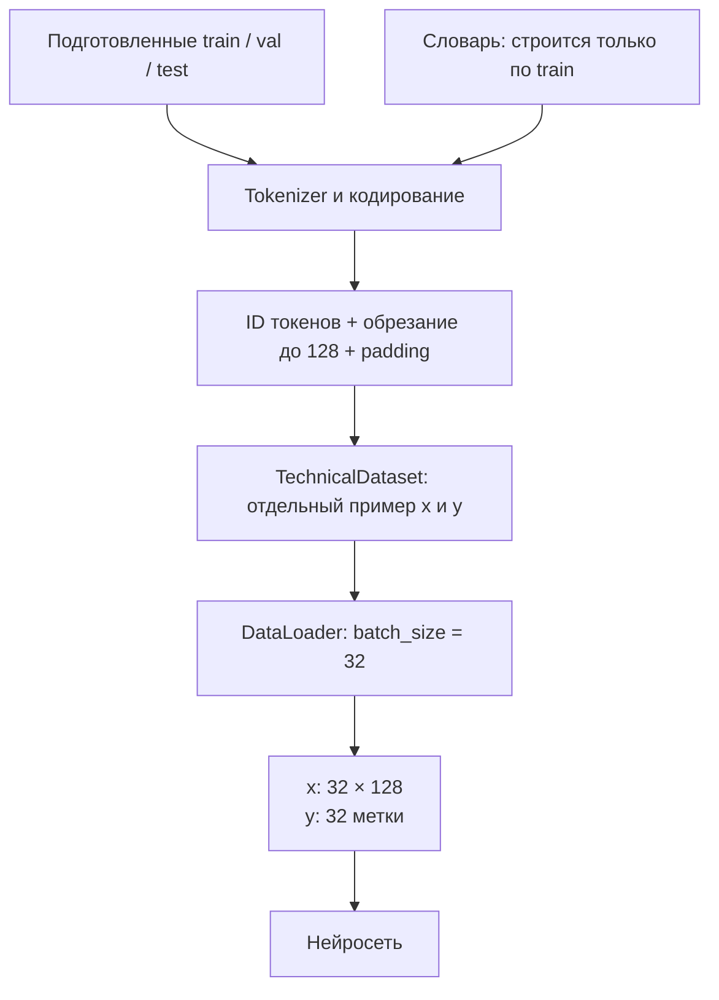

# F2.2 - Dataset, DataLoader и токенизация

F2.2 - это подготовка данных к подаче в нейросеть. Dataset отвечает за отдельный подготовленный пример, а DataLoader - за выдачу групп примеров, называемых batches.

## Задача алгоритма
Входы модели в F1 - строки с техническими вопросами. Нейросеть не может напрямую перемножать слова и матрицы. На этом этапе реализовано преобразование **вопрос → токены → числовые индексы → тензор → батч** без обучения классификатора.

- **Dataset** - хранит примеры и позволяет получить отдельный пример.
- **DataLoader** - собирает примеры в группы и выдаёт их для обучения или оценки.

Входом служат уже разделённые F1.6 записи `train`, `val`, `test`. Использован текст `context` в качестве признака и `domain` как истинная метка темы. `id`, `group_id` и `split` позволяют проверить границы выборок. Поле `answer` не передаётся модели: оно не является входом классификатора вопросов и может содержать дополнительную информацию.

## Токенизация
**Tokenizer - алгоритм разбиения текста на элементы. Эти элементы называются токенами.**
`tokenize(text)` нормализует регистр с `casefold()` и регулярным выражением `\w+|[^\w\s]` выделяет слова и отдельные знаки пунктуации. Для простоты это **word-level tokenizer**, а не BPE, SentencePiece или токенизатор готовой LLM.

Пример (синтетический):
```text
Вопрос:       "Linux: restart service!"
Токены:       ["linux", ":", "restart", "service", "!"]
```

Токенизатор одинаков для train/val/test и не обучается на текстах. Он не удаляет знаки пунктуации и не выполняет стемминг, лемматизацию или морфологический анализ. Пробельные последовательности сами по себе не становятся токенами.

## Приведение вопросов к одинаковой длине
Вопросы имеют разную длину, а для обычного прямоугольного batch нужны одинаковые размеры.

В настройках:
```yaml
max_length: 128
```

Поэтому:
- длинные вопросы обрезаются до первых 128 токенов;
- короткие дополняются нулями до длины 128.

## Обучаем словарь только на train
`build_vocab(train_rows, max_vocab_size=12000)` подсчитывает число вхождений каждого токена **только в train**. Более частые токены получают меньшие индексы; при одинаковой частоте используется лексикографический порядок. Это устраняет влияние порядка строк на итоговый словарь.

Первые четыре индекса фиксированы:
| Индекс | Токен | Назначение |
|---:|---|---|
| 0 | `<PAD>` | Пустые позиции при дополнении последовательности |
| 1 | `<UNK>` | Токен не входит в словарь train |
| 2 | `<BOS>` | Начало вопроса |
| 3 | `<EOS>` | Конец вопроса |

Словарь содержит не более 12 000 позиций **включая служебные токены**. Если редкое слово отсутствует в словаре или встречается только в validation/test, ему присваивается `<UNK>`; расширять словарь по данным отложенных выборок нельзя.

**Пример защиты от утечки:** train содержит «linux service», а validation - «linux unicorn». Токен `unicorn` отсутствует в обучающем словаре, поэтому он становится индексом `1` (`<UNK>`). Таким образом нельзя узнать состав validation до оценки будущей модели.

## Конвертирование текста в последовательность ID
Метод `Vocabulary.encode(text, max_length=128)` сначала добавляет `<BOS>` и `<EOS>`, затем при необходимости обрезает токены **между ними**. `max_length` включает оба служебных токена.

Например, если `linux → 4`, `service → 5`, `restart → 6`:
```text
"linux restart service"
      ↓
[<BOS>, linux, restart, service, <EOS>]
      ↓
[2, 4, 6, 5, 3]
```

При `max_length=4` результат - `[2, 4, 6, 3]`: длинный текст обрезан, но начало и конец сохранены. Поскольку обрезаются хвостовые токены, часть смысла длинных вопросов может теряться; на этом этапе это намеренное ограничение простой архитектуры.

## PyTorch Dataset
`QuestionDataset` реализует `__len__` и `__getitem__`. Для одного вопроса он возвращает:
- `input_ids` - одномерный `torch.long` с индексами токенов;
- `label` - скаляр `torch.long` с номером класса;
- `sample_id` - строковый идентификатор для сохранения соответствия с исходной записью в памяти.

Отображение классов также формируется **только по train**, с сортировкой строковых имён: например, `linux → 0`, `systems → 1`. Validation и test не могут добавить новый класс. Dataset не изменяет исходные строки и не дополняет их нулями.

## DataLoader и collate_fn
**DataLoader берёт отдельные примеры из Dataset и собирает их в batch.**
**Batch - небольшая группа примеров, которую модель обрабатывает вместе.**
Тексты имеют разную длину. Их нельзя сразу объединить в матрицу, пока у каждого примера не одинаковое число индексов. Функция `collate_questions` определяет максимальную длину **внутри текущего батча** и дополняет более короткие примеры `PAD_ID=0` справа.

Пример из двух синтетических вопросов:
```text
Вопрос A: [2, 4, 5, 3]       → [2, 4, 5, 3, 0, 0]
Вопрос B: [2, 7, 8, 9, 6, 3] → [2, 7, 8, 9, 6, 3]

Маска A:  [1, 1, 1, 1, 0, 0]
Маска B:  [1, 1, 1, 1, 1, 1]
```

Результирующий батч содержит:
| Поле | Форма | Тип |
|---|---|---|
| `input_ids` | `[B, L]` | `torch.int64` / `torch.long` |
| `attention_mask` | `[B, L]` | `torch.bool` |
| `labels` | `[B]` | `torch.int64` / `torch.long` |
| `sample_ids` | список из `B` строк | Python `list[str]` |

Здесь `B` - количество примеров в батче, `L` - максимальная **фактическая длина после обрезки** в нём, и всегда `L ≤ 128`. Последний батч может содержать меньше примеров.

Нулевые позиции исключаются маской. Это особенно важно для F2.3: при усреднении embeddings нельзя принимать дополненные нули за настоящие слова. На данном этапе attention-маска - просто маска существующих токенов; механизм Transformer Attention пока не реализуется.

`make_loader` создаёт DataLoader с `num_workers=0`, что упрощает выполнение в Windows, и локальным генератором `torch.Generator(seed=42)`. При одинаковом seed и одинаковом наборе строк порядок перемешивания воспроизводим; использовать shuffle для validation/test в будущей оценке нет необходимости.

## Граница данных и проверки
Перед формированием словаря `validate_splits` проверяет:
1. Присутствуют ровно три непустые части `train`, `val`, `test`.
2. У каждой записи корректные `id`, `context`, `domain`, `group_id`, `split`.
3. Один и тот же ID не появляется дважды.
4. Одна группа близких вопросов не встречается в двух разных частях.
5. Все классы validation/test уже существуют в train.

Это дополнительный входной контракт F2; **новый split не создаётся**. Он использует готовые результаты F1.6, сформированные группировкой near-duplicate вопросов. Отсутствие общих group_id не доказывает отсутствия всех возможных смысловых дубликатов.

Все автотесты и синтетическая демонстрация используют искусственные строки. При чтении локальных F1.6 файлов агрегатная проверка не печатает тексты или ID реальных записей и ничего не сохраняет на диск. Сырые Q&A и производные выборки остаются локальными.

## Реализация алгоритма
[`src/pytorch_f2/data_pipeline.py`](../../src/pytorch_f2/data_pipeline.py)

**Отдельной команды только для Dataset/DataLoader в CLI проекта нет.** Они создаются при запуске обучения:
```powershell
.\.venv\Scripts\python.exe -m src.cli neural --offline
```

Команда выполняет полное обучение neural classifier и перезаписывает соответствующие модель и результаты. Для изучения F2.2 повторное обучение не требуется.

## Как всё соединяется



## Основная мысль F2.2
Dataset отвечает за отдельный подготовленный пример, а DataLoader - за удобную выдачу групп примеров. Вместе они связывают текстовые данные с обучением нейросети.
- Текст преобразуется в токены, затем в целочисленные ID.
- ID токена не является его смысловым вектором.
- Словарь строится только по train.
- `<pad>` заполняет пустые позиции, `<unk>` обозначает неизвестный токен.
- Обрезание ограничивает вход и может потерять полезную информацию.
- Dataset выдаёт пару `x, y` одного примера.
- DataLoader собирает batch: обычно `x [32, 128]`, `y [32]`.
- Shuffle меняет порядок train, но не состав split.
- Dataset и DataLoader не обновляют веса модели.
