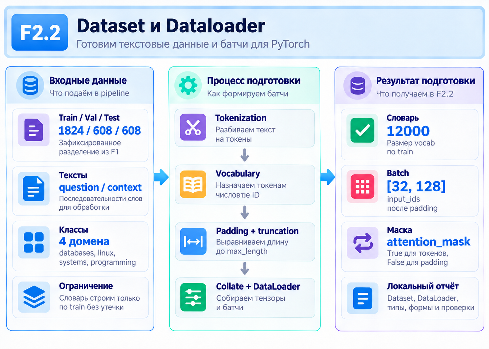
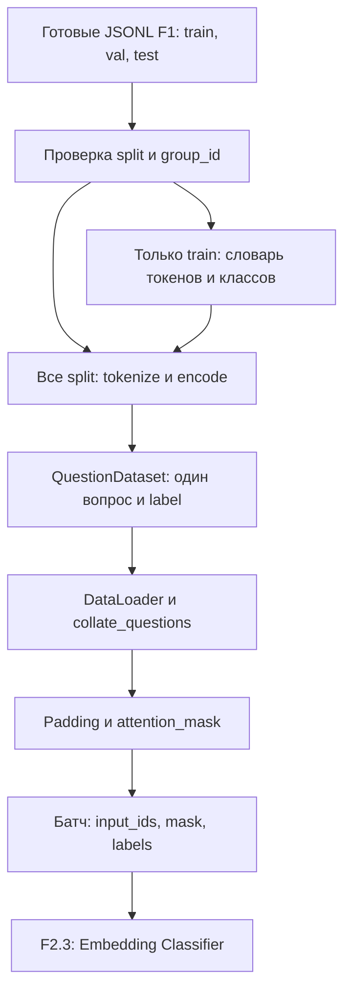

# F2.2 - Dataset и DataLoader: как текст преобразуется в тензоры PyTorch

## 1. Цель этапа:

В Фазе 1 выполнена классификация технических вопросов при помощи `TF-IDF + LogisticRegression`. В F2.1 изучены тензоры и автоматическое вычисление градиентов. Однако между этими результатами оставался важный переход: **как превратить обычный текст в тензоры, которые можно передать собственной нейросети?**

Строку `"Linux: restart service!"` нельзя напрямую подать в математический слой PyTorch. Сначала её нужно разбить на токены, заменить токены числовыми идентификаторами и собрать несколько вопросов в одну матрицу. При этом в исходном наборе вопросы имеют разную длину, а у каждого вопроса есть правильная категория, которую нельзя потерять при подготовке данных.

В исходном наборе F1 содержится **3040 очищенных записей**, распределённых по трём выборкам:

| Выборка | Записей | Для чего нужна |
|---|---:|---|
| `train` | 1824 | Для построения словаря и последующего обучения модели |
| `val` | 608 | Для независимой проверки и выбора модели в следующих этапах |
| `test` | 608 | Для окончательной оценки выбранной модели |

Для классификатора поле `context` используется как входной текст, а поле `domain` - как правильный класс: `databases`, `linux`, `systems` или `programming`. Поля `id`, `group_id` и `split` помогают удостовериться, что примеры не перемешались между выборками. Поле `answer` в модель не передаётся: классифицируется **вопрос**, а не ответ на него.



**Задача F2.2:** реализовать воспроизводимое преобразование **вопрос → токены → ID → Dataset → DataLoader → батч тензоров**, используя словарь и отображение меток, сформированные **только по train**.

**Что должно получиться в конце:** батч с `input_ids`, `attention_mask`, `labels` и `sample_ids`, корректными формами и типами, плюс отдельный CLI-запуск с результатом `F2.2 Dataset/DataLoader CHECK: PASS`.

## 2. Реализация: файлы этапа

В поставку F2.2 включены **шесть файлов**. Основная логика находится в модуле `data_pipeline.py`; демонстрация и тесты проверяют его без запуска обучения.

| Файл | Что реализовано и для чего |
|---|---|
| `src/pytorch_f2/data_pipeline.py` | Реализованы `tokenize()`, `Vocabulary`, `build_vocab()`, `QuestionDataset`, `collate_questions()`, `prepare_data()`, `make_loader()` и чтение готового F1 split. **Это основной рабочий код F2.2.** |
| `scripts/pytorch_batches.py` | Реализован отдельный запуск для проверки pipeline на синтетических примерах либо на локальных JSONL из F1. Скрипт выводит только агрегаты, формы и признаки корректности, не печатает реальные тексты и ID. |
| `tests/test_pytorch_data.py` | Добавлены проверки токенизации, словаря, специальной разметки, обрезки, паддинга, масок, меток классов, порядка выдачи, границ split и CLI. |
| `docs/steps/F2_02_dataset_dataloader.md` | Описаны задача, последовательность разработки, расчёты, проверки и ограничения. Документ используется для технического разбора этапа. |
| `requirements-pytorch-data.txt` | Указан минимальный профиль библиотек для запуска компонента в составе проекта. |
| `.github/workflows/f2-data-pipeline.yml` | Добавлена отдельная CPU-проверка новых тестов, тестов F2.1 и синтетической демонстрации в GitHub Actions. |

**Важно:** F1 split не пересоздавался, размеры выборок не изменялись, Logistic Regression не переобучалась, исходные тексты вопросов не публиковались.

## 3. Последовательность действий

### Шаг 1. Определить контракт входной записи и проверить границы выборок
До обработки токенов необходимо проверить чтение **тех же данных**, которые были подготовлены на F1.6. Функция `read_f1_splits()` читает три существующих файла `train.jsonl`, `val.jsonl` и `test.jsonl` из `data/processed/`, не создавая нового разбиения.

Затем `validate_splits()` проверяет, что:
1. Присутствуют ровно три непустые части: `train`, `val`, `test`.
2. У каждой записи заполнены `id`, `context`, `domain`, `group_id`, `split`.
3. У каждой записи правильное значение `split`, соответствующее файлу.
4. Один и тот же `id` не встречается повторно.
5. Один и тот же `group_id` не оказался в разных частях.
6. Все классы из validation/test уже известны по train, а в train не менее двух классов.

Например, если два близких вопроса имеют одинаковый `group_id`, нельзя помещать один в train, а второй в test: модель могла бы получить преимущество за счёт почти дублирующейся формулировки.

**Зачем:** иначе последующие метрики могут выглядеть лучше действительного качества модели. Проверка отсутствия одинаковых групп снижает риск утечки, но сама по себе не гарантирует, что в корпусе нет любых смысловых дубликатов.

### Шаг 2. Создать простой детерминированный токенизатор
Функция `tokenize(text)` нормализует регистр через `casefold()`, затем выделяет Unicode-слова и отдельные знаки пунктуации регулярным выражением `\w+|[^\w\s]`.

На синтетическом примере это выглядит так:
```text
Исходный вопрос: "Linux: restart service!"
После tokenize: ["linux", ":", "restart", "service", "!"]
```

Одинаковый текст всегда даст одинаковые токены. При этом **BPE, SentencePiece и токенизатор большой языковой модели не реализованы**. Здесь достаточно простой word-level токенизации, чтобы вручную проследить дальнейшие преобразования.

**Зачем:** нейросети нужны не исходные строки, а воспроизводимая последовательность единиц текста, которым можно назначить числовые ID.

### Шаг 3. Построить словарь исключительно по train
Токенизатор сам по себе ещё не знает числовых ID. Эту задачу решает `build_vocab()`: функция проходит **только по вопросам train**, считает частоты токенов и создаёт отображение `токен → ID`.

Сначала резервируются специальные позиции:

| ID | Токен | Зачем нужен |
|---:|---|---|
| `0` | `<PAD>` | Заполняет пустые позиции при выравнивании батча |
| `1` | `<UNK>` | Заменяет токен, которого нет в train-словаре |
| `2` | `<BOS>` | Обозначает начало последовательности |
| `3` | `<EOS>` | Обозначает конец последовательности |

Далее токены сортируются по убыванию частоты. При одинаковой частоте используется алфавитный порядок. Благодаря этому словарь не зависит от случайной перестановки строк train. Его размер ограничен `max_vocab_size=12000`, **включая четыре служебных токена**.

Частоту токена `t` можно описать так:
```math
c(t)=\sum_{x\in D_{train}}\sum_{w\in tokenize(x)}\mathbf{1}[w=t].
```

Здесь `1` означает, что очередной токен совпал с `t`, а `0` - что не совпал. Сумма этих индикаторов определяет частоту токена в обучающих вопросах.

**Пример без утечки:** в train есть `"linux service"`, а в validation - `"linux unicorn"`. Если слова `unicorn` нет в train-словаре, при кодировании validation оно получает `1` (`<UNK>`). После чтения validation словарь **не расширяется**.

**Зачем:** словарь - это часть подготовки, которая извлекает информацию из данных. Поэтому его нельзя формировать по validation или test, иначе нарушится независимость отложенных выборок.

### Шаг 4. Превратили токены в ограниченную по длине последовательность ID
Класс `Vocabulary` содержит метод `encode(text, max_length=...)`. Сначала он токенизирует текст, затем заменяет токены на ID и добавляет `<BOS>`/`<EOS>`.

Пусть заранее задано отображение `linux → 4`, `service → 5`, `restart → 6`. Тогда:
```text
"linux restart service"
          ↓
["linux", "restart", "service"]
          ↓
[<BOS>, "linux", "restart", "service", <EOS>]
          ↓
[2, 4, 6, 5, 3]
```

В конфигурации этапа используется `max_length=128`. Это **полная верхняя граница последовательности вместе с `<BOS>` и `<EOS>`**, то есть содержательных токенов может быть не больше 126. Если вопрос длиннее, отбрасываем хвост середины и сохраняем оба граничных токена.

Например, при `max_length=4` результат будет `[2, 4, 6, 3]`: `service` обрезан, но `<EOS>` остаётся на месте.

**Зачем:** модель должна получать последовательности в пределах согласованного размера, а служебные токены позволяют однозначно находить начало и конец текста. Ограничение по длине может отбросить полезные слова длинного вопроса - это сознательное упрощение F2.2.

### Шаг 5. Реализовать Dataset для получения одного примера
После кодирования необходим компонент, возвращающий по номеру записи входные данные и метку класса. Для получения одной записи реализован `QuestionDataset(torch.utils.data.Dataset)`.

Метод `__len__()` сообщает число примеров. Метод `__getitem__(index)` выдаёт словарь:
```python
{
    "input_ids": torch.tensor([2, 4, 6, 5, 3], dtype=torch.long),
    "label": torch.tensor(1, dtype=torch.long),
    "sample_id": "synthetic-example",
}
```

Число `1` здесь - **условный ID класса в учебном примере**, а не реальная метка конкретного вопроса. Фактические ID классов создаёт `prepare_data()` по отсортированным названиям классов из train. Validation/test используют **то же отображение**, без добавления новых классов.

`QuestionDataset` **не делает padding**: отдельные вопросы пока остаются последовательностями разной длины.

**Зачем:** разделили две обязанности. Dataset отвечает за получение *одной* записи, а формирование общей матрицы отдали следующему компоненту.

### Шаг 6. Написать collate-функцию: padding и маски
Предположим, `DataLoader` запросил сразу два примера длиной 4 и 6 токенов. Объединить их в обычный прямоугольный тензор нельзя, пока длины не сравняются.

`collate_questions()` определяет максимальную длину **внутри текущего батча** и заполняет недостающие позиции справа токеном `<PAD>` (`ID=0`):
```text
Вопрос A: [2, 4, 5, 3] -> [2, 4, 5, 3, 0, 0]
Вопрос B: [2, 7, 8, 9, 6, 3] -> [2, 7, 8, 9, 6, 3]

Маска A: [1, 1, 1, 1, 0, 0]
Маска B: [1, 1, 1, 1, 1, 1]
```

Здесь `1`/`True` в маске означает **настоящий токен**, включая `<BOS>` и `<EOS>`, а `0`/`False` - позицию padding. В результате функция возвращает четыре поля:

| Поле | Форма | Тип | Содержимое |
|---|---|---|---|
| `input_ids` | `[B, L]` | `torch.int64` | ID токенов, дополненные нулями |
| `attention_mask` | `[B, L]` | `torch.bool` | Какие позиции принадлежат настоящему тексту |
| `labels` | `[B]` | `torch.int64` | Правильный класс каждого примера |
| `sample_ids` | `B` строк | `list[str]` | Соответствие исходным записям в памяти |

`B` - число записей в текущем батче; `L` - максимальная **фактическая** длина в нём. Всегда `L ≤ max_length`, но **не обязательно `L=128`**. Именно поэтому один батч может иметь форму `[32, 18]`, а другой - `[32, 128]`. При последнем неполном батче `B` тоже может быть меньше 32.

**Зачем:** маска понадобится в F2.3 для *masked mean pooling*, чтобы при усреднении векторов модель не учитывала добавленные нули. На F2.2 это ещё **не механизм Self-Attention**, а обозначение существующих позиций.

### Шаг 7. Настроить DataLoader и воспроизводимость
Функция `make_loader()` связывает `QuestionDataset` и `collate_questions()` с `torch.utils.data.DataLoader`.

По умолчанию установлены `batch_size=32` и `num_workers=0`; последний параметр упрощает запуск на Windows. Для перемешивания train задан отдельный `torch.Generator(seed=42)`. При тех же данных и seed повторный DataLoader выдаёт тот же порядок примеров, не меняя глобальное состояние генератора случайных чисел.

Для validation и test перемешивание обычно отключают: важно сопоставлять результаты с исходными записями в известном порядке.

**Зачем:** DataLoader снимает с будущего training loop задачу вручную выбирать 32 вопроса, дополнять их, создавать маски и передавать правильные метки.

### Шаг 8. Добавить демонстрацию без обучения и проверки на ошибочные данные
В `scripts/pytorch_batches.py` предусмотрены два режима:
- **Синтетический:** несколько придуманных вопросов в памяти, для проверки логики без локального датасета.
- **Локальный F1:** чтение существующих JSONL, подготовка общего словаря и Dataset для train/val/test, получение одного train-батча.

Оба режима возвращают агрегированный JSON: размеры split, размер словаря, число классов, форму батча, типы тензоров, число отложенных вопросов, содержащих `<UNK>`, и `batch_invariants_pass`.

Тесты отдельно проверяют, что неверные типы, пустые данные, повторяющиеся ID, пересечение групп, неизвестные классы, повреждённый словарь или ошибочная форма последовательности не проходят незамеченными.

**Результат реализации:** F2.2 стал самостоятельным, воспроизводимым компонентом подготовки данных. Для проверки работы Dataset и DataLoader обучение классификатора не требуется.

## 4. Алгоритм обработки: путь одного текста до готового батча

Проследим полный путь синтетического вопроса `"Linux: restart service!"`.

**Действие 1 - токенизация.** После `casefold()` и регулярного выражения получается `['linux', ':', 'restart', 'service', '!']`.

**Действие 2 - словарь.** Для каждого токена находим ID в **train-словаре**. Если какого-то токена нет — записываем `UNK_ID=1` без изменения словаря.

**Действие 3 - ограничение длины.** Добавляются `BOS_ID=2` и `EOS_ID=3`, сохраняется только столько содержательных токенов, сколько разрешает `max_length`.

**Действие 4 - Dataset.** Формируется одномерный тензор `input_ids` и скалярную метку `label`. Дополнительные нули на этапе Dataset отсутствуют.

**Действие 5 - DataLoader + collate.** Для группы примеров длина `L` определяется по самому длинному вопросу в батче, короткие последовательности дополняются `PAD_ID=0` и формируется `attention_mask`.

**Действие 6 - проверка инвариантов.** Убеждаемся, что формы `input_ids` и `attention_mask` совпадают, `labels` имеет длину `B`, типы правильные, а позиции с `PAD_ID` соответствуют `False` в маске.

В краткой форме ключевая проверка выглядит так:
```math
\mathrm{mask}_{i,j}=\begin{cases}
\mathrm{True}, & j<\ell_i,\\
\mathrm{False}, & j\geq\ell_i,
\end{cases}
```


где `ℓᵢ` - действительная длина закодированного вопроса `i` в батче. Важно, что `<BOS>` и `<EOS>` входят в `ℓᵢ`, а добавленные `<PAD>` - нет.

На выходе получается представление, который F2.3 сможет подать в Embedding-слой: целочисленные ID и маску позиций; метки классов пригодятся позже при обучении F2.4.

## 5. Схема: связь F1, F2.2 и будущего классификатора



**Главное на этой схеме:** **информация для словаря берётся только из train**, но уже готовые правила кодирования применяются одинаково ко всем трём частям. Padding выполняется только при сборке батча - не при создании Dataset.

## 6. Локальная проверка в PowerShell: что запускать и как читать результат

Ниже - команды для **уже существующего проекта** на Windows. Они не устанавливают библиотеки, не изменяют Git и не обучают нейросеть.

### 6.1. Перейти в проект
```powershell
cd F:\DEVELOPMENT\ML\ml-engineering-lab
```

### 6.2. Запустить тесты F2.2
```powershell
.\.venv\Scripts\python.exe -m pytest tests/test_pytorch_data.py -q
```

**Что проверяется:** нормализацию Unicode-текста, специальные ID, построение словаря только по train, обрезку с сохранением границ, Dataset, динамический padding, маску, частичные батчи, воспроизводимое перемешивание, защиту от утечек и CLI.

**Исторический результат проверки на Windows при завершении F2.2:** `48 passed`. Если тестовый файл позднее менялся, ориентир - фактический вывод.

### 6.3. Посмотреть пример без реального датасета
```powershell
.\.venv\Scripts\python.exe -m scripts.pytorch_batches --synthetic --check
```

**Ключевые строки из подтверждённого вывода:**
```text
"source": "synthetic"
"split_counts": {"train": 4, "val": 1, "test": 1}
"vocab_size": 11
"class_count": 2
"batch_shape": [4, 5]
"input_dtype": "torch.int64"
"mask_dtype": "torch.bool"
"label_dtype": "torch.int64"
"heldout_questions_with_unk": 2
"batch_invariants_pass": true
F2.2 Dataset/DataLoader CHECK: PASS
```

**Интерпретация:** четыре обучающих примера собраны в матрицу `[4, 5]`. В validation/test встретились неизвестные train-словарю токены - они заменились на `<UNK>`. Формы, типы и маски прошли проверку.

### 6.4. Проверить уже подготовленный split F1
```powershell
.\.venv\Scripts\python.exe -m scripts.pytorch_batches --expect-train 1824 --expect-val 608 --expect-test 608 --check
```

**Подтверждённый на Windows результат при выполнении F2.2:**
```text
"source": "local_f1_split"
"split_counts": {"train": 1824, "val": 608, "test": 608}
"vocab_size": 12000
"class_count": 4
"batch_shape": [32, 128]
"input_dtype": "torch.int64"
"mask_dtype": "torch.bool"
"label_dtype": "torch.int64"
"heldout_questions_with_unk": 1103
"batch_invariants_pass": true
F2.2 Dataset/DataLoader CHECK: PASS
```

Размер `[32, 128]` получен **для первого батча этого конкретного запуска**; он не означает, что каждый батч обязательно имеет длину 128. `1103` - количество вопросов из `val` и `test`, в которых встретился **хотя бы один** `<UNK>` после ограничения длины. Это не 1103 потерянных вопросов и не число неизвестных токенов.

Скрипт не печатает реальные тексты или `sample_id` и не сохраняет датасет в публичные артефакты.

### 6.5. Проверить регрессию проекта
```powershell
.\.venv\Scripts\python.exe -m pytest -q
```

При первоначальном завершении F2.2 на Windows было `253 passed` (205 предыдущих + 48 новых). После всей Фазы 2 - `528 passed`; с появлением Фазы 3 тестов стало больше. **Важно отсутствие `failed`/`errors`, а не совпадение с историческим числом.**

## 7. Что подтверждено и какие ограничения

**Подтверждено тестами и запусками:** существующие split F1 читаются без повторного разделения; токенизация воспроизводима; словарь и классы определяются только по train; отложенные выборки не меняют их; последовательности имеют корректные граничные токены; padding и маски согласованы; формы и типы выходных тензоров подходят для дальнейшего классификатора; порядок перемешивания воспроизводим.

**Ограничения:** токенизатор разделяет слова и пунктуацию, не использует subword-единицы; редкие и невиданные токены превращаются в `<UNK>`; длинные вопросы обрезаются; наличие `group_id` снижает риск утечки между split, но не гарантирует выявление всех близких по смыслу вопросов. Эти ограничения не делают pipeline неверным - они задают границы учебной реализации.

## 8. Основная мысль раздела

**В F2.2 реализован воспроизводимый переход от текстов F1 к тензорам PyTorch.** Проверена неизменность train/validation/test, создана детерминированная word-level токенизация, построен словарь только по обучающей выборке и определено отображение категорий в номера классов. `QuestionDataset` выдаёт отдельные кодированные вопросы; `DataLoader` с `collate_questions()` собирает батчи, динамически добавляет `<PAD>` и строит булеву маску действительных позиций. Подтверждены корректность входного контракта, защита от очевидной утечки данных и воспроизводимость порядка train-батчей. **Обучение модели и измерение качества классификации в F2.2 не выполняются.**

## 9. Файлы этапа

Для изучения рекомендуется идти **от запуска к коду подготовки и затем к тестам**.

| Порядок | Файл | На что смотреть в коде |
|---|---|---|
| 1 | `scripts/pytorch_batches.py` | `synthetic_splits()` и `run()`: откуда берутся примеры, как запускаются `prepare_data()`/`make_loader()`, какие агрегаты выводятся без раскрытия текстов. |
| 2 | `src/pytorch_f2/data_pipeline.py` | `read_f1_splits()` и `validate_splits()`: чтение готовых JSONL, проверка полей, ID, group_id и набора классов. |
| 3 | `src/pytorch_f2/data_pipeline.py` | `tokenize()`: `casefold()`, Unicode-регулярное выражение и обработка пустого/неверного текста. |
| 4 | `src/pytorch_f2/data_pipeline.py` | `build_vocab()`, `Vocabulary.__post_init__()` и `encode()`: частоты train, порядок ID, служебные токены, `<UNK>`, сохранение BOS/EOS при обрезке. |
| 5 | `src/pytorch_f2/data_pipeline.py` | `QuestionDataset.__len__()` и `__getitem__()`: перевод одной записи в `input_ids`, `label`, `sample_id` без padding. |
| 6 | `src/pytorch_f2/data_pipeline.py` | `collate_questions()`: матрица PAD, булева маска, формы тензоров и проверка соответствия последовательностей меткам. |
| 7 | `src/pytorch_f2/data_pipeline.py` | `prepare_data()` и `make_loader()`: единые отображения для трёх Dataset, batch size, seed, shuffle и `num_workers=0`. |
| 8 | `tests/test_pytorch_data.py` | Проверки детерминизма, leakage, повреждённых данных, типов/форм, padding и CLI; отдельно посмотри тесты на частичный последний батч. |
| 9 | `src/pytorch_f2/embedding_classifier.py` | Следующий этап F2.3: как `input_ids` и `attention_mask` используются в `nn.Embedding` и masked pooling. **Этот файл не создавался и не изменялся в F2.2.** |

**Итог F2.2:** реализован проверяемый pipeline преобразования текстовых записей F1 в числовые батчи PyTorch. Разбиение train/validation/test сохранено без изменений.
