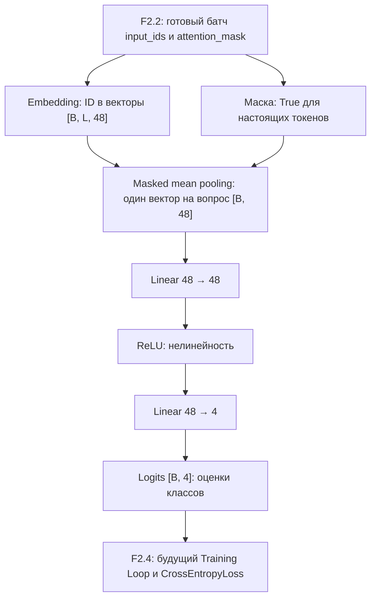

# F2.3 - Embedding Classifier: построение и проверка нейросетевой архитектуры

## 1. Цель этапа:

В Фазе 1 решена задача классификации технических вопросов готовым алгоритмом `TF-IDF + LogisticRegression`. В F2.1 изучены тензоры и Autograd, а в F2.2 реализован pipeline преобразования вопросов в числовые идентификаторы токенов с формированием батчей и масок.

Но **DataLoader сам не классифицирует вопросы**. Например, он может вернуть матрицу `input_ids` формы `[32, 128]`, где каждая строка содержит числовое представление одного вопроса. Эти числа ещё не являются понятным модели представлением текста, а сами по себе ID не показывают, к какому классу относится вопрос.

Потребовалась собственная нейросеть, которая последовательно:
1. Получает числовые ID токенов и маску настоящих позиций.
2. Заменяет каждый ID обучаемым вектором чисел.
3. Объединяет векторы токенов в **один вектор вопроса**, исключив padding.
4. Преобразует этот вектор в оценки классов: `databases`, `linux`, `systems`, `programming`.


Задача F2.3 - реализовать эти вычисления **с помощью слоёв PyTorch**, проверить их численно и убедиться, что выход можно будет использовать в дальнейшем обучении.

**Что должно получиться в конце:** модуль `EmbeddingClassifier(nn.Module)`, принимающий `input_ids` и `attention_mask` и возвращающий `logits` формы `[B, C]`, где `B` - число вопросов, а `C` - число классов. Для реального корпуса F1 ожидается `C=4`.

На этом шаге модель **ещё не знает**, какие параметры дают хорошую классификацию: её веса первоначально случайны. Проверяется **правильность архитектуры и вычислений**, а не качество предсказаний.

## 2. Реализация: файлы этапа

В поставку F2.3 входили **шесть новых файлов**. Они добавлялись отдельно от уже существующих исходников F1, F2.1 и F2.2.

| Файл | Что реализовано и для чего |
|---|---|
| `src/pytorch_f2/embedding_classifier.py` | Реализованы класс `EmbeddingClassifier(nn.Module)`, функция `masked_mean_pool()` и проверка входных тензоров. Это **основной рабочий код этапа**. |
| `scripts/pytorch_classifier.py` | Создана самостоятельная демонстрация прямого прохода на синтетических либо локальных F1-данных. Скрипт показывает формы, количество параметров и результаты проверок без обучения и без вывода текста вопросов. |
| `tests/test_embedding_classifier.py` | Добавлены синтетические тесты архитектуры, точности вычислений, masking, градиентов, неверных входов, повторяемости и совместимости с DataLoader F2.2. |
| `docs/steps/F2_03_embedding_classifier.md` | Описаны инженерная задача, архитектура, вычисления, ограничения и способы проверки. Это текущий учебный материал. |
| `requirements-pytorch-model.txt` | Определён профиль зависимостей для запуска модели и тестов. |
| `.github/workflows/f2-embedding-classifier.yml` | Добавлена лёгкая CPU-проверка, в которой не требуется реальный датасет и не выполняется полное обучение. |

**Граница этапа:** `src/pytorch_f2/data_pipeline.py` - уже существующий файл F2.2, который подаёт модели готовые батчи. Файлы вроде `models/neural.pt` или `reports/neural.json` **не являются результатом F2.3**: на F2.3 не сохраняются обученные веса и не рассчитываются метрики качества.

## 3. Последовательность действий

### Шаг 1. Согласовать интерфейс модели с батчем F2.2
В F2.3 сохранён контракт батча, определённый в F2.2 для `DataLoader`:

| Поле батча | Форма | Тип | Назначение |
|---|---|---|---|
| `input_ids` | `[B, L]` | `torch.int64` (`torch.long`) | ID токенов для каждого вопроса |
| `attention_mask` | `[B, L]` | `torch.bool` | `True` для настоящих позиций, `False` для `<PAD>` |
| `labels` | `[B]` | `torch.int64` | Правильные категории вопросов |
| `sample_ids` | список длины `B` | `list[str]` | Соответствие записям при дальнейшей оценке |

**В F2.3 метод `forward()` использует только `input_ids` и `attention_mask`.** Метки `labels` пока не нужны: расчёт потерь и сопоставление с правильными метками реализуются в F2.4.

Здесь `B` - число вопросов в батче, а `L` - максимальная фактическая длина последовательности в текущем батче после padding. В проекте `B ≤ 32` и `L ≤ 128`; оба значения могут быть меньше, например в последнем батче.

**Зачем этот шаг:** согласованный интерфейс позволяет передавать данные из F2.2 в F2.3 без нового токенизатора, ручной перекладки массивов или изменения train/validation/test.

### Шаг 2. Создать класс нейросети на `torch.nn.Module`
В `src/pytorch_f2/embedding_classifier.py` создан класс `EmbeddingClassifier(nn.Module)`. Он принимает четыре параметра архитектуры:
- `vocab_size` - фактическое число ID в словаре F2.2;
- `num_classes` - число тематических классов;
- `embedding_dim` - длина вектора одного токена;
- `hidden_dim` - ширина скрытого слоя классификатора.

В проектном запуске используются `embedding_dim=48`, `hidden_dim=48`; фактический словарь F2.2 содержал `12000` ID, число классов - `4`.

Созданы четыре компонента:
```python
self.embedding = nn.Embedding(vocab_size, embedding_dim, padding_idx=PAD_ID)
self.hidden = nn.Linear(embedding_dim, hidden_dim)
self.activation = nn.ReLU()
self.output = nn.Linear(hidden_dim, num_classes)
```

**Зачем:** `nn.Module` объединяет все обучаемые параметры в одну модель и позволяет PyTorch отслеживать вычисления. На F2.3 выполняется создание слоёв и их прямой проход; сам процесс изменения их весов будет реализован в F2.4.

### Шаг 3. Преобразовать ID токенов в векторы с помощью Embedding
Числовой ID - это **номер**, а не характеристика смысла слова. Если одному токену назначен ID `4`, а другому `100`, это не означает, что второй в 25 раз «больше» или отличается по смыслу сильнее.

Слой `nn.Embedding` хранит таблицу `E` формы `[V, D]`, где `V` - размер словаря и `D` - длина вектора. Обращение к строке `E[i]` по ID `i` возвращает вектор соответствующего токена.

Для реального запуска таблица имеет размер `[12000, 48]`. Поэтому батч `[32, 128]` после Embedding становится тензором `[32, 128, 48]`: теперь **каждому токену соответствуют 48 чисел**.

**Зачем:** в будущем обучение сможет подбирать эти числа под задачу классификации. На F2.3 векторы пока только инициализированы - их нельзя интерпретировать как заранее выученные значения слов.

### Шаг 4. Собрать один вектор вопроса через Masked Mean Pooling
После Embedding у каждого вопроса есть **несколько векторов** - по одному на позицию. А обычному классификатору нужен **один вектор для всего текста**.

Реализована отдельная функция `masked_mean_pool(embeddings, attention_mask)`. Она:
1. Проверяет форму входа `[B, L, D]` и маски `[B, L]`.
2. Исключает позиции, у которых маска равна `False`.
3. Складывает векторы настоящих токенов.
4. Делит сумму **на число настоящих токенов**, а не на длину дополненного батча.

Например, заданы три действительных токена с векторами `[2,0]`, `[4,0]`, `[0,2]` и один `PAD`. Средний вектор составит:
```math
\frac{[2,0]+[4,0]+[0,2]}{3}=[2,\;2/3].
```

При ошибочном делении на четыре позиции получилось бы `[1.5, 0.5]`. Это **неправильное усреднение**: наличие искусственного padding изменило бы представление вопроса.

В коде маскированные позиции обнуляются **до** суммирования через `masked_fill`, поэтому их значения не влияют на выход даже при искусственно изменённом векторе `<PAD>`.

**Зачем:** разные вопросы могут иметь разную длину, но количество добавленных нулей не должно менять смысл вычисленного представления текста.

### Шаг 5. Добавить два линейных слоя и ReLU
Теперь каждому вопросу соответствует один вектор длины `D`. Для преобразования вектора вопроса реализована «голова классификации»:
```text
Вектор вопроса [D]
        ↓
Linear(D → H)
        ↓
ReLU
        ↓
Linear(H → C)
        ↓
Оценки классов (logits) [C]
```

Первый `Linear` создаёт скрытое представление. `ReLU` оставляет положительные компоненты и обнуляет отрицательные. Благодаря этой нелинейности два слоя не сводятся к одному линейному преобразованию.

Второй `Linear` выдаёт **одно число на класс**. Для исходного корпуса это четыре оценки. Они называются `logits`, **но пока не являются вероятностями**.

**Почему здесь нет Softmax:** в F2.4 для обучения будет использоваться `CrossEntropyLoss`, которая принимает исходные logits и сама выполняет необходимые вычисления в численно устойчивой форме. В F2.3 достаточно проверить формы и значения logits.

### Шаг 6. Реализовать `forward()` и проверки неправильных входов
Метод `forward(input_ids, attention_mask)` связывает компоненты в одну цепочку:
```python
token_vectors = self.embedding(input_ids)
question_vectors = masked_mean_pool(token_vectors, attention_mask)
hidden_vectors = self.activation(self.hidden(question_vectors))
return self.output(hidden_vectors)
```

В реальном модуле перед расчётом предусмотрены проверки:
- `input_ids` - двумерный `torch.long`, с непустым батчем и длиной хотя бы две позиции;
- `attention_mask` - булева матрица точно такой же формы;
- ID токенов лежат внутри диапазона `[0, vocab_size)`;
- маска и `input_ids` находятся на одном устройстве;
- нулевой `PAD_ID` совпадает **строго** с позициями, где маска `False`;
- padding расположен справа, без настоящих токенов после фиктивных;
- каждая строка содержит хотя бы один настоящий токен.

При нарушении контракта выбрасывается `ModelInputError`, вместо того чтобы незаметно выполнить некорректное вычисление.

**Зачем:** модель должна либо выдавать правильный по форме результат, либо ясно сообщать о некорректном входе. Особенно важно не принять padding за содержательный токен.

### Шаг 7. Создать демонстрацию с синтетическим и локальным режимами
В `scripts/pytorch_classifier.py` предусмотрен самостоятельный запуск. Он использует `prepare_data()` и `make_loader()` из F2.2, создаёт `EmbeddingClassifier` под **фактический** словарь и число классов, затем выполняет один прямой проход.

Два режима имеют разное назначение:
- **Синтетический:** четыре придуманных train-примера, по одному val и test, 11 ID словаря и 2 класса. Режим не требует реального датасета.
- **Локальный F1:** готовое разделение 1824/608/608, конфигурацию `configs/local_cpu/lab.yaml` и модель с четырьмя выходами.

В обоих режимах проверяется, что выход конечен, форма совпадает с ожиданием, дополнительные PAD не меняют logits, а повторный forward с теми же весами даёт те же числа.

Инициализация выполняется под фиксированным `seed` внутри `torch.random.fork_rng(...)`, чтобы сам демонстрационный запуск не изменял глобальное состояние случайного генератора вызывающей программы. Для проверки используется `model.eval()` и `torch.no_grad()`, поскольку необходимы **значения прямого прохода без вычисления градиентов и обучения**.

**Зачем:** увидеть настоящие входы и выходы модели в воспроизводимом запуске, не смешивая проверку архитектуры с будущим training loop.

### Шаг 8. Написать тесты математической корректности и границ архитектуры
В `tests/test_embedding_classifier.py` проверяются не только «код запускается», но и поведение отдельных операций:
- правильные типы слоёв `nn.Embedding`, `nn.Linear` и `nn.ReLU`;
- формы `[B, L, D]`, `[B, D]`, `[B, C]`, включая случай `B=1`;
- точный расчёт числа параметров и logits для вручную заданных весов;
- независимость результата от добавления PAD справа и от состава соседних примеров батча;
- нулевой градиент по маскированным позициям и PAD-строке embedding;
- наличие градиентов у обучаемых весов при тестовом `backward()`;
- ошибки при неверных типах, формах, ID, масках или параметрах модели;
- детерминированность и совместимость с DataLoader из F2.2.

Проверка градиентов здесь **не означает полноценное обучение**: тестовый `backward()` только показывает, что будущий оптимизатор сможет получать необходимые производные. Он не запускает тренировочные эпохи и не измеряет качество классификации.

**Результат реализации:** F2.3 стал проверяемым нейросетевым компонентом, который можно непосредственно подключить к циклу обучения F2.4.

## 4. Алгоритм Embedding Classifier: вычисления одного `forward()`

Последовательность одного вызова от `input_ids` до `logits` и одновременно разберём математику.
### 4.1. Векторизовать токены
Входная матрица ID как `I` формы `[B, L]`, таблицу embeddings - `E` формы `[V, D]`. Для токена на позиции `j` вопроса `i` выбирается строка:
```math
X_{i,j,:}=E[I_{i,j}].
```
На выходе `X` имеет форму `[B, L, D]`. Для полного батча при настройках проекта: `[32, 128, 48]`.

### 4.2. Усреднить только настоящие позиции
Пусть `Mᵢⱼ` равно 1 для настоящего токена и 0 для padding. Тогда вектор вопроса вычисляется так:
```math
P_i=\frac{\sum_{j=1}^{L}M_{i,j}X_{i,j,:}}{\sum_{j=1}^{L}M_{i,j}}.
```
В знаменателе **число разрешённых позиций**, включая `<BOS>` и `<EOS>`. Для каждого вопроса получается один вектор длины `D`, то есть `P` формы `[B, D]`.

#### Проверка на конкретных числах

Взять заранее заданные векторы (не обученные моделью):

| Токен | ID | Embedding |
|---|---:|---|
| `<BOS>` | 2 | `[2, 0]` |
| `слово` | 4 | `[4, 0]` |
| `<EOS>` | 3 | `[0, 2]` |
| `<PAD>` | 0 | `[0, 0]` |

Пусть `input_ids = [2,4,3,0]`, `attention_mask = [True, True, True, False]`. Тогда:
```math
P=\frac{[2,0]+[4,0]+[0,2]}{3}=[2,\;0.6667].
```

Если добавить ещё три `<PAD>`, числитель и знаменатель останутся теми же. **Итоговый вектор не изменится.**

### 4.3. Преобразовать вектор вопроса скрытым слоем
Первый линейный слой и активация:
```math
H=\operatorname{ReLU}(PW_1^T+b_1).
```
Здесь `W₁` имеет форму `[Hdim, D]`, `b₁` - `[Hdim]`, а выход - `[B, Hdim]`. При `D=48`, `Hdim=48` форма остаётся `[32, 48]`.

Функция ReLU применяется к каждому элементу:
```math
\operatorname{ReLU}(z)=\max(0,z).
```
Она даёт модели нелинейность, но сама не содержит обучаемых параметров.

### 4.4. Вычисление оценок классов
Последний линейный слой:
```math
Z=HW_2^T+b_2,
```
где `W₂` имеет форму `[C, Hdim]`, а `Z` - `[B, C]`. Для четырёх классов формируется `[32, 4]`.

**Числовой эталон из тестов:** матрицы `W₁` и `W₂` заданы как единичные матрицы размера 2 × 2, с нулевыми смещениями. После ReLU на неотрицательных числах результат не меняется, поэтому для последовательности `[BOS, слово, EOS]` logits равны `[2, 2/3]`. Для `[BOS, EOS]` они равны `[1, 1]`. Так тест сравнивает реальный `forward()` не с другим случайным расчётом, а с заранее известным ответом.

Класс с максимальным logit можно найти через `argmax`. **Но до обучения этот выбор не доказывает, что модель правильно классифицирует текст.**

### 4.5. Сколько параметров содержит модель
Число обучаемых параметров определяется архитектурой:
```math
N=VD+(DHdim+Hdim)+(Hdim\cdot C+C).
```
Для реального словаря `V=12000`, `D=48`, `Hdim=48`, `C=4`:

| Компонент | Параметры |
|---|---:|
| Embedding: `12000 × 48` | 576 000 |
| Первый Linear: `48 × 48 + 48` | 2 352 |
| Второй Linear: `48 × 4 + 4` | 196 |
| **Всего** | **578 548** |

Это **количество параметров архитектуры**, а не количество уже выученных «знаний». В синтетическом режиме `V=11` и `C=2`, при тех же `D=Hdim=48` получается **2 978 параметров**.

## 5. Схема: как F2.2 связан с моделью F2.3



**Главное на схеме:** сначала каждому токену сопоставляем вектор, затем маской исключаем padding и формируем один вектор текста, после чего вычисляем четыре оценки классов. **F2.3 заканчивается на logits**: стрелка к F2.4 показывает следующее применение архитектуры, а не обучение внутри этого этапа.

## 6. Локальная проверка в PowerShell: что запускать и как читать результат
Команды предназначены для уже созданного проекта Windows. Они **не устанавливают пакеты, не меняют Git, не переобучают классификатор и не сохраняют новые веса**.

### 6.1. Перейти в корень проекта
```powershell
cd F:\DEVELOPMENT\ML\ml-engineering-lab
```

### 6.2. Проверить отдельно F2.3
```powershell
.\.venv\Scripts\python.exe -m pytest tests/test_embedding_classifier.py -q
```

**Что проверяется:** структуру модели, ручной числовой эталон, размеры logits, padding, градиенты, некорректные входы, повторяемость и интеграцию с Dataset/DataLoader.

**Подтверждённый на Windows результат при завершении F2.3:** `56 passed`. Это число относится **только к тестам F2.3**. Если файл тестов позже менялся, нужно ориентироваться на фактический вывод.

### 6.3. Выполнить наглядный запуск на синтетических данных
```powershell
.\.venv\Scripts\python.exe -m scripts.pytorch_classifier --synthetic --check
```

Скрипт создаёт маленький словарь и модель с двумя классами. Ключевые поля ожидаемого отчёта:
```json
{
  "source": "synthetic",
  "split_counts": {"train": 4, "val": 1, "test": 1},
  "vocab_size": 11,
  "class_count": 2,
  "batch_shape": [4, 5],
  "embedding_dim": 48,
  "hidden_dim": 48,
  "logits_shape": [4, 2],
  "parameter_count": 2978,
  "padding_invariant": true,
  "repeatable_forward": true,
  "forward_invariants_pass": true,
  "trained": false
}
```

В конце должен появиться статус:
```text
F2.3 Embedding Classifier CHECK: PASS
```

**Как читать этот результат:** четыре вопроса представлены батчем `[4,5]`, а модель выдаёт по две оценки на вопрос - `[4,2]`. `padding_invariant=true` показывает, что добавление фиктивных позиций не изменило выходы. `trained=false` подтверждает, что **обучение не выполнялось**. JSON выше показывает важные поля; фактический CLI также выводит дополнительные значения.

### 6.4. Проверить совместимость с настоящим split F1
```powershell
.\.venv\Scripts\python.exe -m scripts.pytorch_classifier --expect-train 1824 --expect-val 608 --expect-test 608 --check
```

При сохранённой конфигурации F2 ожидается:

| Поле | Ожидаемое значение | Почему |
|---|---|---|
| `source` | `local_f1_split` | Используются локальные JSONL из F1 |
| `split_counts` | `1824 / 608 / 608` | Исходный F1 split не меняется |
| `vocab_size` | `12000` | Фактический словарь, подтверждённый на F2.2 |
| `class_count` | `4` | Четыре тематические категории |
| `batch_shape` | `[32, 128]` | Первый батч в ранее проверенной конфигурации F2.2 |
| `logits_shape` | `[32, 4]` | Четыре logits для каждого вопроса |
| `parameter_count` | `578548` | Сумма параметров Embedding и Linear-слоёв |
| `forward_invariants_pass` | `true` | Формы, конечные числа, masking и повторяемость |
| `trained` | `false` | Только прямой проход |

Форма `[32,128]` **не обязана** получаться для всех батчей: F2.2 дополняет последовательности до максимальной фактической длины *текущего* батча. Числа из таблицы - ожидаемые по сохранённым настройкам F2.2 и архитектуре, а не измерение качества классификации.

Скрипт не печатает исходные вопросы или `sample_ids`; данные остаются локальными.

### 6.5. Запустить полную регрессию репозитория
```powershell
.\.venv\Scripts\python.exe -m pytest -q
```

**Исторически подтверждённый результат Windows на момент завершения F2.3:** `309 passed` (253 предыдущих теста + 56 новых). После завершения всей Фазы 2 набор вырос до `528 passed`; в более поздней Фазе 3 тестов стало ещё больше. Критерий успеха - **отсутствие `failed` и `errors`**, а не соответствие старому числу.

## 7. Что подтверждено и какие ограничения

**Подтверждено архитектурными и числовыми тестами:** класс содержит Embedding, два Linear-слоя и ReLU; размерности согласованы с батчами F2.2; masked pooling исключает фиктивные позиции; вручную заданные веса дают ожидаемые logits; `backward()` может передавать градиенты через модель; неправильные входы отклоняются; демонстрация воспроизводима.

**Ограничения архитектуры:**
- **Mean pooling теряет порядок содержательных токенов.** Перестановка слов при тех же embedding-векторах не изменяет их среднее. В этой архитектуре нет собственного механизма позиционного кодирования.
- Усреднение даёт каждому настоящему токену одинаковый коэффициент при формировании вектора вопроса. Модель не вычисляет контекстное внимание между словами.
- Векторный размер `48` и один скрытый слой выбраны для небольшой учебной CPU-модели, а не как доказанно оптимальная архитектура.
- Векторы токенов до обучения случайно инициализированы. Качество можно оценить только после F2.4–F2.5 на данных, не участвующих в настройке.

Эти ограничения не являются дефектами F2.3: задача этапа - создать **простую, прозрачную и проверяемую** модель как основу дальнейшего обучения.

## 8. Основная мысль раздела

**В F2.3 реализована и проверена архитектура `EmbeddingClassifier`.** Входные ID преобразуются в обучаемые векторы; `masked_mean_pool()` агрегирует только действительные позиции; последовательность `Linear → ReLU → Linear` выдаёт по одному logit на каждый класс. Проверены математические операции, размерности, исключение padding, совместимость с DataLoader, дифференцируемость и воспроизводимость. **Наличие корректного `forward()` ещё не означает обученную модель:** оптимизация весов, функция потерь и оценка качества относятся к последующим этапам. Простое усреднение токенов не моделирует порядок слов и контекстные связи между позициями.

## 9. Файлы этапа

Изучать лучше **от демонстрационного запуска к отдельным слоям, проверкам и тестам**, сопоставляя каждое действие с вычислительной схемой выше.

| Порядок | Файл | На что смотреть в коде |
|---|---|---|
| 1 | `scripts/pytorch_classifier.py` | `run()`: вызовы `prepare_data()`/`make_loader()`, сбор батча, создание модели, запуск `model(input_ids, mask)` и проверка результатов без обучения. |
| 2 | `src/pytorch_f2/embedding_classifier.py` | `EmbeddingClassifier.__init__()`: четыре параметра архитектуры, слои `nn.Embedding`, `nn.Linear`, `nn.ReLU`, `padding_idx=PAD_ID`. |
| 3 | `src/pytorch_f2/embedding_classifier.py` | `masked_mean_pool()`: `masked_fill`, суммирование по оси токенов, деление на число `True` в маске; отдельно проверяется защиту от пустой последовательности. |
| 4 | `src/pytorch_f2/embedding_classifier.py` | `EmbeddingClassifier.forward()`: контракт `[B,L]`, проверка нулевых PAD и правого padding, точные последовательные преобразования до logits. |
| 5 | `tests/test_embedding_classifier.py` | `test_known_weights_yield_expected_logits`, `test_pooling_ignores_masked_vectors_exactly`, `test_extra_padding_has_no_effect_on_logits`: математический эталон и независимость от padding. |
| 6 | `tests/test_embedding_classifier.py` | Проверки `backward()`, нулевого градиента PAD-строки, неверных форм/ID/масок, детерминизма и совместимости с F2.2. |
| 7 | `src/pytorch_f2/data_pipeline.py` | **Уже существующий код F2.2**: `prepare_data()`, `QuestionDataset`, `collate_questions()`, `make_loader()` — откуда берутся `input_ids`, маски и размеры словаря/классов. |
| 8 | `configs/local_cpu/lab.yaml` | **Уже существующая конфигурация**: `vocab_size`, `max_length`, `batch_size`, `embedding_dim`, `hidden_dim`, `seed`; как они задают форму и количество параметров. |
| 9 | `src/pytorch_f2/training_loop.py` | **Следующий этап F2.4**, не часть F2.3: как готовые logits позже используются для расчёта loss и обновления весов. |

**Итог F2.3:** реализована проверяемая архитектура классификатора на PyTorch, совместимая с батчами F2.2. Подготовлена основа для обучения в F2.4.
